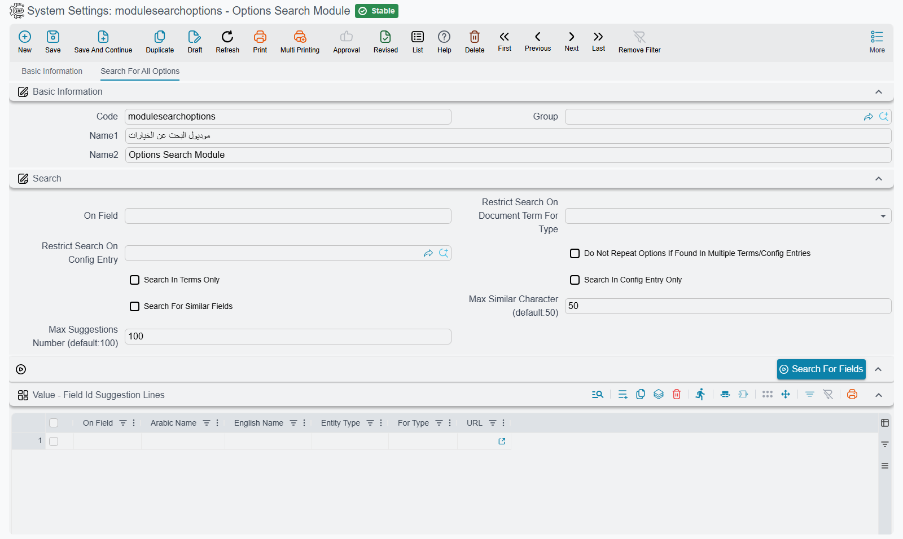

# Options Search — Finding Where an Option Lives

The **Options Search Module** is a settings record whose only job is to answer the question support
hears every day: *"there is an option for this somewhere — where is it?"* You type a word, press one
button, and get every document term option, module setting and configuration-screen field whose name
contains that word, each with a link that opens the right screen with the cursor already on the
field.

Nama has hundreds of options spread across the document terms of every document type, the settings
record of every module, and screens such as Item Configurations, Screen Modifier or Document Book.
Remembering which of them holds "allow negative stock" or "print the QR code" is not realistic; this
screen searches all of them at once, in Arabic or English.

## Opening it

The record has no menu entry of its own. Open **Administration → Settings → System Settings** and
open the row **Options Search Module** (code `modulesearchoptions`). It is one of the
[settings records](/admin/system-settings-and-configuration-group#System-Settings----one-record-per-module)
the system creates for itself, so it is always there and cannot be deleted. Its page is titled
**Search For All Options**.

## Searching

1. Type a word or part of a word in **On Field** — `negative`, `QR`, `سالب`.
2. Press **Search For Fields**.
3. Read the results in the grid below, and click the **URL** of the line you want.

Nothing needs saving: the button fills the grid straight away, and you can change the word and press
it again as often as you like.

A word matches an option when it appears anywhere in the option's Arabic name, its English name or
its field id, regardless of upper and lower case. Two more things make the search forgiving:

- **Typed with the wrong keyboard layout.** Forget to switch the keyboard to English and type `neg`,
  and you get `ىثل`. The search also tries the word as if the keyboard had been switched, so `ىثل`
  still finds "negative" — and the same works the other way round for an Arabic word typed on the
  English layout.
- **Wildcards.** `*` stands for any run of characters and `?` for exactly one. A pattern with
  wildcards must cover the whole name or field id, so `print*qr` finds options whose name starts
  with "print" and ends with "QR"; write `*print*qr*` to find the two words anywhere in the name.

## The settings

| Field | What it does |
|---|---|
| **On Field** | The word to look for. |
| **Restrict Search On Document Term For Type** | Searches the document terms of one document type only — pick Sales Invoice and only Sales Invoice term options are listed. Module settings and configuration screens are still searched unless you tick **Search In Terms Only** as well. |
| **Search In Terms Only** | Lists document term options only. Ticking it clears **Search In Config Entry Only**. |
| **Search In Config Entry Only** | Lists module settings only. Ticking it clears **Search In Terms Only** and the document type above. |
| **Do Not Repeat Options If Found In Multiple Terms/Config Entries** | The same option often exists in the terms of many document types. Ticked, each option is listed once, at the first place it was found, instead of once per document type. |
| **Search For Similar Fields** | Also lists options whose name merely resembles the word — useful when you are not sure of the exact wording, or misspelled it. |
| **Max Similar Character (default:50)** | How loose a resemblance **Search For Similar Fields** accepts. Raise it for more, looser results; lower it for fewer, closer ones. Leave it at 50 unless the results are too many or too few. |
| **Max Suggestions Number (default:100)** | The most lines the grid will hold. Left empty or zero, it is 100. |

Each document type's terms, each settings record and each configuration screen contributes at most
20 matches. A very short word such as `a` therefore fills the grid with the first matches of every
screen rather than everything — narrow the word, or restrict the search, until the line you want
appears.

## Reading the results

Each line of the **Field Id Suggestion Lines** grid is one option:

| Column | Meaning |
|---|---|
| **On Field** | The option's field id. |
| **Arabic Name** / **English Name** | The option's label as the screen shows it. |
| **Entity Type** | Where the option lives: `DocumentTerm` for a term option, the settings record's code (`moduleaccounting`, `global`, …) for a module setting, or the screen's type (`ItemConfigurations`, `DocumentBook`, …) for a configuration screen. |
| **For Type** | For a term option, the document type whose terms carry it. For a module setting, `ConfigEntry`. |
| **URL** | Opens the screen with the cursor on that field. |

What the link opens depends on the kind of line:

- **A module setting** opens that module's settings record, on the field, ready to edit.
- **A term option** opens a *new, blank* document term for that document type, on the field. It shows
  you where the option sits on the term screen; to change the option for real, open the term your
  document book actually uses.
- **A configuration screen field** likewise opens a new, blank record of that screen, on the field.

Besides document terms and module settings, the search covers the fields of more than sixty
configuration screens — among them Item Configurations, Screen Modifier, Fields and Entities
Settings, GUI Post Actions, Entity Flow, Task Schedule, Document Book, User, Security Profile,
Report Definition, Report Wizard, Approval Definition, Notification Definition, Required Fields,
Default Values Template, Translation OverRider, Menu Definition and the POS register.
