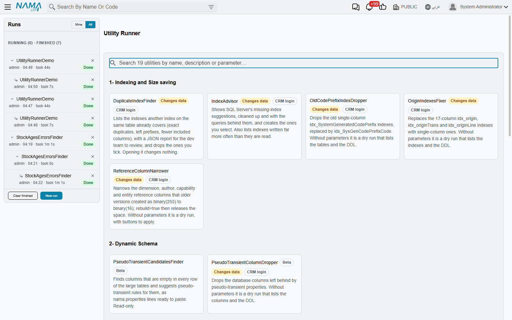
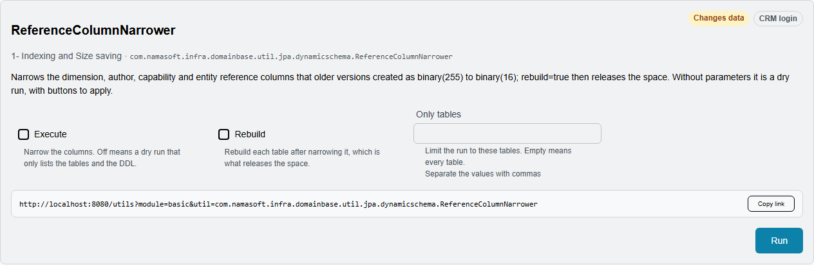
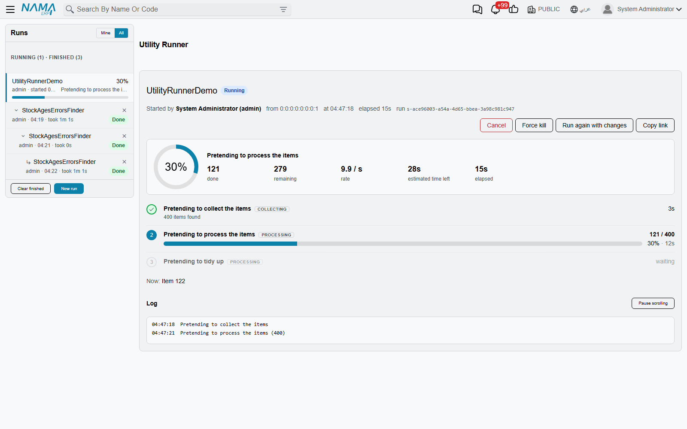
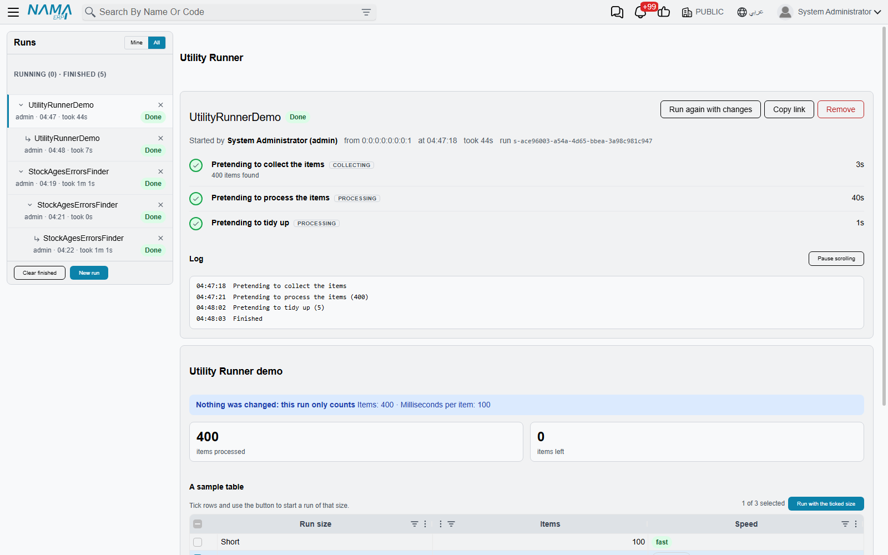
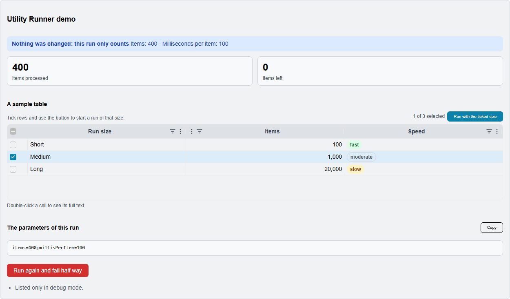

# The Utility Runner

Admin utilities used to be links: you pasted a long address into the browser, the tab showed a spinner for as long as the utility worked, and if the tab was closed or the connection dropped you no longer knew whether it had finished. The Utility Runner replaces that with one page. It lists the utilities with a description of each, gives every one a form for its parameters, shows a run's progress while it works, lets you stop it, and keeps the result afterwards — for you and for whoever opens the page next.

Nothing about the utilities themselves changed. The links on the documentation pages still work; they now open on this page instead of on a blank tab.

## Opening it

There are three ways in, and all three reach the same page:

- **From the application:** **Utilities → Monitoring → Utility Runner**, or type *Utility Runner* in the search box at the top.
- **From `utils.html`:** the last section, **Utility Runner**, has the link **Run and Monitor Utilities**.
- **From a utility link:** any launcher link on these pages starts its utility and lands on that run — see [Utility links](#Utility-links).

Like every utility link, the page works only for the `admin` user or a user with **Allow Access to Admin Restricted Functionality (utils.html, kill tasks, logout users and so on)** — see [Treat As Admin](/platform/security/users-and-login#Treat-As-Admin). Opening the page changes nothing.

::: info The page opens in English
Everything a utility reports — its description, its phases, its log and its result — is written in English only. So `utils.html` and the utility links always open the page in English. Reached from inside the Arabic interface it shows its own buttons and labels in Arabic around that English text.
:::

## Finding a utility

The page opens on the catalogue: one card per utility, grouped in numbered sections, with a search box above them. The search keeps the cards whose name, description or parameters contain what you typed.

A card carries up to three badges, and they tell you what you are about to touch before you open anything:

| Badge | What it means |
|---|---|
| **Changes data** | The utility changes data, either always or when one of its parameters is set. A card without it only reads. |
| **CRM login** | Some of what it does is reserved for the Namasoft support team, signed in through the Namasoft CRM. |
| **Beta** | Still being tried out. Listed only on a server running in debug mode, so a customer's production server does not offer it. |

The sections are:

| Section | Utilities in it | Documented on |
|---|---|---|
| 1- Indexing and Size saving | Reference column narrowing, origin index repair, duplicate index finder, index advisor, dropping the old code prefix index | [Database Size and Index Utilities](/admin/reprocessing/database-size-and-index-utilities.md) |
| 2- Dynamic Schema | The tools that find and remove columns the application no longer uses | Beta — listed only on servers running in debug mode |
| 3- Inventory and Costing | Fixing invalid current net quantity and cost, fast average-cost reprocessing from a date, fast reprocessing of stock transfers whose costs disagree, stock ages rebuild, stock ages rebuild of chosen dimensions, the stock ages errors finder | [Reprocessing Quantity, Cost, and Stock Ages](/admin/reprocessing/reprocess-qty-and-cost.md) and [Cost and Quantity Problems](/admin/reprocessing/cost-and-qty-problems.md) |
| 4- Rebuild and Recalculate | Rent contract system entries, contracting cost executions and project extract costs | [Rebuilding Module System Entries](/admin/reprocessing/module-entries-rebuild-utilities.md) |
| 5- Approvals | Recalculating approval summaries, clearing pending approvals that have nothing left to approve | [Approval Repair Utilities](/admin/reprocessing/approval-repair-utilities.md) |
| 6- Diagnostics | The list of slow SQL statements | [When the System Is Slow](/admin/troubleshooting/system-is-slow.md) |

Because the second section is Beta, it is missing on most servers while the numbering of the others stays the same.

**The catalogue is not every utility there is.** Many older ones — the batch utilities that work from a list file, most module rebuilds — are not listed. Under the cards, **Run by class name** takes a utility's full technical name, the `className` shown in its launcher on the documentation page, and opens it all the same. A utility opened this way gets a single box for its parameters, written exactly as they appear in its link after the `-`.

## Starting a run

Clicking a card opens the utility's form: its description, one field per parameter with a line of help under each, and the **Run** button.

A few things on the form are worth knowing:

- **The link under the fields** is the utility link for the values you have filled, rebuilt as you type. **Copy link** copies it — handy for a ticket, or for sending to the customer's administrator to run.
- **A parameter reserved for the support team** is greyed out with the note *Needs a Namasoft CRM support login. The default value is used.* unless you signed in through the Namasoft CRM. You can still run the utility; that parameter simply stays at its default, which for the database utilities means a dry run.
- **When the values you filled mean the run will change data**, the form says *With the current values this run changes data.*, the **Run** button turns red, and pressing it asks you to confirm first.
- **Recent** buttons beside **Run** refill the form with the values you used the last few times on this browser.

Press **Run** and the page moves to the run.

::: warning Starting a utility that is already running
Most utilities refuse to run twice at the same time. If the one you start is already running — started by you earlier or by a colleague — nothing new starts: the page opens the run that is in progress and says *This utility was already running. The page is now following that run.*
:::

## Following a run

The top line says who started the run, from which address, when, and for how long it has been going, followed by the run's id. Below it:

- **The progress box** shows the current phase with its percent, how many items are done and remaining, the rate per second and the estimated time left.
- **The phases** are the steps the utility announced, in order. A finished phase shows how long it took, the running one shows its counts and a bar, and the ones still to come say *waiting*. A phase marked **Collecting** is the utility finding out what it has to do; one marked **Processing** is the work itself.
- **Now** is the item being worked on at this moment.
- **Log** is what the utility wrote as it went. It follows the last line; **Pause scrolling** holds it still while you read.

You do not have to stay. The run belongs to the server, not to your tab: close the page, come back an hour later, and it is in the **Runs** panel with its progress or its result.

Not every utility has been taught to report this much. An older one shows a moving bar instead of a percent and whatever progress line it writes for the task monitor, and its result when it ends.

### Stopping a run

**Cancel** asks the utility to stop. It stops at its next safe point — between two tables, two documents or two batches — so the button changes to *Stopping…* and the run may go on for a little while. What happens to the work already done depends on the utility: one that saves as it goes keeps what it finished, and one that does everything in a single step undoes all of it. Either way nothing is left half done. The run ends as **Stopped**.

**Force kill** also ends the run's database session, which rolls back whatever it had open. Use it only when **Cancel** has had no effect. It is not offered for the utilities that change the structure of the database, where it could leave a table half changed.

## The result

When a run ends its status becomes **Done**, **Stopped** or **Failed**. A failed run shows the error it ended with; the others show their result under the progress.

A result is built from a few kinds of blocks:

- **A coloured line at the top** saying what kind of run this was — for example *Dry run - nothing was changed* or *Executed*.
- **Cards** with the headline numbers.
- **Tables.** They sort and filter like any grid in the system, and double-clicking a cell opens its full text with a **Copy** button — useful for a long SQL statement or an error.
- **Text blocks** such as the exact database statements, each with **Copy**.
- **Buttons** that start another run.

### Buttons that start another run

Most utilities that change something work in two steps: the first run only lists what it found, and a button on its result applies the fix. The button starts a new run of the same utility with the right parameters, so you never have to edit a link by hand.

Where a table has tick boxes, the buttons above it act on the rows you ticked, and the counter beside them says how many that is. There is no limit on how many rows you may tick: select a few, or use the box in the header to take them all. With a filter on, the header box ticks only the rows the filter shows, so you can filter the table down to one kind of problem and tick all of it in one click. Rows you ticked earlier stay ticked when a filter hides them, so read the counter before you press a button. A button is greyed out, and says why when you point at it, when no row is ticked or when it needs the support team's login.

A red button changes data and asks you to confirm first.

### After the run

Three buttons at the top of a finished run:

- **Run again with changes** opens the form filled with this run's values, ready to adjust and run again.
- **Copy link** copies the utility link that repeats this run. It is missing when the run's parameters are too long for a link — after ticking thousands of rows, for instance.
- **Remove** deletes this result from the server.

## The Runs panel

The panel beside the page lists every run on the server: the running ones first, with their percent, then the finished ones, newest first. Click a run to open it. **Mine** narrows the list to the runs you started; **All** is what everyone with access sees, each run with the code of the user who started it.

**The list is a tree.** A run you start from a button on the result of another run is listed under that run. After a morning of finding errors and fixing them in batches you can see at a glance which fix came from which report. The arrow beside a run hides or shows the runs started from it, and a hidden branch shows how many runs it holds.

Finished runs are kept for 24 hours, and at most the 200 most recent, after which the server forgets them. The `x` on a run removes it sooner, and **Clear finished** removes all the finished runs — for every user, not only yours, which is why it asks first. The list lives in the server's memory, so restarting the application server empties it.

::: tip Keeping results longer
The 24 hours can be changed for a server with `util-run-retention-hours` in [nama.properties](/getting-started/nama-properties). A result you need to keep should still be copied out — into the ticket, or a file — rather than left on the page.
:::

## Utility links

A utility link is the address form that has always started utilities, and the form every launcher on these pages builds — see [Launcher links on these pages](/admin/reprocessing/#Launcher-links-on-these-pages). What it does depends on who opens it:

| Opened by | What happens |
|---|---|
| A browser signed in as an administrator | The utility starts at once and the browser lands on its run in the Utility Runner. |
| The same, while that utility is already running | Nothing new starts; the browser lands on the run in progress. |
| A browser signed in as anyone else | Nothing starts. The page opens on the utility's form, and the server refuses to run it. |
| A script or a scheduled command | As before: the request waits until the utility ends and receives its result as text. |

::: warning A link starts its utility immediately
Opening a utility link in the browser does not show the form first: the run starts as soon as the page loads, with the values in the link and with no confirmation. To look before you run, open the Utility Runner and pick the utility from the catalogue instead.
:::

To get the old behaviour in a browser — a tab that waits and then shows the result alone — add `&sync=true` to the end of the link.

The [critical errors](/admin/troubleshooting/critical-errors#Database-schema-fixes-Namasoft-support-only) about database leftovers use the same links: the utility's name inside the message is a link that starts its dry run and opens it here.

## Messages you may see

| Message | Why | What to do |
|---|---|---|
| *This run was not found. It has expired or the server was restarted.* — «لم يتم العثور على هذا التشغيل. انتهت مدة حفظه أو تمت إعادة تشغيل الخادم.» | The page was opened on a run the server no longer keeps: it ended more than 24 hours ago, was removed, or the server was restarted since. | Run the utility again. If it was a fix, its first run will list only what is still left to fix. |
| *This utility was already running. The page is now following that run.* — «هذه الأداة كانت تعمل بالفعل. الصفحة تتابع الآن ذلك التشغيل.» | You started a utility that somebody had already started. | Nothing — you are looking at the run in progress. Start yours when it ends, if it is still needed. |
| *{0} is already running since {1}. Open the Utility Runner page to follow or stop it.* — «{0} قيد التشغيل بالفعل منذ {1}. افتح صفحة تشغيل الأدوات المساعدة لمتابعته أو إيقافه.» | The database size and index utilities run one at a time, and another one of them is working. | Open the run named in the message from the **Runs** panel and wait for it, or cancel it. |
| *Needs a Namasoft CRM support login* — «يتطلب تسجيل دخول دعم Namasoft CRM» | The tip on a greyed-out button: it changes the structure of the database, which only the support team may do. | Leave it to the support team, who sign in through the Namasoft CRM. |
| *Changing the database schema needs an admin user logged in through the Namasoft CRM* — «تغيير هيكل قاعدة البيانات يتطلب مستخدم مدير مسجل الدخول من خلال نظام CRM الخاص بنماسوفت» | A link that changes the structure of the database was opened by an administrator who did not sign in through the Namasoft CRM. The run ends as **Failed** with this text. | The same. |
| *Tick at least one row first* — «حدد صفاً واحداً على الأقل أولاً» | The tip on a greyed-out button above a table: it acts on the ticked rows and none is ticked. | Tick the rows it should act on. |
| *The server cut this table at its limit. Only the first {0} rows are shown.* — «قطع الخادم هذا الجدول عند الحد الأقصى. تُعرض أول {0} صف فقط.» | A result table reached 50,000 rows. | Fix what is listed and run the report again for the rest, or narrow the run with the utility's parameters. |
| *Could not read the runs from the server. Retrying…* — «تعذرت قراءة عمليات التشغيل من الخادم. جارٍ إعادة المحاولة…» | The page lost contact with the server — a network drop, an expired session, or a restart. | Wait; it keeps trying. Runs already started go on working on the server. If it persists, sign in again. |
| *This class could not be opened as a utility:* — «تعذر فتح هذا الكلاس كأداة:» | The name typed under **Run by class name** is not a utility on this server: a typing mistake, or a utility from a module or a version this server does not have. | Copy the `className` again from the launcher on the documentation page. |

## Related pages

- [Reprocessing and Utilities](/admin/reprocessing/)
- [Database Size and Index Utilities](/admin/reprocessing/database-size-and-index-utilities.md)
- [Batch Utilities That Work From a List File](/admin/reprocessing/batch-utilities-from-file.md)
- [Critical Errors at Login](/admin/troubleshooting/critical-errors)
