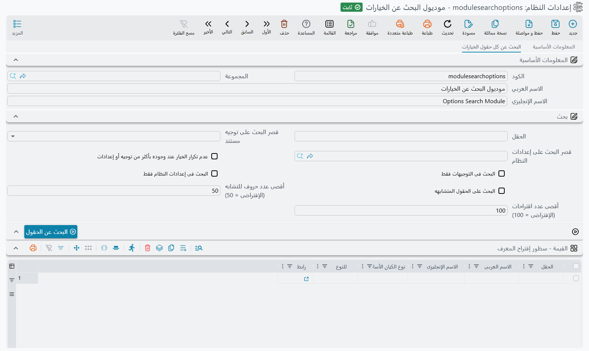

# البحث عن الخيارات — أين يوجد هذا الخيار؟

**موديول البحث عن الخيارات** سجل إعدادات له مهمة واحدة: أن يجيب عن السؤال الذي يسمعه الدعم الفني كل
يوم: *«هناك خيار لهذا في مكان ما — أين هو؟»* تكتب كلمة، وتضغط زرًا واحدًا، فتظهر لك كل خيارات
التوجيهات وإعدادات الموديولات وحقول شاشات الإعداد التي يحتوي اسمها على هذه الكلمة، ومع كل منها رابط
يفتح الشاشة الصحيحة والمؤشر واقف على الحقل.

في نما مئات الخيارات موزعة على توجيهات كل نوع مستند، وسجل إعدادات كل موديول، وشاشات مثل **إعدادات صنف**
و**تعديل شاشة** و**دفتر مستند**. وتذكّر أيها يحمل «السماح بالرصيد السالب» أو «طباعة رمز QR»
ليس واقعيًا؛ وهذه الشاشة تبحث فيها كلها دفعة واحدة، بالعربية أو بالإنجليزية.

## فتح الشاشة

ليس للسجل بند خاص في القائمة. افتح **إدارة النظام ← الإعدادات ← إعدادات النظام** ثم افتح سطر
**موديول البحث عن الخيارات** (الكود `modulesearchoptions`). وهو من
[سجلات الإعدادات](/ar/admin/system-settings-and-configuration-group) التي ينشئها النظام بنفسه، فهو
موجود دائمًا ولا يمكن حذفه. وعنوان صفحته **البحث عن كل حقول الخيارات**.

## البحث

1. اكتب كلمة أو جزءًا من كلمة في **الحقل** — `سالب`، `QR`، `negative`.
2. اضغط **البحث عن الحقول**.
3. اقرأ النتائج في الجدول أسفلها، واضغط **رابط** السطر الذي تريده.

لا حاجة إلى الحفظ: الزر يملأ الجدول فورًا، ويمكنك تغيير الكلمة والضغط مرة بعد مرة.

تطابق الكلمة خيارًا متى وردت في أي موضع من اسمه العربي أو اسمه الإنجليزي أو معرّف حقله، دون اعتبار
لحالة الأحرف الإنجليزية. وأمران آخران يجعلان البحث متسامحًا:

- **الكتابة بلغة لوحة مفاتيح خاطئة.** إذا نسيت تحويل لوحة المفاتيح إلى العربية وكتبت `shgf` وأنت تقصد
  `سالب`، يجرّب البحث الكلمة كأن لوحة المفاتيح قد حُوّلت، فيجد «سالب» — والعكس كذلك لكلمة إنجليزية
  كُتبت على لوحة المفاتيح العربية.
- **الرموز البديلة.** `*` تعني أي عدد من الحروف و`?` تعني حرفًا واحدًا بالضبط. والنمط الذي فيه رموز بديلة
  يجب أن يغطي الاسم أو معرّف الحقل كله، فـ`print*qr` يجد الخيارات التي يبدأ اسمها بـ«print» وينتهي بـ«QR»؛
  واكتب `*print*qr*` لتجد الكلمتين في أي موضع من الاسم.

## الإعدادات

| الحقل | ماذا يفعل |
|---|---|
| **الحقل** | الكلمة المطلوب البحث عنها. |
| **قصر البحث على توجيه مستند** | يبحث في توجيهات نوع مستند واحد فقط — اختر فاتورة المبيعات فلا تظهر إلا خيارات توجيه فاتورة المبيعات. وتظل إعدادات الموديولات وشاشات الإعداد داخلة في البحث ما لم تؤشر **البحث فى التوجيهات فقط** أيضًا. |
| **البحث فى التوجيهات فقط** | يعرض خيارات التوجيهات وحدها. وتأشيره يلغي تأشير **البحث فى إعدادات النظام فقط**. |
| **البحث فى إعدادات النظام فقط** | يعرض إعدادات الموديولات وحدها. وتأشيره يلغي **البحث فى التوجيهات فقط** ونوع المستند أعلاه. |
| **عدم تكرار الخيار عند وجوده بأكثر من توجيه أو إعدادات** | كثيرًا ما يوجد الخيار نفسه في توجيهات أنواع مستندات كثيرة. عند تأشيره يظهر كل خيار مرة واحدة، في أول موضع وُجد فيه، بدلًا من مرة لكل نوع مستند. |
| **البحث على الحقول المتشابهه** | يعرض أيضًا الخيارات التي يشبه اسمها الكلمة شبهًا — مفيد حين لا تكون متأكدًا من الصياغة أو أخطأت في كتابتها. |
| **أقصى عدد حروف للتشابه (الإفتراضى = 50)** | مقدار التشابه الذي يقبله **البحث على الحقول المتشابهه**. ارفعه لنتائج أكثر وأبعد شبهًا، واخفضه لنتائج أقل وأقرب. اتركه 50 ما لم تكن النتائج كثيرة جدًا أو قليلة جدًا. |
| **أقصى عدد اقتراحات (الإفتراضى = 100)** | أكبر عدد من الأسطر يتسع له الجدول. إن تُرك فارغًا أو صفرًا فهو 100. |

توجيهات كل نوع مستند، وكل سجل إعدادات، وكل شاشة إعداد، يساهم كل منها بعشرين نتيجة على الأكثر.
فالكلمة القصيرة جدًا مثل `a` تملأ الجدول بأوائل النتائج من كل شاشة لا بكل شيء — فاجعل الكلمة أدق، أو
قصر البحث، حتى يظهر السطر الذي تريده.

## قراءة النتائج

كل سطر في جدول **سطور إقتراح المعرف** خيار واحد:

| العمود | معناه |
|---|---|
| **الحقل** | معرّف حقل الخيار. |
| **الاسم العربى** / **الاسم الإنجليزى** | عنوان الخيار كما يظهر على الشاشة. |
| **نوع الكيان الأساسى** | أين يوجد الخيار: `DocumentTerm` لخيار توجيه، وكود سجل الإعدادات (`moduleaccounting`، `global`، …) لإعداد موديول، ونوع الشاشة (`ItemConfigurations`، `DocumentBook`، …) لشاشة إعداد. |
| **للنوع** | لخيار التوجيه: نوع المستند الذي تحمل توجيهاته هذا الخيار. ولإعداد الموديول: `ConfigEntry`. |
| **رابط** | يفتح الشاشة والمؤشر على ذلك الحقل. |

وما يفتحه الرابط يتوقف على نوع السطر:

- **إعداد موديول** يفتح سجل إعدادات ذلك الموديول، على الحقل، جاهزًا للتعديل.
- **خيار توجيه** يفتح توجيهًا *جديدًا فارغًا* لذلك النوع من المستندات، على الحقل. فهو يريك أين يقع الخيار
  في شاشة التوجيه؛ أما لتغيير الخيار فعلًا فافتح التوجيه الذي يستخدمه دفتر مستنداتك.
- **حقل شاشة إعداد** يفتح كذلك سجلًا جديدًا فارغًا من تلك الشاشة، على الحقل.

وإلى جانب التوجيهات وإعدادات الموديولات، يشمل البحث حقول أكثر من ستين شاشة إعداد — منها
**إعدادات صنف**، و**تعديل شاشة**، و**أعدادات الحقول و الشاشات**، و**GUI Post Actions**، و**مسار الكيان**،
و**مهمة مجدولة**، و**دفتر مستند**، و**مستخدم**، و**ملف الصلاحيات**، و**تعريف تقرير**، و**أداة إنشاء تقرير**،
و**تعريف موافقه**، و**تعريف تنبيهات**، و**الحقول المطلوبة**، و**قالب قيم افتراضية**، و**تغيير ترجمة**،
و**تعريف قائمة**، و**ماكينة** نقاط البيع.
