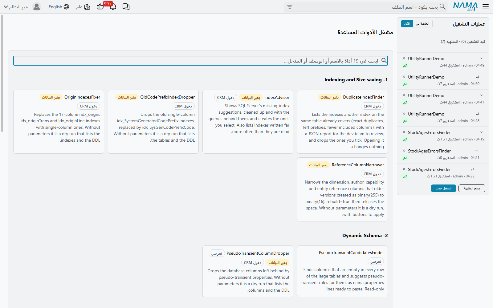
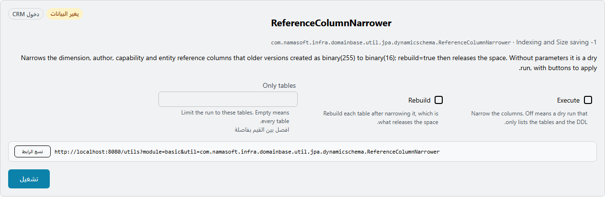
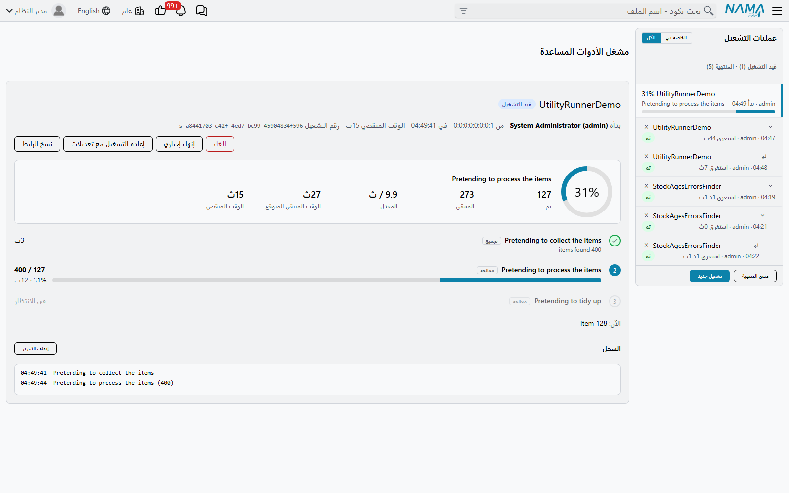
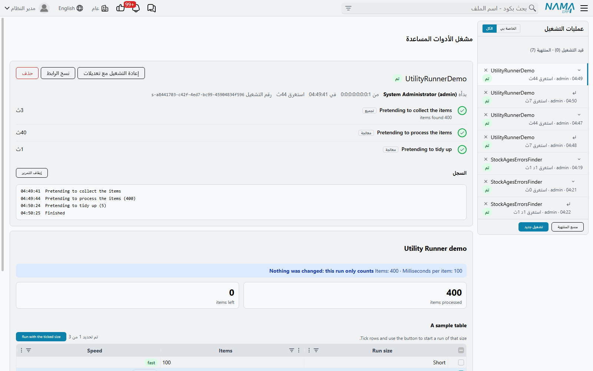
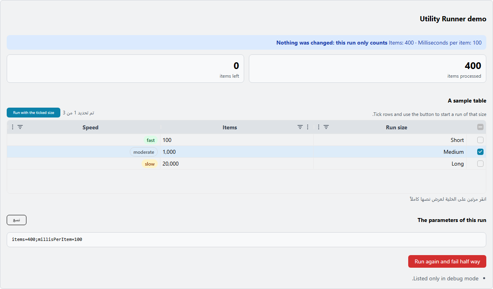

# مشغل الأدوات المساعدة (Utility Runner)

كانت أدوات المدير روابط: تلصق عنواناً طويلاً في المتصفح، فتبقى الصفحة تدور ما دامت الأداة تعمل، وإذا أُغلقت الصفحة أو انقطع الاتصال لم تعد تعرف هل انتهت الأداة أم لا. مشغل الأدوات المساعدة يضع صفحة واحدة مكان ذلك كله. فهو يعرض الأدوات مع وصف لكل واحدة، ويعطي كل أداة نموذجاً لمدخلاتها، ويعرض تقدم التشغيل أثناء العمل، ويتيح إيقافه، ويحتفظ بالنتيجة بعد الانتهاء — لك ولمن يفتح الصفحة بعدك.

الأدوات نفسها لم يتغير فيها شيء. والروابط الموجودة في صفحات التوثيق ما زالت تعمل؛ لكنها الآن تفتح على هذه الصفحة بدلاً من صفحة فارغة.

## فتح الصفحة

هناك ثلاث طرق، وكلها تصل إلى الصفحة نفسها:

- **من داخل النظام:** **Utilities ← Monitoring ← Utility Runner**، أو اكتب *مشغل الأدوات المساعدة* في مربع البحث بالأعلى.
- **من صفحة `utils.html`:** القسم الأخير **Utility Runner** فيه الرابط **Run and Monitor Utilities**.
- **من رابط أداة:** أي رابط تشغيل في هذه الصفحات يشغّل أداته ويفتح على ذلك التشغيل — راجع «روابط الأدوات» في هذه الصفحة.

ومثل كل روابط الأدوات، لا تعمل الصفحة إلا للمستخدم `admin` أو لمستخدم مفعّل لديه **Allow Access to Admin Restricted Functionality (utils.html, kill tasks, logout users and so on)** — راجع [المعاملة كمدير](/ar/platform/security/users-and-login#Treat-As-Admin). وفتح الصفحة لا يغير شيئاً.

::: info الصفحة تفتح بالإنجليزية
كل ما تكتبه الأداة — وصفها ومراحلها وسجلها ونتيجتها — مكتوب بالإنجليزية فقط. ولهذا تفتح صفحة `utils.html` وروابط الأدوات الصفحة بالإنجليزية دائماً. وإذا فُتحت من داخل الواجهة العربية ظهرت أزرارها وعناوينها بالعربية حول ذلك النص الإنجليزي، كما في الصور هنا. ولهذا نذكر في هذه الصفحة اسم كل زر بالعربية ثم بالإنجليزية بين قوسين.
:::

## البحث عن أداة

تفتح الصفحة على قائمة الأدوات: بطاقة لكل أداة، مجمّعة في أقسام مرقمة، وفوقها مربع بحث. والبحث يُبقي البطاقات التي يحوي اسمها أو وصفها أو مدخلاتها ما كتبته.

وتحمل البطاقة حتى ثلاث شارات تخبرك بما ستتعامل معه قبل أن تفتح شيئاً:

| الشارة | معناها |
|---|---|
| **يغير البيانات** (Changes data) | الأداة تغيّر البيانات، دائماً أو حين يُفعَّل أحد مدخلاتها. والبطاقة التي لا تحملها تقرأ فقط. |
| **دخول CRM** (CRM login) | جزء مما تفعله مقصور على فريق دعم نماسوفت، المسجّل دخوله من خلال نظام CRM الخاص بنماسوفت. |
| **تجريبي** (Beta) | ما زالت تحت التجربة. لا تظهر إلا على سيرفر يعمل في وضع التطوير (debug mode)، فلا يعرضها سيرفر الإنتاج لدى العميل. |

والأقسام (أسماؤها بالإنجليزية في الصفحة) هي:

| القسم | الأدوات فيه | موثقة في |
|---|---|---|
| 1- Indexing and Size saving | تضييق أعمدة المراجع، وإصلاح فهارس الأصل، واكتشاف الفهارس المكررة، واقتراح الفهارس، وحذف فهرس بادئة الكود القديم | [أدوات حجم قاعدة البيانات والفهارس](/ar/admin/reprocessing/database-size-and-index-utilities.md) |
| 2- Dynamic Schema | الأدوات التي تكتشف الأعمدة التي لم يعد النظام يستخدمها وتحذفها | تجريبية — لا تظهر إلا على السيرفرات التي تعمل في وضع التطوير |
| 3- Inventory and Costing | إصلاح صافي الكمية والتكلفة الحالية غير الصحيح، وإعادة المعالجة السريعة للتكلفة المتوسطة من تاريخ، وإعادة المعالجة السريعة لتحويلات المخزون المختلفة التكلفة، وإعادة بناء أعمار المخزون، وإعادة بناء أعمار المخزون لمحددات بعينها، واكتشاف أخطاء أعمار المخزون | [إعادة معالجة الكمية والتكلفة وأعمار المخزون](/ar/admin/reprocessing/reprocess-qty-and-cost.md) و[مشاكل التكلفة والكمية](/ar/admin/reprocessing/cost-and-qty-problems.md) |
| 4- Rebuild and Recalculate | قيود النظام لعقود الإيجار، وحصر تكاليف المقاولات وتكاليف مستخلصات المشاريع | [إعادة بناء قيود النظام في الوحدات](/ar/admin/reprocessing/module-entries-rebuild-utilities.md) |
| 5- Approvals | إعادة احتساب ملخصات الموافقات، ومسح الموافقات المعلقة التي لم يعد فيها ما يُعتمد | [أدوات إصلاح الموافقات](/ar/admin/reprocessing/approval-repair-utilities.md) |
| 6- Diagnostics | قائمة استعلامات SQL البطيئة | [حين يصبح النظام بطيئًا](/ar/admin/troubleshooting/system-is-slow.md) |

ولأن القسم الثاني تجريبي فهو يغيب في أغلب السيرفرات بينما يبقى ترقيم الأقسام الأخرى كما هو.

**والقائمة لا تضم كل الأدوات الموجودة.** كثير من الأدوات الأقدم — أدوات الدفعات التي تعمل من ملف، وأغلب أدوات إعادة بناء قيود الوحدات — غير مدرجة فيها. وتحت البطاقات، يأخذ **التشغيل باسم الكلاس** (Run by class name) الاسم التقني الكامل للأداة، وهو قيمة `className` الظاهرة في رابط تشغيلها بصفحة التوثيق، ويفتحها كغيرها. والأداة التي تُفتح بهذه الطريقة تأخذ مربعاً واحداً لمدخلاتها، تُكتب فيه كما تظهر في رابطها بعد علامة `-`.

## بدء التشغيل

الضغط على بطاقة يفتح نموذج الأداة: وصفها، وحقل لكل مدخل تحته سطر يشرحه، وزر **تشغيل** (Run).

وفي النموذج أشياء يحسن أن تعرفها:

- **الرابط تحت الحقول** هو رابط الأداة بالقيم التي أدخلتها، ويُعاد بناؤه وأنت تكتب. وزر **نسخ الرابط** (Copy link) ينسخه — وهو مفيد لتذكرة، أو لإرساله إلى مدير النظام لدى العميل ليشغّله.
- **المدخل المقصور على فريق الدعم** يظهر باهتاً ومعه الملاحظة «يتطلب تسجيل دخول دعم Namasoft CRM. سيتم استخدام القيمة الافتراضية.» ما لم تكن سجّلت الدخول من خلال نظام CRM الخاص بنماسوفت. وتستطيع تشغيل الأداة مع ذلك؛ لكن ذلك المدخل يبقى على قيمته الافتراضية، ومعناها في أدوات قاعدة البيانات تشغيل تجريبي.
- **حين تعني القيم التي أدخلتها أن التشغيل سيغيّر البيانات** يذكر النموذج «بالقيم الحالية سيغير هذا التشغيل البيانات.»، ويتحول زر **تشغيل** إلى الأحمر، والضغط عليه يطلب تأكيدك أولاً.
- أزرار **سابق** (Recent) بجانب زر **تشغيل** تعيد ملء النموذج بالقيم التي استخدمتها في المرات الأخيرة على هذا المتصفح.

اضغط **تشغيل** فتنتقل الصفحة إلى التشغيل.

::: warning تشغيل أداة تعمل بالفعل
أغلب الأدوات ترفض أن تعمل مرتين في الوقت نفسه. فإذا كانت الأداة التي تشغّلها تعمل بالفعل — شغّلتها أنت من قبل أو شغّلها زميل — فلا يبدأ شيء جديد: تفتح الصفحة التشغيل الجاري وتذكر «هذه الأداة كانت تعمل بالفعل. الصفحة تتابع الآن ذلك التشغيل.»
:::

## متابعة التشغيل

السطر الأعلى يذكر من بدأ التشغيل، ومن أي عنوان، ومتى، وكم مضى عليه، ثم رقم التشغيل. وتحته:

- **مربع التقدم** يعرض المرحلة الحالية ونسبتها، وعدد البنود التي تمت والمتبقية، والمعدل في الثانية، والوقت المتبقي المتوقع.
- **المراحل** هي الخطوات التي أعلنتها الأداة بالترتيب. المرحلة المنتهية تعرض الوقت الذي استغرقته، والجارية تعرض أعدادها وشريطاً، والقادمة تذكر *في الانتظار* (waiting). والمرحلة المعلَّمة **تجميع** (Collecting) هي الأداة وهي تكتشف ما عليها أن تفعله؛ والمعلَّمة **معالجة** (Processing) هي العمل نفسه.
- **الآن** (Now) هو البند الذي يُعمل عليه في هذه اللحظة.
- **السجل** (Log) هو ما كتبته الأداة أثناء العمل. وهو يتابع آخر سطر؛ وزر **إيقاف التمرير** (Pause scrolling) يثبّته وأنت تقرأ.

ولا يلزمك البقاء. التشغيل يخص السيرفر لا صفحتك: أغلق الصفحة وعد بعد ساعة فتجده في لوحة **عمليات التشغيل** (Runs) بتقدمه أو بنتيجته.

وليست كل الأدوات مهيأة لعرض هذا كله. الأداة الأقدم تعرض شريطاً متحركاً بدلاً من النسبة، وسطر التقدم الذي تكتبه لصفحة مراقبة المهام، ثم نتيجتها حين تنتهي.

### إيقاف التشغيل

زر **إلغاء** (Cancel) يطلب من الأداة أن تتوقف. وهي تتوقف عند أول نقطة آمنة — بين جدولين أو مستندين أو دفعتين — فيتحول الزر إلى *جارٍ الإيقاف…* وقد يستمر التشغيل قليلاً. وما يحدث للعمل الذي تم يتوقف على الأداة: التي تحفظ أولاً بأول تحتفظ بما أنهته، والتي تفعل كل شيء في خطوة واحدة تتراجع عنه كله. وفي الحالتين لا يبقى شيء نصف منجز. وينتهي التشغيل بالحالة **أُوقف** (Stopped).

وزر **إنهاء إجباري** (Force kill) ينهي أيضاً جلسة قاعدة البيانات الخاصة بالتشغيل، فيُتراجع عن كل ما كان مفتوحاً فيها. لا تستخدمه إلا إذا لم يُجدِ **إلغاء**. وهو لا يظهر في الأدوات التي تغيّر هيكل قاعدة البيانات، حيث قد يترك جدولاً نصف معدَّل.

## النتيجة

حين ينتهي التشغيل تصبح حالته **تم** (Done) أو **أُوقف** (Stopped) أو **فشل** (Failed). التشغيل الفاشل يعرض الخطأ الذي انتهى به؛ وغيره يعرض نتيجته تحت التقدم.

وتُبنى النتيجة من بضعة أنواع من الأجزاء:

- **سطر ملوّن في الأعلى** يذكر نوع هذا التشغيل — مثل *Dry run - nothing was changed* (تشغيل تجريبي لم يغيّر شيئاً) أو *Executed* (تم التنفيذ).
- **بطاقات** فيها الأرقام الرئيسية.
- **جداول.** تُرتَّب وتُفلتَر كأي جدول في النظام، والنقر مرتين على خلية يفتح نصها كاملاً مع زر **نسخ** (Copy) — وهو مفيد لاستعلام SQL طويل أو لنص خطأ.
- **أجزاء نصية** مثل أوامر قاعدة البيانات نفسها، ومع كل منها زر **نسخ**.
- **أزرار** تبدأ تشغيلاً آخر.

### أزرار تبدأ تشغيلاً آخر

أغلب الأدوات التي تغيّر شيئاً تعمل على خطوتين: التشغيل الأول يعرض ما وجده فقط، وزر في نتيجته يطبّق الإصلاح. والزر يبدأ تشغيلاً جديداً للأداة نفسها بالمدخلات الصحيحة، فلا تحتاج أبداً إلى تعديل رابط بيدك.

وحيث يكون للجدول مربعات اختيار، تعمل الأزرار التي فوقه على الصفوف التي حددتها، والعدّاد بجانبها يذكر عددها. ولا حدّ لعدد الصفوف التي تحددها: حدد بضعة صفوف، أو استخدم المربع الذي في رأس الجدول لتأخذها كلها. وإذا كان على الجدول فلتر فمربع الرأس يحدد الصفوف التي يعرضها الفلتر فقط، فتستطيع أن تفلتر الجدول على نوع واحد من المشاكل وتحدده كله بضغطة واحدة. والصفوف التي حددتها من قبل تبقى محددة حين يخفيها الفلتر، فاقرأ العدّاد قبل أن تضغط زراً. والزر يظهر باهتاً، ويذكر السبب حين تقف عليه بالمؤشر، إذا لم يكن أي صف محدداً أو إذا كان يتطلب دخول فريق الدعم.

والزر الأحمر يغيّر البيانات ويطلب تأكيدك أولاً.

### بعد التشغيل

ثلاثة أزرار في أعلى التشغيل المنتهي:

- **إعادة التشغيل مع تعديلات** (Run again with changes) يفتح النموذج مملوءاً بقيم هذا التشغيل، جاهزاً لتعديلها وتشغيلها من جديد.
- **نسخ الرابط** (Copy link) ينسخ رابط الأداة الذي يكرر هذا التشغيل. ويغيب حين تكون مدخلات التشغيل أطول من أن يحملها رابط — بعد تحديد آلاف الصفوف مثلاً.
- **حذف** (Remove) يحذف هذه النتيجة من السيرفر.

## لوحة عمليات التشغيل

اللوحة التي بجانب الصفحة تعرض كل عمليات التشغيل على السيرفر: الجارية أولاً مع نسبتها، ثم المنتهية، الأحدث أولاً. اضغط على تشغيل لتفتحه. و**الخاصة بي** (Mine) تقصر القائمة على ما بدأته أنت؛ و**الكل** (All) هو ما يراه كل من له حق الدخول، ومع كل تشغيل كود المستخدم الذي بدأه.

**والقائمة شجرة.** التشغيل الذي تبدؤه من زر في نتيجة تشغيل آخر يُعرض تحت ذلك التشغيل. فبعد صباح من اكتشاف الأخطاء وإصلاحها على دفعات ترى بنظرة واحدة أي إصلاح جاء من أي تقرير. والسهم بجانب التشغيل يخفي أو يُظهر التشغيلات التي بدأت منه، والفرع المخفي يذكر عدد التشغيلات التي فيه.

وتُحفظ عمليات التشغيل المنتهية 24 ساعة، وبحد أقصى أحدث 200 منها، ثم ينساها السيرفر. وعلامة `x` على التشغيل تحذفه قبل ذلك، وزر **مسح المنتهية** (Clear finished) يحذف كل عمليات التشغيل المنتهية — لكل المستخدمين لا لك وحدك، ولهذا يسأل أولاً. والقائمة محفوظة في ذاكرة السيرفر، فإعادة تشغيل سيرفر التطبيق تفرغها.

::: tip الاحتفاظ بالنتائج مدة أطول
يمكن تغيير مدة الـ 24 ساعة لسيرفر بعينه بالإعداد `util-run-retention-hours` في [ملف nama.properties](/ar/getting-started/nama-properties). ومع ذلك فالنتيجة التي تحتاج إلى الاحتفاظ بها ينبغي نسخها — إلى التذكرة أو إلى ملف — لا تركها في الصفحة.
:::

## روابط الأدوات

رابط الأداة هو صيغة العنوان التي كانت تشغّل الأدوات دائماً، وهي الصيغة التي يبنيها كل رابط تشغيل في هذه الصفحات — راجع [روابط التشغيل في هذه الصفحات](/ar/admin/reprocessing/#rwbT-ltshGyl-fy-hdhh-lSfHt). وما يفعله يتوقف على من يفتحه:

| من يفتحه | ما يحدث |
|---|---|
| متصفح مسجّل الدخول بمستخدم مدير | تبدأ الأداة فوراً ويفتح المتصفح على تشغيلها في مشغل الأدوات المساعدة. |
| الحالة نفسها، والأداة تعمل بالفعل | لا يبدأ شيء جديد؛ يفتح المتصفح على التشغيل الجاري. |
| متصفح مسجّل الدخول بأي مستخدم آخر | لا يبدأ شيء. تفتح الصفحة على نموذج الأداة، ويرفض السيرفر تشغيلها. |
| سكربت أو أمر مجدول | كما كان: ينتظر الطلب حتى تنتهي الأداة ويستلم نتيجتها نصاً. |

::: warning الرابط يشغّل أداته فوراً
فتح رابط أداة في المتصفح لا يعرض النموذج أولاً: يبدأ التشغيل بمجرد تحميل الصفحة، بالقيم التي في الرابط ودون تأكيد. وإذا أردت أن تنظر قبل أن تشغّل فافتح مشغل الأدوات المساعدة واختر الأداة من القائمة.
:::

وللحصول على السلوك القديم في المتصفح — صفحة تنتظر ثم تعرض النتيجة وحدها — أضف `&sync=true` إلى آخر الرابط.

و[الأخطاء الحرجة](/ar/admin/troubleshooting/critical-errors) الخاصة ببقايا قاعدة البيانات تستخدم الروابط نفسها: اسم الأداة داخل الرسالة رابط يبدأ تشغيلها التجريبي ويفتحه هنا.

## رسائل قد تظهر لك

| الرسالة | السبب | ما تفعله |
|---|---|---|
| «لم يتم العثور على هذا التشغيل. انتهت مدة حفظه أو تمت إعادة تشغيل الخادم.» | فُتحت الصفحة على تشغيل لم يعد السيرفر يحتفظ به: انتهى منذ أكثر من 24 ساعة، أو حُذف، أو أُعيد تشغيل السيرفر بعده. | شغّل الأداة من جديد. وإن كانت إصلاحاً فتشغيلها الأول سيعرض ما بقي يحتاج إصلاحاً فقط. |
| «هذه الأداة كانت تعمل بالفعل. الصفحة تتابع الآن ذلك التشغيل.» | شغّلت أداة كان غيرك قد شغّلها. | لا شيء — أنت تنظر إلى التشغيل الجاري. شغّل تشغيلك حين ينتهي، إن بقيت له حاجة. |
| «{0} قيد التشغيل بالفعل منذ {1}. افتح صفحة تشغيل الأدوات المساعدة لمتابعته أو إيقافه.» | أدوات حجم قاعدة البيانات والفهارس تعمل واحدة بعد أخرى، وواحدة أخرى منها تعمل الآن. | افتح التشغيل المذكور في الرسالة من لوحة **عمليات التشغيل** وانتظره، أو ألغِه. |
| «يتطلب تسجيل دخول دعم Namasoft CRM» | تلميح على زر باهت: الزر يغيّر هيكل قاعدة البيانات، وهذا لفريق الدعم وحده. | اتركه لفريق الدعم، الذي يسجّل الدخول من خلال نظام CRM الخاص بنماسوفت. |
| «تغيير هيكل قاعدة البيانات يتطلب مستخدم مدير مسجل الدخول من خلال نظام CRM الخاص بنماسوفت» | فتح رابطاً يغيّر هيكل قاعدة البيانات مستخدمٌ مدير لم يسجّل الدخول من خلال نظام CRM الخاص بنماسوفت. وينتهي التشغيل بالحالة **فشل** وبهذا النص. | كما سبق. |
| «حدد صفاً واحداً على الأقل أولاً» | تلميح على زر باهت فوق جدول: الزر يعمل على الصفوف المحددة ولا صف محدد. | حدد الصفوف التي ينبغي أن يعمل عليها. |
| «قطع الخادم هذا الجدول عند الحد الأقصى. تُعرض أول {0} صف فقط.» | بلغ جدول في النتيجة 50,000 صف. | أصلح ما هو معروض ثم شغّل التقرير من جديد للباقي، أو ضيّق التشغيل بمدخلات الأداة. |
| «تعذرت قراءة عمليات التشغيل من الخادم. جارٍ إعادة المحاولة…» | فقدت الصفحة الاتصال بالسيرفر — انقطاع في الشبكة، أو انتهاء الجلسة، أو إعادة تشغيل. | انتظر؛ فهي تواصل المحاولة. وعمليات التشغيل التي بدأت تستمر في العمل على السيرفر. وإن استمر ذلك فسجّل الدخول من جديد. |
| «تعذر فتح هذا الكلاس كأداة:» | الاسم المكتوب تحت **التشغيل باسم الكلاس** ليس أداة على هذا السيرفر: خطأ في الكتابة، أو أداة من وحدة أو إصدار ليس على هذا السيرفر. | انسخ قيمة `className` من جديد من رابط التشغيل في صفحة التوثيق. |

## صفحات ذات صلة

- [إعادة المعالجة والأدوات](/ar/admin/reprocessing/)
- [أدوات حجم قاعدة البيانات والفهارس](/ar/admin/reprocessing/database-size-and-index-utilities.md)
- [أدوات تعمل على دفعة سجلات من ملف](/ar/admin/reprocessing/batch-utilities-from-file.md)
- [الأخطاء الحرجة عند الدخول](/ar/admin/troubleshooting/critical-errors)
