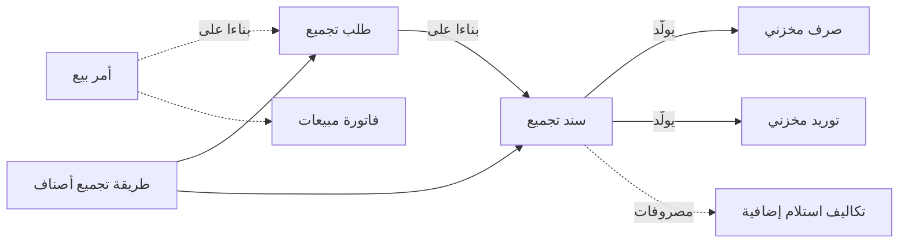

# الإنتاج بمستندات التجميع

مصنع عطور يعبّئ 200 زجاجة من عطر خاص لسلسلة فنادق بعد ظهر يوم ثلاثاء. يدخل ستة لترات من الزيت ولتران
من الكحول و200 زجاجة و200 غطاء و200 علبة هدايا، ويخرج 200 زجاجة معبأة في علبها. لا مسار تشغيل ولا صالة
إنتاج ولا شيء ينتظر نصف مكتمل بين محطة وأخرى. هي وصفة واحدة وخطوة واحدة، والسؤالان الصعبان الوحيدان:
ما المكونات التي خرجت من الرف، وكم أصبحت تكلفة الزجاجة الواحدة؟

هذا بالضبط عمل شاشات التجميع. إنها «التصنيع الخفيف» داخل موديول المخازن: وصفة، ومستند يُخرج المكونات
من المخزون ويُدخل المنتج، وتكلفة تنتقل من الأولى إلى الثاني. وتشرح هذه الصفحة كيف تدير الشركات إنتاجها
بهذه الطريقة.

## لمن يناسب هذا السيناريو

- نشاط يصنع منتجًا من وصفة معروفة في **خطوة واحدة**: الخلط والتعبئة، والتعبئة وإعادة التعبئة، والأطقم
  وعلب الهدايا، وأعمال الطباعة، والمطابخ وتجهيز الأطعمة، وتشكيل الحديد، والمعدات الهندسية التي تُصنع
  حسب الطلب. ولا أحد يحتاج هنا إلى تتبع صالات الإنتاج أو الإنتاج تحت التشغيل.
- في منشآت «نما» تنتج **شركة من كل 4 شركات** تقريبًا بمستندات التجميع مرة في الشهر على الأقل. وليست
  المصانع وحدها: نحو شركتين من كل 3 شركات صناعية تعمل هكذا، ومثلها نحو شركة من كل 4 شركات توزيع،
  وشركتان من كل 5 شركات تجزئة تخلط ما تبيعه أو تعبئه أو تجمعه في أطقم.
- يعمل عادةً إلى جانب سيناريو للبيع، إما [التجارة بالفاتورة المباشرة](/ar/business-scenarios/scenario-direct-invoice-trading)
  أو [التوزيع من أمر البيع إلى التحصيل](/ar/business-scenarios/scenario-order-to-cash-distribution).
  والشركات التي تشتري مكوناتها من الخارج تضيف مسار
  [الاستيراد](/ar/business-scenarios/scenario-importer-landed-cost)، والمتاجر التي تعبّئ في مخازنها
  الخلفية تجمعه مع [سلسلة متاجر بنقاط البيع](/ar/business-scenarios/scenario-retail-chain-pos).
- ونحو شركة من كل 7 من هذه الشركات تدير أيضًا [دورة التصنيع الكاملة](/ar/business-scenarios/scenario-full-manufacturing)
  لمنتجاتها متعددة المراحل، وتُبقي التجميع للمنتجات البسيطة.

## ما تحتاجه

::: info التراخيص المطلوبة
`supplychain-assembly` و`supplychain-inventory`، وأضف `supplychain-sales` حين يتبع الإنتاجُ أمرَ بيع.
:::

- [التجميع والتعبئة](/ar/modules/supplychain/assembly-and-packaging/): الوصفات ومستندات التجميع، وكلها
  تحت **المخازن ← التجميع**.
- [سلسلة الإمداد](/ar/modules/supplychain/): المخازن، وسندات الصرف والتوريد التي ينشئها التجميع، والتكلفة
  التي تقيّمها.
- [المبيعات](/ar/modules/supplychain/sales-journey): أمر البيع والفاتورة، حين تجمّع حسب الطلب.
- [الرواتب](/ar/modules/hr/payroll/): نحو 3 من كل 5 من هذه الشركات تصرف رواتب عمالها في «نما» أيضًا. ويصل
  وقت العمال إلى تكلفة المنتج عبر بنود المصروفات في سند التجميع، كما يأتي بيانه.

## مسار المستندات (Document Flow)

الخط المتصل في الوسط هو المسار كله في أغلب الشركات: طريقة تجميع وسند تجميع. أما الأجزاء المنقطة فهي
للتجميع بناءً على طلب العميل. وهذا طلب الفنادق من أوله إلى آخره.

1. **أمر البيع.** تطلب سلسلة الفنادق 200 زجاجة معبأة، فتسجل المبيعات **أمر بيع** بالسعر المتفق عليه.
2. **الخطة.** يُنشئ الإنتاج **طلب تجميع** ويضع أمر البيع في حقل **بناءا على**، ويختار **طريقة التجميع**
   الخاصة بالعطر (الوصفة) ويجعل الكمية 200. يُعاد حساب كل سطر من سطور المكونات من وصفة الزجاجة الواحدة:
   30 مل زيت للزجاجة تصبح 6 لترات. طلب التجميع لا يحرّك المخزون. وإن كان توجيهه يفعّل **الحجز** في
   تبويب الحجز، فإنه يحجز المكونات حتى لا يبيعها أحد في الأثناء.
3. **وصول المكونات إلى غرفة التعبئة.** إن كانت محفوظة في مخزن آخر، فإن **سند تحويل مخزني** ينقلها أولًا
   إلى مخزن الإنتاج. وهو تحويل عادي ينشئه أمين المخزن بيده، ولا ينشئه طلب التجميع.
4. **التجميع.** في اليوم المحدد يُنشئ المشرف **سند التجميع** بناءً على الطلب، ويصحح سطرًا إن استُخدمت
   شحنة زيت مختلفة، ويضيف سطرين في تبويب **بنود مصروفات**: أجر التعبئة بواقع 2.00 للزجاجة، وكهرباء خط
   التعبئة.
5. **ما ينشئه الحفظ.** سند التجميع لا يحرّك المخزون بنفسه أبدًا. عند الحفظ يولّد **صرفًا مخزنيًا**
   للمكونات من مخزن الصرف، و**توريدًا مخزنيًا** للزجاجات الـ200 إلى مخزن التوريد. ولأن فيه بنود
   مصروفات، فإنه يولّد كذلك سند **تكاليف استلام إضافية**. وتظهر الثلاثة في جدول **السندات المخزنية**
   داخله. تعديل سند التجميع يحدّثها، وحذفه يحذفها.
6. **التكلفة.** تُعالَج هذه المستندات في الخلفية كطلبات أعمال، ويُكلَّف التوريد بعد أن تُعرف تكلفة
   الصرف. مكونات تكلفتها 9,000 مع 600 مصروفات تجعل تكلفة الزجاجة 48.00.
7. **البيع.** تُصدر المبيعات فاتورة الفنادق بناءً على أمر البيع. تخرج الزجاجات من المخزون بتكلفة 48.00
   للواحدة، بالفاتورة نفسها أو بالصرف المخزني التابع لها بحسب توجيهات المبيعات عندك، ويُحصَّل المبلغ
   كأي بيع آخر. انظر [رحلة البيع](/ar/modules/supplychain/sales-journey).

والبيع من المخزون يتبع المسار نفسه دون الأجزاء المنقطة: يُنشئ المشرف سند التجميع من طريقة التجميع
مباشرة، ويُباع المنتج من الرف.

## الإعداد خطوة بخطوة

1. **الأصناف والوحدات.** أنشئ المكونات والأصناف التامة. يجب أن تكون وحدة طريقة التجميع من الوحدات
   الأساسية أو الثانوية للصنف التام، ووحدة كل مكوّن من وحداته الأساسية، فاضبط الوحدات أولًا. انظر
   [فهم الأصناف](/ar/modules/supplychain/understanding-items) و[وحدات القياس](/ar/modules/supplychain/units-of-measure).
2. **المخازن.** حدّد المخزن الذي تُصرف منه المكونات والمخزن الذي يُورَّد إليه الإنتاج التام. وكثير من
   الشركات تخصص مخزنًا للإنتاج. انظر [المخازن والمواقع](/ar/modules/supplychain/warehouses-and-locators).
3. **طرق التجميع.** اكتب وصفة لكل صنف تام، بمخزني الصرف والتوريد الافتراضيين وبالأصناف الأخرى التي
   يُنتجها التجميع إن وُجدت. واستخدم **المكونات** للقطع البديلة المتكافئة، و**ملف طريقة التعبئة** للكراتين
   والملصقات. انظر [طرق التجميع والمكونات وطرق التعبئة](/ar/modules/supplychain/assembly-and-packaging/assembly-boms-and-components).
4. **بنود المصروفات للعمالة والمصاريف غير المباشرة.** أنشئ بند مصروف لكل تكلفة تريدها داخل تكلفة المنتج:
   العمالة والطاقة ووقت الماكينات. وحيث تتكرر المصروفات نفسها كل مرة، أعدّ **ملفات عمليات التجميع** لتُحسب
   السطور تلقائيًا. انظر [طلبات التجميع وسندات التجميع](/ar/modules/supplychain/assembly-and-packaging/assembly-documents-and-requests).
5. **توجيه سند التجميع.** في تبويب **التأثير** املأ دفاتر وتوجيهات الصرف والتوريد، وهي إجبارية، و**دفتر
   سند التكاليف الإضافية** و**توجيهه**، وهما لازمان ما إن يحمل السند بنود مصروفات. وراجع هناك أيضًا
   خيارات توزيع التكلفة.
6. **توجيه طلب التجميع،** إن كنت تخطط بالطلبات: قرّر هل يحجز المكونات أم لا.
7. **توجيهات المبيعات،** إن كنت تجمّع حسب الطلب: أمر البيع والفاتورة، وأيهما يحرّك المخزون. انظر
   [رحلة البيع](/ar/modules/supplychain/sales-journey).

## الإعدادات والأدوات الأكثر استخدامًا

- **التكاليف الإضافية.** نحو 2 من كل 3 من هذه الشركات تستخدم مستندات التكاليف الإضافية. وفي التجميع
  تتحول بنود المصروفات إلى سند تكاليف استلام إضافية من تلقاء نفسها. انظر
  [تكلفة المخزون وإعادة التقييم](/ar/modules/supplychain/inventory-costing).
- **أوامر الشراء.** نحو 7 من كل 10 تشتري مكوناتها بأوامر شراء. انظر [رحلة الشراء](/ar/modules/supplychain/purchasing-journey).
- **الرواتب.** نحو 3 من كل 5 تصرف الرواتب في «نما». انظر [الرواتب](/ar/modules/hr/payroll/).
- **التصنيع الكامل إلى جانب التجميع.** نحو شركة من كل 7 تدير كذلك أوامر إنتاج لمنتجاتها متعددة المراحل.
  انظر [موديول التصنيع](/ar/modules/manufacturing/).

## صور أخرى للسيناريو نفسه

**الدفعات والمنتجات متعددة المستويات.** يتولى **سند تجميع متعدد** المنتجَ الذي تُجمَّع مكوناته هي
الأخرى، أو عدة منتجات معًا. يتتبع روابط **طريقة التجميع الفرعية** نزولًا في شجرة الوصفة ويولّد سند تجميع
لكل سطر، ويمكن ملؤه من أمر بيع. ومع زر **تغيير حالة السطور و إنشاء سندات التجميع حسب المستوى** يبني
المستوى الأعمق أولًا، ولا يصعد إلى ما فوقه إلا بعد أن يدخل مخزون ذلك المستوى. انظر
[التجميع متعدد المستويات والتعبئة المجمّعة](/ar/modules/supplychain/assembly-and-packaging/multi-level-and-aggregated-assembly).

**خطوط التعبئة وتشغيلات الماكينات.** خط التعبئة الذي يحوّل المواد السائبة طوال اليوم إلى كراتين على
منصات يسجّل يومه في **سند تعبئة متعدد** واحد، بالفرزات والهالك. والعمل الذي تصفه الماكينة أفضل مما تصفه
الوصفة، كطاحونة لها مستهلكاتها وتكلفتها بالساعة، يُسجَّل في **سند معالجة** يبدأ من **ماكينة تجميع**. انظر
[سندات المعالجة وماكينات التجميع](/ar/modules/supplychain/assembly-and-packaging/processing-documents-and-machines).

**أطقم تُباع ولا تُجمَّع.** طقم هدايا يُباع فقط ولا يُحفظ مجمّعًا على الرف لا يحتاج إلى سند تجميع أصلًا.
أعطِ الصنف **طريقة فرد مكونات الصنف المجمع**، وفعّل خيار فرد مكونات التجميع مع الحفظ
(Spread Assembly Components With Save) في توجيه البيع. عندها يضيف حفظ البيع مكونات الطقم تحت سطره،
ويخرج المخزون على هيئة المكونات. انظر [الخيارات الخاصة بكل مستند](/ar/modules/supplychain/document-terms/doc-term-document-specific).

**التصنيع حسب الطلب عبر طلب التجميع.** حقل **بناءا على** في سند التجميع يقبل طلب تجميع أو سند تجميع آخر
أو سند تقطيع أصناف، ولا يقبل أمر بيع. لذلك يصل الطلب إلى الإنتاج عبر طلب تجميع كما في المثال أعلاه، أو
عبر سند تجميع متعدد.

**فك المنتجات.** سند التجميع نفسه يفك المنتج: مع خيار حساب الأصناف الموردة من طريقة تجميع الصنف المسحوب
(Calculate CoProducts From Issued Item Assembly BOM) في التوجيه، تصرف الصنف التام فتُورَّد أجزاؤه.
انظر [طلبات التجميع وسندات التجميع](/ar/modules/supplychain/assembly-and-packaging/assembly-documents-and-requests).

## قرارات قبل بدء التشغيل

- **التجميع أم التصنيع الكامل.** التجميع خطوة واحدة. وحين تحتاج إلى مسارات تشغيل وصالات إنتاج وكميات
  تنتظر بين المراحل وإعادة تشغيل وأمر يُغلق وتُحسب تكلفته في النهاية، فهذه
  [دورة التصنيع الكاملة](/ar/business-scenarios/scenario-full-manufacturing). وبعض الشركات تحتفظ بسجلات
  مكونات المنتج ومسارات التشغيل في موديول التصنيع وتظل تنتج بسندات التجميع. وهذا اختيار سليم، لا إعداد
  ناقص.
- **كيف تدخل العمالة والمصاريف غير المباشرة في التكلفة.** اكتبها في تبويب بنود المصروفات، أو احسبها من
  أسعار بنود المصروفات، أو دع ملفات عمليات التجميع تضيفها. وإن لم تختر أيًّا منها حمل المنتج تكلفة مكوناته
  وحدها.
- **وصفة للوحدة أم إجماليات مكتوبة.** الكميات المسحوبة افتراضيًا هي الوصفة مضروبة في الكمية المجمّعة.
  وإن كان موظفوك يكتبون إجمالي كل مكوّن، ففعّل خيار عدم ضرب الكميات في سند التجميع
  (Do Not Multiply Quantities In Assembly Doc) في
  [إعدادات سلسلة الإمداد](/ar/modules/supplychain/configuration/documents-and-details-configuration).
- **مخزن صرف واحد أم عدة مخازن.** **مخزن الصرف** في رأس السند يُكتب على كل السطور المسحوبة عند الحفظ.
  فإن كانت المكونات تأتي من عدة مخازن فاتركه فارغًا، أو انقل المكونات إلى مخزن واحد أولًا.
- **كيف تتوزع التكلفة بين الأصناف الموردة.** بالكمية، أو بمتوسط سعر البيع، أو بمبلغ ثابت، أو بلا تكلفة
  على الإطلاق، ويُحدَّد ذلك لكل سطر. قرّره قبل توريد أول منتج ثانوي.
- **خطوة الطلب أم لا.** تناسب الطلبات الشركات التي تخطط وتحجز مسبقًا أو تجمّع حسب الطلب. أما الشركات التي
  تنتج كلما قلّ المخزون فتذهب عادة إلى سند التجميع مباشرة.

## اقرأ أيضًا

1. [التجميع والتعبئة](/ar/modules/supplychain/assembly-and-packaging/): الصفحة الرئيسية والشاشات في لمحة.
2. [طرق التجميع والمكونات وطرق التعبئة](/ar/modules/supplychain/assembly-and-packaging/assembly-boms-and-components)
3. [طلبات التجميع وسندات التجميع](/ar/modules/supplychain/assembly-and-packaging/assembly-documents-and-requests)
4. [التجميع متعدد المستويات والتعبئة المجمّعة](/ar/modules/supplychain/assembly-and-packaging/multi-level-and-aggregated-assembly)
5. [سندات المعالجة وماكينات التجميع](/ar/modules/supplychain/assembly-and-packaging/processing-documents-and-machines)
6. [تكلفة المخزون وإعادة التقييم](/ar/modules/supplychain/inventory-costing)
7. [نظرة عامة على وحدة التصنيع](/ar/modules/manufacturing/manufacturing-overview): الخطوة التالية.
