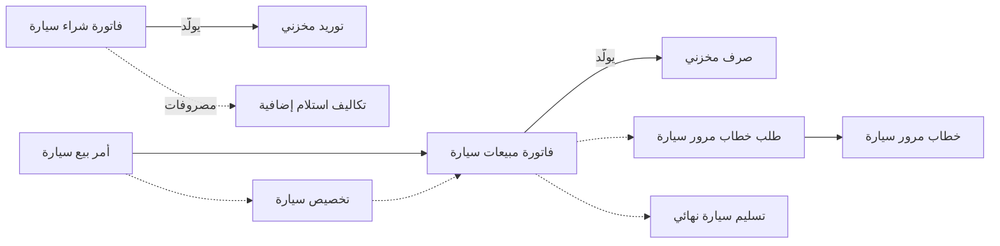
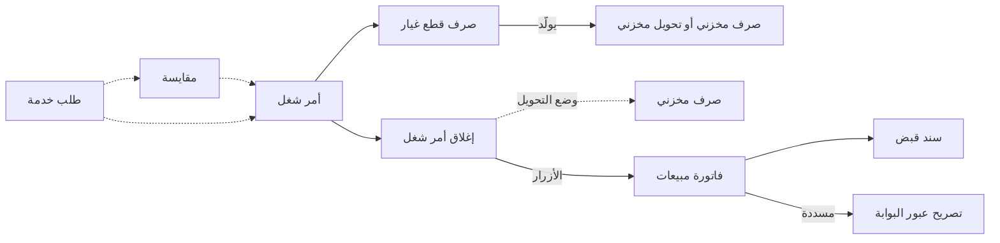

# وكيل سيارات ومركز خدمة

يستلم وكيل ست سيارات من طراز واحد من المستورد بسعر 74,000 للسيارة، ومعها 15,000 شحن وجمارك للشحنة كلها.
وكل سيارة تُباع لعميل بعينه، برقم الشاسيه، بدفعة حجز وخطة سداد وخطاب مرور للوحات وموعد تسليم. وبعد سنتين
تعود السيارة نفسها إلى ورشة الوكيل للصيانة، وتُقسم الفاتورة بين المالك وشركة التأمين وبرنامج الضمان.

لا شيء من هذا يناسب مخزونًا يُعامل كأكياس الأسمنت. كل سيارة يجب أن تُتابع ككيان مستقل، وكل إصلاح مهمة
لها عمالتها وقطع غيارها ومن يدفع ثمنها. وموديول مركز الخدمة يغطي النصفين، المعرض والورشة، وكثير من
المجموعات تدير الاثنين جنبًا إلى جنب. وتشرح هذه الصفحة المسارين كليهما.

## لمن يناسب هذا السيناريو

- **وكلاء السيارات** الذين يشترون السيارات ويبيعونها واحدة واحدة برقم الشاسيه، مع خطوات الترخيص وكثيرًا
  مع بيع بالتمويل. و**الورش** التي تحاسب على العمالة وقطع الغيار لكل مهمة، وأحيانًا تحاسب شركة تأمين أو
  برنامج ضمان.
- في منشآت «نما» تعمل **شركة من كل 16 شركة** تقريبًا بهذه الطريقة. الوكلاء نحو شركة من كل 25، والورش نحو
  شركة من كل 30، وكثيرًا ما يكون الاثنان في المجموعة نفسها.
- تصل السيارات عادة عبر مسار
  [الاستيراد: التكاليف الإضافية والاعتمادات المستندية](/ar/business-scenarios/scenario-importer-landed-cost).
  وكثيرًا ما يكون المعرض والورشة شركتين منفصلتين ضمن [مجموعة شركات](/ar/business-scenarios/scenario-multi-company-group)،
  ويبيع منفذ قطع الغيار على طريقة [التجارة بالفاتورة المباشرة](/ar/business-scenarios/scenario-direct-invoice-trading).

## ما تحتاجه

::: info التراخيص المطلوبة
`srvcenter` (الورشة)، و`srvcenter-subitems` (السيارات)؛ و`srvcenter-insurance-and-installments` (اختياري، للتأمين والتمويل)؛ و`crm` (مكالمات المتابعة والاستبيانات)؛ و`supplychain-sales` و`supplychain-inventory` و`supplychain-purchases`؛ و`accounting-loans` (التسهيلات الائتمانية لتمويل المخزون) و`accounting-lgt` لدى بعض الشركات.
:::

- [مركز الخدمة](/ar/modules/servicecenter/): مسارا شراء السيارات وبيعها، وملف السيارة وإعدادات حالتها،
  ودورة أمر الشغل في الورشة.
- [سلسلة الإمداد](/ar/modules/supplychain/): سندات الصرف والتوريد والتحويل التي تولّدها مستندات السيارات
  والورشة، ومخزن قطع الغيار.
- [إدارة علاقات العملاء](/ar/modules/crm/crm-overview): مكالمات المتابعة واستبيانات رضا العملاء.
- [البنوك والشيكات](/ar/modules/accounting/banks-and-cheques/cheques-financial-papers): الشيكات الآجلة
  التي يحصّلها أغلب الوكلاء.

## مسار المستندات (Document Flow)

لكل نصف مساره الخاص. وما يربط بينهما سجل السيارة، لأن السيارة التي بيعت هي نفسها التي تعود للصيانة.

### بيع سيارة

1. **وصول السيارات.** **فاتورة شراء سيارة** للسيارات الست، بشاسيه واحد في كل سطر، تُنشئ سجل سيارة لكل سطر
   حين يكون خيار **إنشاء صنف فرعي من السطر** مفعّلًا في توجيهها. وتولّد **التوريد المخزني** الذي يُدخل
   السيارات إلى المخزون. أما الشحن والجمارك فتوضع على الفاتورة نفسها كسطور أصناف خدمية، فتولّد منها
   الفاتورة سند **تكاليف استلام إضافية** يوزّع الـ15,000 على السيارات الست، فتصل تكلفة كل شاسيه إلى 76,500.
2. **الصفقة.** يتفق عميل على سعر 87,000. يسجل **أمر بيع سيارة** السيارةَ والسعر ونوع البيع وجدول الدفعات
   ودفعة حجز 5,000 في حقل **قيمة الحجز**. وحين يملأ التوجيه حسابي قيمة الحجز، تكون هذه الدفعة القيد
   المحاسبي الوحيد قبل الفاتورة.
3. **تثبيت الشاسيه (اختياري).** **تخصيص سيارة** يختم العميل والفرع والمندوب على الشاسيه. وهو يسجل لمن
   وُعدت السيارة. أما ما يمنع بيعها مرة ثانية فعلًا فهو إعدادات حالة السيارة، أو علامة **منع البيع** في سجل
   السيارة.
4. **البيع.** **فاتورة مبيعات سيارة**، المبنية على الأمر عبر حقل **بناءا على**، هي نقطة اللاعودة: الإيراد
   والضريبة والذمة المدينة وتكلفة المبيعات و**الصرف المخزني** الذي يُخرج السيارة من المعرض. ومن صفحة
   الفوترة في الفاتورة يحصّل زر **إنشاء سند قبض** القيمة المتبقية كلها، أو يحصّل زر
   **إنشاء سند قبض للدفعات المختارة** الدفعات التي تؤشّر عليها فقط. وبعد الفاتورة لا رجوع إلا بـ**مردود
   مبيعات سيارة**.
5. **اللوحات.** **طلب خطاب مرور سيارة**، المبني على الأمر أو الفاتورة، ثم **خطاب مرور سيارة**، يُصدران
   أوراق الترخيص. ولا يُنشئ أيٌّ منهما قيدًا محاسبيًا.
6. **التسليم.** **تسليم سيارة نهائي** يسجل تسليم السيارة للعميل. توجيهه بلا دفتر أو توجيه توليد، فلا يحرّك
   المخزون، لأن الفاتورة فعلت ذلك.

كل مستند من هذه المستندات يكتب سطر حالة على سجل السيارة، ولكن فقط حيث تنص **إعدادات حالة السيارة**
الخاصة بالطراز على ذلك. ويعرض تبويب **الإحصائيات** في سجل السيارة الأثر كاملًا.

### صيانة سيارة

1. **الحجز.** **طلب خدمة** يحجز ساعات في صالة عمل للزيارة. وهو اختياري، ومثله **المقايسة** التي تسعّر
   العمل للعميل.
2. **المهمة.** يُنشأ **أمر الشغل** بناءً على المقايسة أو الطلب في حقل **بناءا على**. يخطط المهام وقطع
   الغيار، وكل سطر فيه يحمل التقسيم بين حصة العميل والتأمين والضمان والحصة الداخلية. وأمر الشغل لا يُنشئ
   قيدًا محاسبيًا ولا يحرّك المخزون.
3. **قطع الغيار.** يصرف أمين المخزن القطع على أمر الشغل بسند **صرف قطع غيار**، وتوجيهه يحدد الوضع. في
   وضع الصرف يولّد **صرفًا مخزنيًا** فورًا. ومع خيار **تحويل لا صرف** يولّد **سند تحويل مخزني** إلى مخزن
   الإنتاج تحت التشغيل الخاص بأمر الشغل، وتبقى القطع في المخزون حتى الإغلاق. والقطع غير المستخدمة تعود
   بسند **ارتجاع قطع غيار**.
4. **الإغلاق.** **إغلاق أمر شغل** يجمع الحصص الأربع، ويُنشئ قيدًا محاسبيًا لحصة العميل، ويولّد **صرفًا
   مخزنيًا** للقطع المحوّلة إلى مخزن الإنتاج تحت التشغيل مطروحًا منها ما ارتُجع. ويصبح أمر الشغل **مغلقًا**.
5. **الفواتير.** أزرار **إنشاء فاتورة العميل** و**إنشاء فاتورة التأمين** و**إنشاء فاتورة الضمان** في أمر
   الشغل المغلق يُنتج كل منها **فاتورة مبيعات** بحصة جهة واحدة. والحصة الداخلية لا تُفوتر أبدًا. ويدفع
   العميل بـ**سند قبض** أو على الفاتورة نفسها.
6. **الخروج.** يُرفض **تصريح عبور البوابة** حتى توجد الفواتير المطلوبة، وحتى تُسدَّد ما لم يسمح توجيهه
   بغير ذلك. عندها تخرج السيارة.
7. **المتابعة.** كثير من الورش تسجل مكالمة متابعة أو ترسل استبيان رضا بعد كل مهمة. انظر
   [استبيانات خدمة العملاء](/ar/modules/crm/questionnaires/crm-questionnaires).

## الإعداد خطوة بخطوة

1. **احفظ إعدادات مركز الخدمة مرة واحدة،** وحدّد مصدر أسعار الخدمات. عدة مستندات تقرأ ذلك السجل. انظر
   [إعداد مركز الخدمة](/ar/modules/servicecenter/servicecenter-getting-started).
2. **الماركات والطرازات وكتالوج الورشة.** أعدّ الماركات والطرازات والفئات، ثم صالات العمل والمهام
   والخدمات. فالطراز هو ما يحدد أزمنة العمالة وأسعارها وفترات الصيانة. انظر
   [الماركات والطرازات](/ar/modules/servicecenter/workshop-setup/servicecenter-brands-and-models)
   و[صالات العمل](/ar/modules/servicecenter/workshop-setup/servicecenter-work-centers).
3. **فعّل تتبع السيارات.** احذف خاصية الأصناف الفرعية من **الخصائص الممنوعة**، وفعّل **له صنف فرعي** وأرفق
   **إعدادات حالة السيارة** بكل صنف يمثل طرازًا، وأضف عمودي الشاسيه والمحرك إلى شاشات الشراء. والثلاثة
   كلها لازمة. انظر [وكالة السيارات في نما](/ar/modules/servicecenter/cars-setup/servicecenter-cars-overview).
4. **ارسم دورة حياة السيارة.** اكتب سطور تحديث الحالة وسطور حركات الحالة في الإعدادات معًا، بحيث ينقل كل
   مستند تستخدمه السيارة إلى حالة تسمح بها الحركات. انظر
   [إعدادات حالة السيارة](/ar/modules/servicecenter/cars-setup/car-status-configurations).
5. **الدفاتر والتوجيهات لكل خطوة.** فعّل إنشاء السيارة في مستند شراء واحد فقط، وتوليد المخزون في واحد فقط
   من التوريد وفاتورة الشراء، وفي واحد فقط من فاتورة البيع والتسليم النهائي، والتكاليف الإضافية في فاتورة
   الشراء. وفي جانب الورشة املأ دفاتر الفواتير في توجيه أمر الشغل، ودفتر الصرف والحسابات في توجيه الإغلاق،
   ودفتر التوليد أو التحويل في توجيهات قطع الغيار، والفحوص في توجيه تصريح عبور البوابة. انظر
   [توجيهات المستندات في مركز الخدمة](/ar/modules/servicecenter/document-terms/servicecenter-terms-basics).
6. **مخازن الورشة.** أعدّ مخزن قطع الغيار، ومخزن إنتاج تحت التشغيل إن كانت القطع تُحوَّل إلى المهمة. انظر
   [قطع الغيار على أمر الشغل](/ar/modules/servicecenter/spare-parts/servicecenter-spare-parts-overview).
7. **الطاقة الاستيعابية.** اعتمد جدول تحميل لكل صالة عمل، لتُحجز طلبات الخدمة عليه. انظر
   [إعداد مركز الخدمة](/ar/modules/servicecenter/servicecenter-getting-started).
8. **قوالب استبيانات إدارة علاقات العملاء،** إن كنت تستطلع رأي العملاء بعد كل مهمة. اذكر في إعدادات إدارة
   علاقات العملاء الشاشات التي يظهر فيها إجراء **إنشاء استبيان**. انظر
   [استبيانات خدمة العملاء](/ar/modules/crm/questionnaires/crm-questionnaires).

## الإعدادات والأدوات الأكثر استخدامًا

- **إدارة علاقات العملاء.** نحو 7 من كل 10 من هذه الشركات تستخدمها، مقابل نحو 1 من كل 8 عمومًا. انظر
  [إدارة علاقات العملاء](/ar/modules/crm/crm-overview).
- **المواقع.** نحو 6 من كل 7 تتتبع مكان السيارة أو القطعة في الساحة أو المخزن. انظر
  [المخازن والمواقع](/ar/modules/supplychain/warehouses-and-locators).
- **الشيكات الآجلة.** نحو 4 من كل 5 تحصّل الأقساط بالشيكات. انظر
  [الشيكات والأوراق المالية](/ar/modules/accounting/banks-and-cheques/cheques-financial-papers).
- **الموافقات.** كلها تدير دورات موافقة على مستنداتها. انظر [الموافقات](/ar/platform/approvals/approvals-system).
- **ملف السيارة.** سجل السيارة هو أكثر الشاشات تعديلًا في هذا السيناريو، فاللوحات وأوراق الجمارك وتفاصيل
  أخرى كثيرة تُكتب فيه يدويًا. انظر [ملف السيارة](/ar/modules/servicecenter/cars-setup/car-master-file).
- **تمويل المخزون.** بعض الوكلاء يموّلون مخزونهم بتسهيلات ائتمانية من البنوك. انظر
  [التسهيلات الائتمانية](/ar/modules/accounting/bank-facilities/credit-facilities).

## صور أخرى للسيناريو نفسه

**التوريد هو الذي يحرّك المخزون.** بعض الوكلاء يُدخلون السيارات إلى المخزون بسند **توريد سيارة** عند
وصولها الفعلي، ويتركون فاتورة الشراء للمال. وهذا يعمل ما دام توجيه واحد فقط من الاثنين يولّد المخزون.
أوقف التوليد في الفاتورة، واستخدم **تجميع** و**تطبيق** في تبويب المستندات المرتبطة في الفاتورة. انظر
[استلام السيارات في المعرض](/ar/modules/servicecenter/car-purchasing/car-receipt).

**البيع بالتمويل والتأمين.** مع `srvcenter-insurance-and-installments` يحمل أمر البيع قسمًا للتمويل فيه
برنامج التقسيط وشركة التمويل، ويمكن بيع وثيقة تأمين مع السيارة. انظر
[شركات التمويل وبرامج التقسيط](/ar/modules/servicecenter/car-installments/car-installment-programs)
و[بيع التأمين مع السيارة](/ar/modules/servicecenter/car-insurance/car-insurance-overview).

**عروض الأسعار والاعتمادات أولًا.** المعارض التي تقدم عروضًا رسمية تضيف **طلب عرض أسعار سيارة** و**عرض
أسعار سيارة** و**اعتماد بيع سيارة** داخليًا قبل الأمر. والثلاثة سجلات فقط. انظر
[دورة بيع السيارة](/ar/modules/servicecenter/car-sales/car-sales-cycle).

**التراجع عن خطوة.** كل خطوة قبل الفاتورة يمكن التراجع عنها بحذف المستند أو بمستند الإلغاء الخاص به:
للتخصيص وأمر البيع وخطابات المرور والتسليم النهائي والتوريد مستند إلغاء لكل منها. انظر
[مستندات الإلغاء](/ar/modules/servicecenter/car-sales/car-cancellation-documents).

**أوامر بيع بدل الفواتير.** الورش التي تفوتر عبر مسار المبيعات المعتاد تفعّل **توليد أوامر بيع لا فواتير**
في توجيه أمر الشغل، فتُنتج الأزرار الثلاثة أوامر بيع. انظر
[فوترة أمر الشغل](/ar/modules/servicecenter/job-cycle/servicecenter-job-order-invoicing).

**أعمال التأمين والضمان.** حين تدفع شركة تأمين أو برنامج ضمان جزءًا من الإصلاح، ينتج تقسيم الحصص على كل
سطر ما يصل إلى ثلاث فواتير. وفاتورتا الضمان والتأمين وحدهما تحملان هاتين الحصتين إلى الدفاتر. انظر
[من يدفع ماذا](/ar/modules/servicecenter/job-cycle/servicecenter-payer-split).

## قرارات قبل بدء التشغيل

- **أي مستند يُنشئ سجل السيارة.** فعّله لنوع مستند واحد فقط في مسار الشراء، ولا تفعّله أبدًا في مردود.
  مستندان يحملان الخيار إما أن يعيدا كتابة السيارة أو يُنشئا سجلًا مكررًا، ولا شيء يتحقق من أن رقم الشاسيه
  فريد.
- **أي مستند يُدخل السيارة إلى المخزون ويُخرجها منه.** اختر التوريد أو فاتورة الشراء عند الدخول، وفاتورة
  البيع أو التسليم النهائي عند الخروج. فإن ضبطت الاثنين دخلت السيارة نفسها مرتين، أو خرجت مرتين.
- **دورة حياة السيارة.** لا تأتي مع النظام دورة حياة جاهزة. ودون إعدادات حالة تظل المستندات تُحفظ لكنها لا
  تغيّر شيئًا في السيارة. ارسمها قبل أول عملية شراء.
- **أين يُسجَّل المال.** دفعة الحجز على أمر البيع. والأقساط تُجدوَل على الأمر والفاتورة وتُحصَّل بسندات قبض
  تُنشأ من الفاتورة. اتفق على ذلك مع المالية قبل أول دفعة حجز.
- **كيف تخرج القطع من المخزن.** إما أن تُصرف مباشرة بسند صرف قطع الغيار، أو تُحوَّل إلى مخزن الإنتاج تحت
  التشغيل الخاص بالمهمة ويصرف الإغلاق ما استُهلك. قرّر قبل أول مهمة.
- **مدى صرامة تصريح عبور البوابة.** كل فحص من فحوصه السبعة خيار في التوجيه. حدّد أي الفواتير يجب أن توجد،
  وأيها يجب أن يُسدَّد، قبل أن يُسمح للسيارة بالخروج.
- **كيف تُستخدم المقايسات.** كثير من الورش تعامل المقايسة كأداة تسعير تُعدَّل بحرية ما دام العميل يقرر.
  وقرّر هل يجب أن يأتي كل أمر شغل من مقايسة.

## اقرأ أيضًا

1. [مركز الخدمة](/ar/modules/servicecenter/servicecenter-overview) و
   [إعداد مركز الخدمة](/ar/modules/servicecenter/servicecenter-getting-started)
2. [وكالة السيارات في نما](/ar/modules/servicecenter/cars-setup/servicecenter-cars-overview)
   و[ملف السيارة](/ar/modules/servicecenter/cars-setup/car-master-file)
   و[إعدادات حالة السيارة](/ar/modules/servicecenter/cars-setup/car-status-configurations)
3. [فاتورة شراء السيارة](/ar/modules/servicecenter/car-purchasing/car-purchase-invoice)
   و[الشحن والجمارك والتكلفة النهائية](/ar/modules/servicecenter/car-purchasing/car-landed-cost)
4. [دورة بيع السيارة](/ar/modules/servicecenter/car-sales/car-sales-cycle)
   و[أوامر بيع السيارات واعتماداتها](/ar/modules/servicecenter/car-sales/car-sales-order)
   و[خطابات المرور](/ar/modules/servicecenter/car-sales/car-traffic-letters)
   و[تسليم السيارة](/ar/modules/servicecenter/car-sales/car-final-delivery)
5. [نظرة عامة على دورة أمر الشغل](/ar/modules/servicecenter/job-cycle/servicecenter-job-cycle-overview)
   و[طلبات الخدمة](/ar/modules/servicecenter/job-cycle/servicecenter-service-request)
   و[المقايسات](/ar/modules/servicecenter/job-cycle/servicecenter-job-estimation)
6. [قطع الغيار على أمر الشغل](/ar/modules/servicecenter/spare-parts/servicecenter-spare-parts-overview)
   و[فوترة أمر الشغل](/ar/modules/servicecenter/job-cycle/servicecenter-job-order-invoicing)
   و[تصريح عبور البوابة](/ar/modules/servicecenter/job-cycle/servicecenter-gate-pass)
7. [استبيانات خدمة العملاء](/ar/modules/crm/questionnaires/crm-questionnaires)
   و[المكالمات](/ar/modules/crm/activities/crm-calls)
