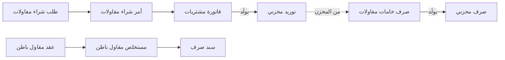
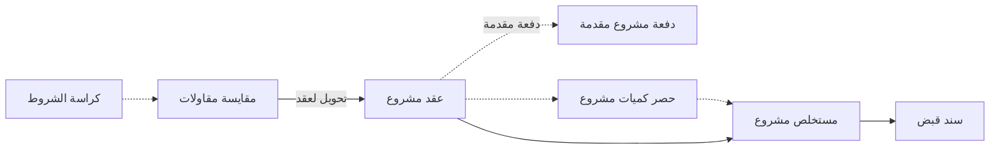

# شركة مقاولات

شركة مقاولات تبني برجاً سكنياً بقيمة 230,000. كل أسبوع يطلب الموقع حديداً وبلوكاً، ويرسل مقاول
الباطن المسؤول عن أعمال المباني مستخلصه الشهري، ويُصرف لأربعين عاملاً باليومية من كشف المراقب،
ومرة في الشهر تطالب الشركة المالك بقيمة ما أُنجز. والإدارة تسأل عن كل هذا سؤالين: *كم تكلّف المشروع
حتى الآن؟* و*كم طالبنا به منه؟* ومسار المقاولات موجود ليصل كل شراء وكل أجر وكل مستخلص إلى المشروع
الصحيح، ويُفضَّل أن يصل إلى البند الصحيح من المقايسة، دون أن يفرزه أحد في آخر الشهر.

يدعم نما ثلاثة مستويات من النشاط نفسه. بعض المقاولين يكتفون بوسم مصروفاتهم بالمشروع، وكثيرون
يُديرون جانب التكلفة داخل وحدة المقاولات، وبعضهم يطالب المالك منها أيضاً. هذه الصفحة تمر على
المستويات الثلاثة لتختار ما يناسبك ثم تنتقل إلى المستوى التالي لاحقاً.

## لمن يناسب هذا السيناريو

- مقاولو المباني والأعمال المدنية والتشطيبات والأعمال الكهروميكانيكية والبنية التحتية: عمل قائم على
  المشروعات، بمشتريات للمواقع ومقاولي باطن وعمالة كبيرة في الموقع. وفي تركيبات نما، نحو شركة من كل
  10 شركات تعمل في المقاولات.
- نحو 3 من كل 5 مقاولين يستخدمون وحدة المقاولات، وأغلبهم لجانب التكلفة. ونحو 3 من كل 10 يطالبون
  مالك المشروع أيضاً بمستخلصات المشروع. ونحو 2 من كل 5 يحسبون تكلفة مشروعاتهم بالمحددات وحدها ولا
  يفتحون الوحدة أصلاً.
- يجمع المقاولون عادة بين هذه الصفحة و[مجموعة شركات](/ar/business-scenarios/scenario-multi-company-group)
  حين يكون كل مشروع كبير أو تحالف شركةً مستقلة، و[شركة خدمات واستخدام مالي فقط](/ar/business-scenarios/scenario-service-and-finance-only)
  لحسابات المركز الرئيسي. والمقاول الذي يبني وحداته ليبيعها يقرأ أيضاً
  [مطور عقاري](/ar/business-scenarios/scenario-real-estate-developer).

## ما تحتاجه

::: info التراخيص المطلوبة
`contracting` (و`contracting-qc` لشاشات جودة الموقع)، و`supplychain-inventory`،
و`supplychain-purchases`، و`fixedassets`، و`humanresource-payroll`، و`basic-mobile-ess` للحضور من
الهاتف، و`accounting-banks`، و`accounting-lgt` لخطابات ضمان العطاءات وحسن التنفيذ.
:::

مستوى *المحددات فقط* لا يحتاج أي ترخيص من تراخيص المقاولات: يكفي `accounting` وتراخيص سلاسل
الإمداد والرواتب.

- [المقاولات](/ar/modules/contracting/): المشروعات والعقود والمستخلصات والموازنات وتكلفة المشروع.
- [سلاسل الإمداد](/ar/modules/supplychain/): مخازن المواقع وفواتير المشتريات والتوريدات المخزنية.
- [الحسابات](/ar/modules/accounting/): طلبات الصرف وسنداته، وفواتير المتنوعات، والشيكات وخطابات
  الضمان.
- [الموارد البشرية](/ar/modules/hr/): رواتب موظفي الموقع والمكتب.
- [الأصول الثابتة](/ar/modules/fixedassets/): الأوناش والخلاطات والسيارات وإهلاكها.
- [الموبايل](/ar/modules/mobile/): تسجيل الحضور من الموقع.

## مسار المستندات

جانب التكلفة حين يُدار داخل وحدة المقاولات:

وجانب المالك، للمقاولين الذين يطالبون المالك من الوحدة أيضاً:

تابع شهراً واحداً في البرج، بالمستوى الكامل:

1. **الموقع يطلب الحديد.** يحرر مهندس الموقع **طلب شراء مقاولات** بأربعة أطنان من حديد التسليح على
   بند الخرسانة في عقد المشروع. الطلب لا يُسجّل شيئاً في الحسابات؛ هو يوثّق ما يحتاجه الموقع ولأي بند.
2. **المشتريات تطلب التوريد.** يُنشأ **أمر شراء مقاولات** من الطلب (وتظهر الشاشة في القائمة
   الإنجليزية باسم *Contractor Purchase Order*). يضيف الأمر الأطنان الأربعة إلى الكمية المطلوبة على
   البند في العقد، ولا يُسجّل أي مبلغ.
3. **فاتورة المورد.** لا توجد فاتورة مشتريات خاصة بالمقاولات: يُفوتَر الأمر على **فاتورة مشتريات**
   عادية تُسوّي جانب المورد. ويدخل الحديد مخزن الموقع بـ**توريد مخزني**، يتولد من الفاتورة أو يُستلم
   أولاً ثم يُجمَع داخلها.
4. **استخدام الحديد.** حين يخرج الحديد من المخزن للصب، يولّد **صرف خامات مقاولات** على بند الخرسانة
   **صرفاً مخزنياً** يحرك المخزون، ويضع تكلفة الحديد المخزنية على المشروع. في هذه اللحظة تصبح الخامة
   تكلفة على المشروع.
5. **الخدمات والإيجارات.** ما لا يُخزَّن أبداً (إيجار ونش، كهرباء الموقع، رسوم ترخيص) يُسجَّل على
   **فاتورة شراء مستلزمات مقاولات**، وسطورها تحمل كود البند وتضع تكلفتها على المشروع.
6. **العمالة اليومية.** كشف المراقب للعمال المؤقتين يصبح **مستند السركي**، الذي يُسجّل الأجور ويضعها
   على المشروع كتكلفة عمالة. أما الموظفون على الرواتب فيصلون إلى المشروع بطريق آخر: سندات الرواتب
   وتوزيع تكلفة الموظفين.
7. **مقاول الباطن يطالب.** يعمل مقاول المباني بموجب **عقد مقاول باطن**. ومستخلصه الشهري
   (**مستخلص مقاول باطن**) يعتمد 800 م²، ويخصم الضمان المحتجز وجزءاً من دفعته المقدمة، ويُسجّل
   التكلفة والالتزام. ثم يُدفع له بـ**سند صرف**.
8. **مطالبة المالك.** في جانب المالك، يحمل **عقد المشروع** البنود المسعّرة، وكثيراً ما يُحوَّل من
   **مقايسة مقاولات** مبنية على **كراسة الشروط**. توقيع العقد لا يُسجّل شيئاً. ويسجّل **حصر كميات
   مشروع** اختياري ما نُفّذ هذا الشهر، ثم يطالب **مستخلص مشروع** بقيمته: الإيراد والضريبة والضمان
   المحتجز والدفعة المقدمة المستردة. ويُسوّيه **سند قبض** من المالك.

والقاعدة وراء الرسمين: العقود لا تُحرّك شيئاً، والمستخلصات تُحرّك كل شيء. التفاصيل في
[نظرة عامة على المقاولات](/ar/modules/contracting/contracting-overview).

## الإعداد خطوة بخطوة

1. **ملف مشروع لكل موقع، ومعه محدده.** أنشئ [مشروع المقاولات](/ar/modules/contracting/setup/contracting-projects)،
   و[مجموعة تحليلية](/ar/platform/shared-master-files/dimensions-and-composite-dimensions) له، ومخزناً
   للموقع إذا كانت الخامات تُخزَّن فيه، و[دفاتر المستندات](/ar/platform/documents-and-records/document-books)
   إذا كان لكل مشروع ترقيمه الخاص. المجموعة التحليلية هي ما تُصفّى عليه كل التقارير، لذلك تأتي أولاً
   حتى في مستوى *المحددات فقط*.
2. **البنود القياسية بحساباتها.** كل [بند قياسي](/ar/modules/contracting/setup/contracting-standard-terms)
   يحمل الحسابات التي يُسجَّل عليها نصيبه من المستخلص. ومن دونها لا يجد المستخلص ما يُسجّله.
3. **الشروط ونماذج العقود.** الضمان المحتجز واسترداد الدفعة المقدمة والغرامات
   [شروط قياسية](/ar/modules/contracting/setup/contracting-conditions)؛ اجمع المعتاد منها في مجموعة كي لا
   يُعاد إدخالها في كل عقد.
4. **مقاولو الباطن.** سجّل كل [مقاول باطن](/ar/modules/contracting/setup/contracting-contractors-and-consultants)،
   وقرّر مرة واحدة هل يُربط بملف مورد، ليظهر رصيده في مكان واحد.
5. **توجيهات المستندات، واحداً واحداً.** كل مستند مقاولات له أثر يأخذ حساباته والمستندات التي يولّدها
   من توجيهه: المستخلصات، وصرف خامات المقاولات (ويحتاج دفتر وتوجيه الصرف المخزني الذي يولّده)، ومستند
   السركي، وفاتورة شراء المستلزمات. راجع الأثر المحاسبي لكل توجيه على مستند تجريبي قبل بدء التشغيل.
   راجع [توجيهات مستندات المقاولات](/ar/modules/contracting/document-terms/contracting-terms-basics).
6. **مستخدمو المواقع.** امنح مهندسي المواقع [ملف صلاحيات](/ar/platform/security/security-profiles)
   يقتصر على تحرير الطلبات (طلبات الشراء، وطلبات صرف الخامات، وطلبات الصرف)، واترك تحويلها للمشتريات
   والحسابات.
7. **الأفراد.** جهّز الرواتب لكل موقع، وإذا كان الحضور يُسجَّل من الهاتف فجهّز نطاقات الحضور في
   [الخدمة الذاتية على الموبايل](/ar/modules/mobile/mobile-hr-self-service).

## الإعدادات والأدوات الأكثر استخدامًا

- **الرواتب.** نحو 3 من كل 5 مقاولين يُديرون الرواتب على نما، مقابل نحو 2 من كل 5 شركات عموماً.
  راجع [الموارد البشرية](/ar/modules/hr/).
- **الحضور من الهاتف.** نحو الثلث يسجّلون الحضور من الهاتف، أي ضعف النسبة في غيرهم. راجع
  [الخدمة الذاتية للموظف](/ar/modules/mobile/mobile-hr-self-service).
- **الأصول الثابتة.** نحو النصف يحتفظون بمعداتهم وسياراتهم في وحدة الأصول الثابتة، ويمكن أن يصل
  الإهلاك إلى تكلفة المشروع. راجع [كيف تُبنى تكلفة المشروع](/ar/modules/contracting/costs/contracting-cost-model).
- **طلبات الصرف.** نحو 2 من كل 5 يمرّرون مصروفات المواقع على طلب صرف قبل السند، مقابل نحو 1 من كل 5
  عموماً. راجع [سندات القبض والصرف](/ar/modules/accounting/money-in-and-out/receipts-and-payments).
- **المجموعات التحليلية.** نحو 3 من كل 5 يضعون على المستندات مجموعة تحليلية لكل مشروع. راجع
  [المحددات](/ar/platform/shared-master-files/dimensions-and-composite-dimensions).
- **مخازن كثيرة ودفاتر كثيرة.** نحو النصف لديهم 20 مخزناً أو أكثر، غالباً مخزن لكل موقع، ومئات
  [دفاتر المستندات](/ar/platform/documents-and-records/document-books) أمر طبيعي حين يكون لكل مشروع
  ترقيمه.
- **خطابات الضمان.** نحو 1 من كل 5 يتابعون خطابات ضمان العطاءات وحسن التنفيذ. راجع
  [خطابات الضمان](/ar/modules/accounting/bank-facilities/letters-of-guarantee).

## صور أخرى للسيناريو نفسه

**المحددات فقط.** المشروع مجموعة تحليلية لا أكثر. مشتريات الموقع على فواتير مشتريات عادية إلى مخزن
الموقع، والخدمات على [فاتورة متنوعات](/ar/modules/accounting/money-in-and-out/misc-purchasing)،
والمصروفات النثرية على طلب صرف يحوّله أمين الخزينة إلى سند صرف؛ وكلها تحمل المجموعة التحليلية
للمشروع. وتكلفة المشروع تأتي من الحسابات مصفّاة بتلك المجموعة. البداية سريعة، وتجيب عن «كم تكلّف
المشروع»، لكنها لا تجيب عن «كم تكلّف هذا البند».

**جانب التكلفة داخل الوحدة.** المسار في الرسم الأول. تتراكم تكلفة المشروع بنداً بنداً من صرف الخامات،
وفواتير شراء المستلزمات، ومستند السركي، ومستخلصات مقاولي الباطن، والتكلفة الموزعة للموظفين والمعدات،
ويعرض جدول بنود العقد التكلفة الفعلية أمام قيمة العقد في أي لحظة. راجع
[كيف تُبنى تكلفة المشروع](/ar/modules/contracting/costs/contracting-cost-model)،
و[المشتريات](/ar/modules/contracting/costs/contracting-purchasing)،
و[خامات المشروع](/ar/modules/contracting/costs/contracting-project-materials)،
و[العمالة اليومية](/ar/modules/contracting/costs/contracting-daily-labour)،
و[المصروفات المتنوعة](/ar/modules/contracting/costs/contracting-misc-spend).

**مطالبة المالك خارج الوحدة.** بعض المقاولين يُديرون جانب التكلفة في الوحدة ويطالبون المالك على فاتورة
بيع مبدئية وفاتورة مبيعات عاديتين، موسومتين بالمجموعة التحليلية للمشروع. هذا يعمل، لكن الضمان المحتجز
لدى المالك واسترداد الدفعة المقدمة والكميات المُطالَب بها تراكمياً تبقى حينئذ خارج العقد، لذلك يكون
[مستخلص المشروع](/ar/modules/contracting/project-contracting/contracting-project-extracts) أنسب حين تتبع
المطالبةُ مقايسةً.

**العطاءات.** المقاولون الذين يدخلون مناقصات يبنون [كراسة الشروط](/ar/modules/contracting/setup/contracting-term-sheets)،
ويسعّرونها على [مقايسة مقاولات](/ar/modules/contracting/project-contracting/contracting-assays) أو عرض سعر
مقاولات، ويحللون التكلفة المخططة لكل بند على [كروت التحليل](/ar/modules/contracting/setup/contracting-term-analysis-cards)،
ثم يحوّلون العطاء الفائز إلى عقد المشروع. وكل ذلك اختياري؛ يمكن كتابة العقد مباشرة.

## قرارات قبل بدء التشغيل

- **إلى أي حد تتبنى الوحدة.** المحددات فقط، أو جانب التكلفة، أو دورة المالك كاملة. المستويات يبني
  بعضها على بعض: المجموعة التحليلية تبقى مفيدة في كل مستوى، ومطالبة المالك يمكن إضافتها بعد أن يستقر
  جانب التكلفة.
- **مجموعة تحليلية أم مشروع مقاولات، أم الاثنان.** حتى في المستوى الكامل، احتفظ بمجموعة تحليلية لكل
  مشروع: الحسابات وكل تقرير خارج المقاولات يُصفّى عليها.
- **خامة مخزنية أم تكلفة مباشرة.** الخامة التي تبيت في مخزن تمر بزوج الشراء وتصل إلى المشروع عند
  صرفها. وما لا يُخزَّن أبداً يذهب إلى فاتورة شراء المستلزمات. حدّد أي الأصناف من أي نوع قبل أول أمر.
- **كود البند إلزامي أم اختياري.** سطر التكلفة بلا كود بند يُحفظ ويُسجَّل محاسبياً بشكل صحيح، لكنه لا
  يصل أبداً إلى تكلفة المشروع. اجعل كود البند إلزامياً في توجيهات الخامات والمشتريات ما لم تحتج سطوراً
  فارغة عن قصد.
- **من يحرر ومن يحوّل.** مستخدمو مواقع محدودون يحررون الطلبات فقط، والمشتريات والحسابات تحوّلها؛ هكذا
  تبقى مشتريات المواقع تحت السيطرة دون أن يتعطل الموقع.
- **عمالة يومية أم رواتب.** العمال الذين يُصرف لهم من كشف المراقب يُسجَّلون على مستند السركي، والموظفون
  على الرواتب يصلون إلى تكلفة المشروع عبر توزيع تكلفة الموظفين. اختر طريقاً واحداً لكل نوع من العاملين.

## اقرأ أيضًا

1. [نظرة عامة على المقاولات](/ar/modules/contracting/contracting-overview)
2. [إعدادات المقاولات](/ar/modules/contracting/contracting-configuration)
3. [مشروعات المقاولات](/ar/modules/contracting/setup/contracting-projects) و[البنود القياسية](/ar/modules/contracting/setup/contracting-standard-terms)
4. [كيف تُبنى تكلفة المشروع](/ar/modules/contracting/costs/contracting-cost-model)
5. [طلبات وأوامر شراء المقاولات](/ar/modules/contracting/costs/contracting-purchasing) و[صرف الخامات للمشروع](/ar/modules/contracting/costs/contracting-project-materials)
6. [دورة مقاول الباطن](/ar/modules/contracting/contractor-contracting/contracting-contractor-cycle) و[مستخلصات مقاولي الباطن](/ar/modules/contracting/contractor-contracting/contracting-contractor-extracts)
7. [دورة عقود المشروعات](/ar/modules/contracting/project-contracting/contracting-owner-cycle) و[مستخلصات المشروع](/ar/modules/contracting/project-contracting/contracting-project-extracts)
8. [المشتريات المتنوعة](/ar/modules/accounting/money-in-and-out/misc-purchasing) و[سندات القبض والصرف](/ar/modules/accounting/money-in-and-out/receipts-and-payments)
