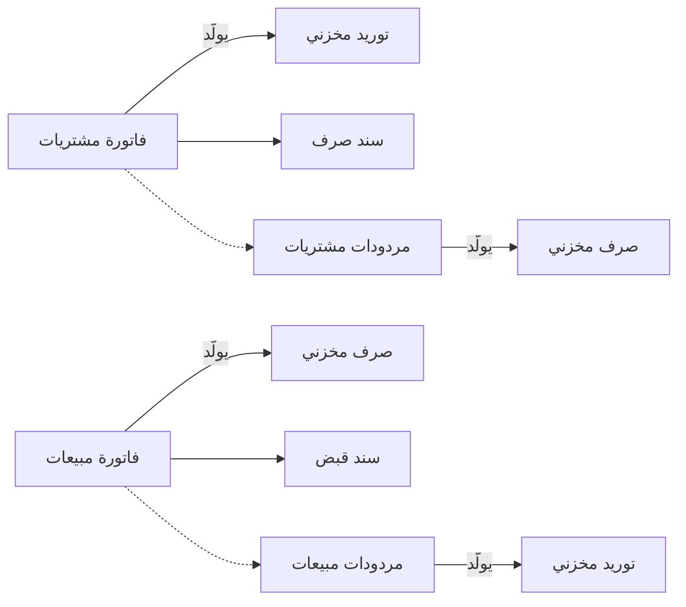

# التجارة بالفاتورة المباشرة

يشتري محل دهانات 500 علبة من مورّده بفاتورة شراء واحدة، وفي العصر يدخل دهّان فيأخذ 12 علبة ويدفع ثمنها على الكاونتر. لم يكتب أحد عرض أسعار ولا أمر بيع، ولم يُدخل أحد في المخزن سند صرف: الفاتورة هي البيع نفسه، والبضاعة تخرج معها. تشرح هذه الصفحة كيف يُعدّ نظام نما لنشاط يبيع بهذه الطريقة، حيث تحمل كل فاتورة حركتها المخزنية وتحصيلها معها.

## لمن يناسب هذا السيناريو

- التجّار والمحلات والموزّعون الذين يبيعون لعملاء عابرين أو دائمين، والورش وتجار الجملة الصغار الذين يُتَّفق على البيع ويُسلَّم في اللحظة نفسها. والشراء مرآة للبيع: فاتورة المورّد هي التي تُدخل البضاعة.
- في منشآت نما تعمل قرابة شركتين من كل 5 شركات بهذه الطريقة. فهي تُصدر فواتير كل شهر، ومجموع أوامر البيع وعروض الأسعار عندها أقل من عُشر فواتيرها.
- وهو نقطة البداية لمعظم أساليب البيع الأخرى. فإذا كان السعر يُتفاوض عليه أولًا فأضف [البيع بعروض الأسعار](/ar/business-scenarios/scenario-quotation-led-selling)، وإذا كان عملاء الآجل يطلبون مسبقًا ويُسلَّمون لاحقًا فانظر [التوزيع من أمر البيع إلى التحصيل](/ar/business-scenarios/scenario-order-to-cash-distribution)، وإذا كانت البضاعة تأتي من الخارج فأضف [الاستيراد: التكاليف الإضافية والاعتمادات المستندية](/ar/business-scenarios/scenario-importer-landed-cost). أما الكاونتر المزدحم متعدد الكاشيرات فينتقل عادةً إلى [سلسلة متاجر بنقاط البيع](/ar/business-scenarios/scenario-retail-chain-pos).

## ما تحتاجه

::: info التراخيص المطلوبة
`accounting` و`supplychain-sales` و`supplychain-purchases` و`supplychain-inventory`. وكثيرًا ما يُضاف `accounting-banks` (الشيكات والتحويلات البنكية) و`basic-tax-e-invoice` (الفاتورة الإلكترونية).
:::

- [إدارة سلسلة التوريد](/ar/modules/supplychain/) فيها الأصناف والمخازن والفواتير والمرتجعات والسندات المخزنية التي تُنشئها.
- [الحسابات والبنوك](/ar/modules/accounting/) فيها شجرة الحسابات والخزائن وسندات القبض والصرف، والشيكات مع ترخيص البنوك.
- [الفواتير والضرائب والخصومات](/ar/modules/invoicing/) تغطي قوائم الأسعار والعروض والخصومات والضرائب، والفاتورة الإلكترونية حيث تشترطها مصلحة الضرائب لديك.

## مسار المستندات

تابع محل الدهانات خلال شهر واحد:

1. **الشراء.** يسلّم المورّد 500 علبة ومعها فاتورته، فيُدخل المشتري **فاتورة مشتريات**. ولأن توجيهها مفعّل فيه **إنشاء مستندات تلقائيا** (Generate Document(s))، فإن حفظها يُنشئ **توريدًا مخزنيًا** بالعلب الخمسمائة في مخزن الفاتورة، فتصل الكمية وتكلفتها مع الفاتورة. ولا يفتح أحد شاشة التوريد المخزني.
2. **السداد للمورّد.** عندما يدفع المحل، يُنشئ زر **إنشاء سند صرف** (Generate payment voucher) على فاتورة المشتريات المحفوظة **سند صرف** على المورّد بالمتبقي من الفاتورة.
3. **البيع.** يأخذ الدهّان 12 علبة، فيُدخل الكاشير **فاتورة مبيعات** باسمه. توجيهها يولّد **الصرف المخزني** عند الحفظ، فتخرج العلب من المخزن وتُسجَّل تكلفة البضاعة المباعة، وتُسجَّل قيود الإيراد والضريبة في الخطوة نفسها.
4. **قبض الثمن.** يدفع الدهّان على الكاونتر، فيسجّل الكاشير المبلغ في جدول **السداد** (Payment Lines) بالفاتورة: نقدًا أو ببطاقة أو قسيمة أو جهاز دفع. أما عميل الآجل الذي يدفع لاحقًا فيُصدَر له **سند قبض**: إما بزر **إنشاء سند قبض** (Generate Receipt Voucher) على الفاتورة بالمتبقي منها، أو تُصدره الإدارة المالية لاحقًا وتملأ تبويب **الفواتير** فيه بزر **تجميع سندات** (Collect Vouchers).
5. **مرتجع.** علبتان لونهما خطأ، فيُدخل الكاشير **مردودات مبيعات** ويختار الفاتورة الأصلية في عمود **الفاتورة** بالسطر، فيُردّ للعميل السعر الذي دفعه فعلًا، ولا يمكنه إرجاع أكثر مما بيع له. وتوجيه المرتجع يولّد **التوريد المخزني** الذي يعيد العلب إلى المخزن.
6. **الإرجاع للمورّد.** وصلت عشر علب تالفة، فيُدخل المشتري **مردودات مشتريات** على المورّد، وتولّد **صرفًا مخزنيًا** يُخرجها من المخزون.

لم يُستعمل في الشهر كله أمر بيع ولا عرض أسعار ولا سند مخزني يُكتب يدويًا. كل فاتورة وكل مرتجع يحمل حركته المخزنية بنفسه.

## الإعداد خطوة بخطوة

1. **شغّل معالج الإعداد واعتمد شجرة الحسابات.** ينشئ المعالج دفاتر المستندات والتوجيهات والإعدادات التي توافق إجاباتك، والشجرة تحدد أين يقع كل قيد. انظر [ملف المعالج](/ar/admin/wizard-file) و[شجرة الحسابات](/ar/modules/accounting/ledger-setup/chart-of-accounts).
2. **أنشئ المخازن**، مخزنًا لكل مكان تُحفظ فيه البضاعة وتُجرد، مع مواقع تخزينية إن احتجت أرقام الأرفف. انظر [المخازن والمواقع التخزينية](/ar/modules/supplychain/warehouses-and-locators).
3. **استورد الأصناف ووحداتها وقوائم الأسعار.** يصعب تغيير الوحدات ونوع الصنف بعد أن تتحرك عليه كميات، فاضبطها أولًا. انظر [فهم أصناف المخزون](/ar/modules/supplychain/understanding-items) و[دليل إدارة الأسعار والعروض](/ar/modules/invoicing/pricing-and-offers-guide) و[استيراد السجلات](/ar/platform/import-export/importing-records).
4. **استورد العملاء والموردين** بحساباتهم وقائمة أسعارهم ومدة سدادهم. انظر [العملاء والموردون وجهات الصلة](/ar/platform/shared-master-files/customers-suppliers-and-parties).
5. **أدخل المخزون الافتتاحي** بـ**سند افتتاح مخزني** لكل مخزن. توجيهه يولّد التوريد المخزني الذي يُدخل الكميات، ومكانه الفترة الافتتاحية. انظر [سند افتتاح مخزني](/ar/modules/supplychain/receiving-stock#snd-fttH-mkhzny-OpeningStockDocument).
6. **اضبط دفاتر المستندات والتوجيهات التي تولّد السندات المخزنية.** في توجيهات فاتورة المبيعات وفاتورة المشتريات ومردودات المبيعات ومردودات المشتريات فعّل **إنشاء مستندات تلقائيا** وحدد **دفتر المستند** و**توجيه المستند** للسند المخزني المُنشأ. انظر [دفاتر المستندات](/ar/platform/documents-and-records/document-books) و[إعدادات التوليد والمحددات](/ar/modules/supplychain/document-terms/doc-term-generation-and-dimensions#ltwlyd-Generation).
7. **أنشئ الخزائن والحسابات البنكية** التي تمر بها المقبوضات والمدفوعات. انظر [حقائب الحسابات والخزائن والشركاء](/ar/modules/accounting/ledger-setup/accounts-bags-safes-and-partners) و[البنوك والحسابات البنكية والتحويلات](/ar/modules/accounting/banks-and-cheques/banks-and-bank-accounts).
8. **أنشئ المستخدمين وملفات صلاحياتهم**، فيبيع الكاشير ويحصّل، ويشتري المشتري. انظر [ملف الصلاحيات](/ar/platform/security/security-profiles).

## الإعدادات والأدوات الأكثر استخدامًا

- **مردودات المبيعات**: تُصدرها نحو 4 من كل 5 شركات في هذا السيناريو، وتكاد تكون دائمًا على الفاتورة الأصلية. انظر [المرتجعات والاستبدالات](/ar/modules/supplychain/sales-journey#lmrtjaat-wlstbdlt).
- **سند الافتتاح المخزني**: استعملته نحو 2 من كل 3 شركات لإدخال مخزونها عند بدء التشغيل. انظر [استلام المخزون في المستودع](/ar/modules/supplychain/receiving-stock).
- **قوائم الأسعار**: نحو نصف الشركات تسعّر مبيعاتها بقوائم الأسعار بدل كتابة السعر في كل سطر. وحين لا تنطبق قائمة، يمكن لإعداد **استخدام آخر سعر بيع** (Use Last Sales Price) أن يعيد استعمال آخر سعر بيع به للعميل. انظر [إعدادات التسعير وقوائم الأسعار](/ar/modules/supplychain/configuration/pricing-and-price-lists).
- **سند يُنشأ من الفاتورة** تسلسل شائع في الجانبين: **إنشاء سند قبض** على فاتورة المبيعات و**إنشاء سند صرف** على فاتورة المشتريات. انظر [ربط سندات الدفع بالفواتير](/ar/modules/invoicing/payment-entries).
- **الشيكات**، حيث يدفع العملاء بشيكات آجلة، تُسجَّل في تبويب **أوراق تجارية** بسند القبض. انظر [الشيكات والأوراق المالية](/ar/modules/accounting/banks-and-cheques/cheques-financial-papers).

## صور أخرى للسيناريو نفسه

**الاستلام أولًا ثم الفاتورة.** بعض الشركات تستلم البضاعة بـ**توريد مخزني** عند وصول الشاحنة، ثم تُدخل فاتورة المورّد بعد أيام. عندئذ تُبنى الفاتورة من سندات التوريد بزرّي **تجميع** و**تطبيق** بدل أن تولّد توريدًا جديدًا. والزوجان نفساهما يعملان في جانب البيع للبضاعة التي صُرفت قبل فوترتها. انظر [تجميع وتطبيق](/ar/modules/supplychain/the-document-screen#tjmyaa-wtTbyq-nSf-aaml-wHd-Collect--Apply) و[رحلة الشراء](/ar/modules/supplychain/purchasing-journey).

**الفاتورة يدويًا والصرف عند الطلب.** يمكن أن يُترك **إنشاء مستندات تلقائيا** غير مفعّل في التوجيه، فتُحفظ الفاتورة بلا حركة مخزنية، ثم يولّد زر **إنشاء سند مخزني** (Create Inventory Doc.) على الفاتورة الصرف المخزني (أو التوريد المخزني) عندما يكون المخزن جاهزًا للتنفيذ. ويناسب ذلك محلًا يفوتر فيه المكتب ويؤكد المخزن ما خرج فعلًا.

**درج الكاشير.** حين يحصّل شخص واحد مبالغ صغيرة كثيرة في اليوم، تضيف [ورديات الكاشير](/ar/modules/accounting/money-in-and-out/cashier-shifts) سند فتح وردية وسندات كاشير مبسّطة وسند غلق وردية يجرد الدرج.

## قرارات قبل بدء التشغيل

- **أي مستند يحرّك المخزون.** حدد في كل توجيه هل تولّد الفاتورة سندها المخزني، والتزم بذلك. فصرف مخزني يُكتب يدويًا لبضاعة تغطيها فاتورة مولِّدة، دون أن يُجمَّع في تلك الفاتورة، يُخرج البضاعة مرتين. وإذا لزم أن تعيش العادتان معًا ففعّل **عدم إنشاء المستندات تلقائيا إذا تم إضافة مستندات يدوية** في توجيه الفاتورة: عندئذ لا تولّد الفاتورة التي في جدولها سندات مخزنية شيئًا.
- **العملاء العابرون.** إما عميل نقدي واحد لمبيعات الكاونتر المجهولة، وإما إنشاء العميل على الكاونتر. الثاني يعطيك اسمًا ورقم هاتف لكل بيعة، لكن بعض محلات التجزئة تنتهي بعشرات الآلاف من العملاء، فخطّط لطريقة بناء أكوادهم.
- **السداد على الفاتورة أم بسند.** مبيعات الكاونتر أبسط ما تكون على جدول **السداد** بالفاتورة. أما عملاء الآجل الذين يدفعون لاحقًا، أو يدفعون عدة فواتير مرة واحدة، فيحتاجون سندات قبض. حدد أي العملاء يأخذ أيهما.
- **مرتجع تعود بضاعته ومرتجع لا تعود.** استعمل توجيه مرتجع يولّد التوريد المخزني حين تعود البضاعة فعلًا، وتوجيهًا آخر أو إشعارًا دائنًا حين يُعدَّل السعر فقط. انظر [إشعارات الدائن والمدين](/ar/modules/accounting/money-in-and-out/credit-and-debit-notes).
- **مراقبة الائتمان.** ملف العميل يسجّل حدًا ائتمانيًا، لكن حفظ الفاتورة لا يقارنها به. فإن أردت أن تتوقف الفواتير عند الحد فابنِ القاعدة بـ[التحقق المبني على المعايير](/ar/platform/governance/criteria-based-validation#mnaa-byaa-ytjwz-Hd-ytmn-laamyl).

## اقرأ أيضًا

1. [رحلة المبيعات](/ar/modules/supplychain/sales-journey)
2. [رحلة الشراء](/ar/modules/supplychain/purchasing-journey)
3. [إعدادات التوليد والمحددات](/ar/modules/supplychain/document-terms/doc-term-generation-and-dimensions)
4. [إصدار المخزون من المستودع](/ar/modules/supplychain/issuing-stock) و[استلام المخزون في المستودع](/ar/modules/supplychain/receiving-stock)
5. [سندات القبض والصرف](/ar/modules/accounting/money-in-and-out/receipts-and-payments)
6. [ربط سندات الدفع بالفواتير](/ar/modules/invoicing/payment-entries)
7. [فهم أصناف المخزون](/ar/modules/supplychain/understanding-items)
