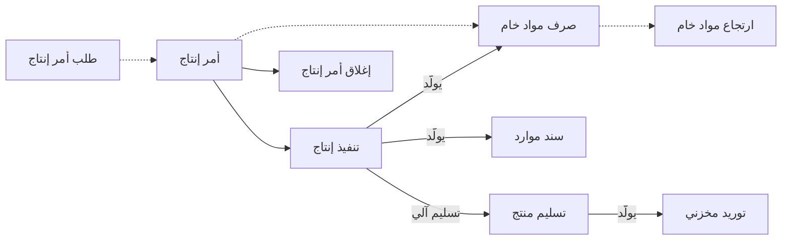

# دورة التصنيع الكاملة

مصنع دهانات يصنع 5,000 لتر من الدهان الأبيض المائي في تشغيلة واحدة. تُخلط التشغيلة وتُطحن وتُلوَّن
وتُعبأ على مدى يومين. تُصرف الخامات إلى صالة الخلط في الصباح، وتنتظر التشغيلة عند المطاحن طوال الليل،
ويفشل 40 لترًا في فحص اللون عند التلوين فتعود لإعادة التشغيل. وحين ينتهي كل شيء يحتاج المصنع أن يعرف كم
كلّف اللتر الواحد فعلًا، ولماذا زاد ذلك على ما قالته الوصفة.

سند تجميع واحد لا يستطيع أن يروي هذه القصة. فهي تحتاج إلى أمر يخطط العمل، وإلى سجلات تتبع التشغيلة من
مرحلة إلى مرحلة، وإلى إغلاق في النهاية يجمع كل التكاليف ويثبّتها على المنتج. هذه هي دورة التصنيع الكاملة،
وتشرح هذه الصفحة كيف تديرها المصانع في «نما».

## لمن يناسب هذا السيناريو

- مصنع **إنتاجه على مراحل**: منتجات تمر بعدة عمليات في صالات إنتاج مختلفة، وكميات تنتظر بينها أو تُرفض
  أو تتلف، وخامات تُصرف إلى الصالة، وأمر يُغلق وتُحسب تكلفته عند انتهائه. ومن أمثلته الدهانات
  والكيماويات، وقطع البلاستيك والمعادن المصبوبة في قوالب، والمراتب والأثاث، والكرتون والحديد.
- في منشآت «نما» تدير **شركة من كل 12 شركة** تقريبًا الدورة الكاملة، أي نحو نصف الشركات الصناعية كلها.
- والمصنع نفسه كثيرًا ما يصنع منتجاته البسيطة بسندات التجميع. انظر
  [الإنتاج بمستندات التجميع](/ar/business-scenarios/scenario-assembly-production).
- وتبيع المصانع عادة عبر [التوزيع من أمر البيع إلى التحصيل](/ar/business-scenarios/scenario-order-to-cash-distribution)،
  وكثيرًا ما تشتري خاماتها عبر مسار [الاستيراد](/ar/business-scenarios/scenario-importer-landed-cost)،
  وكثيرًا ما يكون المصنع شركة ضمن [مجموعة شركات](/ar/business-scenarios/scenario-multi-company-group)
  إلى جانب ذراع تجارية.

## ما تحتاجه

::: info التراخيص المطلوبة
`manufacturing`، ومعه `manufacturing-mrp` أو `manufacturing-molds` أو `manufacturing-crtn-pln` حيث تنطبق؛ و`supplychain-inventory` و`supplychain-purchases`؛ و`supplychain-qc-qa` لمستندات الجودة؛ و`humanresource-payroll` لجانب العاملين.
:::

- [التصنيع](/ar/modules/manufacturing/): مكونات المنتج ومسارات التشغيل وصالات الإنتاج وأوامر الإنتاج
  والتنفيذ وصرف المواد الخام وارتجاعها وتسليم المنتج والإغلاق والتكاليف.
- [سلسلة الإمداد](/ar/modules/supplychain/): المخازن وسندات الصرف والتوريد التي تولّدها مستندات التصنيع،
  وشراء الخامات.
- [مراقبة الجودة](/ar/modules/supplychain/quality-control): قوائم الفحص ومستندات الجودة التي يولّدها التنفيذ.
- [الرواتب](/ar/modules/hr/payroll/): نحو 2 من كل 3 من هذه المصانع تصرف رواتب عمالها في «نما».

## مسار المستندات (Document Flow)

أمر الإنتاج هو الخطة، والتنفيذات تسجل ما حدث، وسندات الصرف والتسليم تحرّك المخزون، وإغلاق الأمر يثبّت
التكلفة. وهذه تشغيلة الدهان من أولها إلى آخرها.

1. **الطلب (اختياري).** يُنشئ التخطيط **طلب أمر إنتاج** بـ5,000 لتر، فيمر بدورة الموافقات، ثم يُنشأ
   **أمر الإنتاج** بناءً عليه. وحقل **طلب أمر الإنتاج** في رأس الأمر يشير إليه، فيمكن تتبع كل منهما من
   الآخر.
2. **الأمر.** يختار المخطط الصنف، فينسخ الأمر **مكونات المنتج** و**مسار التشغيل**: المكونات مضروبة حتى
   5,000 لتر، والعمليات الأربع: الخلط (10) والطحن (20) والتلوين (30) والتعبئة (40). وإن كان توجيه أمر
   الإنتاج يحدد دفتر وتوجيه طلب صرف مواد خام، فإن حفظ الأمر يُنشئ أيضًا **طلب صرف مواد خام** ليعرف المخزن
   ما عليه تجهيزه. ثم يضغط المخطط **بدء أمر الإنتاج** ويحفظ: صار الأمر **قيد التنفيذ**، وتجمدت سطور
   مكوناته ومسار تشغيله.
3. **الخامات تخرج من المخزن.** **صرف مواد خام** يحمّل الخامات على الأمر، وأمر الإنتاج هو الحقل الإجباري
   الوحيد فيه. يمكن لأمين المخزن إنشاؤه من الأمر مستخدمًا حقل الصرف لكمية المنتج التام
   (Issue For Finished Product Quantity) ليضرب المكونات في الكمية، أو يولّده التنفيذ للمكونات التي تُصرف
   مع التنفيذ. وتوجيهه هو الذي يولّد **الصرف المخزني** الذي ينقص المخزون فعلًا.
4. **العمل يمر بالمراحل.** كل **تنفيذ إنتاج** يسجل كميات تنتقل من عملية إلى التي تليها. عند التلوين ينتقل
   4,960 لترًا إلى الأمام، وينتقل 40 لترًا إلى حالة **مرفوض**. ثم يعيد تنفيذ لاحق هذه الأربعين لترًا إلى
   الطحن فتمر من جديد. واعتماد التنفيذ يولّد ما يطلبه توجيهه: صرف مواد خام، و**سندات موارد** لوقت العمالة
   والماكينات، ومستندات جودة للعمليات التي لها قائمة فحص.
5. **الدهان يصل إلى المخزن.** مع خيار **تسليم المنتج النهائي تلقائيا** في توجيه التنفيذ، فإن السطر الذي
   ينقل الكمية إلى آخر عملية يُنشئ **تسليم منتج**. والتسليم يولّد دائمًا **توريدًا مخزنيًا** للدهان التام
   ولأي منتج ثانوي.
6. **البواقي تعود.** بقي 120 كجم من الصبغة لم تُستخدم. **ارتجاع مواد خام** على الأمر يعيدها إلى المخزون
   بالتوريد المخزني الذي يولّده، ويخرجها من تكلفة الأمر.
7. **إغلاق الأمر.** سند **إغلاق أمر إنتاج** يجمع كل سندات صرف المواد الخام وارتجاعها وسندات الموارد الخاصة
   بالأمر، ويضيف التكاليف غير المباشرة من نوع التكاليف غير المباشرة في الأمر، ويعيد تقييم سندات تسليم المنتج
   بتكلفة الوحدة الفعلية. فتتبع قيود التسليم التكلفة الجديدة، ويصبح الأمر **مغلقًا**، وتُرفض بعدها
   المستندات التي تعمل عليه.
8. **البيع.** يُباع الدهان من المخزون بتكلفته بعد الإغلاق، عبر
   [سيناريو البيع](/ar/business-scenarios/) الذي تستخدمه الشركة.

## الإعداد خطوة بخطوة

1. **الأصناف.** أنشئ الخامات والمنتجات الوسيطة والمنتجات التامة بوحداتها وإعدادات تكلفتها. انظر
   [فهم الأصناف](/ar/modules/supplychain/understanding-items).
2. **صالات الإنتاج والعمليات القياسية.** تحدد أين يجري العمل، وما يستهلكه، وبأي سعر، وإليها تشير مسارات
   التشغيل. انظر [صالات الإنتاج والعمليات القياسية](/ar/modules/manufacturing/manufacturing-work-centers).
3. **مكونات المنتج.** تحدد ما تستهلكه الوحدة الواحدة من كل منتج. ابنِ المستويات الدنيا قبل المنتجات التي
   تستخدمها. انظر [مكونات المنتج (BOM)](/ar/modules/manufacturing/manufacturing-bom).
4. **مسارات التشغيل.** تسرد العمليات التي يمر بها كل منتج والموارد التي تستهلكها كل خطوة. انظر
   [مسارات التشغيل](/ar/modules/manufacturing/manufacturing-routing).
5. **إعدادات التصنيع.** خيارات على مستوى قاعدة البيانات للأوامر والصرف والارتجاع والتنفيذ. انظر
   [إعدادات التصنيع](/ar/modules/manufacturing/manufacturing-configuration).
6. **توجيهات المستندات.** فيها معظم السلوك الفعلي: ما يشترطه أمر الإنتاج وما يسمح به، وهل يُنشئ طلب صرف،
   وما يولّده كل تنفيذ، وهل التسليم آلي، والسندات المخزنية خلف الصرف والارتجاع والتسليم. املأ كل دفتر
   وتوجيه توليد ستستخدمه دورتك. انظر
   [توجيهات أمر الإنتاج والتخطيط](/ar/modules/manufacturing/document-terms/mfg-terms-production-orders)
   و[توجيهات التنفيذ والتسليم](/ar/modules/manufacturing/document-terms/mfg-terms-execution-and-delivery)
   و[توجيهات المواد الخام](/ar/modules/manufacturing/document-terms/mfg-terms-materials).
7. **مخازن الإنتاج.** أعدّ مخازن الخامات ومخازن الإنتاج التام التي يستخدمها الصرف والتسليم. انظر
   [المخازن والمواقع](/ar/modules/supplychain/warehouses-and-locators).
8. **التكاليف.** أعدّ أنواع التكاليف غير المباشرة، وقرّر بشأن الأسعار المعيارية والتكلفة لكل تشغيلة، قبل
   إغلاق أول أمر. انظر [تكاليف الإنتاج](/ar/modules/manufacturing/production-costing)
   و[توجيهات التكاليف والموارد والقوالب](/ar/modules/manufacturing/document-terms/mfg-terms-costing).

## الإعدادات والأدوات الأكثر استخدامًا

- **الثلاثي الأساسي.** كل مصنع على هذه الدورة يسجل تنفيذات الإنتاج وصرف المواد الخام وتسليم المنتج. انظر
  [تنفيذ الإنتاج](/ar/modules/manufacturing/production-execution)
  و[صرف المواد الخام وإرتجاعها](/ar/modules/manufacturing/raw-material-issue).
- **إغلاق الأوامر.** نحو 2 من كل 3 تغلق أوامرها بسند إغلاق أمر الإنتاج. انظر
  [تكاليف الإنتاج](/ar/modules/manufacturing/production-costing).
- **ارتجاع المواد الخام.** نحو 1 من كل 3 تسجل الخامات العائدة من الصالة. انظر
  [صرف المواد الخام وإرتجاعها](/ar/modules/manufacturing/raw-material-issue).
- **طلبات الأصناف.** نحو 2 من كل 3 تُنشئ طلبات أصناف لشراء خاماتها. انظر
  [رحلة الشراء](/ar/modules/supplychain/purchasing-journey).
- **مراقبة الجودة.** نحو 1 من كل 4 تولّد مستندات جودة من الإنتاج. انظر
  [مراقبة الجودة](/ar/modules/supplychain/quality-control).
- **الرواتب.** نحو 2 من كل 3 تصرف رواتب عمالها في «نما». انظر [الرواتب](/ar/modules/hr/payroll/).

## صور أخرى للسيناريو نفسه

**أوامر الإنتاج المجمعة.** المصنع الذي يخطط ليوم أو لأسبوع دفعة واحدة يجمع احتياجاته في **سند أوامر
الإنتاج المجمعة**. يمكنه تجميع طلبات أوامر الإنتاج المفتوحة، أو أن يُبنى على أمر بيع أو فاتورة مبيعات في
حقل **بناءا على**، وهو يُنشئ أمر إنتاج لكل سطر. ويمكن لصالة إنتاج تشغّل عدة أوامر معًا أن تنفذها مرة
واحدة باختيار السند المجمع في التنفيذ. انظر [أوامر الإنتاج](/ar/modules/manufacturing/production-orders).

**التصنيع حسب الطلب.** حقل **بناءا على** في أمر الإنتاج يقبل طلب أمر إنتاج، أو سند تخطيط احتياجات المواد،
أو سند أوامر إنتاج مجمعة، أو خطة خامات الكرتون، ولا يقبل أمر بيع. لذلك يصل طلب العميل إلى المصنع عبر سند
أوامر إنتاج مجمعة مبني عليه، أو عبر تخطيط احتياجات المواد حين يجمعه طلبًا، أو عبر أمر إنتاج يُنشئه المخطط
يدويًا لتلك المهمة.

**التخطيط باحتياجات المواد (MRP).** مع `manufacturing-mrp` يجمع سند التخطيط الطلب، ويطرح منه المخزون،
ويقترح سطور إنتاج وشراء ثم يُنشئها. وقليل من المصانع تستخدمه، فأغلبها يخطط يدويًا أو بالأوامر المجمعة.
انظر [تخطيط احتياجات المواد](/ar/modules/manufacturing/material-requirements-planning).

**خطوة طلب للخامات.** بدل الصرف المباشر، يمكن لتوجيه أمر الإنتاج أن يُنشئ **طلب صرف مواد خام** مع كل أمر،
والمخازن التي تزن ما تسلّمه يمكنها تحويل سطور الطلب الموزونة إلى سند الصرف. انظر
[توجيهات المواد الخام](/ar/modules/manufacturing/document-terms/mfg-terms-materials).

**القوالب والكرتون والمخلفات.** مصانع القطع المصبوبة تتتبع عُددها في
[قوالب التصنيع](/ar/modules/manufacturing/manufacturing-molds)، ومصانع الكرتون المموج تستخدم
[تصنيع الكرتون](/ar/modules/manufacturing/carton-manufacturing-overview)، والمخلفات التي ما زالت لها
قيمة تعود إلى المخزون بسند [إستلام التالف](/ar/modules/manufacturing/scrap-receipt).

## قرارات قبل بدء التشغيل

- **أمر واحد في كل مرة أم أوامر مجمعة.** بعض المصانع تدير لكل تشغيلة دورة صارمة: أمر ثم تنفيذات ثم إغلاق.
  وأخرى تخطط بالأوامر المجمعة وتنفذها وتغلقها معًا.
- **كيف تُصرف الخامات.** إما مقدمًا من الأمر، أو عبر طلب صرف أولًا، أو يولّدها كل تنفيذ للمكونات التي تُصرف
  مع التنفيذ. ويمكنك المزج بين الثلاث لكل مكوّن، لكن حدّد الطريقة الافتراضية.
- **مكونات لكل منتج أم لكل تشغيلة.** حيث تختلف كل تشغيلة عن غيرها، كالدهانات الملونة والأثاث حسب الطلب،
  تعدّل بعض الشركات المكونات في كل أمر، وهو ما يسمح به خيار **يمكن تعديل تفاصيل مكونات المنتج** ما دام
  الأمر في حالته المبدئية. وأخرى تحتفظ بمكونات منتج لكل نوعية فينتهي بها الأمر إلى مكونات أكثر من الأصناف.
  وكلا الاختيارين سليم.
- **تسليم آلي أم يدوي.** التسليم الآلي يُدخل المنتج إلى المخزن لحظة تنفيذ آخر عملية، والتسليم اليدوي يتيح
  للمخزن أن يتحقق من العدد أولًا.
- **أغلق كل أمر.** حتى يُغلق الأمر تحمل سندات التسليم تكلفة مؤقتة. والإغلاق العادي يُرفض ما دام جزء من
  كمية الأمر لم يبدأ بعد. واستخدم **الإنهاء** للأوامر التي لن تكتمل، فالتكاليف والقيود فيه هي نفسها في
  الإغلاق العادي.
- **بوابات الجودة.** قرّر هل يجب أن تنتظر العملية، أو التسليم، مستند جودة معتمدًا. ويمكن لتوجيهي التنفيذ
  والتسليم فرض ذلك.

## اقرأ أيضًا

1. [نظرة عامة على وحدة التصنيع](/ar/modules/manufacturing/manufacturing-overview)
2. [صالات الإنتاج والعمليات القياسية](/ar/modules/manufacturing/manufacturing-work-centers)
3. [مكونات المنتج (BOM)](/ar/modules/manufacturing/manufacturing-bom) و[مسارات التشغيل](/ar/modules/manufacturing/manufacturing-routing)
4. [طلبات أوامر الإنتاج](/ar/modules/manufacturing/production-order-request) و[أوامر الإنتاج](/ar/modules/manufacturing/production-orders)
5. [صرف المواد الخام وإرتجاعها](/ar/modules/manufacturing/raw-material-issue)
6. [تنفيذ الإنتاج](/ar/modules/manufacturing/production-execution)
7. [تكاليف الإنتاج](/ar/modules/manufacturing/production-costing)
8. [إعدادات التصنيع](/ar/modules/manufacturing/manufacturing-configuration) و[توجيهات مستندات التصنيع](/ar/modules/manufacturing/document-terms/mfg-terms-production-orders)
