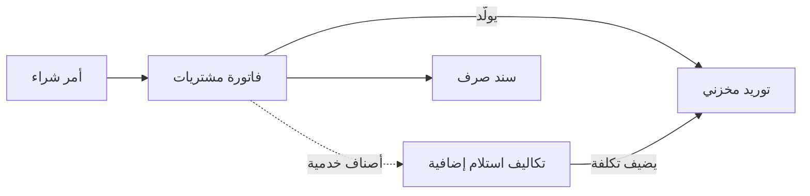
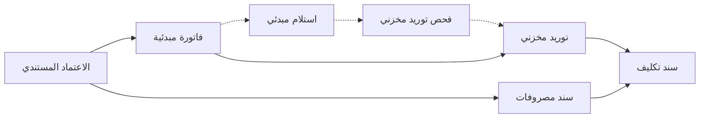

# الاستيراد: التكاليف الإضافية والاعتمادات المستندية

مستورد أجهزة منزلية يشتري 400 فرن من مصنع في الخارج بسعر 150 دولارًا للفرن، ثم يدفع 12,000 للشحن البحري و11,250 جمارك و3,750 لمخلّص الجمارك قبل أن تصل الأفران إلى مخزنه. فإن لم تصل هذه الـ 27,000 إلى الأفران، بقي كل فرن في المخزون بسعر المصنع، وصار كل هامش ربح تعلنه الشركة بعد ذلك أعلى من حقيقته. هذه الصفحة تشرح كيف تُحمَّل المصاريف على البضاعة: بمستند تكاليف إضافية بجانب فاتورة المشتريات، وهي طريقة أغلب المستوردين، أو عبر شاشات الاعتماد المستندي حين يلزم تتبّع الجانب البنكي أيضًا.

## لمن يناسب هذا السيناريو

- شركة تشتري بضاعة من الخارج بعملة أجنبية، ويجب أن يُحمَّل الشحن والتأمين والجمارك والتخليص على تكلفة الأصناف.
- في منشآت نما، تُحمِّل نحو 2 من كل 5 شركات تكاليف إضافية على مشترياتها. ونحو شركة من كل 3 تستخدم مستند **تكاليف استلام إضافية**، ونحو شركة من كل 7 تتابع استيرادها عبر شاشات الاعتماد المستندي.
- الاستيراد يأتي غالبًا خلف سيناريو بيع. فنحو 2 من كل 3 من الشركات التي تعمل بأوامر البيع تُحمِّل تكاليف إضافية أيضًا، ولذلك تُقرأ هذه الصفحة غالبًا مع [التوزيع من أمر البيع إلى التحصيل](/ar/business-scenarios/scenario-order-to-cash-distribution) أو [التجارة بالفاتورة المباشرة](/ar/business-scenarios/scenario-direct-invoice-trading) أو [سلسلة متاجر](/ar/business-scenarios/scenario-retail-chain-pos) تشتري مركزيًا.

## ما تحتاجه

::: info التراخيص المطلوبة
`supplychain-purchases`، و`supplychain-inventory` (ومنه تكاليف الاستلام الإضافية والاستلام المبدئي وفحص التوريد)، و`supplychain-lc` لشاشات الاعتماد المستندي، و`accounting-banks` لسند تغيير سعر الصرف والتحويلات البنكية. ويُضاف `accounting-lgt` حين يطلب المورد أو الجمارك خطابات ضمان.
:::

- [سلسلة التوريد](/ar/modules/supplychain/): أوامر وفواتير الشراء، والتوريدات المخزنية، ومستند التكاليف الإضافية، والاعتماد المستندي، والتكلفة.
- [الحسابات](/ar/modules/accounting/): أسعار الصرف وإعادة التقييم، والحسابات البنكية، والجانب البنكي للاعتمادات وخطابات الضمان.

## مسار المستندات

المسار الشائع، حيث تتبع المصاريف فاتورة المشتريات:

ومسار الاعتماد المستندي، حيث يحمل الاعتماد البضاعة ومصروفاتها:

تتبّع الأفران الـ 400 في المسار الشائع.

1. **الأمر.** يرسل المشتري **أمر شراء** بـ 400 فرن بسعر 150 دولارًا. الأمر التزام ولا يُنشئ قيدًا.
2. **فاتورة المورد.** حين تصل الأفران تُسجَّل **فاتورة مشتريات** بالدولار. اختيار العملة يجلب السعر من شاشة سعر الصرف بتاريخ قيمة الفاتورة، وهو 3.75 هنا، فتكون قيمة الفاتورة بالعملة المحلية 225,000. ويولّد توجيهها **التوريد المخزني** الذي يُدخل الأفران المخزن بتكلفة 562.50 للفرن.
3. **المصاريف.** هناك طريقتان لإدخال الـ 27,000. إن كانت فواتير شركة الشحن والمخلّص حاضرة، يضيفها المشتري إلى فاتورة المشتريات نفسها سطورًا بأصناف خدمية، فيولّد خيار **إنشاء سند تكاليف استلام إضافية بالأصناف الخدمية** في توجيه الفاتورة مستند **تكاليف استلام إضافية** منها. وإن وصلت لاحقًا، يُنشأ مستند **تكاليف استلام إضافية** مباشرة ويُربط بالفاتورة أو بالتوريد، بسطر لكل مصروف، يذكر كل سطر **بند المصروف** والطرف الدائن: شركة الشحن أو مصلحة الجمارك أو المخلّص.
4. **التكلفة تصل إلى الأفران.** يوزّع مستند التكاليف الإضافية الـ 27,000 على الأصناف المستلمة بالأساس الذي تختاره: بالقيمة أو بالوزن أو بالكمية أو يدويًا. فتصبح تكلفة الفرن 562.50 + 67.50 = **630**. ويتم ذلك حين يُعالَج طلب المخزون الخاص بالمستند في الخلفية، فتتغير أعمدة التكلفة في التوريد بعد الحفظ بلحظات.
5. **تُباع الأفران.** كل صرف مخزني يحمّل تكلفة المبيعات بـ 630، والمصاريف داخلة فيها. ولا تحتاج هذه الخطوة إعدادًا إضافيًا.
6. **يُسدَّد المورد.** يسدّد **سند صرف** أو تحويل بنكي مبلغ 60,000 دولار. وما دام الدين مفتوحًا، يعيد **سند تغيير سعر صرف** تقييم قيمته المحلية حين يتحرك السعر.

وفي مسار الاعتماد المستندي تسير الشحنة نفسها هكذا:

1. يفتح البنك الاعتماد. حيث تُتتبَّع دورة البنك، يأتي أولًا **طلب اعتماد مستندي** ثم **طلب فتح اعتماد** ثم **فتح اعتماد**، ومستند الفتح هو الذي ينشئ القيود المحاسبية ويحمّل الدفعة المقدمة وعمولة الفتح على البضاعة كتكاليف.
2. ملف **الاعتماد المستندي** يحمل المورد والبنك والقيمة وتاريخ الانتهاء والموانئ، وهل تصل البضاعة على عدة شحنات.
3. **الفاتورة المبدئية** للاعتماد تذكر الأفران الـ 400 وسعرها. ولا يمكن تحميل مصروفات على اعتماد ليست له فاتورة مبدئية، إذ لا توجد قيم أصناف توزَّع عليها.
4. كل مصروف، حين يُصرف، يُسجَّل في **سند مصروفات** يذكر الاعتماد، ويذكر الشحنة إذا كان الاعتماد متعدد الشحنات.
5. تُستلم الأفران بـ **توريد مخزني** يذكر الاعتماد، أو شحنته، في حقل **مصدر التكلفة**. والشركات التي تفحص البضاعة قبل قبولها تضع قبله **استلام مبدئي** و**فحص توريد مخزني**.
6. **سند التكليف** يُقفل التكلفة: زر **تجميع المصروفات على الأصناف** يملؤه من المصروفات المسجَّلة على الاعتماد أو الشحنة، وحفظه يوزّعها على الأصناف المستلمة. ويُرفض حفظه ما لم يوجد توريد مخزني محفوظ واحد على الأقل يذكر الاعتماد.

## الإعداد خطوة بخطوة

1. **العملات وأسعار الصرف.** أنشئ العملات التي تشتري بها وأدخل أسعارها. يبحث المستند عن سعر يومي، ثم سعر لمدى تاريخ، ثم سعر للفترة، ثم سعر سنوي، ولا يرجع أبدًا إلى سعر يوم سابق، فأبقِ سعرًا للفترة أو سنويًا خلف الأسعار اليومية ([العملات وأسعار الصرف](/ar/platform/shared-master-files/currencies-and-exchange-rates)).
2. **الموردون الأجانب.** جهّز الموردين الذين تستورد منهم، والأسعار والخصومات المتفق عليها إن كنت تحفظها ([كيف يُحدَّد سعر الشراء](/ar/modules/supplychain/purchase-pricing)).
3. **بنود المصروفات.** أنشئ **بند مصروف** لكل نوع من المصاريف (الشحن البحري، والجمارك، والتخليص، والتأمين)، بحساباته وأساس توزيعه. وإن كانت المصاريف ستُكتب على فاتورة المشتريات، فأنشئ أيضًا صنفًا خدميًا لكل منها مع ملء بند المصروف فيه (في [الشحن والجمارك والتكلفة النهائية](/ar/modules/servicecenter/car-purchasing/car-landed-cost) مثال محلول).
4. **توجيهات الشراء.** في توجيه فاتورة المشتريات حدد التوريد الذي تولّده، وإن كانت المصاريف على الفاتورة ففعّل **إنشاء سند تكاليف استلام إضافية بالأصناف الخدمية** مع دفتر المستند المولَّد وتوجيهه ([إعدادات التوليد والمحددات](/ar/modules/supplychain/document-terms/doc-term-generation-and-dimensions)). وفي توجيه التوريد المخزني اجعل **دائن التكاليف الإضافية** هو الحساب الذي يجعله مستند التكاليف الإضافية مدينًا، حتى يتقابل القيدان ويعود الحساب الوسيط إلى الصفر ([إعدادات التأثيرات المحاسبية](/ar/modules/supplychain/document-terms/doc-term-accounting-effects#ltklf-lDfy-wfrq-mrdwd-lmshtryt-Additional-Cost--Purchase-Return-Difference)).
5. **جانب الاعتماد المستندي، إن كنت تستخدمه.** جهّز البنوك والحسابات البنكية، وحدد الاعتمادات التي تأتي على عدة شحنات، واقرأ [الاعتمادات المستندية للاستيراد](/ar/modules/supplychain/letters-of-credit) مع الجانب البنكي في [الاعتمادات المستندية البنكية](/ar/modules/accounting/bank-facilities/bank-letters-of-credit).
6. **التكلفة.** اختر بين الوارد أولًا يُصرف أولًا والمتوسط المتحرك مرة واحدة للشركة كلها في [إعدادات التكلفة](/ar/modules/supplychain/configuration/costing-configuration)، قبل أول توريد.

## الإعدادات والأدوات الأكثر استخدامًا

- **أوامر الشراء.** نحو 7 من كل 10 مستوردين يصدرون أمرًا قبل الفاتورة ([رحلة الشراء](/ar/modules/supplychain/purchasing-journey)).
- **مستند التكاليف الإضافية.** يأتي عادة بمعدل مستند لكل خمس فواتير مشتريات تقريبًا: قرابة مستند لكل فاتورة عند بعض المستوردين، وعدة مستندات للفاتورة عند آخرين ([تكلفة المخزون وإعادة التقييم](/ar/modules/supplychain/inventory-costing#ltklyf-lDfy-aal-ltwrydt-ReceiptAdditionalCost)).
- **سند تغيير سعر الصرف.** نحو شركة من كل 6 تعيد به تقييم أرصدتها بالعملات الأجنبية، عادة مرة كل شهر ([سندات القيد والتسويات](/ar/modules/accounting/ledger-setup/journal-entries#snd-tGyyr-saar-lSrf)).
- **الاعتمادات المستندية.** نحو شركة من كل 7 تمسك [اعتماداتها المستندية](/ar/modules/supplychain/letters-of-credit) في نما، ومعظمها يمضي باعتماداته إلى الفاتورة المبدئية والمصروفات وتوزيع التكلفة.
- **بوابة فحص.** أقل من شركة من كل 10 تضع استلامًا مبدئيًا وفحصًا قبل التوريد المخزني، وأغلبها في الأغذية والسلع الفنية ([استلام المخزون في المستودع](/ar/modules/supplychain/receiving-stock#ltkml-maa-fHS-lstlm)، [ضبط الجودة](/ar/modules/supplychain/quality-control)).
- **خطابات الضمان.** المستوردون الذين يتعاملون مع ضمانات الجمارك أو الموردين يتتبعونها في [خطابات الضمان](/ar/modules/accounting/bank-facilities/letters-of-guarantee).

## صور أخرى للسيناريو نفسه

**مصاريف معروفة قبل وصول البضاعة.** يمكن إنشاء مستند تكاليف استلام إضافية على أمر الشراء بحقل **التوزيع مؤقتا بناءً على أمر الشراء**. وحين تُنشأ فاتورة المشتريات لاحقًا من هذا الأمر، ينتقل مستند التكاليف الإضافية إلى الفاتورة من تلقاء نفسه.

**شحنة واحدة وعدة فواتير.** حين تُفوتَر حاوية واحدة على عدة فواتير مشتريات، يكفي مستند تكاليف استلام إضافية واحد لها كلها: اذكرها في جدول **السندات المكلفة** فيه. ويجب أن تكون المستندات في مستند التكاليف الإضافية الواحد من نوع واحد.

**مصاريف ليست تكلفة أصناف.** الرسوم السنوية للبنك أو تكلفة زيارة سوق لا مكان لها على البضاعة. سجّلها في **فاتورة متنوعات**، التي ترسلها مباشرة إلى حساب مصروف ([المشتريات المتنوعة وتشغيل المعدات](/ar/modules/accounting/money-in-and-out/misc-purchasing)).

**فحص الجودة قبل المخزون.** مستوردو الأغذية والسلع الفنية يسجّلون الوصول بـ **استلام مبدئي** لا يحرّك المخزون، ثم يفحصون البضاعة بـ **فحص توريد مخزني** أو **مستند فحص جودة**، وبعدها فقط يُدخلون الكمية المقبولة بـ **توريد مخزني** ([استلام المخزون في المستودع](/ar/modules/supplychain/receiving-stock#stlm-mbdyy-InitialReceipt)).

**مستوردو السيارات.** تتبع السيارات الآلية نفسها على فاتورة شراء السيارة، وتصل التكلفة إلى كل شاسيه على حدة ([الشحن والجمارك والتكلفة النهائية](/ar/modules/servicecenter/car-purchasing/car-landed-cost)).

## قرارات قبل بدء التشغيل

- **مستند التكاليف الإضافية أم شاشات الاعتماد المستندي.** مستند التكاليف الإضافية يكفي حين لا يهم إلا تكلفة الأصناف. واستخدم شاشات الاعتماد المستندي حين يجب تتبّع الاعتماد نفسه: فتحه وتأمينه وشحناته ومصروفاته وأحداثه.
- **لكل فاتورة أم لكل شحنة.** قد تتبع المصاريف كل فاتورة مشتريات، وقد يوزّع مستند واحد مصاريف الحاوية على كل الفواتير التي حملتها. اختر طريقة والتزم بها، حتى تبقى تكلفة الصنف قابلة للمقارنة بين الشحنات.
- **المصاريف على الفاتورة أم في مستند مستقل.** سطور الأصناف الخدمية على فاتورة المشتريات تناسب المصاريف المعروفة وقت فوترة البضاعة. ومستند تكاليف استلام إضافية مستقل يناسب الفواتير التي تصل بعد أسابيع من أطراف أخرى.
- **الحساب الوسيط.** حدد الحساب الذي تمر به المصاريف، واجعل مستند التكاليف الإضافية وتوجيه التوريد المخزني متفقين عليه قبل أول شحنة.
- **مصاريف تصل بعد بيع البضاعة.** طريقة وصول المصروف المتأخر إلى تكلفة ما خرج من المخزن تتوقف على طريقة التكلفة وإعداداتها. اقرأ [تكلفة المخزون وإعادة التقييم](/ar/modules/supplychain/inventory-costing) و[إعدادات التكلفة](/ar/modules/supplychain/configuration/costing-configuration) قبل بدء التشغيل، لا بعد أول فاتورة متأخرة.

## اقرأ أيضًا

1. [رحلة الشراء](/ar/modules/supplychain/purchasing-journey) و[استلام المخزون في المستودع](/ar/modules/supplychain/receiving-stock)
2. [تكلفة المخزون وإعادة التقييم](/ar/modules/supplychain/inventory-costing)
3. [الشحن والجمارك والتكلفة النهائية](/ar/modules/servicecenter/car-purchasing/car-landed-cost)، مثال محلول بقيوده
4. [الاعتمادات المستندية للاستيراد](/ar/modules/supplychain/letters-of-credit) و[الاعتمادات المستندية البنكية](/ar/modules/accounting/bank-facilities/bank-letters-of-credit)
5. [العملات وأسعار الصرف](/ar/platform/shared-master-files/currencies-and-exchange-rates)
6. [إعدادات التكلفة](/ar/modules/supplychain/configuration/costing-configuration)
7. [ضبط الجودة](/ar/modules/supplychain/quality-control) و[خطابات الضمان](/ar/modules/accounting/bank-facilities/letters-of-guarantee)
