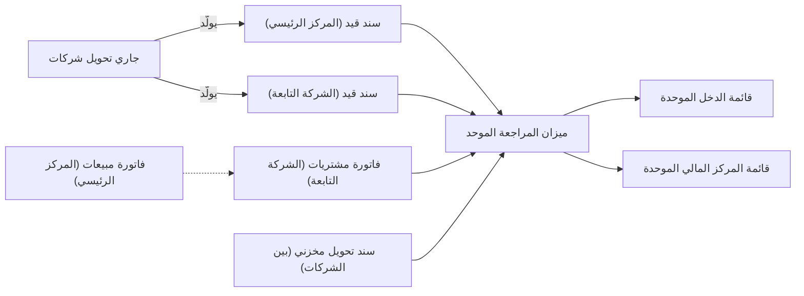

# مجموعة شركات

مجموعة عائلية تملك شركة تجارية في الرياض، ومصنعًا يورّد لها، وشركة تابعة في القاهرة تبيع المنتجات نفسها بالجنيه المصري. كل شركة تقدّم إقراراتها الضريبية وتمسك دفاترها، ومع ذلك تتشارك الثلاث ملف أصناف واحدًا وقائمة عملاء واحدة والمستخدمين أنفسهم والتقارير نفسها، والملّاك يريدون قوائم مالية واحدة للمجموعة كلها. وضعُ الشركات الثلاث في قاعدة بيانات نما واحدة يحقق ذلك: لكل شركة دفتر حساباتها وترقيمها، والقوائم الموحدة تجمعها بعد استبعاد ما تعاملت به الشركات فيما بينها.

## لمن يناسب هذا السيناريو

- شركات شقيقة تتشارك الملفات الرئيسية والمستخدمين والتقارير: ذراع تجارية ومصنع، أو شركة لكل مشروع أو لكل مجموعة محلات، أو شركة تابعة في بلد آخر.
- في منشآت نما، تحتفظ نحو 2 من كل 5 منشآت بأكثر من شركة في قاعدة البيانات نفسها، ونحو منشأة من كل 4 بثلاث شركات أو أكثر.
- تعمل المجموعة عادةً بسيناريو بيع أو أكثر داخل كل شركة. فالذراع التجارية تتبع غالبًا [التجارة بالفاتورة المباشرة](/ar/business-scenarios/scenario-direct-invoice-trading) أو [التوزيع من أمر البيع إلى التحصيل](/ar/business-scenarios/scenario-order-to-cash-distribution)، والمصنع [الإنتاج بمستندات التجميع](/ar/business-scenarios/scenario-assembly-production) أو [دورة التصنيع الكاملة](/ar/business-scenarios/scenario-full-manufacturing)، والمقاولون والمطورون يفتحون غالبًا شركة لكل مشروع ([شركة مقاولات](/ar/business-scenarios/scenario-contracting-company)، [مطور عقاري](/ar/business-scenarios/scenario-real-estate-developer)).

## ما تحتاجه

::: info التراخيص المطلوبة
لا ترخيص إضافيًا. فترخيص `accounting` يشمل جاري تحويل الشركات والقوائم المالية الموحدة الثلاث. والترخيص يحدد عدد الشركات النشطة المسموح بها، والشركات غير النشطة والمركبة لا تُحسب.
:::

- [المنصة](/ar/platform/): الشركات وبقية المحددات، ودفاتر المستندات، وملفات الصلاحيات، والصلاحيات على مستوى السجلات، وفلترة الحقول.
- [الحسابات](/ar/modules/accounting/): دفاتر الحسابات، وشجرة الحسابات، وجاري تحويل الشركات، والإقفال السنوي، والقوائم المالية الموحدة.
- [الموارد البشرية](/ar/modules/hr/): جانب الأفراد. نحو منشأتين من كل 5 منشآت تشغّل الرواتب على نما، والموظف ومستندات الرواتب تحمل شركتها كأي سجل آخر.

## مسار المستندات

كل شركة تشتري وتبيع وتدفع بمستنداتها، في دفاترها. أما ما تنفرد به المجموعة فهو التعامل بين الشركات، والتقارير التي تجمعها:

تتبّع ربع سنة في المجموعة العائلية.

1. **كل شركة تعمل في دفاترها.** للشركة التجارية والمصنع والشركة التابعة في القاهرة سجل **شركة** لكل منها يحدد **دفتر الحسابات**، الذي يحدد العملة الرئيسية للشركة، ومن خلال نوع شجرة الحسابات شجرةَ حساباتها. كل مستند يحمل شركته محددًا، ويُرقَّم في دفتر مستند يتبع تلك الشركة، فلا تأخذ فاتورة مبيعات المصنع رقمًا من سلسلة الشركة التجارية.
2. **الملفات الرئيسية مشتركة.** تُحفظ الأصناف والعملاء والشركة فيها **عام (PUBLIC)**، فتبيع الشركات الثلاث الأصناف نفسها للعملاء أنفسهم دون الاحتفاظ بثلاث نسخ.
3. **المصنع يورّد للشركة التجارية.** الشركتان تمسكان دفاترهما بالريال، فيمكن نقل البضاعة بـ **سند تحويل مخزني** **نوع التحويل** في توجيهه **بين الشركات (عادي)**. وتُخرج المعالجة المخزون من دفاتر المصنع وتُدخله دفاتر الشركة التجارية، كل جانب مقابل **الحساب الوسيط** للشركة الأخرى، بالتكلفة.
4. **الشركة التجارية تبيع للقاهرة.** التحويل المخزني يُرفض بين شركتين تستعمل دفاتر حساباتهما عملتين مختلفتين، فتصدر الشركة التجارية **فاتورة مبيعات** للشركة التابعة، وتسجّل الشركة التابعة **فاتورة مشتريات**، وكلتاهما على حسابات مخصصة للتعامل داخل المجموعة. ويُسجَّل كل جانب بعملته.
5. **المركز الرئيسي يموّل الشركة التابعة.** يولّد **جاري تحويل شركات** بمبلغ 50,000 دولار **سند قيد** في كل شركة دفعة واحدة، كل منهما متوازن على الحساب الوسيط للشركة الأخرى. وبين شركتين بعملتين مختلفتين يُحوَّل كل سطر بسعر شركته، فيحمل الحسابان الوسيطان المبلغ نفسه، 50,000 دولار.
6. **المجموعة تُصدر تقاريرها.** يعرض **ميزان المراجعة الموحد** عمودًا لكل شركة، ثم الاستبعادات، ثم إجمالي المجموعة. فهو يترجم كل شركة إلى عملة التقرير، ويعكس كل حساب معلَّم **حساب بين شركات المجموعة**، فيخرج من أرقام المجموعة التمويلُ والمبيعات بين الشركات وتكلفتها وهامش الربح على المخزون الذي ما زال لدى القاهرة. وتعرض **قائمة الدخل الموحدة** و**قائمة المركز المالي الموحدة** النتيجة نفسها، ولا يلزم تسجيل شيء أو إقفاله قبل تشغيلها.
7. **السنة تُقفل لكل شركة.** كل شركة تُقفل سنتها بـ **قيد ختامي** خاص بها: قيد ختامي واحد لكل فترة لكل شركة.

## الإعداد خطوة بخطوة

1. **الشركات.** أنشئ سجل **شركة** لكل شركة، في حدود العدد المرخَّص، بأرقام السجل التجاري والتسجيل الضريبي ودفتر الحسابات و**الحساب الوسيط** ([المحددات والمحددات المركبة](/ar/platform/shared-master-files/dimensions-and-composite-dimensions#Dft-aal-nwaa-baaynh)). ويجب أن يكون الحساب الوسيط معلَّمًا حسابًا بين شركات المجموعة، والشاشة تنبّهك إن لم يكن كذلك.
2. **دفاتر الحسابات والشجرات.** حدد الشركات التي تتشارك شجرة حسابات واحدة: الشركات على **نوع شجرة حسابات** واحد تعمل على الشجرة نفسها، وكل دفتر حسابات تُقفل عملته الرئيسية وتقويمه بمجرد ربط شركة به ([المفاهيم الأساسية والإعداد المبدئي للحسابات](/ar/modules/accounting/ledger-setup/accounting-concepts-and-setup#nwaa-shjr-lHsbt)). وحدد **عملة التقرير** التي تُعرض بها المجموعة.
3. **دفاتر المستندات لكل شركة.** الدفتر يتبع شركة واحدة ولا يُترك «عام»، فأنشئ دفاتر كل شركة قبل أول مستند لها ([دفاتر المستندات](/ar/platform/documents-and-records/document-books)).
4. **من يرى أي شركة.** محددات سجل المستخدم تحدّ كل ما يمكن أن يصل إليه المستخدم، ومحددات الدخول تختار الشركة التي تعمل بها الجلسة، وجدول محددات الدخول البديلة يذكر التركيبات الأخرى التي يجوز له التحول إليها ([الصلاحيات على مستوى السجلات](/ar/platform/security/record-level-security)). ثم أعطِ كل دور [ملف صلاحياته](/ar/platform/security/security-profiles)، وأرخِ التضييق على حقول بعينها حين يحتاج مستند إلى الوصول لسجلات شركة أخرى بـ [فلترة الحقول بالمحددات](/ar/platform/field-filtering/field-filtering-by-dimension).
5. **الشاشات التي لا تستعملها شركة.** أخفِها من سجل الشركة بجدولَي **الشاشات الغير مستعملة** و**المميزات الغير مستعملة** ([إيقاف شاشات ومميزات لشركة بعينها](/ar/getting-started/licensing#yqf-shsht-wmmyzt-lshrk-baaynh)).
6. **بقية المحددات.** حدد أيًّا من القطاع والفرع والإدارة والمجموعة التحليلية تستعمله المجموعة، ومدى صرامة فحصها، في [المحددات في الإعدادات العامة](/ar/platform/global-config/global-config-dimensions).
7. **التوحيد.** اجعل أرصدة شركات المجموعة والمبيعات بينها وتكلفتها ورأس المال والاستثمارات على حسابات خاصة بها تحت شجرات معلَّمة **حساب بين شركات المجموعة**، واضبط شجرة حقوق الملكية على **تاريخي**، وأدخل أسعار الصرف والشركة فيها «عام» لتخدم المجموعة ([مجموعة جاهزة للتوحيد](/ar/modules/accounting/financial-reporting/consolidated-statements#mjmwaa-jhz-lltwHyd)).

## الإعدادات والأدوات الأكثر استخدامًا

- **الموافقات.** نحو 3 من كل 4 مجموعات تمرّر مستنداتها عبر [الموافقات](/ar/platform/approvals/approvals-system).
- **دفاتر المستندات.** مئات من [دفاتر المستندات](/ar/platform/documents-and-records/document-books) أمر طبيعي في المجموعة، وبعضها يحتفظ بالآلاف، لأن كل شركة، وغالبًا كل فرع أو مشروع، ترقّم مستنداتها.
- **فروع داخل الشركات.** نحو نصف المجموعات تقسّم شركاتها أيضًا إلى [فروع](/ar/platform/shared-master-files/dimensions-and-composite-dimensions).
- **الإقفال السنوي.** نحو 2 من كل 5 يُقفلون سنواتهم بـ [القيد الختامي](/ar/modules/accounting/ledger-setup/year-end-and-period-control)، قيدًا لكل شركة.
- **جاري تحويل الشركات.** نحو مجموعة من كل 8 تسجّل التعامل بين شركاتها بـ [جاري تحويل الشركات](/ar/modules/accounting/ledger-setup/journal-entries#jry-tHwyl-lshrkt)، وحيث يُستعمل يكون عملًا روتينيًا، كثيرًا ما يتجاوز مئة تحويل في السنة.

## صور أخرى للسيناريو نفسه

**شركة لكل مشروع أو لكل محل.** المقاولون والمطورون وبعض مجموعات التجزئة يفتحون شركة لكل مشروع أو مبنى أو مجموعة محلات، لتكون لكل منها دفاترها وتسجيلها الضريبي. الهيكل نفسه، والذي يكبر هو عدد الشركات ودفاتر المستندات.

**شركات بعملات مختلفة.** المجموعة التي لها شركات في عدة بلدان تمسك كل دفتر حسابات بعملته المحلية. فينتقل المخزون بينها بفواتير المبيعات والمشتريات لا بالتحويل المخزني، ويحوّل جاري تحويل الشركات كل سطر بسعر شركته، وتترجم القوائم الموحدة كل شركة إلى عملة التقرير ([القوائم المالية الموحدة](/ar/modules/accounting/financial-reporting/consolidated-statements#kyf-tutrjm-lshrkt)).

**مخزون بين شركتين بالعملة نفسها.** حين تمسك الشركتان دفاترهما بالعملة نفسها، ينقل التحويل المخزني بنوع التحويل **بين الشركات (عادي)** البضاعة بالتكلفة، ويسجّل الجانبين على الحسابين الوسيطين ([التحويل بين الشركات](/ar/modules/supplychain/moving-stock#ltHwyl-byn-lshrkt)).

**أصل يُباع داخل المجموعة.** الأصل الثابت الذي تبيعه شركة لأخرى تُزيله قائمة المركز المالي الموحدة من أرقام المجموعة، بشرط أن يسجّل البائع ربحه على حساب أرباح وخسائر معلَّم حسابًا بين شركات المجموعة ([أصل يُباع داخل المجموعة](/ar/modules/accounting/financial-reporting/consolidated-statements#Sl-yubaa-dkhl-lmjmwaa)).

## قرارات قبل بدء التشغيل

- **شركة أم فرع.** دفاتر مستقلة وتسجيل ضريبي مستقل يعنيان شركة. أما الموقع داخل شركة واحدة، يشاركها دفاترها، فهو فرع. وكل مستند يحمل شركته من أول حفظ، فاحسم هذا القرار قبل أول مستند.
- **أي مستخدم يرى أي شركة.** ما يصل إليه المستخدم تحدّه محددات سجل المستخدم، لا الشركة التي يختارها عند الدخول. والشاشات والمميزات المخفية لشركة تتبع كذلك الشركة المسجلة على سجل المستخدم، والمستخدم الذي شركته «عام» يتبع **الشركة الافتراضية** الخاصة به. حدد المستخدمين المحصورين في شركة واحدة، ومن يعمل عبرها كلها، كفريق مالية المجموعة.
- **ملفات رئيسية مشتركة أم منفصلة.** الأصناف والعملاء المتروكة «عام» تتشاركها كل الشركات. ولا تعطِ السجل شركة إلا حين يجب ألا تراه الشركات الأخرى أو تستعمله.
- **شجرة واحدة أم عدة شجرات.** الشركات على نوع شجرة حسابات واحد تتشارك شجرة حسابات واحدة. والشركة التي يجب أن تتبع شجرة نظامية مختلفة تأخذ نوع شجرة خاصًا بها.
- **كيف تُسوّى المعاملات بين الشركات.** ضع كل رصيد مع شركة من المجموعة على حسابات معلَّمة حسابًا بين شركات المجموعة، وسجّل التحويلات بين الشركات بجاري تحويل الشركات، الذي يسجّل الجانبين دفعة واحدة فيتطابقان دائمًا. ورصيد المجموعة المتروك على حساب عادي لا يُستبعد، ويظهر فرقَ استبعادات في قائمة المركز المالي الموحدة.

## اقرأ أيضًا

1. [المحددات والمحددات المركبة](/ar/platform/shared-master-files/dimensions-and-composite-dimensions) و[المحددات في الإعدادات العامة](/ar/platform/global-config/global-config-dimensions)
2. [المفاهيم الأساسية والإعداد المبدئي للحسابات](/ar/modules/accounting/ledger-setup/accounting-concepts-and-setup) و[الفترات المالية وإقفال الفترات وتعدّد العملات](/ar/modules/accounting/support/accounting-periods-and-currency)
3. [دفاتر المستندات](/ar/platform/documents-and-records/document-books)
4. [الصلاحيات على مستوى السجلات](/ar/platform/security/record-level-security) و[ملف الصلاحيات](/ar/platform/security/security-profiles) و[فلترة الحقول بالمحددات](/ar/platform/field-filtering/field-filtering-by-dimension)
5. [الترخيص، ولماذا تغيب شاشة أو حقل](/ar/getting-started/licensing)
6. [سندات القيد والتسويات](/ar/modules/accounting/ledger-setup/journal-entries) و[تحريك المخزون بين المخازن](/ar/modules/supplychain/moving-stock)
7. [القوائم المالية الموحدة](/ar/modules/accounting/financial-reporting/consolidated-statements)
8. [الإقفال السنوي والتحكم في الفترات](/ar/modules/accounting/ledger-setup/year-end-and-period-control)
