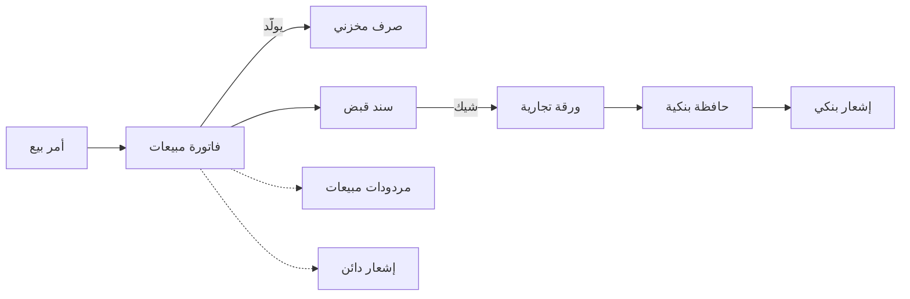
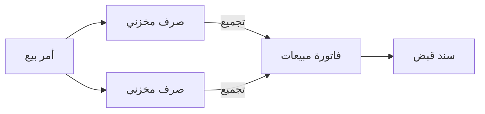

# التوزيع من أمر البيع إلى التحصيل

يتلقى موزّع أدوية نحو 40 طلبًا في اليوم من الصيدليات، معظمها بالهاتف أو عن طريق مندوبيه. تخرج البضاعة على سيارات الشركة صباح اليوم التالي، وتدفع الصيدليات بعد أسابيع، وكثيرًا ما يكون الدفع بشيك مؤرَّخ بعد ستين يومًا. وبين الطلب والمال حجوزات وتسليمات ومرتجعات لأصناف قاربت صلاحيتها على الانتهاء وشيكات تنتظر في البنك. تشرح هذه الصفحة سلسلة المستندات التي تحمل الطلب خلال ذلك كله، والطرق الثلاث الشائعة لترتيب التسليم.

## لمن يناسب هذا السيناريو

- موزّعو الأدوية والمستلزمات الطبية والسلع الاستهلاكية والأغذية والكيماويات: طلبات من عملاء آجل معروفين، تُسلَّم بسيارات الشركة، وتُحصَّل لاحقًا، وكثيرًا ما يكون ذلك بشيك آجل.
- في منشآت نما تشغّل نحو شركة من كل 3 شركات أوامر البيع بانتظام. ونحو شركة من كل 5 لديها خطوة تخرج فيها البضاعة قبل إصدار الفاتورة، بصرف مخزني أو بسند تحميل أو سند توصيل. وسندات التحميل والتوصيل المستقلة تستعملها نحو شركة من كل 10، والبيع بسيارات التوزيع عدد قليل من الشركات.
- ومعظم الموزّعين يستوردون ما يبيعونه أيضًا، فتُقرأ هذه الصفحة عادةً مع [الاستيراد: التكاليف الإضافية والاعتمادات المستندية](/ar/business-scenarios/scenario-importer-landed-cost). والموزّع الذي يتفاوض على الأسعار مع كل عميل يضيف [البيع بعروض الأسعار](/ar/business-scenarios/scenario-quotation-led-selling)، والمجموعة التي فيها عدة شركات تجارية تقرأ [مجموعة شركات](/ar/business-scenarios/scenario-multi-company-group).

## ما تحتاجه

::: info التراخيص المطلوبة
`supplychain-sales` و`supplychain-inventory` و`supplychain-purchases` و`accounting-banks`. وللمندوبين وسيارات التوزيع على تطبيق نما للجوال `supplychain-sales-mobile-app` أو `basic-mobile-orders`؛ وللمحصّلين الذين يسجّلون المقبوضات في الميدان `accounting-electronic-receipt`؛ و`basic-tax-e-invoice` حيث تنطبق الفاتورة الإلكترونية.
:::

- [إدارة سلسلة التوريد](/ar/modules/supplychain/) فيها أمر البيع والفاتورة والصرف المخزني والحجز والتحميل والتوصيل.
- [الحسابات والبنوك](/ar/modules/accounting/) فيها سندات القبض والأوراق التجارية (الشيكات) والحافظة البنكية والإشعار البنكي وإشعارات الدائن.
- [الفواتير والضرائب والخصومات](/ar/modules/invoicing/) تغطي قوائم الأسعار والعروض ومحددات الأسعار والفاتورة الإلكترونية.
- [تطبيقات الجوال](/ar/modules/mobile/) تضع الطلبات والفواتير والتحصيل على هواتف المندوبين.

## مسار المستندات

طلب صيدلية واحد، من المكالمة إلى تحصيل الشيك:

1. **أمر البيع.** تطلب صيدلية 60 كرتونة، فيُدخل موظف المبيعات **أمر بيع**، ويملأ ملف الصيدلية قائمة الأسعار والمندوب ومدة السداد والحسابات. توجيه الأمر مفعّل فيه **حجز**، فتُحجز الكراتين الستون لهذه الصيدلية بينما يجهّز المخزن حمولات اليوم التالي.
2. **الفاتورة.** في المساء يضغط الموظف **إنشاء الفاتورة** (Generate Invoice) على الأمر، فتنسخ **فاتورة المبيعات** الأمر، ويولّد حفظها **الصرف المخزني** الذي يُخرج الكراتين من المخزن ويلغي حجز الأمر. والفاتورة هي ما يحمله السائق.
3. **التسليم.** تسلّم السيارة صباح اليوم التالي وتوقّع الصيدلية على نسخة الفاتورة. وإن كانت الشركة تسجّل التسليمات منفصلة، فهنا يأتي دور سندات التحميل والتوصيل (انظر *صور أخرى للسيناريو نفسه*).
4. **التحصيل.** بعد ثلاثة أسابيع يزور المندوب الصيدلية ويستلم شيكًا مؤرَّخًا بعد ستين يومًا. تسجّل الإدارة المالية **سند قبض** للصيدلية، وتطابقه على الفاتورة في تبويب **الفواتير** (يملؤه زر **تجميع سندات** بأقدم الفواتير المفتوحة)، وتُدخل الشيك في تبويب **أوراق تجارية**. فتُنشأ **الورقة التجارية** بحالة **مستلم**.
5. **البنك.** في تاريخ الاستحقاق يذهب الشيك إلى البنك في **حافظة بنكية**، فتصير حالته **بحافظة بنكية**. وحين يؤكد البنك وصول المال ينقله **إشعار بنكي** بالتحصيل إلى **تم تحصيله**. وإن ارتدّ الشيك ينقله إشعار بنكي بالرفض إلى **رفض مؤقت** أو **رفض نهائي** ويعيد المبلغ إلى رصيد الصيدلية.
6. **مرتجع.** ثلاث كراتين قاربت صلاحيتها على الانتهاء وتعود مع السيارة التالية. يُدخل الموظف **مردودات مبيعات** على الفاتورة الأصلية، يختارها في عمود **الفاتورة** بالسطر، فيُردّ للصيدلية ما دفعته. ويولّد المرتجع **التوريد المخزني** الذي يعيد الكراتين.
7. **مطالبة سعرية.** وُعدت الصيدلية بسعر ترويجي فاتته الفاتورة. لا تتحرك بضاعة، فتُصدر الإدارة المالية **إشعارًا دائنًا** بالفرق، تطابقه على الفاتورة في تبويب **التفاصيل**، فينخفض ما على الصيدلية.

## الإعداد خطوة بخطوة

1. **العملاء بفئاتهم ومناطقهم وشروط ائتمانهم.** يحمل كل عميل قائمة الأسعار والمندوب ومدة السداد والحد الائتماني التي يرثها كل أمر، ومنطقة عنوان الشحن هي ما يقود تخطيط التوصيل. انظر [العملاء والموردون وجهات الصلة](/ar/platform/shared-master-files/customers-suppliers-and-parties) و[فئات العملاء والموردين](/ar/modules/supplychain/customer-and-supplier-classes).
2. **قوائم الأسعار ومحددات الأسعار.** قوائم الأسعار لكل فئة أو تصنيف عملاء تغطي معظم الحاجة. ومحدد أسعار المبيعات يفصل الأسعار التي تتوقف على شيء غير العميل والصنف، مثل قناة البيع. انظر [دليل إدارة الأسعار والعروض](/ar/modules/invoicing/pricing-and-offers-guide) و[محددات أسعار المبيعات](/ar/modules/supplychain/sales-price-classifiers).
3. **توجيهات الأمر والفاتورة والصرف**: أي مستند يحجز، وأيها يلغي الحجز، وأيها يولّد الصرف المخزني. انظر [دليل نظام الحجوزات الشامل](/ar/modules/supplychain/reservation-system-guide) و[إعدادات التوليد والمحددات](/ar/modules/supplychain/document-terms/doc-term-generation-and-dimensions#ltwlyd-Generation).
4. **منظمات التوصيل والسائقون والسيارات**، إن كان التوصيل يُخطَّط في النظام. انظر [التسليم والتحميل](/ar/modules/supplychain/delivery-and-loading).
5. **دفاتر الأوراق التجارية والحسابات البنكية**، حتى تُرقَّم الشيكات الواردة وتُحفظ وتُودَع في البنك الصحيح. انظر [الشيكات والأوراق المالية](/ar/modules/accounting/banks-and-cheques/cheques-financial-papers) و[البنوك والحسابات البنكية والتحويلات](/ar/modules/accounting/banks-and-cheques/banks-and-bank-accounts).
6. **مراقبة الائتمان.** الحد الائتماني للعميل مسجَّل لكنه لا يُفحص عند الحفظ. والموزّعون الذين يجب أن يوقفوا أمرًا أو فاتورة فوق الحد يبنون القاعدة بـ[التحقق المبني على المعايير](/ar/platform/governance/criteria-based-validation#mnaa-byaa-ytjwz-Hd-ytmn-laamyl)، أو يمرّرون هذه الأوامر على موافقة.
7. **تطبيق نما للجوال ومخازن سيارات التوزيع**، إن كان المندوبون يأخذون الطلبات أو يبيعون من السيارات. انظر [المبيعات والمخازن والاستعلام عن الأصناف](/ar/modules/mobile/mobile-sales-inventory) و[تطبيق نما للهواتف المحمولة](/ar/modules/mobile/mobile-application-guide).

## الإعدادات والأدوات الأكثر استخدامًا

- **مردودات المبيعات**: يكاد كل موزّع يُصدرها. وحيث تخرج البضاعة على سيارات قد تبلغ المرتجعات ثلث الفواتير، فتوجيه مرتجع يولّد توريده المخزني يوفّر كثيرًا من الإدخال. انظر [المرتجعات والاستبدالات](/ar/modules/supplychain/sales-journey#lmrtjaat-wlstbdlt).
- **الموافقات**: نحو 9 من كل 10 شركات في هذا السيناريو لديها تعريفات موافقة، مثلًا على الأوامر والسندات والعملاء الجدد. انظر [نظام الموافقات](/ar/platform/approvals/approvals-system).
- **الشيكات الآجلة**: نحو النصف يسجّل أوراقًا تجارية، مقابل نحو 2 من كل 5 من جميع الشركات. انظر [الشيكات والأوراق المالية](/ar/modules/accounting/banks-and-cheques/cheques-financial-papers).
- **إشعارات الدائن**: نحو 2 من كل 5 تُصدرها، للمطالبات السعرية والخصومات اللاحقة حين لا تعود بضاعة. انظر [إشعارات الدائن والمدين](/ar/modules/accounting/money-in-and-out/credit-and-debit-notes).
- **التكاليف الإضافية**: نحو 2 من كل 3 تضيف الشحن والجمارك إلى توريداتها، لأن معظم الموزّعين يستوردون أيضًا. انظر [الاستيراد: التكاليف الإضافية والاعتمادات المستندية](/ar/business-scenarios/scenario-importer-landed-cost).
- **مطابقة المقبوضات بالفواتير**: تسوّي المقبوضات أقدم الفواتير المفتوحة تلقائيًا، ومستند [تسوية أعمار الديون](/ar/modules/accounting/money-in-and-out/aging-allocation) يطابق ما يريد العميل تسويته بطريقة أخرى، فتبقى تقارير أعمار الديون صحيحة.

## صور أخرى للسيناريو نفسه

**التسليم أولًا والفاتورة لاحقًا.** كثير من الموزّعين يشحنون للعميل نفسه عدة مرات في الأسبوع ويفوترون مرة واحدة في آخر الشهر، أو يفوترون ما وصل فعلًا فقط. كل تسليم **صرف مخزني** يُنشأ من أمر البيع، فيلغي حجز الأمر أو يخفّضه حسب توجيه الصرف. وفي آخر الشهر يفتح الموظف **فاتورة مبيعات** للعميل، ويضغط **تجميع** بمدى تاريخ ليجمع سندات الصرف غير المفوترة لهذا العميل من ذلك المخزن، ثم يحوّلها **تطبيق** إلى سطور فاتورة مسعّرة. وحفظ الفاتورة يختم تلك السندات فلا تُجمع مرتين أبدًا. ولكي ينجح ذلك يجب ألا يولّد توجيه الفاتورة صرفًا مخزنيًا ثانيًا: إما أن يكون **إنشاء مستندات تلقائيا** غير مفعّل، وإما أن يكون **عدم إنشاء المستندات تلقائيا إذا تم إضافة مستندات يدوية** مفعّلًا. انظر [تجميع وتطبيق](/ar/modules/supplychain/the-document-screen#tjmyaa-wtTbyq-nSf-aaml-wHd-Collect--Apply).

**سندات التحميل والتوصيل.** حيث تحمل السيارة طلبات عملاء كثيرين على خط سير واحد، يجمع **سند التحميل** التسليمات على سيارة واحدة حسب خط السير أو السائق أو المركبة، ويسجّل **سند التوصيل** أن كل عميل استلم البضاعة ووقّع، مع تأكيد اختياري بكلمة سر يعطيها العميل للسائق. ومع تفعيل **استخدام منظمة التوصيل للسائقين** يحجز **ملف إعدادات السائقين** كل مستند على سائق وسيارة حسب المنطقة ويوم الأسبوع وحمولة السيارة، وتعطي طوابير التسليم السائقين قائمة واحدة بما ينتظر الخروج. انظر [التسليم والتحميل](/ar/modules/supplychain/delivery-and-loading).

**البيع بسيارات التوزيع.** كل سيارة مخزن قائم بذاته، يُحمَّل صباحًا بـ**سند تحويل مخزني** من المخزن الرئيسي (أو بطلب يُرفع من الهاتف وينفّذه المخزن). يكتب المندوب **فاتورة المبيعات** على تطبيق نما للجوال على مخزن السيارة، ويأخذ النقد في سطور الدفع بالفاتورة أو يتركها آجلة، ويوقّع العميل والمندوب على الشاشة. وتحدد إعدادات تطبيق الجوال أي مستند يصير كل طلب يأتي من الهاتف في النظام، وأي الدفاتر والمخازن يستعملها المندوب، وأي العملاء والأصناف تُرسَل إلى الهاتف. انظر [المبيعات والمخازن والاستعلام عن الأصناف](/ar/modules/mobile/mobile-sales-inventory) و[تحريك المخزون بين المخازن](/ar/modules/supplychain/moving-stock).

**التحصيل في الميدان.** المحصّلون الذين يزورون العملاء للأرصدة القديمة يسجّلون **سند قبض إلكتروني** على الهاتف: العميل والمبلغ، نقدًا أو بشيك برقمه وبنكه، والتوقيعين، والفواتير التي يسوّيها. وله أثره المحاسبي الخاص، ومع تفعيل **إنشاء ورقة تجارية** في توجيهه يصير الشيك المحصَّل ورقة تجارية تدخل دورة الحافظة والإشعار البنكي نفسها. انظر [سند القبض الإلكتروني](/ar/modules/accounting/money-in-and-out/cashier-shifts#snd-lqbD-llktrwny).

**حين يغيّر العميل طلبه.** العميل الذي يخفّض طلبه من 100 إلى 60 يترك 40 وحدة محجوزة بلا سبب. يُطلق **سند إلغاء حجز** هذا الجزء من الحجز، بينما يبقى الأمر مسجّلًا لما طُلب أصلًا. انظر [مستندات العمليات في المبيعات والمشتريات](/ar/modules/supplychain/sales-operations-documents).

## قرارات قبل بدء التشغيل

- **أين يخرج المخزون.** عند الفاتورة، حين تفوتر قبل خروج السيارة، أو عند صرف مخزني يُنشأ من الأمر، حين تسلّم أولًا وتفوتر لاحقًا. حدد المستند المولِّد في التوجيهات والتزم بواحد لكل نوع من البيع، وإلا خرجت البضاعة نفسها مرتين.
- **أي مستند يحجز.** احجز عند الأمر، وألغِ الحجز عند المستند الذي يليه، وتأكد أن الأصناف تخصم المحجوز من المتاح. فالحجز الذي لا يلغيه أحد يعطّل بضاعة موجودة فعلًا.
- **مخزن لكل سيارة، وطريقة إعادة تعبئتها.** السيارة التي تشارك المخزن الرئيسي مخزنه لا يمكن جردها وحدها. قرّر هل تُعبّأ السيارات بتحويل كل صباح أم تُكمَّل عند الطلب، وكيف تعود البضاعة غير المباعة.
- **من يتولى تحصيلات الميدان.** سندات القبض الإلكترونية التي يسجّلها المحصّلون والشيكات التي يجلبونها تحتاج شخصًا في الإدارة المالية يطابقها على الفواتير ويودع الشيكات في وقتها. سمِّ هذا الشخص قبل أن يخرج أول محصّل.
- **ما مدى صرامة الحد الائتماني.** مسجَّل للتقارير فقط، أو تنبيه عبر موافقة، أو رفض عبر قاعدة تحقق. اتفق عليه مع المبيعات قبل التشغيل، فالرفض يوقف السيارات.

## اقرأ أيضًا

1. [رحلة المبيعات](/ar/modules/supplychain/sales-journey)
2. [دليل نظام الحجوزات الشامل](/ar/modules/supplychain/reservation-system-guide)
3. [إصدار المخزون من المستودع](/ar/modules/supplychain/issuing-stock)
4. [تشريح مستند سلسلة التوريد](/ar/modules/supplychain/the-document-screen)
5. [التسليم والتحميل](/ar/modules/supplychain/delivery-and-loading)
6. [محددات أسعار المبيعات](/ar/modules/supplychain/sales-price-classifiers)
7. [الشيكات والأوراق المالية](/ar/modules/accounting/banks-and-cheques/cheques-financial-papers)
8. [إشعارات الدائن والمدين](/ar/modules/accounting/money-in-and-out/credit-and-debit-notes)
9. [تسوية أعمار الديون](/ar/modules/accounting/money-in-and-out/aging-allocation)
10. [المبيعات والمخازن والاستعلام عن الأصناف](/ar/modules/mobile/mobile-sales-inventory)
11. [نظام الموافقات](/ar/platform/approvals/approvals-system)
