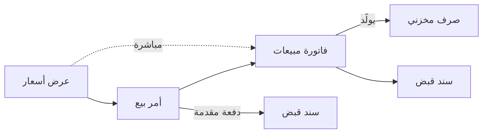

# البيع بعروض الأسعار

تزور أسرة معرض مطابخ، فيسعّر البائع مطبخًا بـ85,000 بخصم 8%، والعرض صالح أسبوعين. تعود الأسرة وتوافق، وتدفع 25,500 دفعة مقدمة، وتريد التركيب بعد شهر. وفي هذا الشهر على المعرض أن يحفظ الخزائن لها، وأن يشتري الفرن الذي لا يحتفظ به في مخزونه، وأن يفوتر الباقي يوم التركيب دون أن ينسى الدفعة المقدمة. تشرح هذه الصفحة كيف يحمل نظام نما بيعًا كهذا من أول سعر إلى آخر دفعة.

## لمن يناسب هذا السيناريو

- معارض الأثاث والمطابخ والإضاءة والأدوات الصحية، والتجّار الفنيون الذين يبيعون للمقاولين والشركات: كل نشاط يُتَّفق فيه على السعر مع كل عميل قبل البيع، وكثيرًا ما يدفع العميل جزءًا مقدمًا.
- في منشآت نما تُصدر نحو شركة من كل 5 شركات عروض أسعار بانتظام، عرضين أو أكثر في الشهر. ونحو 3 من كل 4 منها تشغّل أوامر البيع أيضًا.
- وعادةً ما يقوم هذا البيع فوق [التجارة بالفاتورة المباشرة](/ar/business-scenarios/scenario-direct-invoice-trading) للعملاء العابرين الذين لا يحتاجون عرض أسعار. والشركات التي توصّل بسياراتها لعملاء الآجل تقرأ أيضًا [التوزيع من أمر البيع إلى التحصيل](/ar/business-scenarios/scenario-order-to-cash-distribution)، ومن تستورد ما تبيعه تضيف [الاستيراد: التكاليف الإضافية والاعتمادات المستندية](/ar/business-scenarios/scenario-importer-landed-cost).

## ما تحتاجه

::: info التراخيص المطلوبة
`supplychain-sales` و`supplychain-inventory` و`supplychain-purchases`. ونحو شركة من كل 4 في هذا السيناريو تضيف `crm` للزيارات والمتابعات، ويلزم `accounting-banks` حيث تُدفع الدفعة المقدمة أو الباقي بشيكات.
:::

- [إدارة سلسلة التوريد](/ar/modules/supplychain/) فيها عرض الأسعار وأمر البيع والفاتورة والحجز والصرف المخزني.
- [الفواتير والضرائب والخصومات](/ar/modules/invoicing/) تغطي قوائم الأسعار والعروض وحدود خصم البائع وجداول الدفع.
- [الحسابات والبنوك](/ar/modules/accounting/) فيها سندات القبض التي تأخذ الدفعة المقدمة والباقي.
- [خدمة العملاء](/ar/modules/crm/)، حيث تكون مرخّصة، تسجّل الزيارات والمكالمات والمتابعات حول العرض.

## مسار المستندات

المطبخ خطوة بخطوة:

1. **عرض الأسعار.** يُدخل البائع **عرض أسعار** للأسرة: الخزائن وسطح العمل والحوض والفرن، بأسعار من قائمة الأسعار، وخصم سطر 8%، و**صالح من** / **صالح حتى** يغطيان أسبوعين. ملف الموظف الخاص بالبائع يسمح حتى 10%، فيُحفظ العرض. ولو كان الخصم 12% لرُفض الحفظ، ولزم أن يحفظه مدير حدّه أعلى.
2. **الموافقة.** لدى المعرض تعريف موافقة على عرض الأسعار لا يبدأ إلا فوق مبلغ محدد، فيوافق مدير الفرع على هذا العرض قبل أن يذهب إلى الأسرة.
3. **أمر البيع.** توافق الأسرة خلال مدة الصلاحية، فيُنشئ البائع **أمر بيع** من عرض الأسعار، فينسخ العميل والسطور والأسعار والخصومات ويربط الأمر بالعرض. ولو عادت الأسرة بعد **صالح حتى** لرُفض الحفظ بالرسالة «التاريخ الفعلي يجب ان يكون في المدي المحدد في صالح من و صالح إلي في عرض الأسعار».
4. **حفظ البضاعة.** توجيه الأمر مفعّل فيه **حجز**، فتُحجز الخزائن الموجودة في المخزن للأسرة. ومع تفعيل **خصم المحجوز من المتاح للبيع** (Include Reserved In Balance) في إعدادات الصنف، ترى المبيعات الأخرى أنها لم تعد متاحة.
5. **الدفعة المقدمة.** يسجّل الكاشير **سند قبض** بـ25,500 ويجعل أمر البيع في **بناءً على**. فينخفض المتبقي من الأمر إلى 59,500.
6. **الشراء للعميل.** الفرن غير موجود في المخزن، فيُصدر قسم المشتريات **أمر شراء** به للمورّد، ويصل بفاتورة مشتريات بعد أسبوع.
7. **الفاتورة.** يوم التركيب يبني زر **إنشاء الفاتورة** (Generate Invoice) على الأمر **فاتورة المبيعات**. وحفظها يولّد **الصرف المخزني** الذي يُخرج المطبخ من المخزن ويلغي حجز الأمر. ولأن توجيه الفاتورة ينسخ روابط سندات القبض الخاصة بالأمر، تكون الدفعة المقدمة محسوبة على الفاتورة من البداية، ويكون المتبقي منها 59,500 لا 85,000.
8. **الباقي.** تدفع الأسرة الباقي بشيك يُسجَّل في **سند قبض** ثانٍ على الفاتورة.

## الإعداد خطوة بخطوة

1. **الأصناف وقوائم الأسعار**، حتى يبدأ كل عرض من السعر الرسمي لا من رقم يتذكره البائع. انظر [دليل إدارة الأسعار والعروض](/ar/modules/invoicing/pricing-and-offers-guide) و[التسعير والعروض والكوبونات](/ar/modules/supplychain/pricing-offers-and-coupons).
2. **حدود خصم البائع** في ملف كل موظف: إلى أي حد يذهب البائع ومدير الفرع والإدارة العامة في كل مستوى من الخصم. سطر العرض يحدد المدى للجميع، وحد الموظف يقطع لكل شخص على حدة. انظر [حدود خصم البائع](/ar/modules/invoicing/salesman-discount-limits).
3. **توجيهات عرض الأسعار وأمر البيع والفاتورة.** حدد ما ينسخه كل مستند من سابقه، وهل يحجز المخزون. في توجيه الأمر فعّل **حجز**، وفي توجيه الفاتورة فعّل **إلغاء حجز المستندات المرتبطة** حتى تُطلق الفاتورة حجز الأمر. ويُبقي **نسخ السعر من المستند الأعلى مع بناء على** (Copy Price From Parent Document With From Document) السعر المتفق عليه في الفاتورة بدل إعادة تسعيرها، ويسمح **تجاهل التحقق من حد الخصم الأقصى عند وجود الخصم بسند بناءً عليه** بمرور خصم عرض الأسعار المعتمد في المستندات المبنية عليه. انظر [إعدادات النسخ من المستند](/ar/modules/supplychain/document-terms/doc-term-from-document) و[دليل نظام الحجوزات الشامل](/ar/modules/supplychain/reservation-system-guide) و[إعدادات الأسعار والضرائب والخصومات](/ar/modules/supplychain/document-terms/doc-term-pricing-taxes-discounts).
4. **الموافقات على العروض الكبيرة أو ذات الخصم العميق**، بـ**تطبيق عند التوافق مع الاستعلام** (Apply When Query) حتى لا يتوقف للمراجعة إلا ما يحتاجها. انظر [الموافقات الشرطية](/ar/platform/approvals/approvals-system#lmwfqt-lshrTy).
5. **الدفعات المقدمة.** فعّل **استعمال الجداول النظامية لمتابعة ربط الصرف والقبض بالفواتير** في الإعدادات العامة، ثم **نسخ الجداول النظامية لمتابعة ربط الصرف والقبض الخاصة ببناءً على للسند** في توجيه فاتورة المبيعات، حتى تتبع سندات القبض المأخوذة على الأمر الفاتورةَ. وحيث يُتفق مقدمًا على دفعة مقدمة وباقٍ، يقسم **نموذج جدولة الدفعات** الأمر إليهما. انظر [نسخ سندات الدفع من الأوامر إلى الفواتير](/ar/modules/invoicing/payment-entries#nskh-sndt-ldfaa-mn-lwmr-l-lfwtyr) و[دليل المستخدم لجداول الدفع](/ar/modules/invoicing/payment-schedules-user-guide).
6. **سندات التوصيل**، إن كان المعرض يوصّل ويركّب في عنوان العميل. انظر [التسليم والتحميل](/ar/modules/supplychain/delivery-and-loading).

## الإعدادات والأدوات الأكثر استخدامًا

- **الموافقات**: تكاد كل شركة في هذا السيناريو تملك تعريفات موافقة، مقابل نحو 7 من كل 10 من جميع الشركات. والعروض ذات الأسعار الخاصة هي المرشح الطبيعي. انظر [نظام الموافقات](/ar/platform/approvals/approvals-system).
- **التنبيهات**: تكاد كلها ترسلها، مثلًا لإبلاغ مدير بأن عرضًا ينتظر موافقته. انظر [تعريفات التنبيهات](/ar/platform/notifications/notifications-system).
- **لوحات المعلومات**: نحو 5 من كل 6 تستعمل [لوحات ذكاء الأعمال](/ar/platform/bi/) لمتابعة مبيعاتها.
- **أوامر الشراء**: نحو 4 من كل 5، أكثر من أي سيناريو بيع آخر، لأن البضاعة المطلوبة كثيرًا ما تُشترى للعميل. انظر [رحلة الشراء](/ar/modules/supplychain/purchasing-journey).
- **المواقع التخزينية**: نحو النصف يحتفظ بأماكن الأرفف في المخزن، وهذا يفيد حين تُحفظ أصناف كبيرة لعميل. انظر [المخازن والمواقع التخزينية](/ar/modules/supplychain/warehouses-and-locators).
- **طلبات التحويل**: نحو 2 من كل 5 تنقل البضاعة بين المعرض والمخزن الرئيسي بطلب أولًا. انظر [تحريك المخزون بين المخازن](/ar/modules/supplychain/moving-stock).

## صور أخرى للسيناريو نفسه

**من العرض إلى الفاتورة مباشرة.** كثير من العروض لا يصير أمر بيع أبدًا: يوافق العميل ويأخذ البضاعة في الأسبوع نفسه. يبني زر **إنشاء الفاتورة** على عرض الأسعار فاتورة المبيعات مباشرة، وتولّد الفاتورة صرفها المخزني كالمعتاد. والشركات منقسمة بالتساوي تقريبًا بين هذا الشكل المختصر والمرور الدائم بأمر بيع.

**الفاتورة المبدئية بدل العرض.** حين يحتاج العميل مستندًا في شكل فاتورة لاعتماد ميزانية أو للجمارك أو للبنك، تؤدي **فاتورة البيع المبدئية** دور عرض الأسعار، وعليها زر **إنشاء الفاتورة** نفسه حين يوافق العميل أو يدفع. انظر [الفاتورة المبدئية](/ar/modules/supplychain/sales-journey#lftwr-lmbdyy-ProformaSalesInvoice).

**التوصيل إلى المنزل والتركيب.** يسجّل **سند التوصيل** أن البضاعة وصلت إلى العميل ووقّع باستلامها، مع كلمة سر يعطيها العميل للسائق إن شئت، وتعطي طوابير التسليم السائقين قائمة واحدة بما ينتظر الخروج. انظر [التسليم والتحميل](/ar/modules/supplychain/delivery-and-loading).

**متابعة العميل في خدمة العملاء.** التجّار الفنيون الذين يزورون المواقع ويتابعون العروض بالهاتف يسجّلون تلك الزيارات والمكالمات في وحدة خدمة العملاء، وهم نحو شركة من كل 4 في هذا السيناريو. انظر [نظرة عامة على خدمة العملاء](/ar/modules/crm/crm-overview).

## قرارات قبل بدء التشغيل

- **من العرض إلى الفاتورة مباشرة أم دائمًا عبر أمر بيع.** يستحق الأمر مكانه حين تحتاج البضاعة إلى حجز أو شراء أو دفع مقدم. فإن لم يلزم شيء من ذلك، وفّر الشكل المختصر مستندًا في كل بيعة.
- **الحجز عند الأمر أم عند العرض أم لا حجز.** الحجز عند العرض يحفظ البضاعة لعملاء قد لا يعودون أبدًا، ومعظم المعارض تحجز عند الأمر. وإذا حجز الاثنان فلا بد أن يحمل توجيه الأمر **إلغاء حجز المستندات المرتبطة** أو **تحديث حجز المستندات المرتبطة**، وإلا رُفض الحفظ لأن البضاعة نفسها ستُحجز مرتين.
- **الدفعات المقدمة تُؤخذ على الأمر.** خذ الدفعة المقدمة بسند قبض مبني على الأمر، ودع الفاتورة تلتقطها بخيار النسخ. وفعّل الخيارين قبل أخذ أول دفعة مقدمة، حتى يُتابَع الربط من البداية.
- **من يعطي كم من الخصم.** ضع أعلى خصم يُسمح لأي شخص في العرض، وحدّ كل شخص في ملف الموظف الخاص به. وخانة **الحد الأقصى** الفارغة في سطر العرض تُحسب صفرًا.
- **ماذا يحدث للعروض المنتهية.** إما أن تنتهي العروض نهائيًا، وإما أن تحمل توجيهات الأمر والفاتورة **السماح بعمل فاتورة مستند على عرض سعر منتهي**. اختر أحدهما، حتى يعرف البائعون هل يمكن احترام سعر قديم.

## اقرأ أيضًا

1. [رحلة المبيعات](/ar/modules/supplychain/sales-journey)
2. [حدود خصم البائع](/ar/modules/invoicing/salesman-discount-limits)
3. [دليل نظام الحجوزات الشامل](/ar/modules/supplychain/reservation-system-guide)
4. [إعدادات المبيعات والعروض](/ar/modules/supplychain/configuration/sales-and-offers-configuration)
5. [ربط سندات الدفع بالفواتير](/ar/modules/invoicing/payment-entries)
6. [دليل المستخدم لجداول الدفع](/ar/modules/invoicing/payment-schedules-user-guide)
7. [دليل نظام الخصومات وحساب الضرائب على الفواتير](/ar/modules/invoicing/invoice-discounts-and-tax-calculation-guide)
8. [التسليم والتحميل](/ar/modules/supplychain/delivery-and-loading)
9. [نظام الموافقات](/ar/platform/approvals/approvals-system)
