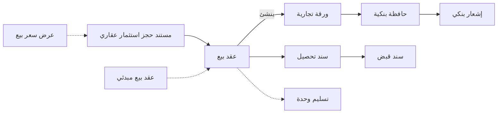

# مطور عقاري (بيع الوحدات على الخريطة)

مطور يطرح كمبوند من 400 شقة قبل أن تُصب أول قاعدة. يختار مشترٍ الشقة 12، ويدفع 20,000 جدية حجز،
ثم يوقّع بعد شهر عقداً بقيمة 900,000 بمقدم 20%، ويسلّم أربعين شيكاً آجلاً بالباقي، شيكاً كل ربع سنة
لعشر سنوات. والمطور يحتاج أن يعرف عن كل وحدة: هل هي متاحة أم محجوزة أم مباعة، وكم بقي على المشتري،
وأي الشيكات في البنك، وكم تكلّف المبنى حتى الآن. ومسار بيع العقارات موجود لأن بيع الوحدة ليس مستنداً
واحداً: هو حجز، ثم عقد، ثم جدول طويل من الأقساط، ثم سنوات من التحصيل.

## لمن يناسب هذا السيناريو

- المطورون الذين يبيعون شققاً أو فيلات أو محلات أو قطع أراضٍ على الخريطة أو أثناء الإنشاء، بخطط أقساط
  طويلة تُسدَّد عادة بشيكات آجلة. وفي تركيبات نما، نحو شركة من كل 18 شركة تبيع وحدات في وحدة العقارات.
- نحو شركة من كل 10 شركات تعمل في العقارات. نحو 3 من كل 5 منها تبيع وحدات، ونحو 1 من كل 6 تؤجّر.
  والبيع على الخريطة بأقساط مضمونة بشيكات هو الشكل الأكثر شيوعاً، خاصة في مصر.
- يجمع المطورون عادة بين هذه الصفحة و[شركة مقاولات](/ar/business-scenarios/scenario-contracting-company)
  حين يبنون أبراجهم بأنفسهم، و[مجموعة شركات](/ar/business-scenarios/scenario-multi-company-group) حين
  يكون كل مشروع شركةً مستقلة.

## ما تحتاجه

::: info التراخيص المطلوبة
`realestate`، و`realestate-sales` (عروض أسعار البيع، وعقود البيع المبدئية والنهائية، والتسليم،
والتنازل)، و`accounting-banks` (الشيكات، والحوافظ البنكية، والإشعارات البنكية)؛ و`realestate-rent`
لصورة التأجير.
:::

- [العقارات](/ar/modules/realestate/): شجرة العقارات، ومستندات البيع، والتحصيل، والغرامات، وتكلفة
  الوحدات.
- [الحسابات](/ar/modules/accounting/): سندات القبض، والشيكات ودورتها البنكية، وفواتير المتنوعات
  لمصروفات الإنشاء.
- [المقاولات](/ar/modules/contracting/)، فقط إذا كانت الشركة تبني من خلال وحدة المقاولات.

## مسار المستندات

تابع الشقة 12 من مكتب المبيعات حتى آخر شيك:

1. **عرض السعر.** يطبع مندوب المبيعات **عرض سعر بيع** فيه السعر والمقدم وكل الأقساط. العرض لا يحجز
   شيئاً، لذلك يمكن توزيعه بلا قيد.
2. **الحجز.** يدفع المشتري 20,000. يسجّل **مستند حجز استثمار عقاري** الجدية، ومتى صارت حالته
   *مؤكد* خرجت الشقة 12 من المعروض. والقيد الوحيد الذي ينشئه هو قيد الجدية.
3. **العقد.** على الحجز المحفوظ، يفتح زر **إنشاء سند بيع** **عقد بيع** فيه الوحدة والمشتري والسعر
   والعشرون ألفاً المدفوعة. ويملأ نموذج الدفع مقدماً قدره 180,000 وأربعين قسطاً ربع سنوي، ويبني زر
   **إنشاء الأقساط** الجدول. واعتماد العقد يجعل الوحدة *مباعة*، وينشئ المديونية، ويسجّل البيع. والمطورون
   الذين يوقّعون اتفاقاً مبدئياً أولاً يستخدمون **عقد بيع مبدئي**، يحجز الوحدة ولا يسجّل شيئاً، ثم يُبنى
   عقد البيع عليه.
4. **الشيكات.** حين تكون أعمدة الأوراق التجارية مفعّلة لعقد البيع، ينشئ اعتماد العقد **ورقة تجارية**
   لكل سطر قسط يحمل بيانات شيك. ومن أزرار العقد نفسه تذهب شيكات هذا الشهر إلى البنك على **حافظة
   بنكية**، ويُسجَّل رد البنك (تحصيل أو رفض) على **إشعار بنكي**.
5. **النقدية والتحويلات.** ما لا يأتي بشيك يُحصَّل على أكواد أقساط العقد في **سند تحصيل** يسوّي
   الأقساط، وزره **إنشاء سند قبض** يفتح **سند القبض** الذي يستلم المال.
6. **التأخر في السداد.** يمكن تحميل القسط المتأخر على **سند غرامة** يُنشأ من العقد بزر **إنشاء سند
   غرامة**. الغرامة مديونية مستقلة ولا تغيّر القسط.
7. **التسليم.** عند انتهاء المبنى، يسجّل **تسليم وحدة** التسليم ويختم العقد والوحدة. وإذا كان توجيه
   البيع يؤجّل الإيراد حتى التسليم، فالتسليم هو المستند الذي يطلق قيد العقد.
8. **بعد البيع.** إذا باع المشتري وحدته قبل الاستلام، ينقل **سند تنازل عن ملكية** من نوع *لمشتري اخر*
   الأقساط غير المسددة إلى المشتري الجديد؛ أما نوع *للشركة* فيعيد الوحدة إلى المعروض.

المسار كاملاً، وما يفعله كل مستند، في [دورة بيع العقارات](/ar/modules/realestate/sales/realestate-sales-cycle).

## الإعداد خطوة بخطوة

1. **ابنِ شجرة العقارات ثم الوحدات.** أنشئ المشروع ثم انزل بأزرار الإنشاء: البلوكات، فالعمارات،
   فالأدوار، فالوحدات، مع نماذج الوحدات لإنشاء الشقق المتماثلة دفعة واحدة. والمشروعات الكبيرة تُستورد
   عادة. راجع [المشروعات والبلوكات والأراضي](/ar/modules/realestate/properties/realestate-projects-blocks-lands)
   و[العمارات والأدوار والوحدات](/ar/modules/realestate/properties/realestate-buildings-floors-and-units).
2. **قوائم الأسعار ونماذج الدفع.** قائمة أسعار البيع تسعّر كل وحدة، ونموذج الدفع يملأ المقدم والأقساط،
   فيتوقف المندوبون عن كتابة الأرقام. راجع [قوائم الأسعار ونماذج الدفع](/ar/modules/realestate/sales/realestate-price-lists-and-payment-methods).
3. **أنواع الرسوم والعمولات بحساباتها.** الرسوم والعمولات تأخذ حساباتها من ملفات أنواعها لا من توجيه
   المستند، فاضبطها قبل أول عقد. راجع [أنواع الرسوم والعمولات والمصروفات](/ar/modules/realestate/costs/realestate-fee-commission-and-expense-types).
4. **توجيهات البيع.** الحجز وعقد البيع وسند التحصيل والتسليم يأخذ كلٌّ منها حساباته من توجيهه، وأي زوج
   محاسبي لا يُسجَّل إلا إذا امتلأ طرفاه. وهنا تقرر هل يُسجَّل الإيراد عند العقد أم عند التسليم. راجع
   [توجيهات مستندات البيع](/ar/modules/realestate/document-terms/realestate-terms-sales).
5. **دفاتر الشيكات والحوافظ البنكية.** جهّز دفاتر الأوراق التجارية والبنوك، وأضف عقد البيع إلى المستندات
   التي تنشئ أوراقاً تجارية في [إعدادات الوحدة](/ar/modules/realestate/realestate-configuration). راجع
   [الشيكات والأوراق المالية](/ar/modules/accounting/banks-and-cheques/cheques-financial-papers).
6. **الوحدات المباعة قبل بدء التشغيل.** حمّلها على **عقد بيع افتتاحي** في الفترة المالية الافتتاحية،
   مع تعليم الأقساط المسددة بـ*مدفوع بالكامل*. راجع [عقود البيع الافتتاحية](/ar/modules/realestate/opening/realestate-opening-sales).

## الإعدادات والأدوات الأكثر استخدامًا

- **الشيكات الآجلة.** نحو 3 من كل 4 مطورين يسجّلون شيكات الأقساط، ونحو 2 من كل 3 يستخدمون أيضاً
  مستند إلغاء الورقة التجارية حين يُستبدل شيك. راجع [الشيكات والأوراق المالية](/ar/modules/accounting/banks-and-cheques/cheques-financial-papers).
- **التنازلات.** نحو 2 من كل 3 يسجّلون إعادة البيع والإرجاع على سند التنازل. راجع
  [التنازل وإلغاء البيع](/ar/modules/realestate/sales/realestate-waiver-and-cancellation).
- **الحجوزات.** نحو 1 من كل 3 يحجزون قبل العقد، ونحو حجز من كل 3 ينتهي بالإلغاء لا بالبيع. راجع
  [الحجوزات والعقود المبدئية](/ar/modules/realestate/sales/realestate-reservations-and-initial-contracts).
- **الغرامات.** نحو 1 من كل 4 يحمّلون غرامات تأخير. راجع [الغرامات](/ar/modules/realestate/collections/realestate-fines).
- **فواتير المتنوعات للإنشاء.** نحو 9 من كل 10 يسجّلون مصروفات الإنشاء على
  [فواتير المتنوعات](/ar/modules/accounting/money-in-and-out/misc-purchasing).
- **لوحات المتابعة.** نحو 5 من كل 6 يتابعون المبيعات والتحصيل على [لوحات ذكاء الأعمال](/ar/platform/bi/).

## صور أخرى للسيناريو نفسه

**العقد مباشرة.** نحو ثلثي المطورين يتجاوزون الحجز ويوقّعون عقد البيع مباشرة؛ وقائمة اختيار العقار في
العقد لا تعرض إلا الوحدات المتاحة غير المحجوزة، فلا تُباع وحدة مرتين في الحالتين.

**الإيراد عند التسليم.** مع تفعيل *إنشاء تأثير محاسبى لمستندات التسليم فقط* في توجيه عقد البيع، يجعل
العقد الوحدة مباعة ويبني الجدول، لكنه لا يسجّل شيئاً حتى يطلق تسليم الوحدة قيده. راجع
[تسليم الوحدة](/ar/modules/realestate/sales/realestate-handover).

**تكلفة الإنشاء لكل وحدة.** معظم المطورين يسجّلون مصروفات الإنشاء على فواتير متنوعات موسومة بالمشروع.
ومن يحتاج التكلفة لكل وحدة يُدخلها بدلاً من ذلك على سند تكلفة استثمار عقاري، الذي يوزّع كل تكلفة على
الوحدات بالمساحة أو بالسعر أو بأساس آخر، راجع [توزيع تكاليف المشروع](/ar/modules/realestate/costs/realestate-cost-distribution).
وقلة يبنون من خلال وحدة المقاولات، التي يمكن أن تُنزَل تكلفة مشروعها على الوحدات، راجع
[جسر التكلفة من المقاولات](/ar/modules/contracting/costs/contracting-realestate-cost-bridge).

**التأجير.** نحو شركة من كل 30 شركة لديها عقود إيجار. ولمسار التأجير سلسلته الخاصة: **عرض سعر إيجار**
يمكن أن يحجز الوحدة، ثم **عقد إيجار** يبني جدول الإيجار، ثم **قيد إثبات استحقاق قسط إيجار** يثبت إيراد
كل فترة، ثم التحصيل على العقد، و**إنهاء عقد إيجار** لإنهاء العقد. راجع [دورة التأجير](/ar/modules/realestate/rent/realestate-rent-cycle).

## قرارات قبل بدء التشغيل

- **الحجز أولاً أم العقد مباشرة.** الطريقان مدعومان. وإذا كانت الجدية تُؤخذ قبل التوقيع فاستخدم مستند
  الحجز ليُسجَّل المبلغ وتُقفل الوحدة.
- **الإيراد عند العقد أم عند التسليم.** اضبطه مرة واحدة في توجيه البيع والتزم به؛ فهو يغيّر قيد كل عقد.
- **شيكات ينشئها العقد أم شيكات تُستلم على سندات القبض.** ترك العقد ينشئ الشيكات من سطور أقساطه يوفّر
  إدخال أربعين شيكاً لكل بيعة، لكن أعمدة الأوراق التجارية يجب أن تُفعَّل قبل أول عقد.
- **تكلفة الإنشاء على فواتير المتنوعات، أم على سند تكلفة استثمار عقاري، أم عبر المقاولات.** اختر بحسب
  حاجتك إلى التكلفة لكل وحدة.
- **ترحيل الوحدات المباعة بعقود البيع الافتتاحية.** حمّل الجدول المتبقي لكل وحدة مباعة على عقد بيع
  افتتاحي بدلاً من إعادة إدخال العقود القديمة وتحصيلاتها.
- **حسابات الرسوم والعمولات أولاً.** فهي تأتي من ملفات الأنواع، فاضبطها قبل أول عقد.

## اقرأ أيضًا

1. [نظرة عامة على وحدة العقارات](/ar/modules/realestate/realestate-overview)
2. [إعدادات الوحدة](/ar/modules/realestate/realestate-configuration)
3. [كيف تُمثَّل العقارات](/ar/modules/realestate/properties/realestate-estate-model)
4. [دورة بيع العقارات](/ar/modules/realestate/sales/realestate-sales-cycle)
5. [عقد البيع](/ar/modules/realestate/sales/realestate-sales-contract) و[بناء خطة الأقساط](/ar/modules/realestate/sales/realestate-installment-plans)
6. [كيف يعمل تحصيل الأقساط](/ar/modules/realestate/collections/realestate-collection-basics)
7. [تسليم الوحدة](/ar/modules/realestate/sales/realestate-handover) و[التنازل وإلغاء البيع](/ar/modules/realestate/sales/realestate-waiver-and-cancellation)
8. [بدء التشغيل: الأرصدة الافتتاحية](/ar/modules/realestate/opening/realestate-opening-balances)
