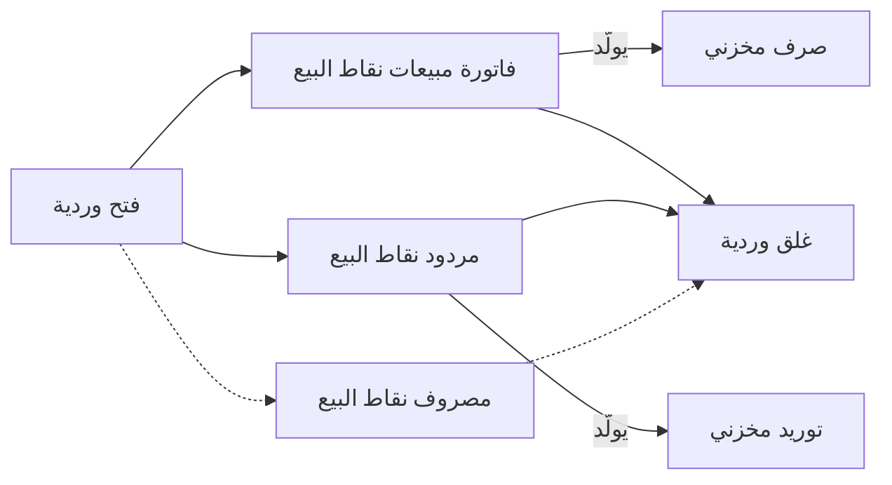
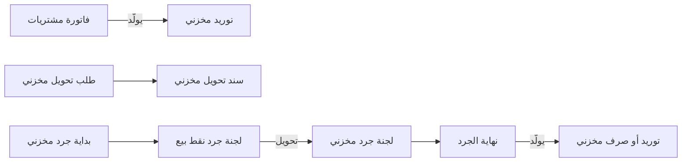

# سلسلة متاجر بنقاط البيع

سلسلة عطور لها 8 فروع، في كل فرع ماكينتان، ومخزن رئيسي واحد. في يوم سبت مزدحم تسجّل كل ماكينة بضع مئات من الفواتير، وتُغذّى الفروع من المخزن الرئيسي مرتين في الأسبوع، ويُجرد كل فرع آخر الشهر. تواصل الماكينات البيع حين ينقطع الإنترنت، وكل فاتورة ومردود ووردية وجرد يصل إلى الخادم مستندًا يُعالَج إلى حركة مخزون وقيود. هذه الصفحة تتبع هذه السلسلة من أول فاتورة على الماكينة حتى جرد آخر الشهر.

## لمن يناسب هذا السيناريو

- نشاط له فروع كثيرة، لكل فرع ماكيناته ومخزنه، وكلها تُغذّى من مخزن رئيسي. هكذا تعمل محلات الملابس والعطور ومستحضرات التجميل والأجهزة والأثاث والمطاعم والمتاجر العامة.
- في منشآت نما، تعمل نحو شركة من كل 10 شركات بماكينات نقاط البيع، ونحو شركة من كل 9 شركات تعمل في تجارة التجزئة.
- نادرًا ما تكون الماكينة طريق البيع الوحيد. فنحو 4 من كل 5 من هذه الشركات يصدرون كذلك فواتير مبيعات عادية من الإدارة، لعملاء الجملة والتوصيل والبيع الآجل، وهذا هو سيناريو [التجارة بالفاتورة المباشرة](/ar/business-scenarios/scenario-direct-invoice-trading) يعمل بجانب هذا السيناريو.
- والسلاسل التي تشتري من الخارج تضيف سيناريو [الاستيراد](/ar/business-scenarios/scenario-importer-landed-cost) في الإدارة، والمجموعة التي تجعل كل سلسلة أو كل بلد شركة مستقلة تضيف سيناريو [مجموعة الشركات](/ar/business-scenarios/scenario-multi-company-group).

## ما تحتاجه

::: info التراخيص المطلوبة
`namapos` و`supplychain-sales` و`supplychain-inventory` و`supplychain-purchases`. ويُضاف `namapos-captain-order` للمطاعم التي يأخذ فيها النُدُل الطلبات من الهاتف، و`basic-mobile-stocktaking` أو `supplychain-electronic-taking` للجرد بأجهزة القراءة، و`basic-tax-e-invoice` حيث تُطبَّق الإيصالات الإلكترونية.
:::

والترخيص يحدد كذلك عدد الماكينات النشطة المسموح بها. الماكينات غير النشطة لا تُحسب، ولماكينات كابتن أوردر الفرعية عدد خاص بها (راجع [الترخيص](/ar/getting-started/licensing)).

- [نقاط البيع](/ar/modules/pos/): تطبيق الماكينة، وشاشات الخادم التي تُعَدّ فيها الماكينات وتصل إليها مستنداتها.
- [سلسلة التوريد](/ar/modules/supplychain/): الأصناف والمخازن وقوائم الأسعار والعروض والمشتريات والتحويلات والجرد.
- [الحسابات](/ar/modules/accounting/): حيث تنتهي قيود المبيعات والنقدية والمخزون التي تنتجها المستندات.

## مسار المستندات

تجري دورتان جنبًا إلى جنب. يوم الماكينة، ويتكرر على كل ماكينة:

ودورة المخزون التي تُبقي الفروع ممتلئة ومجرودة:

وهذا أسبوع واحد في الفرع 3 من سلسلة العطور.

1. **الإدارة تشتري.** تصل شحنة من 600 زجاجة إلى المخزن الرئيسي على **فاتورة مشتريات**، ويولّد توجيهها **التوريد المخزني** الذي يُدخل الزجاجات إلى المخزون.
2. **يُغذّى الفرع.** ينشئ أمين المخزن الرئيسي **طلب تحويل مخزني** بـ 120 زجاجة من المخزن الرئيسي إلى الفرع 3، ويتم النقل بـ **سند تحويل مخزني**: يخرج المخزون من المخزن الرئيسي ويدخل مخزن الفرع في مستند واحد.
3. **تُفتح الماكينة.** في العاشرة صباحًا يفتح الكاشير **فتح وردية** برصيد افتتاحي 500 نقدًا. تأخذ الوردية كودًا خاصًا بها، وكل ما يُباع على هذه الماكينة حتى الغلق يتبعها.
4. **تُسجَّل الفواتير.** كل عملية بيع هي **فاتورة مبيعات نقاط البيع**، تُحفظ على الماكينة أولًا ثم تُرسَل إلى الخادم في الخلفية. يختار الخادم دفترها وتوجيهها من جدولَي **الدفاتر والتوجيهات** و**توجيهات المبيعات** في الماكينة، وينتج التوجيه القيد المحاسبي ويولّد **الصرف المخزني** من مخزن الماكينة. لا يختار الكاشير توجيهًا أبدًا.
5. **عميل يعيد زجاجة.** الاسترداد **مردود نقاط البيع** على الفاتورة الأصلية، وينتج توجيهه القيد العكسي و**التوريد المخزني** الذي يعيد الزجاجة إلى الرف. ويأخذ العميل نقدًا، أو إشعارًا دائنًا يصرفه لاحقًا.
6. **نقدية تخرج من الدرج.** يدفع الكاشير 40 للنظافة من الدرج بـ **مصروف نقاط البيع**، على الحساب الذي يحدده توجيهه.
7. **تُغلق الوردية.** في العاشرة مساءً يعدّ الكاشير الدرج على **غلق وردية**. تعرض الماكينة لكل طريقة دفع المبلغ المتوقع أمام المبلغ المعدود وتسجّل الفرق. وإذا كان خيار **تصفير النقدية مع غلق الوردية** مفعَّلًا، تُنقل النقدية المعدودة من الماكينة في الحسابات وتبدأ الوردية التالية من الصفر.
8. **الفرع يحوّل مخزونًا لغيره.** لدى الفرع 3 فائض من طقم هدايا نفد من الفرع 5. من الماكينة يسجّل **طلب تحويل مخزني نقاط البيع** خروج 10 أطقم من الفرع 3 إلى الفرع 5، ويكتمل النقل بـ **سند تحويل مخزني** عادي يذكر الطلب مستندًا مصدرًا له.
9. **يُجرد الشهر.** يحفظ مسؤول المخزون **بداية جرد مخزني** لمخزن الفرع. يقرأ الموظفون الأرفف على الماكينة في **لجنة جرد نقط بيع**. وعلى الخادم يحوّل زر **تحويل إلى لجنة جرد** هذا العد إلى سجل **لجنة جرد مخزني**، ثم تقارن **نهاية الجرد** الكميات المعدودة بالدفاتر وتولّد التوريدات للزيادة والصرف للعجز.

كل مستند في الخطوات من 3 إلى 9 يصل من ماكينة هو مستند نظامي: يمكن فتحه وطباعته واستخراج التقارير منه على الخادم، لكن لا يمكن تعديله هناك. والخطأ يُصحَّح بمستند جديد، لا بتغيير المستند الذي أرسلته الماكينة.

## الإعداد خطوة بخطوة

1. **الفروع ومخزن لكل فرع.** كل ماكينة تبيع من مخزن واحد، ولا تُحفظ الماكينة على الشركة «عام»، فالمحلات و[فروعها](/ar/platform/shared-master-files/dimensions-and-composite-dimensions) و[مخازنها](/ar/modules/supplychain/warehouses-and-locators) تأتي أولًا.
2. **الأصناف بالباركود.** حمّل الأصناف بالباركود، و[باللون والمقاس](/ar/modules/supplychain/understanding-items) حيث تبيع بالموديلات. وحدد الأصناف التي تستلمها كل ماكينة بملف [الأصناف المرسلة لنقاط البيع](/ar/modules/pos/erp-setup/pos-items-and-sync-settings)، فكاونتر المخبوزات لا يحتاج أصناف العدد والأدوات.
3. **قوائم الأسعار والعروض.** تستلم الماكينات [قوائم الأسعار والعروض](/ar/modules/supplychain/pricing-offers-and-coupons) للأصناف التي عندها، فجهّزها قبل أول مزامنة.
4. **الماكينات والصلاحيات والشاشات.** أنشئ [ماكينة](/ar/modules/pos/erp-setup/pos-register-setup) لكل جهاز بمخزنها وطرق الدفع وجداول التوجيهات، وأعطِ كل كاشير [ملف صلاحيات نقاط البيع](/ar/modules/pos/erp-setup/pos-security-profiles)، ورتّب [الشاشات والأجهزة](/ar/modules/pos/erp-setup/pos-screen-and-device-settings).
5. **التوجيهات والترقيم.** جدول **الدفاتر والتوجيهات** في كل ماكينة يحدد كيف تُعالَج مستنداتها على الخادم: راجع [توجيهات مستندات نقاط البيع](/ar/modules/pos/erp-setup/pos-document-terms). واضبط الكود الذي تعطيه كل ماكينة لمستنداتها في [ترقيم مستندات نقاط البيع](/ar/modules/pos/erp-setup/pos-document-numbering)، حتى لا تتكرر أرقام الإيصالات بين الأجهزة.
6. **المزامنة.** نزّل الماكينات ودعها تسحب بياناتها الأولى. وكل تغيير بعد ذلك يصل إلى الماكينة بالمزامنة نفسها، كما تشرح [كيف تتزامن بيانات نقاط البيع مع الخادم](/ar/modules/pos/pos-data-sync).
7. **إعدادات غلق الوردية.** حدد ما يحدث للنقدية عند الغلق وأي المستندات تمنع الغلق، في [إعدادات فتح وغلق الوردية وتصفير النقدية](/ar/modules/pos/erp-setup/pos-shift-close-settings).
8. **مسار التحويل.** حدد من ينشئ طلبات التحويل ومن ينفذها، وهل تريد التحويل بخطوة واحدة أم بخطوتين ([تحريك المخزون بين المخازن](/ar/modules/supplychain/moving-stock)).
9. **إعدادات الجرد.** اضبط طريقة مقارنة العد وتسويته في [إعدادات الجرد المخزني](/ar/modules/supplychain/configuration/stock-taking-configuration)، ثم نفّذ جردًا أول بـ [الجرد المخزني](/ar/modules/supplychain/stock-taking).

## الإعدادات والأدوات الأكثر استخدامًا

- **أكثر من فرع.** كل هذه الشركات تقريبًا لها عدة محلات، لكل منها مخزنه.
- **قوائم الأسعار والعروض.** كلها تقريبًا تستخدم [قوائم الأسعار](/ar/modules/supplychain/pricing-offers-and-coupons)، ونحو 2 من كل 3 تعمل بالعروض، مقابل نحو شركة من كل 4 بين كل الشركات.
- **الجرد.** نحو 4 من كل 5 يجردون محلاتهم بـ [دورة الجرد](/ar/modules/supplychain/stock-taking).
- **طلبات التحويل.** نحو 3 من كل 5 يضعون [طلب تحويل](/ar/modules/supplychain/moving-stock) قبل التحويل، مقابل نحو شركة من كل 5 بين كل الشركات.
- **فواتير الإدارة.** نحو 4 من كل 5 يصدرون كذلك فواتير مبيعات عادية بجانب الماكينات.
- **دفاتر الإيصالات.** نحو شركة من كل 3 تضبط دفاتر الإيصالات المطبوعة المرقّمة بـ [دفاتر الإيصالات](/ar/platform/payments/receipt-books).
- **اللون والمقاس.** أصناف الموديلات أساسية في محلات الملابس والهواتف، وتظهر على الماكينة كـ [إضافات الأصناف](/ar/modules/pos/pos-item-addons).

## صور أخرى للسيناريو نفسه

**المطاعم والمقاهي.** يضيف المطعم الصالات والطاولات والطلبات المعلقة ومسار مركز خدمة العملاء وتطبيق كابتن أوردر، الذي يرسل منه النادل الطلب من الطاولة إلى المطبخ والماكينة. ويحتاج `namapos-captain-order`. راجع [الطاولات والحجوزات وكابتن أوردر](/ar/modules/pos/pos-tables-and-restaurant).

**طلب يؤخذ الآن ويُسلَّم لاحقًا.** محل الأثاث أو الأجهزة يأخذ دفعة مقدمة على الماكينة بـ **سند حجز اوردر نقاط بيع**، وينتج توجيهه، كالبيع، القيد المحاسبي وصرف المخزون، ويُلغى بـ **سند إلغاء حجز اوردر نقاط بيع** إن تراجع العميل ([مستندات نقاط البيع على الخادم](/ar/modules/pos/erp-setup/pos-documents-on-the-server#lbyaa)).

**بضاعة في الطريق.** حين تستغرق الرحلة من المخزن الرئيسي إلى الفرع يومًا أو أكثر، استخدم التحويل بخطوتين: **صرف تحويل مخزني** عند خروج البضاعة و**استلام تحويل مخزني** عند وصولها، وغالبًا عبر مخزن بضاعة بالطريق ([تحريك المخزون بين المخازن](/ar/modules/supplychain/moving-stock#ltHwyl-dhw-lkhTwtyn-mzyd-mn-ltHkm-wlttbaa)).

**فروع تستلم من الموردين مباشرة.** يستطيع الفرع تسجيل التوريد على الماكينة بـ **توريد نقاط البيع**، ويحدد توجيهه هل يُولَّد له توريد مخزني على الخادم ([العمليات المخزنية على الماكينة](/ar/modules/pos/pos-inventory-operations)).

**الدفع الذاتي.** يقرأ المتسوّق أصنافه ويدفع بالبطاقة على كشك أندرويد، وتُحفظ كل عملية بيع منه على ماكينة عادية في شبكة المحل ([كشك الدفع الذاتي](/ar/modules/pos/pos-self-checkout-kiosk)).

**الجرد بأجهزة القراءة.** المحلات الكبيرة تجرد بأجهزة قراءة محمولة عبر الجرد الإلكتروني (`supplychain-electronic-taking`) أو تطبيق الجرد على الموبايل (`basic-mobile-stocktaking`)، بدل الجرد على الماكينة ([الجرد المخزني](/ar/modules/supplychain/stock-taking#dkhl-ntyj-laad)).

## قرارات قبل بدء التشغيل

- **فاتورة خادم لكل فاتورة ماكينة، أم فواتير مجمّعة.** يحسم ذلك خيار **طريقة تجميع فواتير نقاط البيع** في إعدادات نقاط البيع. «كل فاتورة بمفردها» تنشئ فاتورة على الخادم لكل فاتورة ماكينة. و«تجميع الفواتير» يدمج فواتير الوردية نفسها في فاتورة خادم واحدة متى اتفقت في العميل والمندوب والمستخدم وبقية الشروط المذكورة في [شاشة إعدادات نقاط البيع](/ar/modules/pos/erp-setup/pos-settings-screen#rsl-lmstndt-l-lkhdm)، حتى **أقصى عدد لسطور الفاتورة**. التجميع يقلّل كثيرًا ما يعالجه الخادم وما يظهر في التقارير، والفاتورة بمفردها تُبقي كل إيصال ظاهرًا فاتورةً مستقلة.
- **أي المبيعات تمر بالماكينة.** الجملة والتوصيل الآجل والطلبات الكبيرة ذات الدفعات المقدمة تبقى غالبًا في الإدارة فواتيرَ مبيعات عادية. حدد مكان كل نوع من البيع قبل أن يبدأ الكاشير.
- **التحقق من المخزون على الماكينة.** لا تتحقق الماكينة من المخزون إلا إذا كان لها **إعدادات تحديث كميات الماكينة** ([التحقق من المخزون على الماكينة](/ar/modules/pos/erp-setup/pos-items-and-sync-settings#ltHqq-mn-lmkhzwn-aal-lmkyn)). وبدونها حدد مصير البيع الذي يصل إلى الخادم والمخزون لا يكفيه: **التوجيه في حالة حدوث خطأ** في الماكينة يسمح بحفظه ومعالجة المخزون بعد ذلك ([توجيه الخطأ](/ar/modules/pos/erp-setup/pos-document-terms#twjyh-lkhT)).
- **الرصيد الافتتاحي للدرج.** إن كان **تصفير النقدية مع غلق الوردية** غير مفعَّل تبقى النقدية المعدودة في الدرج للوردية التالية، وإن كان مفعَّلًا يُفرَّغ الدرج إلى الخزينة مع كل غلق. اختر ما يوافق طريقة تسليم النقدية في محلاتك، وأغلق كل وردية على كل ماكينة كل يوم.
- **كم مرة تجرد.** بعض السلاسل تجرد كل شهر وبعضها مرة في السنة. نافذة جرد قصيرة وجرد متكرر على نطاق أصغر يعطيان فروقًا أوضح.
- **أي الأصناف تصل إلى أي ماكينة.** إرسال كل الأصناف إلى كل ماكينة يبطئ المزامنة ويزحم البحث. حدد قوائم الأصناف لكل نوع من المحلات قبل بدء التشغيل.

## اقرأ أيضًا

1. [نقاط البيع — نظرة عامة](/ar/modules/pos/pos-overview) و[البداية على الماكينة](/ar/modules/pos/pos-getting-started)
2. [نقاط البيع — الإعداد على الخادم](/ar/modules/pos/erp-setup/) و[إعداد الماكينة](/ar/modules/pos/erp-setup/pos-register-setup)
3. [توجيهات مستندات نقاط البيع](/ar/modules/pos/erp-setup/pos-document-terms) و[مستندات نقاط البيع على الخادم](/ar/modules/pos/erp-setup/pos-documents-on-the-server)
4. [الورديات والنقدية](/ar/modules/pos/pos-shifts-and-cash) و[إعدادات فتح وغلق الوردية وتصفير النقدية](/ar/modules/pos/erp-setup/pos-shift-close-settings)
5. [المرتجعات والإحلال](/ar/modules/pos/pos-returns-and-replacements) و[العمليات المخزنية على الماكينة](/ar/modules/pos/pos-inventory-operations)
6. [كيف تتزامن بيانات نقاط البيع مع الخادم](/ar/modules/pos/pos-data-sync)
7. [تحريك المخزون بين المخازن](/ar/modules/supplychain/moving-stock) و[الجرد المخزني](/ar/modules/supplychain/stock-taking)
8. [التسعير والعروض والكوبونات](/ar/modules/supplychain/pricing-offers-and-coupons) و[دفاتر الإيصالات](/ar/platform/payments/receipt-books)
