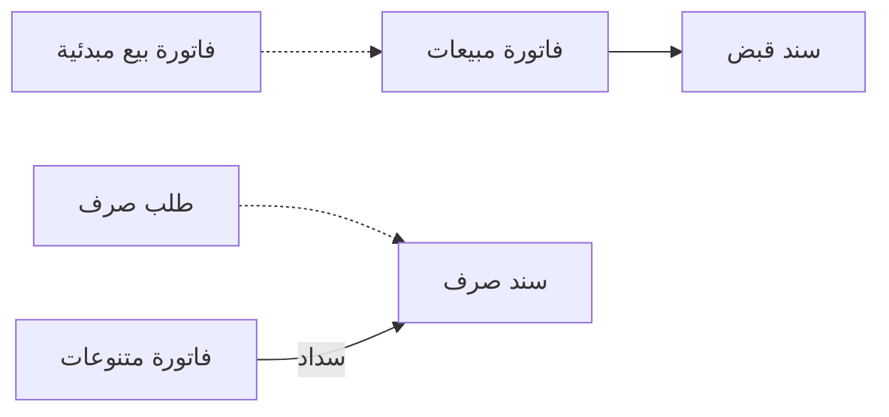

# شركة خدمات واستخدام مالي فقط

مكتب استشارات من اثني عشر موظفاً يطالب كل عميل بأتعاب شهرية ثابتة، ويدفع الإيجار والرواتب وبضع
عشرات من فواتير الموردين كل شهر، ويريد أن يرى الربح لكل عميل. وفرع شركة أجنبية لا يحتاج إلا دفاتر
نظامية بالعملة المحلية تُقفل كل شهر. لا مخزن عند أيٍّ منهما، ولا صنف مخزني ولا تسليم. ونما عند هذه
الشركات هو نظام الحسابات أولاً: الخدمات تُفوتَر على فواتير المبيعات، والمصروفات تمر بفواتير المتنوعات
والسندات، وأحد المحددات يقوم مقام سجل الأعمال.

## لمن يناسب هذا السيناريو

- مكاتب الاستشارات والمحاماة والمراجعة، وإدارة المرافق، ووكلاء الشحن والنقل، والمدارس ومراكز التدريب،
  والعيادات، والشركات الأجنبية التي تمسك دفاترها النظامية على نما. وفي تركيبات نما، نحو شركة من كل 4
  شركات لا تحرك أي مخزون.
- وإذا استبعدنا شركات العقارات والمقاولات، وهي أيضاً بلا مخزون لكن لها صفحاتها، تصبح النسبة نحو 1 من
  كل 6. نحو نصف هذه الشركات يفوتر خدماته على فواتير المبيعات، والباقي يستخدم نما للحسابات فقط.
- كثيراً ما تجمع هذه الشركات بين هذه الصفحة و[مجموعة شركات](/ar/business-scenarios/scenario-multi-company-group)
  حين تتقاسم شركة قابضة أو مجموعة شركات شقيقة قاعدة بيانات واحدة. والمقاولون والمطورون يمسكون حسابات
  مراكزهم الرئيسية بالطريقة نفسها، إلى جانب [شركة مقاولات](/ar/business-scenarios/scenario-contracting-company)
  أو [مطور عقاري](/ar/business-scenarios/scenario-real-estate-developer).

## ما تحتاجه

::: info التراخيص المطلوبة
`accounting`، و`accounting-banks`؛ و`supplychain-sales` لفواتير الخدمات؛ و`humanresource-payroll`
للرواتب؛ و`basic-tax-e-invoice` حيث تُطبَّق الفاتورة الإلكترونية؛ و`ecpa` لفوترة المشروعات بالوقت.
:::

- [الحسابات](/ar/modules/accounting/): شجرة الحسابات، وسندات القيد، والسندات، وفواتير المتنوعات،
  والإشعارات، والبنوك، وضبط الفترات.
- [سلاسل الإمداد](/ar/modules/supplychain/): فاتورة المبيعات وأصناف الخدمة التي تبيعها فقط.
- [الموارد البشرية](/ar/modules/hr/): الرواتب، لنحو 1 من كل 5 من هذه الشركات.
- [إدارة المشاريع](/ar/modules/ecpa/): الساعات والمهام وفواتير المشروعات، للمكاتب التي تفوتر الوقت.

## مسار المستندات

تابع شهراً واحداً في مكتب الاستشارات:

1. **مطالبة العميل.** تُسجَّل كل أتعاب شهرية على **فاتورة مبيعات** سطورها أصناف خدمة: أصناف تُباع ولا
   تُخزَّن أبداً، فلا تصرف الفاتورة شيئاً من مخزن. والمكاتب التي ترسل تقديراً أولاً تُصدر **فاتورة بيع
   مبدئية** وتبني الفاتورة منها. وكل فاتورة تحمل كود عمل العميل في مجموعتها التحليلية.
2. **العميل يسدد.** يستلم **سند القبض** المبلغ ويسوّي الفاتورة. وحيث تشيع الشيكات تُسجَّل في صفحة
   الأوراق المالية في السند.
3. **فواتير الموردين.** الإيجار واشتراكات البرامج وأتعاب المراجع ومستلزمات المكتب تُسجَّل على **فاتورة
   متنوعات**، وكل سطر يختار **بند شراء** يحمل حساب المصروف. ثم يسددها **سند صرف**.
4. **المصروفات النثرية.** يحرر الموظفون **طلب صرف** لسيارة أجرة أو مندوب توصيل أو غداء عمل؛ فيقبله أمين
   الخزينة وينشئ منه **سند الصرف**.
5. **تسويات بلا نقدية.** **الإشعار الدائن** يخفّض ما على العميل، و**الإشعار المدين** يضيف عليه رسماً،
   وكلاهما دون المساس بالخزينة.
6. **الخزينة وآخر الشهر.** **التحويل البنكي** ينقل المال بين الحسابات البنكية، و**سند تغيير سعر الصرف**
   يسجّل فروق العملة على الأرصدة بالعملات الأجنبية، ويسجّل المحاسب الاستحقاقات والتسويات على **سندات
   قيد**. ثم تُقفل الفترة كي لا يسجّل فيها أحد بالخطأ.

## الإعداد خطوة بخطوة

1. **شجرة الحسابات والمحددات.** ابنِ [شجرة الحسابات](/ar/modules/accounting/ledger-setup/chart-of-accounts)
   وقرّر ماذا يعني كل [محدد](/ar/platform/shared-master-files/dimensions-and-composite-dimensions) هنا،
   لأن المحددات هي التي تحمل التقارير الإدارية حين لا يوجد مخزون.
2. **أصناف الخدمة.** أنشئ كل خدمة صنفاً من نوع الخدمة. راجع [فهم الأصناف](/ar/modules/supplychain/understanding-items).
3. **بنود الشراء للمصروفات.** بند لكل نوع من المصروفات، بحسابه الافتراضي، ليذهب كل سطر في فاتورة
   المتنوعات إلى مكانه الصحيح. راجع [المشتريات المتنوعة](/ar/modules/accounting/money-in-and-out/misc-purchasing).
4. **البنوك والخزائن.** جهّز [البنوك والحسابات البنكية](/ar/modules/accounting/banks-and-cheques/banks-and-bank-accounts)،
   ودفاتر الشيكات إذا كانت الشيكات مستخدمة.
5. **سجل الأعمال.** أنشئ مجموعة تحليلية (أو قطاعاً) لكل عمل أو عميل أو قضية، واجعلها إلزامية في
   المستندات التي يجب أن تحملها.
6. **الفترات وإقفالها.** افتح السنة المالية وحدّد من يحق له التسجيل في فترة مقفلة. راجع
   [ضبط الفترات المالية](/ar/platform/governance/fiscal-period-control-guide).

## الإعدادات والأدوات الأكثر استخدامًا

- **سندات القيد.** نحو 9 من كل 10 من هذه الشركات يسجّلون سندات قيد يدوية بانتظام. راجع
  [سندات القيد](/ar/modules/accounting/ledger-setup/journal-entries).
- **فواتير المتنوعات.** نحو النصف يسجّلون فواتير الموردين على فواتير المتنوعات. راجع
  [المشتريات المتنوعة](/ar/modules/accounting/money-in-and-out/misc-purchasing).
- **الإشعارات المدينة والدائنة.** نحو 1 من كل 4 يستخدمون الإشعارات المدينة. راجع
  [الإشعارات الدائنة والمدينة](/ar/modules/accounting/money-in-and-out/credit-and-debit-notes).
- **مجموعة تحليلية كسجل.** نحو 1 من كل 5 يخصصون مجموعة تحليلية لكل عمل أو عميل أو قضية. راجع
  [المحددات](/ar/platform/shared-master-files/dimensions-and-composite-dimensions).
- **الاعتمادات.** الاعتمادات والتخصيص الكثيف أقل شيوعاً هنا من أي سيناريو آخر: نحو 2 من كل 5 يمرّرون
  المستندات على اعتمادات، ونحو 1 من كل 5 يخصّصون النظام بكثافة. راجع
  [نظام الاعتمادات](/ar/platform/approvals/approvals-system).

## صور أخرى للسيناريو نفسه

**الحسابات فقط.** بعض الشركات لا تُصدر فاتورة مبيعات واحدة على نما: الإيراد يأتي من نظام آخر أو
كإجماليات شهرية على سندات قيد، ونما يمسك الدفاتر والبنك والتقارير النظامية. والمسار حينئذ هو الخطوات
من 3 إلى 6 فقط.

**الشركات التي يديرها ملاكها والشراكات.** حين يُقسَم الربح بين الشركاء، سجّل حصص كل شريك ووزّع ربح
الفترة بمستند توزيع الأرباح. راجع [حصص الشركاء وتوزيع الأرباح](/ar/modules/accounting/money-in-and-out/partner-shares-and-profit-distribution).

**فوترة الوقت.** المكاتب الهندسية والاستشارية التي تفوتر بالساعة أو بالمرحلة تستخدم وحدة إدارة
المشاريع، التي تسجّل من عمل على ماذا وتحوّل الساعات المسجلة إلى فواتير مشروعات. يستخدمها عدد قليل من
الشركات، لكنها تناسب المكاتب التي تبيع وقتاً مهنياً. راجع [نظرة عامة على إدارة المشاريع](/ar/modules/ecpa/ecpa-overview).

**خدمات المرافق.** الشركات التي تقدم النظافة أو الأمن أو الصيانة لمواقع لا لآلات يمكنها إدارة عقودها
وأوامر عملها على سندات خدمات الصيانة في وحدة إدارة علاقات العملاء. راجع
[خدمات أم آلات](/ar/modules/crm/services-suite/crm-services-suite-overview).

## قرارات قبل بدء التشغيل

- **خدمة أم مخزني، نهائياً.** أصناف الخدمة لا تحمل كمية، ونوع الصنف لا يمكن تغييره بين خدمة ومخزني بعد
  استخدامه في مستند مخزني. ويُرفض الحفظ برسالة:

  «لا يمكنك تغيير نوع الصنف من خدمة إلى مخزني أو العكس بعد استخدامه في سند الصرف , التوريد المخزني أو التحويل المخزني»

  أنشئ كل صنف بالنوع الصحيح من البداية.
- **أي سجل للأعمال.** مجموعة تحليلية (الاختيار المعتاد)، أو قطاع، أو وحدة إدارة المشاريع حين يجب تسجيل
  الساعات وفوترتها.
- **فاتورة متنوعات أم سند قيد للمصروفات.** فاتورة المتنوعات تجمع رصيد المورد وضريبته ومدفوعاته معاً؛
  وسند القيد لا يناسب إلا الاستحقاقات والتسويات الداخلية.
- **الشركاء.** في الشركات التي يديرها ملاكها، قرّر مبكراً هل يُمسك كل مالك كملف
  [شريك](/ar/modules/accounting/ledger-setup/accounts-bags-safes-and-partners) له رأس ماله وحسابه الجاري،
  وهل يتم توزيع الربح على نما.
- **إقفال الفترات.** قرّر بعد كم يوماً من نهاية الشهر تُقفل الفترة، ومن يحق له التسجيل في فترة مقفلة.

## اقرأ أيضًا

1. [شجرة الحسابات](/ar/modules/accounting/ledger-setup/chart-of-accounts)
2. [المحددات والمحددات المركبة](/ar/platform/shared-master-files/dimensions-and-composite-dimensions)
3. [فهم الأصناف](/ar/modules/supplychain/understanding-items)
4. [سندات القبض والصرف](/ar/modules/accounting/money-in-and-out/receipts-and-payments)
5. [المشتريات المتنوعة](/ar/modules/accounting/money-in-and-out/misc-purchasing)
6. [الإشعارات الدائنة والمدينة](/ar/modules/accounting/money-in-and-out/credit-and-debit-notes)
7. [سندات القيد](/ar/modules/accounting/ledger-setup/journal-entries) و[البنوك والحسابات البنكية](/ar/modules/accounting/banks-and-cheques/banks-and-bank-accounts)
8. [ضبط الفترات المالية](/ar/platform/governance/fiscal-period-control-guide)
