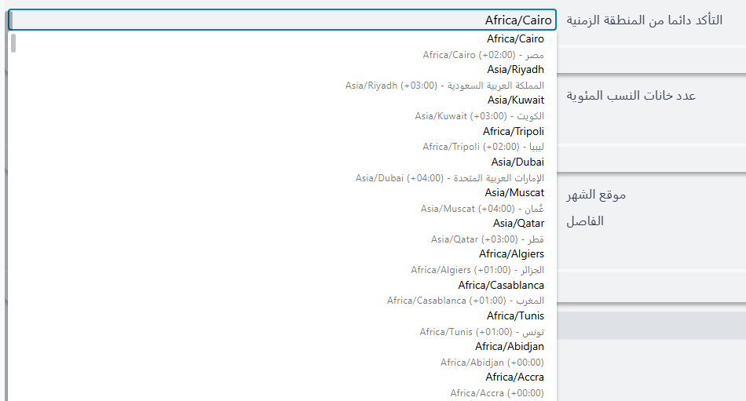

# المنطقة الزمنية للخادم

يسجّل نما الأوقات كما هي بالتوقيت المحلي: الفاتورة المحفوظة الساعة 14:30 تُخزَّن 14:30، وليس بجوارها منطقة زمنية. ولذلك تنتمي قاعدة البيانات إلى منطقة زمنية واحدة، وكل خادم يكتب فيها يجب أن يعمل بتلك المنطقة. والخادم العامل بمنطقة خاطئة لا يتعطل، بل يسجّل أوقاتاً متقدمة أو متأخرة ساعتين أو ثلاثاً، ولا يستطيع أحد بعد ذلك أن يميّزها من الأوقات الصحيحة.

تغطي هذه الصفحة ثلاثة أمور: ضبط المنطقة الزمنية للخادم، والخيار الذي يرفض الخادم العامل بمنطقة خاطئة، وما يفعله نما حين تشترك خوادم بمناطق زمنية مختلفة في SQL Server واحد.

## بأي منطقة زمنية يعمل الخادم

يأخذ الخادم منطقته الزمنية من أول ما يجده مضبوطاً مما يلي:

1. **سطر `timezone` في ملف nama.properties**، وهو يغلب الاثنين الآخرين.
2. **خيار Java المسمى ‎`-Duser.timezone` في Tomcat**، ويسري على ذلك الـ Tomcat وحده.
3. **المنطقة الزمنية لنظام Windows على الجهاز**، إذا لم يوجد أيٌّ من السابقَين.

فالجهاز الذي ساعة Windows فيه مضبوطة أصلاً على منطقة العمل لا يحتاج شيئاً. واضبط المنطقة بنفسك حين يكون الجهاز في مكان آخر (وأشهر الحالات خادم سحابي متروك على UTC)، أو حين يشغّل الجهاز الواحد أكثر من Tomcat لشركات في دول مختلفة.

### ضبطها في Tomcat

1. افتح **Configure Tomcat** من قائمة ابدأ في Windows، أو شغّل `tomcatw.exe` من مجلد `bin` الخاص بـ Tomcat.
2. في تبويب **Java**، أضف الخيار في سطر مستقل داخل مربع **Java Options**.
3. اضغط **Apply** ثم أعد تشغيل خدمة Tomcat.

وهذا هو الخيار لكل دولة من الدول التي يعمل فيها أغلب عملاء نما:

| الدولة | خيار Java | الساعة |
|---|---|---|
| مصر | `-Duser.timezone=Africa/Cairo` | ‎UTC+02:00، و ‎UTC+03:00 في التوقيت الصيفي |
| المملكة العربية السعودية | `-Duser.timezone=Asia/Riyadh` | ‎UTC+03:00 |
| الكويت | `-Duser.timezone=Asia/Kuwait` | ‎UTC+03:00 |
| ليبيا | `-Duser.timezone=Africa/Tripoli` | ‎UTC+02:00 |
| الإمارات العربية المتحدة | `-Duser.timezone=Asia/Dubai` | ‎UTC+04:00 |
| عُمان | `-Duser.timezone=Asia/Muscat` | ‎UTC+04:00 |
| قطر | `-Duser.timezone=Asia/Qatar` | ‎UTC+03:00 |
| الجزائر | `-Duser.timezone=Africa/Algiers` | ‎UTC+01:00 |
| المغرب | `-Duser.timezone=Africa/Casablanca` | ‎UTC+01:00، و ‎UTC+00:00 في شهر رمضان |
| تونس | `-Duser.timezone=Africa/Tunis` | ‎UTC+01:00 |

وأي منطقة زمنية أخرى تُضبط بالطريقة نفسها، بكتابة اسمها بعد علامة `=`. والأسماء هي التي يعرضها حقل **التأكد دائما من المنطقة الزمنية** المشروح أدناه.

::: warning اكتب اسم المكان لا فرقاً ثابتاً
الخيار `-Duser.timezone=GMT+2` يبدو صحيحاً لمصر في الشتاء، ويخطئ ساعة كاملة طوال الصيف. أما `Africa/Cairo` فيتبع تغيير التوقيت الصيفي من تلقاء نفسه.
:::

::: danger Java لا يعترض على الاسم المكتوب خطأ
مع `-Duser.timezone=Asia/Riyad` يبدأ Tomcat كالمعتاد ويعمل بتوقيت GMT. والأسماء حساسة لحالة الأحرف أيضاً. ولا شيء ينبّه إلى ذلك إلا إذا كان خيار **التأكد دائما من المنطقة الزمنية** مملوءاً، وهذا سبب آخر لملئه.
:::

### ضبطها في nama.properties

الأسماء نفسها تُكتب في ملف [nama.properties](/ar/getting-started/nama-properties):

```properties
timezone=Asia/Riyadh
```

يُطبَّق السطر عند بدء تشغيل الخادم، ويُطبَّق مرة أخرى عند تشغيل **Utilities ← Reload Configuration**. أما حذف السطر فيحتاج إلى إعادة تشغيل حتى يعود الخادم إلى منطقة Tomcat أو Windows.

والاسم الذي لا يعرفه النظام يُتجاهل: يبقى الخادم على المنطقة التي كان عليها، وتذكر قائمة الأخطاء الحرجة ذلك عند الدخول:

«المنطقة الزمنية {0} المحددة في ملف nama.properties ليست منطقة زمنية معروفة، لذلك تم تجاهلها والخادم يعمل بالمنطقة الزمنية {1}»

## التأكد دائما من المنطقة الزمنية (Always Ensure Time Zone)

الإعدادان السابقان موجودان على الخادم لا في قاعدة البيانات. فلا شيء يمنع أحداً من استرجاع القاعدة على جهاز جديد، أو إضافة Tomcat ثانٍ، أو الانتقال إلى خادم سحابي ساعته على UTC، وأول علامة على المشكلة تقرير يبدو خاطئاً بعد أسابيع.

خيار **التأكد دائما من المنطقة الزمنية** في صفحة «عام» من الإعدادات العامة يسدّ هذه الثغرة. فهو يكتب المنطقة الزمنية في قاعدة البيانات نفسها، فتنتقل مع كل نسخة احتياطية، ومن بعدها يُرفض أي خادم يعمل بمنطقة أخرى.

<GlobalConfigOption option-code="value.info.alwaysEnsureTimeZone" />

اضغط السهم لأسفل داخل الحقل، أو انقر عليه نقراً مزدوجاً، لتفتح قائمة المناطق الزمنية. تأتي الدول العشر الواردة في الجدول أعلاه أولاً، ثم سائر المناطق، ومع كل منطقة فرقها الحالي عن UTC. ويمكنك كتابة الاسم مباشرة.



وثلاث قواعد تحدد ما يقبله الحقل:

- **منطقة هذا الخادم فقط.** اضبط منطقة الخادم أولاً ثم اخترها هنا. وبذلك لا يمكن أن يمنع الخيارُ الحفظَ على الخادم الذي تعمل عليه.
- **المناطق التي لها ساعة واحدة تُعدّ منطقة واحدة.** الخادم العامل بـ `Asia/Riyadh` يقبل `Asia/Kuwait`، لأن الاثنتين تُظهران الوقت نفسه الآن وستظلان كذلك. أما `Africa/Cairo` والفرق الثابت `GMT+02:00` فليسا منطقة واحدة، لأنهما يفترقان كل صيف.
- **الحقل الفارغ معناه لا فحص.**

### ما يفعله الخادم العامل بمنطقة خاطئة

بعد ملء الخيار، هذا ما يحدث على أي خادم يتصل بهذه القاعدة من منطقة زمنية أخرى:

- **يُرفض كل حفظ**، في كل شاشة وفي كل استيراد، بالرسالة الواردة أدناه.
- **تظهر الرسالة نفسها في قائمة الأخطاء الحرجة** عند الدخول، والضغط عليها يفتح هذا الخيار.
- **القراءة تعمل كما هي.** يستطيع المستخدمون الدخول وفتح السجلات وتشغيل التقارير.
- **الإعدادات العامة يمكن حفظها**، ليُصحَّح الخيار أو يُفرَّغ إن كان الخطأ فيه هو.

«هذا الخادم يعمل بالمنطقة الزمنية {0}، بينما يشترط خيار «التأكد دائما من المنطقة الزمنية» في الإعدادات العامة المنطقة الزمنية {1}. لن يتم حفظ أي بيانات حتى يتم تصحيح المنطقة الزمنية للخادم»

والحل في الخادم في أغلب الأحوال: اضبط منطقته الزمنية كما سبق وأعد تشغيله. ويعود الحفظ إلى العمل فور أن يعمل الخادم بالمنطقة الصحيحة، ولا يلزم تعديل شيء في قاعدة البيانات.

## خوادم بمناطق زمنية مختلفة على SQL Server واحد

جهاز استضافة في القاهرة عليه SQL Server واحد و Tomcat لشركة مصرية وآخر لشركة سعودية. يعمل Tomcat الشركة السعودية بالخيار `-Duser.timezone=Asia/Riyadh`، فكل ما يسجّله بتوقيت الرياض.

لكن SQL Server له ساعة واحدة: ساعة Windows على الجهاز الذي يعمل عليه. فالتقرير الذي يطلب من قاعدة البيانات فواتير اليوم بـ `GETDATE()` يحصل على «اليوم» بتوقيت القاهرة. وهذا صحيح للشركة المصرية. أما الشركة السعودية فبين منتصف الليل والواحدة صباحاً بتوقيت الرياض يكون ذلك هو الأمس.

ويصحّح نما هذا من تلقاء نفسه. فحين يعمل الخادم بمنطقة زمنية تختلف عن منطقة جهاز SQL Server، تُقرأ الساعة في كل استعلام يرسله بالمنطقة الزمنية للخادم نفسه. وحين تتفق المنطقتان تُرسل الاستعلامات كما هي. وليس هناك ما تفعّله.

والصيغ التي يشملها ذلك هي `GETDATE()` و `CURRENT_TIMESTAMP` و `CURRENT_DATE` و `SYSDATETIME()` و `SYSDATETIMEOFFSET()` وصيغ `{fn NOW()}` و `{fn CURDATE()}` و `{fn CURTIME()}`. ويسري ذلك على كل ما يشغّله نما: التقارير وشاشات القوائم ولوحات المعلومات ومسارات الكيانات. أما `GETUTCDATE()` و `SYSUTCDATETIME()` فلا تُمسّان، لأنهما لا تتبعان منطقة زمنية.

ويعيد نما قراءة فرق التوقيت على جهاز SQL Server بعد كل ربع ساعة مباشرة، فيتبع تغيير التوقيت الصيفي على ذلك الجهاز بغير إعادة تشغيل.

::: warning ما يظل يقرأ ساعة جهاز SQL Server
- **الكود المخزَّن في قاعدة البيانات**: الـ Views والإجراءات المخزَّنة والدوال والـ Triggers والقيم الافتراضية للأعمدة. فالتقرير الذي يستدعي View فيه `GETDATE()` يحصل على وقت جهاز SQL Server. انقل قراءة الساعة إلى استعلام التقرير نفسه.
- **الاستعلامات التي لا تمر بنما**: SQL Server Management Studio، أو أداة تقارير خارجية، أو سكربت يتصل بقاعدة البيانات مباشرة.
:::

وللتأكد من أنه يعمل، ابحث في سجل Tomcat عن هذا السطر، ويُكتب أول مرة يجد فيها الخادم نفسه بمنطقة تختلف عن منطقة جهاز قاعدة البيانات:

`SQL clock alignment: instance offset +03:00, database offset +02:00, database clock calls are read at the instance offset`

ولاستبعاده أثناء فحص استعلام ما، يوقفه السطر `disable-sql-clock-alignment=true` في ملف nama.properties.

### الإعداد المطلوب

على SQL Server مشترك بين دول، افعل الأمرين التاليين لكل شركة:

1. أعطِ الـ Tomcat الخاص بها خيار `-Duser.timezone` لدولتها.
2. املأ **التأكد دائما من المنطقة الزمنية** في قاعدة بياناتها بالمنطقة نفسها.

وعندها ترفض القاعدةُ الحفظَ إذا فتحها Tomcat خاطئ، بدل أن تسجّل أوقاتاً مزاحة دون أي تنبيه.

## رسائل قد تظهر لك

| الرسالة | السبب | ما العمل |
|---|---|---|
| «هذا الخادم يعمل بالمنطقة الزمنية {0}، بينما يشترط خيار «التأكد دائما من المنطقة الزمنية» في الإعدادات العامة المنطقة الزمنية {1}. لن يتم حفظ أي بيانات حتى يتم تصحيح المنطقة الزمنية للخادم» | الخادم يعمل بالمنطقة `{0}` وقاعدة البيانات تنتمي إلى `{1}`. تظهر عند حفظ أي سجل، وفي قائمة الأخطاء الحرجة. | اضبط المنطقة الزمنية للخادم على `{1}` وأعد تشغيله. |
| «المنطقة الزمنية {0} لا تطابق المنطقة الزمنية لهذا الخادم ({1}). برجاء تصحيح المنطقة الزمنية للخادم أولا ثم اختيارها هنا» | اخترت في **التأكد دائما من المنطقة الزمنية** منطقة لا يعمل بها هذا الخادم. | اختر `{1}`، أو انقل الخادم أولاً إلى `{0}`. |
| «{0} ليست منطقة زمنية معروفة» | الاسم المكتوب في **التأكد دائما من المنطقة الزمنية** ليس منطقة زمنية. | اختر الاسم من القائمة. |
| «المنطقة الزمنية {0} المحددة في ملف nama.properties ليست منطقة زمنية معروفة، لذلك تم تجاهلها والخادم يعمل بالمنطقة الزمنية {1}» | سطر `timezone` في ملف nama.properties مكتوب خطأ. تظهر في قائمة الأخطاء الحرجة. | صحّح الاسم، ثم أعد التشغيل أو شغّل **Utilities ← Reload Configuration**. |

## انظر أيضاً

- [ملف nama.properties](/ar/getting-started/nama-properties) — سطر `timezone` وسائر إعدادات الخادم
- [صفحة «عام» في الإعدادات العامة](/ar/platform/global-config/global-config-general) — موضع خيار التأكد دائما من المنطقة الزمنية
- [الأخطاء الحرجة عند الدخول](/ar/admin/troubleshooting/critical-errors) — كيف تُبنى القائمة وكيف تُحدَّث
