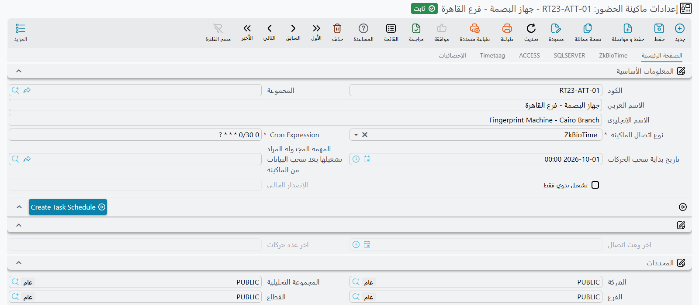

# تطبيق attcron لسحب بيانات الحضور (The attcron Attendance Agent)

ماكينات البصمة هي في الغالب أكثر الأجهزة إزعاجًا في شبكة أي منشأة. فهي موضوعة داخل أحد الفروع، خلف أي راوتر يصادف وجوده في ذلك الفرع، وتتوقع أن يتم التخاطب معها من داخل نفس الشبكة المحلية. أما نظام نما فيعمل على خادم في مكان آخر تمامًا — غالبًا في مركز بيانات، وغالبًا خلف جدار حماية لا يسمح بأي اتصال وارد.

**attcron** هو التطبيق الصغير الذي يسد هذه الفجوة. يتم تنصيبه في الفرع، بجوار ماكينة الحضور، حيث يستطيع الوصول إليها بحرية. وعلى فترات مجدولة يقوم بجمع البصمات الجديدة ودفعها **إلى الخارج** باتجاه نما. ولأن كل اتصال يبدأ من الفرع، فلا يحتاج أي فرع إلى IP ثابت ولا إلى فتح أي منفذ وارد؛ كل ما يحتاجه الفرع هو القدرة على الوصول إلى خادم نما.

::: tip اقرأ صفحة الإعدادات أولًا
كل ما يفعله attcron — أي ماكينة، وأي استعلام، وأي جدولة — يتحدد من خلال سجل **إعدادات ماكينة الحضور** في نما. فالتطبيق لا يحتفظ تقريبًا بأي إعدادات خاصة به؛ بل يسأل نما عن تعليماته في كل مرة يبدأ فيها العمل. جهّز ذلك السجل أولًا: [ماكينات الحضور](../modules/hr/attendance/attendance-machines.md).

هذه الخاصية بحاجة إلى ترخيص منفصل. يرجى التواصل مع فريق المبيعات أو الدعم الفني للحصول على الترخيص.
:::

## ما تحتاجه قبل البدء

على جهاز الفرع الذي سيشغّل التطبيق — وهو عادةً نفس الجهاز الذي يعمل عليه برنامج ماكينة الحضور:

- **JDK 21**
- **Apache Tomcat 10**، مع ضبط نوع التشغيل على **Automatic** حتى يعود التطبيق للعمل بعد إعادة تشغيل الجهاز

وفي نما:

- سجل **بيانات اعتماد الـ API** (API Credentials) — احتفظ بـ **Client ID** و **Client Secret**
- سجل **إعدادات ماكينة الحضور** محفوظ — احتفظ بـ **الكود** الخاص به

## التنصيب

يتم تسليم التطبيق عبر ملف تنصيب صغير يقوم بتحميله وفك ضغطه نيابةً عنك.

1. حمّل ملف التنصيب من [https://namasoft.com/bin/nama-attcron-upgrader.jar](https://namasoft.com/bin/nama-attcron-upgrader.jar).
2. ضع الملف **داخل مجلد Tomcat** وشغّله من هناك. فهو يبحث عن مجلد `webapps` بجواره؛ وإن شغّلته من أي مكان آخر فسيتوقف مع الرسالة *"Please run from inside tomcat folder"*.
3. يقوم بتحميل التطبيق، ثم ينتظر حتى يحرر Tomcat النسخة السابقة، ثم يضع النسخة الجديدة مكانها. ظهور رسائل عن انتظار حذف أحد المجلدات أمر طبيعي — امنحه دقيقة أو دقيقتين.
4. افتح المتصفح على ذلك الجهاز وادخل إلى `http://localhost:8080/attcron`.

::: warning لا تُعِد تسمية ملف التنصيب
يحدد ملف التنصيب ما الذي يقوم بتنصيبه من اسم الملف نفسه. وإعادة تسميته إلى اسم لا يحتوي على "cron" تجعله يُنصّب تطبيقًا خاطئًا.
:::

## التشغيل الأول: الاتصال بنما

عند فتح التطبيق لأول مرة تظهر شاشة إعداد قصيرة تطلب خمسة بيانات، كلها إلزامية:

| الحقل | ما الذي تُدخله |
|---|---|
| Nama Server URL | عنوان خادم نما لديك، مثل `https://erp.example.com`. |
| Nama Client Id | من سجل بيانات اعتماد الـ API. |
| Nama Client Secret | من سجل بيانات اعتماد الـ API. |
| Attendance Machine Config File Code | كود سجل إعدادات ماكينة الحضور. |
| Password (from attcron-password.txt in the Tomcat folder) | كلمة المرور الخاصة بالتطبيق نفسه، وشرحها في قسم «كلمة مرور التطبيق» أدناه. |

يمكنك كتابة عنوان الخادم بالصيغة المتوفرة لديك — بشرطة مائلة في نهايته أو بدونها، وبـ `/erp` أو بدونها — والتطبيق يستنتج الباقي.

اضغط **Start**. يتصل التطبيق فورًا بنما، ويجلب إعداداته، وما لم يكن خيار **Only Work Manually** مفعّلًا في تلك الإعدادات فإنه ينفذ عملية سحب بيانات أولى مباشرةً ثم يستقر على جدولته.

استخدم `https` في عنوان خادم نما حتى لا يُرسل الـ client secret عبر الشبكة بشكل مكشوف.

## كلمة مرور التطبيق

صفحة التطبيق محمية بكلمة مرور خاصة به. وهي ليست كلمة مرور أحد مستخدمي نما، ولا تُخزَّن في نما.

- عندما يبدأ التطبيق العمل ولا يجد ملف `attcron-password.txt` في مجلد Tomcat (أو يجده فارغًا)، ينشئ الملف ويكتب فيه كلمة مرور عشوائية من **8 أحرف**. افتح الملف على جهاز الفرع لقراءة كلمة المرور.
- كلمة المرور هي السطر الأول في ذلك الملف. ولتغييرها عدّل الملف: فالتطبيق يقرأ الملف عند كل تحقق، فلا حاجة إلى إعادة التشغيل، ويُسجَّل خروج كل متصفح دخل بكلمة المرور القديمة.
- يطلبها التطبيق في ثلاثة مواضع: في شاشة الإعداد، وفي صفحة **Sign In** التي تظهر للمتصفح عندما يكون التطبيق مُعدًّا بالفعل ولم يسجّل ذلك المتصفح دخوله بعد، وفي تأكيد **Logout**.
- الإحصائيات و **Send Now** و **Read For Period** مرفوضة إلى أن يسجّل المتصفح دخوله.
- بعد **خمس** كلمات مرور خاطئة خلال دقيقة واحدة، تُرفض كل محاولة — حتى بكلمة المرور الصحيحة — إلى أن تنقضي تلك الدقيقة. وكلمة المرور الخاطئة والمحاولة المحجوبة تُظهران الرسالة نفسها، وهي مذكورة في «رسائل قد تظهر لك» أدناه.

## الشاشة اليومية

بعد إتمام الإعداد يعرض التطبيق صفحة حالة تسرد آخر عمليات سحب البيانات — عمود **Date** وعمود **Records Count** لكل عملية — وتُحدّث نفسها كل ثلاثين ثانية. وفوقها أربعة أزرار:

| الزر | ما الذي يفعله |
|---|---|
| **Read For Period** | يطلب **From Date** و **To Date** (تاريخًا ووقتًا، ويأتيان معبّأين باليوم الحالي من 00:00 إلى 23:59)، ثم يعيد قراءة تلك الفترة بالتحديد. |
| **Send Now** | ينفذ عملية سحب بيانات فورًا، تمامًا كما لو حان موعد الجدولة. |
| **Refresh** | يعيد تحميل جدول الإحصائيات. |
| **Logout** | يطلب كلمة مرور التطبيق، ثم يوقف الجدولة ويفرغ إعدادات التطبيق المخزّنة ويسجّل خروج كل المتصفحات. ويعود التطبيق إلى شاشة الإعداد. |

يظهر رقم إصدار التطبيق بجوار الأزرار، كما يُرسَل إلى نما مع كل عملية إرسال، حيث يظهر في حقل **Current Release Version** على سجل الإعدادات.

::: tip زر Read For Period هو أداة تعويض البيانات الناقصة
استخدمه بعد توقف ماكينة عن العمل لفترة، أو بعد تصحيح استعلام. فهو يعيد قراءة الفترة التي تطلبها دون أن يخل بالنقطة التي وصلت إليها عملية السحب المجدولة، ونما يتجاهل القراءات التي لديه بالفعل — لذا فإعادة قراءة فترة متداخلة أمر آمن ولا ينتج عنه تكرار أبدًا.
:::

::: warning جدول الإحصائيات ليس سجلًا تاريخيًا
قائمة عمليات سحب البيانات محفوظة في الذاكرة فقط. فإعادة تشغيل Tomcat تفرغها، ومتى تجاوزت 50 سطرًا تُقلَّص إلى أحدث 30 سطرًا. إنها مؤشر حالة، وليست سجلًا. أما السجل الدائم فهو في نما، في تبويب **Statistics** على سجل الإعدادات.
:::

## ماذا يحدث في كل عملية سحب بيانات

يسأل التطبيق نما عن إعداداته الحالية، ثم يتخاطب مع الماكينة بالطريقة التي تحددها تلك الإعدادات — واجهة الويب الخاصة بـ ZkBioTime، أو قاعدة بيانات SQL Server، أو ملف Microsoft Access، أو خدمة Timetaag السحابية. ثم يجمع كل ما هو أحدث من النقطة التي وصل إليها آخر مرة، ويرسله إلى نما على دفعات، ويحفظ موضعه الجديد.

بعض الأرقام التي يفيد معرفتها وأنت تراقب عمله:

- عمليات السحب من قواعد البيانات تُرسَل على دفعات من **500** قراءة، ويُحفظ الموضع بعد كل دفعة — لذا فالعملية التي تنقطع في منتصفها تحتفظ بما أنجزته.
- عمليات السحب من ZkBioTime تُقرأ صفحة بصفحة، بواقع **100** قراءة لكل صفحة.
- وعمليات السحب من Timetaag تُقرأ كذلك صفحة بصفحة، بواقع **100** قراءة لكل صفحة، غير أن خدمة Timetaag تُرشِّح بالـ**تاريخ** لا بالوقت: فأياً كانت لحظتا البداية والنهاية اللتان يطلبهما التطبيق، تُعيد الخدمة كل قراءة يقع وقت بصمها في تلك التواريخ. ولذلك تُعيد كل عملية مجدوَلة قراءة اليوم الجاري بأكمله. ولأن النظام يتجاهل ما يملكه بالفعل، فلا ينتج عن ذلك أي تكرار — لكن الرقم في جدول الإحصائيات هو إجمالي اليوم حتى تلك اللحظة، لا عدد القراءات الجديدة، فتكرار الرقم نفسه طوال اليوم أمر طبيعي. وكل عملية Timetaag مجدوَلة تبدأ كذلك قبل النقطة التي وصلت إليها العملية السابقة بنصف ساعة. فبُعيد منتصف الليل يُعيد ذلك بدايةَ الفترة إلى التاريخ السابق، فيُقرأ اليوم السابق مرة أخيرة، وتصل إلى نما بصمةٌ سُجِّلت قُبيل منتصف الليل ورفعها الجهاز بعد دقائق من بدء اليوم الجديد.
- إذا رفض نما إحدى عمليات الإرسال، يحاول التطبيق إرسالها **ثلاث** مرات إجمالًا بفاصل ثانيتين ونصف قبل أن يتوقف ويسجل الفشل. ثم تحاول العملية المجدولة التالية مرة أخرى من نفس الموضع.
- عملية السحب التي لا تجد جديدًا لا ترسل شيئًا إلى نما، فلا تغيّر **Last Connection Time** ولا **Last Log Count** على سجل الإعدادات. وإنما تضيف سطرًا بعدد 0 إلى جدول إحصائيات التطبيق نفسه.
- عملية *Read For Period* لا تُحرّك الموضع المحفوظ عمدًا.

يعمل **Send Now** و **Read For Period** أثناء انتظارك في المتصفح. وقد تستغرق عملية تعويض كبيرة وقتًا طويلًا وتبقى الصفحة واقفة حتى تنتهي؛ وهذا أمر متوقع.

## أين يحفظ التطبيق بياناته

في ثلاثة ملفات. الأولان في مجلد عمل Tomcat (وهو عادةً مجلد `bin`، وإن كان ذلك يعتمد على طريقة تنصيب Tomcat)، والثالث في مجلد Tomcat نفسه.

**`attcron.properties`** يحتوي على القيم الأربع الأولى من شاشة الإعداد — مع تخزين الـ client secret مشفّرًا لا كنص صريح — إضافةً إلى الطابع الزمني الذي وصل إليه التطبيق في سحب البيانات.

**`namasoft.log`** هو سجل التطبيق، ويُستبدل عند بلوغه 100 ميجابايت مع الاحتفاظ بخمس نسخ مضغوطة. وهنا تكمن التفاصيل الحقيقية عندما يفشل شيء ما بصمت.

**`attcron-password.txt`** يحتوي على كلمة مرور التطبيق، وشرحها في قسم «كلمة مرور التطبيق» أعلاه.

ويترتب على ذلك أمران:

- **للبدء من جديد تمامًا**، اضغط **Logout**، أو أوقف Tomcat واحذف ملف `attcron.properties` أو أفرغه ثم شغّله مرة أخرى. وفي الحالتين يعود التطبيق إلى شاشة الإعداد، وهي تطلب كذلك كلمة المرور الموجودة في `attcron-password.txt`.
- **من أين يستأنف التطبيق بعد إعادة تشغيله.** في كل مرة يبدأ فيها التطبيق العمل (إعادة تشغيل Tomcat، أو إعداد جديد بعد *Logout*) يسأل نما عن أحدث وقت بصمة محفوظ لديه لتلك الإعدادات. فإن وُجد، كتبه التطبيق فوق الطابع الزمني المخزّن واستأنف منه. ولا يستخدم الطابع الزمني المخزّن إلا إذا لم تكن لدى نما أي قراءة لتلك الإعدادات، ثم **Fetching Transaction Start Date**، وإن لم يجد أيًّا منهما فمن قبل شهرين. ولذلك فتعديل الطابع الزمني في الملف لا يغيّر شيئًا متى كانت لدى نما قراءات لتلك الإعدادات؛ ولسحب فترة أقدم استخدم **Read For Period**.

## الترقية

لا يوجد تحديث تلقائي. يرسل التطبيق رقم إصداره إلى نما مع كل عملية إرسال، ويظهر في حقل **Current Release Version** على سجل إعدادات ماكينة الحضور — ومقارنة هذا الرقم بإصدار خادمك هي الطريقة التي تكتشف بها أن أحد الفروع قد تخلّف عن الركب. وللترقية، شغّل نفس ملف التنصيب مرة أخرى على جهاز الفرع.

## عندما يحدث خطأ ما

ابدأ من سجل الإعدادات في نما. فحقل **Last Connection Time** هو وقت آخر عملية إرسال حملت قراءة واحدة على الأقل؛ وتبويب **Statistics** يخبرك بما وصل من بيانات. ثم تحرّك للخلف:

**حقل Last Connection Time قديم.** إما أن التطبيق لا يصل إلى نما، أو أن عمليات السحب لا تجد ما ترسله. تأكد من أن Tomcat يعمل على جهاز الفرع، وافتح صفحته محليًا، وجرّب **Send Now** — فالفشل يظهر على الشاشة، والعملية التي نجحت ولم تجد شيئًا تضيف سطرًا بعدد 0 إلى جدول الإحصائيات.

**جدول إحصائيات التطبيق لا يعرض إلا أصفارًا.** التطبيق يعمل، لكن الماكينة لا تعطيه شيئًا. راجع الاستعلام في سجل الإعدادات وجرّب **Read For Period** على فترة تعلم أن بها بصمات.

**القراءات تصل لكن لا يظهر شيء في مستند الحضور والانصراف.** لقد وصلت إلى نما لكن لم تتحول إلى حضور بعد — راجع صندوق الوارد في تبويب Statistics على سجل الإعدادات، والمهمة المجدولة المحددة في حقل **Run Task Schedule After Fetching Transactions**.

**عمليات السحب تبدو متباعدة.** إذا لم يكن تعبير الـ cron بصيغة صحيحة من ستة حقول، يعود التطبيق بصمت إلى العمل كل اثنتي عشرة ساعة.

**إعداد Access لا يبدأ العمل.** يصرّ التطبيق على وجود قيم في Machine URL و Username و Password و Cron Expression كلها، أيًّا كان نوع الاتصال وحتى مع تفعيل **Only Work Manually**. واتصال Access يُفتح بمسار الملف، والتطبيق يمرّر Username و Password إلى مشغّل Access كبيانات دخول، فضع فيهما نصًّا وهميًا إذا لم تكن للملف كلمة مرور.

### رسائل قد تظهر لك

| الرسالة | المعنى |
|---|---|
| *File \[attcron.properties] is not found.* | تم الضغط على **Send Now** أو **Read For Period** بعد حذف ملف إعدادات التطبيق. أعد تشغيل Tomcat واملأ شاشة الإعداد من جديد. |
| *Error While Reading Configuration File, There are one or more property not found.* | تم الضغط على **Send Now** أو **Read For Period** والإعدادات المخزّنة ناقصة. أفرغ الملف وأعد تشغيل Tomcat واملأ شاشة الإعداد من جديد. |
| *Could not Find Attendance Machine Config File Data With Code (…)* | لا يوجد في نما سجل إعدادات بهذا الكود. تحقق من الكود، ومن أن السجل محفوظ. |
| *Invalid Attendance Machine Config File Data* | تم العثور على الإعدادات لكن ينقصها Machine URL أو Username أو Password أو Cron Expression. |
| *IO Exception While Calling Nama ERP Server* | الفرع لا يستطيع الوصول إلى عنوان الخادم المُدخَل. تحقق من الرابط ومن الشبكة ومن أي جدار حماية. |
| *Failed to save attendance logs after 3 retries: …* | رفض نما عملية الإرسال ثلاث مرات؛ والنص الذي يليها هو سبب الرفض من نما نفسه. |
| *UCanAccess driver not found* | مكوّن دعم Access مفقود — أعد تنصيب التطبيق. |
| *Invalid password, or too many failed attempts* | كلمة المرور المكتوبة في شاشة الإعداد أو صفحة Sign In أو تأكيد Logout لا تطابق `attcron-password.txt`، أو أُدخلت خمس كلمات مرور خاطئة خلال الدقيقة الأخيرة. |
| *Password is Required* | أُرسلت شاشة الإعداد، أو تم تأكيد *Logout*، وحقل كلمة المرور فارغ. |
| *From Date and To Date Inputs are Required.* | تم تأكيد *Read For Period* وأحد التاريخين فارغ. |

## صفحات ذات صلة

- **[ماكينات الحضور](../modules/hr/attendance/attendance-machines.md)** — سجل الإعدادات الذي يقود كل ما يفعله التطبيق.
- **[الربط مع ماكينات الحضور والانصراف](attendance-machines-integration.md)** — الأسلوب البديل القائم على ربط قاعدة بيانات الماكينة مباشرةً بقاعدة بيانات نما، دون تطبيق وسيط.
