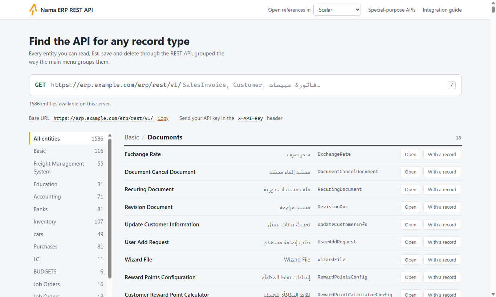
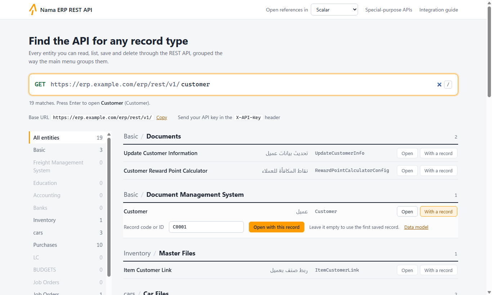
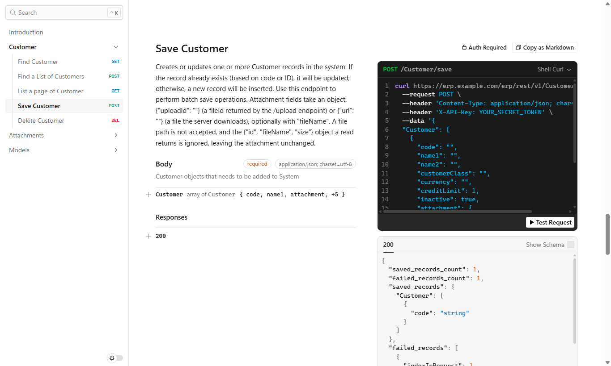

# واجهة برمجية REST لنظام نما

لنظام نما واجهة برمجية REST لإنشاء سجلات أي كيان وقراءتها وتعديلها وحذفها، وهو ينشر وصفًا بمواصفة OpenAPI (Swagger 2.0) لكل كيان لتبني عليه الأنظمة الخارجية.

للبدء بسرعة، شاهد هذا الفيديو: [مقدمة في واجهة REST API لنظام نما](https://youtu.be/lUxZMIoxxUY)

::: tip هل تبحث عن الصورة الكاملة للتكامل؟
قبل الغوص في تفاصيل الواجهة البرمجية، قد ترغب في قراءة المقال [سيناريوهات الربط بين نظام نما والأنظمة الأخرى](./system-integration-scenarios.md). يُحدد المقال الاتجاهات الأربعة الممكنة للتكامل (قراءة/كتابة × نما/النظام الآخر)، ويوضح أي السيناريوهات متاحة مجاناً من الصندوق وأيها يستلزم تطويراً مخصصاً، مع قائمة بالأسئلة التي ينبغي طرحها على العميل قبل تسعير أي تكامل.
:::

## نظرة عامة على متصفح الواجهة البرمجية (API Browser)

متصفح الواجهة البرمجية صفحةٌ على خادمك نفسه تسرد كل كيان تستطيع الواجهة البرمجية قراءته وحفظه، وتفتح لأيٍّ منها مرجعًا كاملًا: عملياته، والحقول التي يقبلها، وأمثلة برمجية جاهزة للنسخ، وزرًّا يرسل طلب تجربة إلى خادمك. وهو عادةً أول ما تعرضه على مطوّرٍ يستعد للربط مع نما.

### الوصول إلى متصفح الواجهة البرمجية

يجده مديرو النظام في صفحة **Utilities** باسم **Open API Browser**، ويمكنك كذلك الذهاب إلى عنوانه مباشرة:

```
http[s]://<server-ip-or-domain>/erp/browseapi/
```

وتحمل هذه الصفحة الأولى رابطين إلى قائمتين:

- **Entities API** ‏(`/erp/browseapi/browseentitiesapi.html`): كل الكيانات الموجودة على الخادم، وهي الصفحة التي يشرحها ما يلي.
- **Special Purpose APIs** ‏(`/erp/browseapi/browsespecialpurposesapi.html`): واجهات بُنيت لتكامل واحد بعينه، مثل مزامنة أجهزة الحضور والانصراف.



### البحث عن كيان

صُمِّم مربع البحث أعلى الصفحة على هيئة طلب: `GET https://<your-server>/erp/rest/v1/` يليه ما تكتبه. اكتب الاسم الإنجليزي أو العربي أو مُعرِّف الكيان: `SalesInvoice` و`Customer` و`فاتورة مبيعات` كلها تعمل، كما تتطابق صور الكتابة العربية المختلفة، فكلمة `فاتوره` تجد `فاتورة`. ويعرض السطر أسفل المربع عدد النتائج واسم أقربها، فاضغط **Enter** لفتحه. واضغط `/` في أي مكان من الصفحة للعودة إلى مربع البحث.

وتحت مربع البحث تظهر الكيانات مجمّعةً تمامًا كما تجمّعها القائمة الرئيسية (**Accounting / Master Files** و**Basic / Documents** وهكذا)، لأن القائمة تُبنى من القائمة الافتراضية نفسها. والكيان الذي تعرضه القائمة في موضعين يظهر في الموضعين. أما القائمة الجانبية على اليسار فتقصر الصفحة على مجموعة رئيسية واحدة من القائمة، وتعرض بجانب كل مجموعة عدد ما يطابق بحثك من كياناتها. والكيانات التي لها واجهة برمجية وليس لها مكان في القائمة تُجمع في النهاية تحت **Not in the menu**.

ولا يظهر إلا ما هو متاح على هذا الخادم: الوحدات والميزات والكيانات التي يستبعدها الترخيص أو إعدادات الأمان الخاصة بالمستخدم لا تظهر.

ويعرض كل سطر الاسم الإنجليزي والاسم العربي ومُعرِّف الكيان، وبالنقر على المُعرِّف يُنسخ. ويفتح زر **Open** مرجع الكيان في تبويب جديد.

### استخدام سجل حقيقي مثالًا

يسهل فهم المرجع كثيرًا حين يكون مثال جسم الطلب مستندًا حقيقيًا لا حقولًا فارغة. يفتح زر **With a record** لوحة صغيرة تحت السطر: اكتب كود سجل محفوظ أو مُعرِّفه واختر **Open with this record**، فيعرض المرجع بيانات ذلك السجل مثالًا. واترك المربع فارغًا لاستخدام أول سجل محفوظ. ويفتح رابط **Data model** المجاور صفحة الكيان في موقع نموذج البيانات.



### الاختيار بين Scalar و Swagger UI

يمكن عرض مرجع الكيان بأداتين، ويختار الحقل **Open references in** أعلى الصفحة بينهما:

- **Scalar** (الاختيار الافتراضي) يعرض العمليات على اليسار، وشرحها في الوسط، وأمثلة برمجية على اليمين بلغات curl وPython وNode.js وPHP وRuby وغيرها. ويرسل زر **Test Request** الطلب إلى خادمك من الصفحة نفسها.
- **Swagger UI** هي الصفحة التفاعلية المعروفة، ويرسل زر **Try it out** في كل عملية الطلب.

وكلتاهما تقرأ الوصف نفسه وتتصل بالخادم نفسه، فاختر ما تفضّله. ويتذكّر متصفحك اختيارك، فتُفتح الصفحة بالأداة نفسها في المرة القادمة، وتتبعه قائمة Special Purpose APIs أيضًا.



::: info لا شيء يغادر خادمك
الأداتان مثبّتتان مع نظام نما، فلا تحمّلان شيئًا من الإنترنت، ولا ترسلان مفتاح الواجهة البرمجية إلا إلى خادمك، ولذلك تعملان على الخوادم غير المتصلة بالإنترنت.
:::

ولتنفيذ أي عملية من الأداتين، أعطها مفتاح الواجهة البرمجية أولًا: زر **Authorize** في Swagger UI، أو مربع المصادقة أعلى صفحة Scalar. راجع [كيفية إنشاء مفتاح الواجهة البرمجية](#kyfy-nsh-mftH-lwjh-lbrmjy).

### مواصفات OpenAPI بصيغة JSON

#### نقطة OpenAPI الأساسية
```
http[s]://<server-ip-or-domain>/erp/browseapi/openapi/{EntityName}.json
```

#### OpenAPI مع بيانات مثال
```
http[s]://<server-ip-or-domain>/erp/browseapi/openapi/{EntityName}.json?exampleCode={code}
```

**المعاملات:**
- `{EntityName}`: نوع الكيان (مثل SalesInvoice وCustomer وItem)
- `{code}`: اختياري - كود سجل محدد أو UUID لاستخدامه كمثال

**أكواد الأمثلة الخاصة:**
- `Find@First`: يستخدم أول سجل متاح كمثال
- أي كود أعمال أو UUID صالح في نظامك

::: tip أمثلة على الروابط
```
# الحصول على مواصفة OpenAPI لـ SalesInvoice مع أول سجل متاح
http://localhost:8080/erp/browseapi/openapi/SalesInvoice.json?exampleCode=Find@First

# الحصول على مواصفة OpenAPI لـ Customer مع عميل محدد
http://localhost:8080/erp/browseapi/openapi/Customer.json?exampleCode=CUST001

# الحصول على مواصفة OpenAPI لـ Item بدون أمثلة
http://localhost:8080/erp/browseapi/openapi/Item.json
```
:::

### بنية استجابة الواجهة البرمجية

تتضمن مواصفة OpenAPI تعريفات مخطط تفصيلية لكل كيان:

#### تعيين أنواع الحقول
- **حقول النص**: Text وBigText وDate وDateTime وTime وEmail وColor وLatLng وEnum
- **حقول الأرقام**: Decimal وInteger
- **حقول القيم المنطقية**: حقول من نوع Boolean
- **حقول المرجع**: تُرجع كود الكيان المُشار إليه
- **المراجع العامة**: كائن يحتوي على `entityType` و`code`
- **حقول المرفقات**: كائنات — تُقرأ على شكل `{"id", "fileName", "size"}`، وتُكتب عند الحفظ بالصيغة `{"uploadId": ...}` أو `{"url": ...}` — انظر قسم «رفع الملفات وإرفاقها» أدناه
- **Collections/التفاصيل**: مصفوفات من الكائنات (مثل بنود الفاتورة وتفاصيل الدفع)

#### الحقول المستثناة
تستثني الواجهة البرمجية تلقائياً:
- الحقول التي يولدها النظام (ما لم يُطلب ذلك تحديداً)
- الحقول المحسوبة
- محتوى الحقول الثنائية (الصور والمستندات) من استجابات القراءة — أما حقل المرفق فيعود بدلاً من ذلك بمعرّفه واسم ملفه وحجمه، ويمكن كتابته عند الحفظ؛ انظر قسم «رفع الملفات وإرفاقها» أدناه
- حقول تتبع المستخدمين الداخلية

### التعامل مع collections الكيانات

تتضمن كثير من الكيانات collections تفصيلية (علاقات one-to-many). فبنود فاتورة المبيعات مثلاً هي الـ collection المسماة `details`، وكل بند يضم الصنف والكمية والسعر ككائنات متداخلة:

```json
{
  "details": {
    "type": "array",
    "items": {
      "properties": {
        "item": {
          "properties": {
            "item": { "type": "string" }
          }
        },
        "quantity": {
          "properties": {
            "quantity": {
              "properties": {
                "primeQty": {
                  "properties": {
                    "value": { "type": "number" },
                    "uom": { "type": "string" }
                  }
                }
              }
            }
          }
        },
        "price": {
          "properties": {
            "unitPrice": { "type": "number" }
          }
        }
      }
    }
  }
}
```

تمثل collections السجلات التفصيلية مثل:
- بنود الفاتورة
- بنود الدفع
- بنود الطلب
- بنود قيد اليومية

---

## المصادقة والوصول إلى الواجهة البرمجية

### طرق المصادقة

تدعم واجهة REST لنما طريقتين للمصادقة:

#### 1. المصادقة بمفتاح الواجهة البرمجية API Key (موصى بها)

تعد API Keys الطريقة الأساسية للمصادقة في تكاملات الإنتاج.

**المصادقة عبر الترويسة (Header):**
```http
X-API-Key: {your-api-key}
```

وتعمل الصيغة القياسية Bearer بالكفاءة نفسها، وهي ما ترسله معظم أدوات الواجهات البرمجية وعملاء الذكاء الاصطناعي تلقائيًا — ضع المفتاح نفسه (حقل **Client Secret** في بيانات الاعتماد) داخل الرمز:
```http
Authorization: Bearer {your-api-key}
```

::: warning المصادقة برمز Bearer تتطلب إصدار 20260922 فأحدث
لا يقرأ ترويسة `Authorization: Bearer` إلا الخوادم من إصدار 20260922 فصاعدًا. أما الخادم الأقدم فيتجاهلها ويرفض الطلب باعتباره غير مصادَق عليه — استخدم معه `X-API-Key`.
:::

أما بيانات الاعتماد المُهيَّأة بمعرّف عميل (client ID) وسر (secret) منفصلين فتُرسَل بترويستين معاً — معرّف العميل في `X-API-Key` والسر في `X-API-Secret`:
```http
X-API-Key: {your-client-id}
X-API-Secret: {your-client-secret}
```

::: tip توافق أسماء الترويسات
`X-API-Key` / `X-API-Secret` هما الاسمان الموصى بهما للترويسات، لكن الأسماء القديمة لا تزال مدعومة: `apiKey` (أو `clientId`) للمفتاح و`clientSecret` للسر. ويُقبل كل اسم سواء كترويسة HTTP أو كمعامل استعلام. ويُقرأ المفتاح أولًا من `X-API-Key` (وأسمائها القديمة)، ولا يُنظر إلى `Authorization: Bearer` إلا إذا خلا الطلب منها جميعًا.
:::

**المصادقة عبر معامل الاستعلام (للاختبار فقط):**
```
http://localhost:8080/erp/browseapi/openapi/SalesInvoice.json?X-API-Key={your-api-key}
```

::: warning
يجب استخدام المصادقة عبر معامل الاستعلام للاختبار في متصفح الواجهة البرمجية فقط. يجب أن تستخدم تكاملات الإنتاج المصادقة عبر الترويسة لأسباب أمنية.
:::

#### 2. المصادقة بالجلسة

في الاختبار عبر المتصفح، يمكن استخدام ملفات تعريف الارتباط (cookies) من جلسة مستخدم مُسجَّل دخوله.

### كيفية إنشاء مفتاح الواجهة البرمجية

يستطيع **مسؤول النظام** إنشاء API Keys عبر شاشة **API Credentials**:

1. افتح شاشة API Credentials (**الأساسيات ← المستندات ← API Credentials**)
2. أنشئ سجلاً جديداً يتضمن:
   - **الكود**: معرّف فريد لبيانات اعتماد الواجهة البرمجية
   - **الاسم**: اسم وصفي للتكامل
3. اختر **المستخدم** الذي ستُطبَّق صلاحياته على هذا المفتاح
4. احفظ السجل
5. **مهم**: يظهر API Key مرة واحدة بعد الحفظ — انسخه فوراً
6. أرسل المفتاح بأمان إلى فريق التطوير أو التكامل

::: tip وراثة الصلاحيات
يرث API Key جميع صلاحيات الوصول من المستخدم المختار:
- حقوق الوصول إلى الكيانات
- صلاحيات الوحدات
- قواعد رؤية البيانات
- قيود الشركة/الفرع
:::

::: info كل سجل ملك لمستخدمه
سجل API Credentials ملك للمستخدم المذكور في حقل **المستخدم**. مدير النظام يرى سجلات الجميع ويديرها؛ وأي مستخدم آخر لا يرى إلا سجلاته، وحقل **المستخدم** الفارغ يُملأ بمن يحفظ السجل. وحفظ سجل يذكر مستخدمًا آخر، من غير مدير النظام، يُرفض بالرسالة *You can only create or edit records that belong to you* (بالإنجليزية فقط — لا ترجمة عربية لها).
:::

### عرض API Keys بعد الإنشاء

لعرض API Key مجدداً بعد إنشائه:

1. افتح سجل API Credentials
2. حدد خيار **"View API Key"**
3. انقر **حفظ**
4. سيظهر API Key على الشاشة

::: info سجل التدقيق
يُسجَّل إعادة عرض API Key في سجل التدقيق لأغراض التتبع الأمني.
:::

### أفضل الممارسات لـ API Keys

1. **أنشئ مفاتيح منفصلة** لكل تكامل
2. **استخدم أسماء وصفية** لتحديد كل تكامل
3. **امنح أدنى الصلاحيات** اللازمة لكل تكامل
4. **جدِّد المفاتيح دورياً** لأسباب أمنية
5. **راقب استخدام الواجهة البرمجية** عبر سجلات التدقيق
6. **ألغِ المفاتيح غير المستخدمة** للحد من المخاطر الأمنية

---

## إعداد CORS

يتولى متصفح الواجهة البرمجية تلقائياً إدارة Cross-Origin Resource Sharing (CORS) لطلبات الواجهة البرمجية:

- يسمح بالطلبات عبر المنشأ من أي نطاق (وضع التطوير)
- يدعم طلبات OPTIONS التمهيدية (preflight)
- يتضمن ترويسات CORS اللازمة في الاستجابات

::: warning CORS في الإنتاج
في بيئات الإنتاج، قم بإعداد سياسات CORS لتقييد الوصول على نطاقات محددة لأسباب أمنية.
:::

---

## نقاط نهاية REST API

### بنية رابط الأساس
```
http[s]://<server>/erp/rest/v1/{entity}/{operation}/{idOrCode}
```

**معاملات المسار:**
- `{entity}`: اسم نوع الكيان (مثل Customer وSalesInvoice وItem)
- `{operation}`: العملية المراد تنفيذها (findByIdOrCode وlist وsave وdelete)
- `{idOrCode}`: اختياري - UUID الكيان أو كود الأعمال

### دعم أساليب HTTP

تدعم الواجهة البرمجية عدة أساليب HTTP للمرونة:

| أسلوب HTTP | العمليات المدعومة | الاستخدام |
|-------------|---------------------|--------|
| **GET** | findByIdOrCode | استرجاع كيان واحد بالمعرّف/الكود |
| **POST** | جميع العمليات | الأسلوب الشامل لكل العمليات |
| **PUT** | save | تحديث الكيانات الموجودة |
| **DELETE** | delete | حذف الكيانات |

::: tip مرونة RESTful
بينما تدعم الواجهة البرمجية اتفاقيات RESTful، يمكن تنفيذ جميع العمليات باستخدام أسلوب POST للتوافق مع مختلف تطبيقات العملاء.
:::

### العمليات المدعومة

#### 1. استرجاع كيان (GET)
```http
GET /erp/rest/v1/{entity}/findByIdOrCode/{idOrCode}
X-API-Key: {api-key}
responseFields: code,name1,contactInfo.email  # ترويسة/معامل اختياري
```

**الاسترجاع الدفعي:**
```http
POST /erp/rest/v1/{entity}/findByIdOrCode
X-API-Key: {api-key}
Content-Type: application/json

["CUST001", "CUST002", "550e8400-e29b-41d4-a716-446655440000"]
```

#### 2. سرد الكيانات مع التصفيح (POST)
```http
POST /erp/rest/v1/{entity}/list
X-API-Key: {api-key}
Content-Type: application/json

{
  "startPage": 1,      # رقم الصفحة (يبدأ من 1)
  "pageSize": 25,      # الحد الأقصى 1000 سجل لكل صفحة
  "textCriteria": "status,Equal,Active,AND;city,Equal,Riyadh,AND;",
  "orderBy": "creationDate:desc,code"
}
```

**تتضمن الاستجابة:**
- `totalRecordsCount`: إجمالي السجلات المطابقة
- `records`: مصفوفة السجلات المطلوبة
- `records_count`: عدد السجلات في الاستجابة

#### 3. إنشاء/تحديث كيان (POST/PUT)
```http
POST /erp/rest/v1/{entity}/save
X-API-Key: {api-key}
Content-Type: application/json

# ترويسات/معاملات الطلب:
saveAsDraft: false           # الحفظ كمسودة بدون التحقق
addRecord: true              # السماح بإنشاء سجلات جديدة
updateRecord: true           # السماح بتحديث السجلات الموجودة
addToCurrentLines: false     # الإضافة إلى البنود التفصيلية الموجودة
trimExtraSpaces: false       # إزالة المسافات الزائدة من النصوص
continueOnErrors: true       # الاستمرار في المعالجة عند الأخطاء
useUserDimension: true       # تطبيق فلاتر محددات المستخدم
ignoredUnFoundRefs: false    # تجاهل المراجع غير الموجودة
responseFields: code,id      # الحقول المُرجَعة بعد الحفظ

# الجسم: بيانات الكيان بصيغة JSON
{
  "code": "CUST001",
  "name1": "Customer Name",
  "contactInfo": {
    "email": "customer@example.com",
    "mobile": "+966501234567"
  }
}
```

وتُرسل بنود المستند في الجسم نفسه داخل الـ collection الخاصة به — لفاتورة المبيعات مثلاً:

```json
{
  "details": [
    {
      "item": { "item": "ITEM001" },
      "quantity": { "quantity": { "primeQty": { "value": 5 } } },
      "price": { "unitPrice": 100 }
    }
  ]
}
```

**الاستجابة:**
```json
{
  "saved_records_count": 1,
  "saved_records": {
    "Customer": [
      {
        "code": "CUST001",
        "id": "550e8400-e29b-41d4-a716-446655440000"
      }
    ]
  }
}
```

#### 4. حذف كيان (DELETE)
```http
DELETE /erp/rest/v1/{entity}/delete/{idOrCode}
X-API-Key: {api-key}
```

**الحذف الدفعي:**
```http
POST /erp/rest/v1/{entity}/delete
X-API-Key: {api-key}
Content-Type: application/json

["CUST001", "CUST002", "550e8400-e29b-41d4-a716-446655440000"]
```

**الاستجابة:**
```json
{
  "deleted_records_count": 2,
  "deleted_records": ["CUST001", "CUST002"],
  "failed_records_count": 1,
  "failed_records": [
    {
      "entityType": "Customer",
      "code": "550e8400-e29b-41d4-a716-446655440000",
      "indexInRequest": 2,
      "errors": [
        {
          "message": "Record is referenced by other entities"
        }
      ]
    }
  ]
}
```

## رفع الملفات وإرفاقها (Attachments)

طلب الحفظ مكتوب بصيغة JSON، وJSON يحمل نصوصاً فقط — فلا يمكن أن تضع فيه مباشرةً ملف PDF لعقد موقَّع أو صورة ممسوحة لسجل تجاري. بدلاً من ذلك يأخذ حقل المرفق كائن JSON صغيراً يخبر الخادم من أين يحصل على الملف، وله صيغتان:

| القيمة | معناها |
|---|---|
| `{"uploadId":"<fileId>"}` | ملف أرسلته مسبقاً إلى نقطة الرفع، فأعادت لك هذا المعرّف `fileId` |
| `{"url":"<http or https address>"}` | يقوم الخادم نفسه بتنزيل الملف من هذا العنوان |

ويمكن لأي من الصيغتين أن تحمل أيضاً `"fileName"`، وهو الاسم الذي يُحفظ به الملف، ويتقدّم على الاسم الذي رُفع به الملف أو المأخوذ من العنوان.

وبعض القيم تستحق التوضيح:

- **وجود `uploadId` و`url` معاً في كائن واحد** يجعل حفظ ذلك السجل يفشل — أعطِ أحدهما فقط.
- **الكائن الذي لا يحمل أياً منهما** يُتجاهل، ويبقى المرفق الموجود في السجل كما هو. وهذا مقصود: فالقراءة تعيد المرفق على شكل `{"id":...,"fileName":...,"size":...}` (انظر «قراءة حقول المرفقات» أدناه)، فإذا قرأت سجلاً وعدّلته في مكان آخر ثم أعدته كما جاء، بقيت مرفقاته على حالها.
- **النص المجرّد** — مسار ملف على جهازك أو على الخادم مثل `C:\docs\contract.pdf`، أو أي نص آخر — **غير مقبول**. فهو يجعل حفظ ذلك السجل يفشل برسالة تبدأ بـ `An attachment is given as an object` وتشرح صيغتي الكائن، وهي بالإنجليزية أياً كانت لغة المستدعي.

::: warning تتطلب إصدار 20261007 فأحدث
كتابة حقول المرفقات عبر نقطة الحفظ، ونقطة الرفع الموضحة أدناه، لا توجدان إلا في الخوادم من إصدار 20261007 فصاعداً.
:::

### معرفة معرّف حقل المرفق

تظهر حقول المرفقات في مخطط OpenAPI/Swagger الخاص بالكيان مثل أي حقل آخر، ونوعها `object` بالخصائص `uploadId` و`url` و`fileName` — وبهذا تميّزها عن الحقول العادية. فملف العميل مثلاً فيه حقل مرفق معرّفه `attachment`.

### الطريقة الأولى: ارفع الملف ثم احفظ

الرفع يتم على خطوتين: أرسل الملف، ثم احفظ السجل الذي يشير إليه.

**الخطوة 1 — الرفع.** أرسل الملف إلى نقطة الرفع، مصادَقاً بمفتاح API نفسه المستخدم في بقية الطلبات، بصيغة `multipart/form-data` تحتوي على جزء ملف واحد:

```http
POST http[s]://<server>/erp/rest/v1/upload
X-API-Key: {api-key}
Content-Type: multipart/form-data
```

باستخدام curl:

```bash
curl -X POST "https://<server>/erp/rest/v1/upload" -H "X-API-Key: <api-key>" -F "file=@invoice-1001.pdf"
```

ويرد الخادم بالمعرّف الذي أعطاه للملف:

```json
{"fileId":"..."}
```

**الخطوة 2 — الحفظ.** ضع هذا المعرّف في حقل المرفق باسم `uploadId`:

```http
POST /erp/rest/v1/Customer/save
X-API-Key: {api-key}
Content-Type: application/json

{"Customer":[{"code":"CUST001","attachment":{"uploadId":"<fileId>"}}]}
```

::: tip ارفع الملف قبيل الحفظ مباشرة
يُحفظ الملف المرفوع في التخزين المؤقت للخادم إلى أن يستخدمه طلب حفظ، ولا يبقى بعد إعادة تشغيل الخادم. لذا ارفعه قبل طلب الحفظ الذي يستخدمه مباشرة، بدلاً من رفع دفعة ملفات مقدَّماً.
:::

### الطريقة الثانية: دع الخادم يجلب الملف

إذا كان الملف موجوداً أصلاً على عنوان ويب يستطيع الخادم الوصول إليه، فلا حاجة للرفع — أعطِ العنوان مباشرة، وهنا مع `fileName` أيضاً ليُحفظ المرفق باسم أوضح من الاسم الموجود في العنوان:

```json
{"Customer":[{"code":"CUST001","attachment":{"url":"https://files.example.com/contracts/cust001.pdf","fileName":"cust001-contract.pdf"}}]}
```

ينزّل الخادم الملف أثناء الحفظ، وفق القواعد التالية:

- **عناوين `http` و`https` فقط.**
- **لا عناوين داخل شبكة الخادم نفسه.** يرفض الخادم العنوان الذي يشير إلى الخادم ذاته أو إلى عنوان link-local، كما يرفض — ما لم تُضبط الخاصية `import-url-allow-private-network=true` في ملف `nama.properties` — العناوين الموجودة على شبكة خاصة. هذا يمنع استغلال طلب الحفظ لسحب ملفات من أجهزة داخلية لا يستطيع المستدعي الوصول إليها بنفسه.
- **الحد الأقصى للحجم 50 ميجابايت** افتراضياً، ويمكن تغييره بالخاصية `import-url-max-file-size-mb` في `nama.properties`.
- **يُتبع حتى 5 تحويلات (redirects).**
- **اسم الملف**، إذا لم يُعطَ `fileName`، يؤخذ من ترويسة `Content-Disposition` في الاستجابة، وإلا فمن الجزء الأخير من مسار العنوان.

إذا رُفض التنزيل أو فشل، يفشل حفظ ذلك السجل برسالة (بالإنجليزية فقط) تذكر العنوان والسبب.

### قراءة حقول المرفقات

تُظهر استجابات القراءة — لسجل واحد أو لقائمة — حقل المرفق على شكل وصف قصير للملف، ولا تُظهر محتواه أبداً:

```json
"attachment": {"id": "...", "fileName": "cust001-contract.pdf", "size": 48213}
```

الحجم `size` بالبايت. وحقل المرفق الفارغ لا يُعاد له وصف. ولأن الكائن الخالي من `uploadId` و`url` يُتجاهل عند الحفظ، يمكن أن يعود هذا الوصف كما هو داخل طلب حفظ دون أن يمس الملف المحفوظ.

### التجربة من متصفح الواجهة البرمجية

يحتوي مرجع كل كيان، في Scalar أو Swagger UI، على قسم **Attachments** فيه عملية الرفع، ويمكنك تجربتها مباشرة من الصفحة: اختر ملفاً، وأرسل الطلب، ثم انسخ قيمة `fileId` من الاستجابة إلى `{"uploadId":"..."}` في جسم عملية الحفظ. كما أن وصف عملية الحفظ نفسها يذكر صيغتي الكائن.

## اختبار الواجهات البرمجية

### استخدام متصفح الواجهة البرمجية للاختبار

يوفر متصفح الواجهة البرمجية عدة طرق لاختبار الواجهات:

#### 1. الوصول المباشر إلى OpenAPI JSON
```bash
# الحصول على مواصفة OpenAPI مع أمثلة
curl -H "X-API-Key: {api-key}" \
  "http://localhost:8080/erp/browseapi/openapi/Customer.json?exampleCode=Find@First"
```

#### 2. الاستيراد إلى Postman
1. انسخ رابط OpenAPI JSON
2. في Postman: Import → Link → الصق الرابط
3. أضف API Key إلى مصادقة المجموعة
4. اختبر جميع عمليات CRUD

#### 3. المرجع التفاعلي
افتح الكيان من [متصفح الواجهة البرمجية](#lbHth-aan-kyn) وأرسل الطلبات من صفحة مرجعه: زر **Test Request** في Scalar، أو **Try it out** في Swagger UI.

### أمثلة على صيغ الطلبات

#### البحث عن سجل واحد
```http
GET /erp/rest/v1/Customer/findByIdOrCode/CUST001
X-API-Key: {api-key}
```

#### البحث عن سجلات متعددة
```http
POST /erp/rest/v1/Customer/findByIdOrCode
X-API-Key: {api-key}
Content-Type: application/json

["CUST001", "CUST002", "CUST003"]
```

#### إنشاء سجل جديد
```http
POST /erp/rest/v1/Customer/save
X-API-Key: {api-key}
Content-Type: application/json
addRecord: true
updateRecord: false

{
  "code": "CUST001",
  "name1": "Customer Name",
  "contactInfo": {
    "email": "customer@example.com",
    "mobile": "+966501234567"
  }
}
```

#### تحديث سجل موجود
```http
POST /erp/rest/v1/Customer/save
X-API-Key: {api-key}
Content-Type: application/json
addRecord: false
updateRecord: true

{
  "code": "CUST001",
  "name1": "Updated Customer Name",
  "contactInfo": {
    "email": "newemail@example.com"
  }
}
```

#### السرد مع الفلاتر
```http
POST /erp/rest/v1/Customer/list
X-API-Key: {api-key}
Content-Type: application/json

{
  "startPage": 1,
  "pageSize": 50,
  "textCriteria": "city,Equal,Riyadh,AND;status,Equal,Active,AND;",
  "orderBy": "status,creationDate:desc,name1"
}
```

---

## معالجة الأخطاء

تُرجع الواجهة البرمجية رموز حالة HTTP قياسية ورسائل خطأ تفصيلية:

### رموز الاستجابة الشائعة
- **200 OK**: طلب ناجح
- **201 Created**: تم إنشاء المورد بنجاح
- **400 Bad Request**: معاملات طلب غير صالحة
- **401 Unauthorized**: مفتاح API مفقود أو غير صالح
- **403 Forbidden**: صلاحيات غير كافية
- **404 Not Found**: المورد غير موجود
- **500 Internal Server Error**: خطأ على جانب الخادم

### صيغة استجابة الخطأ
```json
{
  "error": {
    "code": "ENTITY_NOT_FOUND",
    "message": "Customer with code CUST999 not found",
    "details": "Additional error information"
  }
}
```

---

## الواجهات البرمجية ذات الأغراض الخاصة

بالإضافة إلى عمليات CRUD القياسية، يوفر نما واجهات متخصصة:

### تكامل أجهزة الحضور والانصراف
- نقطة النهاية: `attcron-open-api-template`
- الغرض: مزامنة بيانات الحضور من أجهزة البصمة البيومترية
- يدعم المعالجة الدفعية لسجلات الحضور

### واجهة برمجية لتصدير البيانات
- تصدير السجلات بصيغة JSON مع بيانات العلاقات الكاملة
- يدعم الفلترة والتصفيح
- يحافظ على سلامة البيانات للنسخ الاحتياطي/الترحيل

### العمليات الدفعية
- معالجة سجلات متعددة في طلب واحد
- معالجة تعاملية مع التراجع عند الأخطاء
- محسَّنة للتكاملات ذات الحجم الكبير

---

## اعتبارات الأداء

### التصفيح
تدعم جميع نقاط نهاية السرد التصفيح بحجم صفحة قابل للتهيئة:

```http
POST /erp/rest/v1/{entity}/list
Content-Type: application/json

{
  "startPage": 1,     # ترقيم يبدأ من 1
  "pageSize": 50      # الحد الأقصى 1000 لكل طلب
}
```

**استجابة التصفيح:**
```json
{
  "totalRecordsCount": 2547,
  "records_count": 50,
  "records": { ... }
}
```

### اختيار الحقول
تحكم في الحقول المُرجَعة لتحسين حجم البيانات:

```http
GET /erp/rest/v1/{entity}/findByIdOrCode/{code}
responseFields: code,name1,status,balance
```

**استخدام معامل responseFields:**
- مررها كترويسة HTTP: `responseFields: field1,field2,field3`
- أو كمعامل استعلام: `?responseFields=field1,field2,field3`
- تدعم الحقول المتداخلة: `contactInfo.email,address.city`
- الحقول الافتراضية إذا لم تُحدَّد: `code,id`

### العمليات الدفعية
عالج سجلات متعددة في طلب واحد لأداء أفضل:

#### الاسترجاع الدفعي
```http
POST /erp/rest/v1/Customer/findByIdOrCode
Content-Type: application/json

["CUST001", "CUST002", "550e8400-e29b-41d4-a716-446655440000"]
```

#### الاستيراد/الحفظ الدفعي
```http
POST /erp/rest/v1/Customer/save
Content-Type: application/json
continueOnErrors: true

[
  {
    "code": "CUST001",
    "name1": "Customer 1"
  },
  {
    "code": "CUST002", 
    "name1": "Customer 2"
  }
]
```

### المعايير والترتيب
استخدم صيغة المعايير النصية المنظَّمة في نما للفلترة والترتيب:

```json
{
  "textCriteria": "code,StartsWith,INV,AND;status,Equal,Active,AND;balance,GreaterThan,1000,AND;",
  "orderBy": "status,creationDate:desc,code:asc"
}
```

**صيغة المعايير النصية:**
يتبع كل شرط النمط التالي: `fieldID,operator,value,logic;`

**أمثلة على المعايير:**
```
code,StartsWith,01,AND;
name1,Contains,abc,AND;
date1,Equal,06-07-2025,AND;
creationDate,GreaterThanOrEqual,2025-07-06T13:05:00.000,AND;
amount,GreaterThan,1000,AND;
status,Equal,Active,OR;
type,In,Type1|Type2|Type3,AND;
```

**المشغّلات المدعومة:**
- **المساواة**: `Equal` و`NotEqual`
- **المقارنة**: `GreaterThan` و`GreaterThanOrEqual` و`LessThan` و`LessThanOrEqual`
- **مطابقة النص**: `StartsWith` و`NotStartsWith` و`EndsWith` و`NotEndWith` و`Contains` و`NotContain`
- **عمليات القوائم**: `In` و`NotIn`
- **التجميع**: `OpenBracket` و`CloseBracket`

**العلاقات المنطقية:**
- `AND` - يجب أن تتحقق جميع الشروط
- `OR` - يكفي تحقق شرط واحد على الأقل

**صيغ قيم الحقول:**
- **حقول التاريخ**: `dd-MM-yyyy` (مثال: `06-07-2025`)
- **حقول التاريخ والوقت**: `yyyy-MM-ddTHH:mm:ss.SSS` (مثال: `2025-07-06T13:05:00.000`)
- **حقول المرجع**: `id:entityType:code` أو استخدام اللاحقة `.id`/`.code`
  - مثال: `customer.id,Equal,ffff0001-79e2-11f2-8800-0000ff79c2dd,AND;`
  - مثال: `customer.code,Equal,CUST001,AND;`

::: tip بناء المعايير
استخدم شاشة [تعريف المعايير](/ar/platform/automation-and-rules/criteria-definitions) (Criteria Definition) في نما لبناء شروط الفلتر بصرياً، ثم انقر **Convert to Text** للحصول على التمثيل النصي للاستخدام في الواجهة البرمجية.
:::

### صيغة الترتيب
حدد ترتيب الفرز لحقل واحد أو أكثر باستخدام قيم مفصولة بفواصل:

**الصيغة:** `fieldName:direction,fieldName2:direction,fieldName3`

**أمثلة:**
- حقول متعددة: `"orderBy": "code:desc,name1,creationDate:asc"`
- حقل واحد: `"orderBy": "code:asc"`
- الاتجاه الافتراضي (تصاعدي): `"orderBy": "name1,code"`
- اتجاهات مختلطة: `"orderBy": "status,creationDate:desc,code:asc"`

**قيم الاتجاه:**
- `:asc` - ترتيب تصاعدي (أ-ي، 0-9، من الأقدم للأحدث) - **الافتراضي إذا حُذف**
- `:desc` - ترتيب تنازلي (ي-أ، 9-0، من الأحدث للأقدم)

**ملاحظات:**
- الاتجاه اختياري؛ عند حذفه يُطبَّق الترتيب التصاعدي (`:asc`) افتراضياً
- الحقول المتعددة مفصولة بفواصل
- يمكن لكل حقل أن يملك اتجاه فرز خاص به
- يُزال تلقائياً أي تكرار في الحقول

### خيارات الاستيراد
ضبط دقيق لسلوك الاستيراد عبر ترويسات الطلب:

| المعامل | الافتراضي | الوصف |
|-----------|---------|-------------|
| `saveAsDraft` | false | الحفظ بدون قواعد التحقق |
| `addRecord` | true | السماح بإنشاء سجلات جديدة |
| `updateRecord` | true | السماح بتحديث السجلات الموجودة |
| `addToCurrentLines` | false | الإضافة إلى البنود التفصيلية الموجودة بدلاً من استبدالها |
| `trimExtraSpaces` | false | إزالة المسافات البادئة واللاحقة |
| `continueOnErrors` | true | الاستمرار في معالجة السجلات المتبقية عند الخطأ |
| `useUserDimension` | true | تطبيق فلاتر محددات المستخدم |
| `ignoredUnFoundRefs` | false | تخطي التحقق من حقول المرجع |

---

## استكشاف الأخطاء وإصلاحها

### المشكلات الشائعة وحلولها

#### API Key لا يعمل
- تحقق من أن المفتاح نشط في شاشة API Credentials
- تحقق من صلاحيات المستخدم على الكيان
- تأكد من ضبط ترويسة `X-API-Key` بشكل صحيح (وترويسة `X-API-Secret` عند استخدام زوج معرّف العميل/السر) — وإن كان العميل يرسل `Authorization: Bearer` فتأكد أن الخادم على إصدار 20260922 فأحدث

#### بيانات مثال فارغة
- تحقق من وجود سجلات للكيان
- تحقق من صلاحيات رؤية البيانات للمستخدم
- استخدم `Find@First` للحصول على أي سجل متاح

#### حقول مفقودة في الاستجابة
- حقول النظام مستثناة افتراضياً
- محتوى الملفات غير مدرج في استجابات الواجهة البرمجية — فحقل المرفق يعيد معرّفه واسم ملفه وحجمه فقط (ويمكن كتابته — انظر قسم «رفع الملفات وإرفاقها»)
- الحقول المحسوبة غير متاحة عبر الواجهة البرمجية
