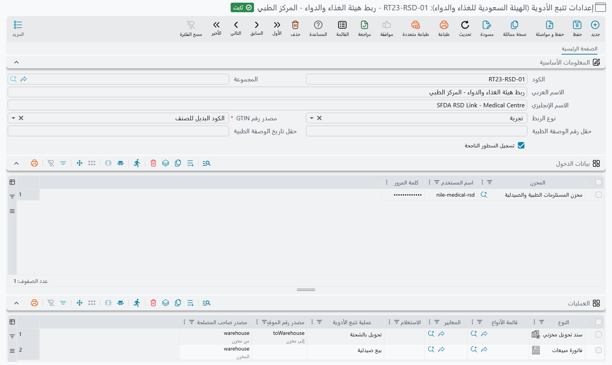

# الإبلاغ عن حركات الأدوية للهيئة السعودية للغذاء والدواء

تدير الهيئة السعودية للغذاء والدواء نظامًا وطنيًا لتتبع الأدوية. فكل دواء مسجَّل يحمل رقم صنف تجاري عالمي ورقم شحنة، ويحمل معظم العبوات رقمًا مسلسلًا فريدًا لكل عبوة، وكلما انتقلت عبوة من يد إلى يد وجب الإبلاغ عن الحركة. فموزّع الجملة يبلّغ عن الصرف إلى الصيدلية، والصيدلية تبلّغ عن الاستلام، ثم تبلّغ مرة أخرى حين تبيع العبوة لمريض. والهيئة تطابق الطرفين، ولهذا فإن حركة لم يُبلَّغ عنها لا تمرّ دون أن يلاحظها أحد — بل تترك بلاغ الطرف الآخر بلا مطابقة.

ويتولى نظام نما هذا الإبلاغ نيابة عنك انطلاقًا من مستندات المخازن المعتادة التي يحررها موظفوك أصلًا. فلا أحد مضطر لزيارة بوابة الهيئة، ولا يوجد زر «أرسل الآن» يجب تذكّره: فبمجرد اكتمال الإعداد الموصوف أدناه، يكون اعتماد مستند مخزني هو ما يدفع البلاغ في طريقه.

::: tip لمن هذه الصفحة
هذا التزام دوائي سعودي، وله ترخيص مستقل تحت الرمز `supplychain-ksa-rsd`. فإن لم تكن تتاجر في الأدوية الخاضعة للتتبع فلن تظهر لك أيٌّ من هذه الشاشات.
:::

## الأجزاء الأربعة

**الأصناف** هي التي تحدد نطاق الإبلاغ. ففي سجل كل دواء خيار **خاضع لتتبع الأدوية**، ولا يُبلَّغ إلا عن السطور التي يحمل صنفها هذه العلامة — أما ما عداها على المستند نفسه فيُتجاهَل ببساطة، ومن ثَم لا تحتاج شحنة مختلطة من أدوية وبضائع عامة إلى أي معالجة خاصة.

**إعدادات تتبع الأدوية (الهيئة السعودية للغذاء والدواء)** — *المخازن ← الإعدادات ← إعدادات تتبع الأدوية* — تحفظ علاقتك بالهيئة: أيّ بيئاتها تخاطب، وبيانات الدخول التي يستعملها كل مخزن مُبلِّغ، ومن أين يُقرأ رقم الصنف التجاري، والقواعد التي تحدد أيُّ مستنداتك يعني أيَّ نوع من الحركات.

**دفتر المستند أو توجيه المستند** هو ما يربط بين الاثنين. فالإعدادات لا تُختار على المستند، وإنما تُستنبَط من دفتره، فإن لم يسمّها الدفتر فمن توجيهه. وهي على الدفتر ضمن مجموعة **المعلومات الأساسية**، وعلى التوجيه تحت **معلومات الضرائب**. وهذا مقصود — فتوجيه المستندات إلى دفاتر مختلفة هو الطريق ليبلّغ الكيان الواحد عبر أكثر من سجل إعدادات.

**طابور البلاغات** هو ما يحمل كل بلاغ إلى الهيئة ويحتفظ بالأدلة. وتتابعه من قوائم تحت *إدارة النظام*.

## ضبط الإعدادات

### أيّ بيئة لدى الهيئة

يختار **نوع الربط** بين بوابة الهيئة التجريبية والبوابة الفعلية. والقيمتان هما **تجربة** و**فعلي**، وأي قيمة غير الفعلية توجّه الإرسال إلى البوابة التجريبية — بما في ذلك ترك الحقل فارغًا. فمرّر سيناريوهاتك عبر البوابة التجريبية أولًا؛ فالبلاغ المقبول هناك دليل على أن أرقام أصنافك التجارية وأرقامها المسلسلة وأكواد مواقعك هي ما تنتظره الهيئة فعلًا.

### بيانات دخول لكل مخزن مُبلِّغ

يحمل جدول **بيانات الدخول** سطرًا لكل مخزن يبلّغ باسمه هو — وهو ما تسميه الهيئة صاحب المصلحة.

| العمود | ما يوضع فيه |
|---|---|
| **مخزن** | المخزن الذي يبلّغ عن نفسه: مركز توزيع، أو صيدلية |
| **اسم المستخدم** | اسم الدخول الذي أصدرته الهيئة لتلك المنشأة |
| **كلمة المرور** | كلمة مرورها |

والبلاغ الذي لا يجد لمخزنه المُبلِّغ سطرًا هنا، أو يجد سطرًا خالي اسم المستخدم أو كلمة المرور، يفشل برسالة تسمّي ذلك المخزن. ولا تُنسَخ كلمة المرور قط على البلاغ نفسه، فتغييرها لدى الهيئة وتحديثها هنا يكفي — ولا يحتاج شيء أُرسل من قبل إلى إعادة.

### من أين يأتي رقم الصنف التجاري

يخبر **مصدر رقم GTIN** النظامَ أيُّ ثلاث قيم في بياناتك هو رقم الصنف التجاري العالمي لدى الهيئة:

| القيمة | تقرأ |
|---|---|
| **كود الصنف** | كود الصنف نفسه |
| **الكود البديل للصنف** | الكود البديل للصنف |
| **الباركود المدخل بالسطر** | الكود المُدخَل على سطر المستند |

ومعظم التركيبات تُبقي تكويدها الداخلي وتضع الرقم التجاري في الكود البديل. وأيًّا كان اختيارك، فإن السطر الذي يتعذر استخراج رقمه التجاري منه يُترك خارج البلاغ، ولذلك فهذا أول حقل تفحصه إن غطّى ردّ الهيئة عبوات أقل مما توقعت.

## تعليم النظام أيُّ مستند يعني أيَّ حركة

جدول **العمليات** هو قلب الإعداد. فكل سطر فيه قاعدة تقول: «المستند الذي على *هذه* الصفة هو حركة من *ذلك* النوع»:

| العمود | ما يفعله |
|---|---|
| **النوع** / **قائمة الأنواع** | المطابقة على نوع المستند، أو على قائمة أنواع |
| **المعايير** / **الاستعلام** | تضييق أدق — دفتر بعينه، أو مخزن بعينه، أو أيًّا كان ما يميّز هذه الحركة عن غيرها المحرَّرة على نوع المستند نفسه |
| **عملية تتبع الأدوية** | الحركة المُبلَّغ عنها |
| **مصدر رقم الموقع العالمي** | الحقل الذي يحمل *الطرف الآخر* الذي يذهب رقم موقعه العالمي في البلاغ |
| **مصدر صاحب المصلحة** | الحقل الذي يحمل المخزن المُبلِّغ باسمه هو |

وتُقرأ السطور من أعلى إلى أسفل، و**أول سطر يطابق هو الذي يفوز**، فضع القواعد الخاصة فوق العامة. والمستند الذي لا يطابق أي سطر لا يُبلَّغ عنه أصلًا — وبهذا تبقى الحركة غير الدوائية المعتادة خارج الطابور.

و**مصدر صاحب المصلحة** مطلوب دائمًا. أما **مصدر رقم الموقع العالمي** فمطلوب لكل حركة لها طرف مقابل، وترفض الإعدادات الحفظ بدونه؛ والحركات الثلاث التي لا طرف مقابل لها هي عمليتا بيع الصيدلية والتوريد.

### الحركات التي تعرفها الهيئة

تأتي كل حركة في صورتين: **بالمسلسل** وتبلّغ عن العبوات فرادى، و**بالشحنة** وتبلّغ عن كمية من شحنة. واختيارك بينهما لا بد أن يوافق الطريقة التي تتوقع الهيئة تتبّع ذلك المنتج بها.

| العملية | ما تبلّغ عنه |
|---|---|
| **صرف / إرسال بالمسلسل** / **صرف / إرسال بالشحنة** | بضاعة تخرج منك إلى طرف آخر |
| **قبول / استلام بالمسلسل** / **قبول / استلام بالشحنة** | بضاعة تصلك من طرف آخر |
| **تحويل بالمسلسل** / **تحويل بالشحنة** | نقل بين موقعين من مواقعك أنت |
| **مرتجع بالمسلسل** / **مرتجع بالشحنة** | بضاعة تعود إليك |
| **إلغاء الصرف بالمسلسل** / **إلغاء الصرف بالشحنة** | سحب صرف سبق الإبلاغ عنه |
| **إلغاء التحويل بالمسلسل** / **إلغاء التحويل بالشحنة** | سحب تحويل سبق الإبلاغ عنه |
| **بيع صيدلية** / **إلغاء بيع صيدلية** | بيع لمريض، وعكسه |
| **توريد** | إدخال مخزون إلى سلسلة التتبع |

### بيع الصيدلية يحمل الوصفة الطبية

بيع الصيدلية هو الحركة الوحيدة التي تبلّغ عن شيء وراء البضاعة. فحقلان في الإعدادات، **حقل رقم الوصفة الطبية** و**حقل تاريخ الوصفة الطبية**، يسمّيان الحقلين في مستند البيع اللذين يحملان رقم الوصفة وتاريخها. والتاريخ ليس اختياريًا — فبيع صيدلية يصل إلى الاعتماد بلا تاريخ وصفة يُرفَض برسالة تقول ذلك صراحة.

ولا طرف مقابل لبيع الصيدلية، إذ تفهم الهيئة أن البضاعة خرجت من سلسلة التتبع إلى يد مريض، فلا يُرسَل رقم موقع لأي طرف آخر.

### التوريد يبلّغ عن شحنة واحدة في المرة

تصف عملية **توريد** شحنة واحدة تدخل سلسلة التتبع، وخدمة الهيئة تقبل واحدة بالضبط في البلاغ. فالمستند المربوط بالتوريد الذي تنتج سطوره أكثر من شحنة متمايزة يُرفَض عند الاعتماد، وتخبرك الرسالة بعدد الشحنات التي وجدها. فجزّئه إلى مستند لكل شحنة.

## ما الذي يجب أن يحمله كل سطر

أيًّا كانت الحركة، لا يدخل السطر في بلاغ إلا إذا أمكن وصفه بالطريقة التي تصف بها الهيئة المخزون:

- **رقم شحنة، دائمًا.** فالسطر الذي لا رقم شحنة له لا يُبلَّغ عنه. وهذا هو السبب الأشيع لأن يبلّغ مستند عن عبوات أقل مما يحويه.
- **رقم مسلسل**، في كل حركة *بالمسلسل*. فالسطر الخاضع للتتبع بلا رقم مسلسل يوقف الاعتماد ويسمّي الصنف.
- **كمية موجبة**، في كل حركة *بالشحنة*. والصفر فما دون يوقف الاعتماد على النحو نفسه.
- **رقم صنف تجاري يمكن استخراجه**، من المصدر الذي ضبطته.

## كيف يحدث البلاغ فعلًا

لا يُرسَل شيء وأنت ما زلت تنظر إلى الشاشة.

1. **تعتمد مستندًا مخزنيًا.** والمستندات الأربعة التي تبلّغ هي: صرف مخزني، وتوريد مخزني، وصرف تحويل مخزني، واستلام تحويل مخزني.
2. **يحسب النظام ما هو مستحق.** فيقارن السطور الخاضعة للتتبع الموجودة الآن على المستند بكل ما سبق أن قبلته الهيئة له. فالسطور الجديدة تُدرَج في الطابور بلاغًا، والسطور التي قبلتها الهيئة من قبل ثم أُزيلت تُدرَج بوصفها الحركة *العكسية* — فالصرف يصير إلغاء صرف، والاستلام يصير مرتجعًا. وبذلك يصحّح تعديلُ المستند سجلَّ الهيئة بدلًا من أن يكرره.
3. **يُلغى أولًا كل ما بقي في الطابور من حفظ سابق**، فحفظ المستند ثلاث مرات قبل أن يعمل الطابور ينتج بلاغًا واحدًا لا ثلاثة. أما البلاغات التي رحلت فعلًا فتبقى محفوظة بوصفها سجل التدقيق.
4. **تلتقط مهمة خلفية الطابورَ نحو مرة كل دقيقة** وترسل البلاغات واحدًا تلو الآخر بالترتيب.

ويحمل البلاغ المُدرَج المستخدمَ والمحددات ولغة الواجهة من لحظة الاعتماد، فيصل الهيئةَ ما حرره ذلك الشخص مهما تأخر الإرسال الفعلي.

## متابعة الإرسال

تجيب قائمتان للعرض فقط تحت *إدارة النظام* عن السؤالين اللذين يطرحهما الناس فعلًا.

**حالة المستند في هيئة تتبع الدواء** تجيب عن سؤال *«هل بُلِّغ عن هذا المستند؟»* — سطر واحد لكل مستند مصدر، يلخّص كل بلاغ حُرِّر له:

| العمود | ما يخبرك به |
|---|---|
| **# المستند** | المستند المُبلَّغ عنه |
| **الحالة** | حالته الإجمالية (انظر أدناه) |
| **عملية التشغيل** و**إلغاء** | أيّ حركة، وهل هذه عكسية |
| **عدد السطور** و**عدد السطور الناجحة** و**عدد السطور غير الناجحة** | كم عبوة أو شحنة بُلِّغ عنها، وكم قبلت الهيئة منها |
| **عدد مرات الإرسال** و**عدد مرات الإرسال غير الناجحة** | كم محاولة احتاجها المستند |
| **تاريخ الحدث** و**تاريخ التنفيذ** | متى أُدرج في الطابور، ومتى ذهب فعلًا |
| **Notification ID** | مرجع الهيئة نفسه للبلاغ المقبول |
| **رسالة الخطأ** | سبب الفشل، إن فشل |
| **محرر الطلب** | من اعتمد المستند |

وبجوارها تقف قائمة البلاغات، وهي تجيب عن سؤال *«ما الذي ذهب إلى الهيئة بالضبط؟»* — سطر لكل مكالمة، بالأعمدة نفسها للحالة والخطأ مضافًا إليها **عدد محاولات**. وأعمدتها المخفية هي موضع الأدلة: **رقم GLN للطرف الآخر** و**مخزن الجهة المُبلِّغة**، والطلب والرد المتبادلان مع الهيئة بنصّهما، محفوظين حرفيًا حتى تستطيع بعد شهور أن تُظهر بالضبط ما أُرسل وبالضبط ما عاد.

### معاني الحالات

| الحالة | المعنى |
|---|---|
| **مبدئي** | أُدرج في الطابور عند الاعتماد ولم يُرسَل بعد |
| **تم التنفيذ** | قبلته الهيئة وأعادت مرجع إشعار |
| **جزئي** | قُبلت بعض سطور المستند ولم تُقبل بعضها |
| **فشل** | لم تنجح المكالمة نفسها — لا بيانات دخول للمخزن، أو لا رقم موقع، أو رفضت خدمة الهيئة الطلب من أصله |
| **Blocked** | ردّت الهيئة لكنها رفضت كل سطر في البلاغ |

والرفض يقع على مستوى السطر، والهيئة تشرح نفسها: فكل عبوة مرفوضة تُدرَج برقم صنفها التجاري ومسلسلها أو شحنتها وسبب الهيئة المرقّم، مجلوبًا من الهيئة بلغة واجهتك. ويُكتب هذا التفصيل في **وصف الخطأ**، وهو ليس من الأعمدة المعروضة افتراضيًا — فأضفه من مُختار الأعمدة حين تحتاج قراءته، أو رشّح عليه لتجد كل مستند رُفض للسبب نفسه.

### عبوة عبوة: نتائج تتبع الأدوية على مستوى الأصناف

حين تحتاج إلى الجواب عن عبوة واحدة لا عن المستند كله، افتح **نتائج تتبع الأدوية على مستوى الأصناف**، وهي أيضًا تحت *إدارة النظام*. فيها سطر لكل عبوة (أو لكل كمية من تشغيلة، في حركات *By Lot*) من كل مستند أُبلغ عنه، ويُعاد بناؤها كلما حُفظ المستند أو عاد أحد بلاغاته:

| العمود | ما يخبرك به |
|---|---|
| **# المستند**، **عملية التشغيل** | المستند والحركة المُبلَّغ عنها |
| **الحالة**، **تم بنجاح** | هل قبلت الهيئة هذه العبوة، أم أن بلاغها ما زال ينتظر الإرسال |
| **الصنف**، **رقم GTIN**، **رقم التشغيلة**، **الرقم المسلسل**، **تاريخ الإنتهاء** | ما أُرسل إلى الهيئة |
| **كود الاستجابة من رصد**، **وصف الخطأ** | جواب الهيئة المرقّم عن هذه العبوة وشرحه |
| **رقم التشغيلة في المستند**، **السريال في المستند**، **تاريخ الصلاحية في المستند** | القيم نفسها كما هي على سطر المستند، فيظهر خطأ الكتابة بجوار ما كانت الهيئة تتوقعه |

افتراضيًا لا تحتفظ القائمة إلا بالعبوات المرفوضة أو التي ما زالت تنتظر. فعّل **تسجيل السطور الناجحة** في الإعدادات لتحتفظ بالعبوات المقبولة أيضًا — وهذا مفيد وأنت تختبر إعدادًا جديدًا، ومزعج بعد أن يستقر العمل.

## تصحيح بلاغ فاشل

البلاغ الذي فشل يبقى فاشلًا؛ فالطابور لا يعيد المحاولة من تلقاء نفسه. وهذا مقصود، لأن الفشل في جُلّه مشكلة بيانات لن تزيدها إعادةُ المحاولة إلا تكرارًا — مخزن بلا رقم موقع، أو بيانات دخول ناقصة، أو شحنة لا تعرفها الهيئة.

وطريق التصحيح إجراء واحد على قائمة **حالة المستند في هيئة تتبع الدواء**: اختر السطور ثم اختر **إعادة حفظ المستندات المختارة** من قائمة المزيد. يسألك أيقف عند أول خطأ أم لا، ثم يعيد حفظ كل مستند مصدر، فيعيده إلى المطابقة نفسها الموصوفة في الخطوة الثانية أعلاه. ولأن تلك المطابقة لا تُدرج إلا ما *لم* تقبله الهيئة بعد، فإن إعادة حفظ مستند قُبل جزئيًا ترسل السطور الناقصة لا غير — ولا سبيل إلى الإبلاغ عن العبوة نفسها مرتين.

فالتسلسل العملي حين يقع خلل واحد دائمًا: اقرأ السبب على سطر الحالة، وصحّحه في موضعه — رقم الصنف التجاري، أو رقم موقع المخزن، أو جدول بيانات الدخول، أو رقم الشحنة الناقص على المستند — ثم أعد الحفظ.

## الاستلام: مطابقة إشعارات الشحن من المورد

كل ما سبق يتعلق بإخبار الهيئة بما فعلته *أنت*. أما الاستلام فيسير في الاتجاه المعاكس. فحين يشحن إليك مورد أدوية، يُبلّغ المورد عن الشحن وتُصدر الهيئة له **إشعار شحن**؛ ويصلك رقم الإشعار مع البضاعة. ويستطيع «نما» أن يقرأ ذلك الإشعار من الهيئة ويطابق فاتورة المشتريات عليه، فتُكتشف التشغيلة الخاطئة أو تاريخ الانتهاء الخاطئ أو الكمية الزائدة عند الإدخال لا عند المراجعة.

### أين يُكتب رقم الإشعار

اختر حقلًا في فاتورة المشتريات يحمل رقم الإشعار — حقلًا نصيًا احتياطيًا في رأس الفاتورة في العادة — واكتب اسمه في **حقل رقم إشعار رصد في فاتورة الشراء** في إعدادات تتبع الأدوية. ويجوز أن يكون الحقل في جدول؛ فيُؤخذ حينئذ أول سطر فيه قيمة، لأن الفاتورة الواحدة تستلم إشعارًا واحدًا. وتُستنبط الإعدادات من دفتر الفاتورة أو توجيهها، تمامًا كما في البلاغات الصادرة.

### قائمة الشحنات الواردة من الموردين (تتبع الأدوية)

**الشحنات الواردة من الموردين (تتبع الأدوية)**، تحت *إدارة النظام*، هي قائمة عمل بما أرسله إليك الموردون. فيها سطر لكل إشعار ورقم GTIN وتشغيلة:

| العمود | ما يخبرك به |
|---|---|
| **Notification ID**، **تاريخ الشحن** | إشعار الهيئة، ومتى شُحنت البضاعة |
| **الحالة** | **بانتظار الاستلام** أو **مستلم جزئيا** أو **مستلم بالكامل** |
| **رقم GTIN**، **الصنف**، **رقم التشغيلة**، **تاريخ الإنتهاء** | ما شُحن. ويُعرف الصنف من رقم GTIN بحسب **مصدر رقم GTIN** في الإعدادات |
| **الكمية**، **الكمية المستلمة**، **المتبقي** | ما شُحن، وما استلمته فواتير مشترياتك حتى الآن، وما بقي |
| **مورد** | المورد الذي أُرسل الإشعار من رقم GLN الخاص به |
| **الفواتير المرتبطة**، **مستند الاستلام** | فواتير المشتريات التي استلمته، وآخرها |
| **تاريخ آخر تحديث من الهيئة** | آخر مرة قُرئ فيها السطر من الهيئة |

لا تتيح الهيئة طريقة لسرد الإشعارات الموجهة إليك؛ فهي تجيب عن رقم إشعار واحد في كل مرة. لذلك يدخل الإشعار القائمة بإحدى طريقتين:

- **تحديث الشحنات الواردة من الهيئة**، في قائمة المزيد في القائمة. يسأل عن **إعدادات تتبع الأدوية** التي تُقرأ ببيانات دخولها، وعن رقم **Notification ID** واحد أو أكثر، مفصولة بفواصل أو مسافات. اترك رقم الإشعار فارغًا لإعادة قراءة السطور التي اخترتها — أو، إن لم تختر شيئًا، كل إشعارات تلك الإعدادات التي لم تُستلم بالكامل بعد. ويُجرَّب الإشعار الجديد بكل سطر من جدول **بيانات الدخول** حتى يجيب المخزن الموجّه إليه.
- **اعتماد فاتورة مشتريات** تحمل رقم إشعار ليس في القائمة بعد يقرؤه من الهيئة في الحال.

وتتبع الكميات المستلمة فواتير مشترياتك: اعتماد فاتورة مشتريات تحمل رقم إشعار، أو تعديلها، أو حذفها، يعيد حساب سطور ذلك الإشعار.

### مطابقة الفاتورة على الإشعار

تقارن المطابقة الفاتورة بالإشعار كما هو لدى الهيئة الآن — إذ تقرأ الإشعار من جديد في كل مرة — وترفض حين:

- لا يكون رقم GLN لمورد الفاتورة هو رقم GLN الذي أُرسل منه الإشعار؛
- يحمل سطرٌ صنفُه **خاضع لتتبع الأدوية** رقم GTIN ليس في الإشعار، أو لوتًا ليس من التشغيلات المشحونة لذلك الرقم؛
- يحمل الإشعار تاريخ انتهاء ويختلف عنه تاريخ انتهاء السطر؛
- تستلم الفاتورة، مع فواتير المشتريات المعتمدة من قبل للإشعار نفسه، من رقم GTIN وتشغيلة أكثر مما شُحن.

وسطور الأصناف غير الخاضعة للتتبع تُتجاهل، والفاتورة التي لا تحمل رقم إشعار لا تُطابَق أصلًا.

ولتشغيل المطابقة طريقتان. لمنع حفظ الفاتورة غير المطابقة، أضف إجراء مسار الكيان [EAValidateSFDARSDIncomingDispatches](/entity-flows/supplychain/EAValidateSFDARSDIncomingDispatches) إلى فاتورة المشتريات؛ وصفحته تذكر الحدث الذي يُربط به. وللتحقق يدويًا من فاتورة محفوظة، استخدم **التحقق من مطابقة إشعارات رصد** من قائمة المزيد في الفاتورة — فيعرض كل الفروق معًا، أو يجيب *تم بنجاح*.

## رسائل قد تظهر لك

يُظهر جانب الاستلام هذه الرسائل:

| الرسالة | السبب | ماذا تفعل |
|---|---|---|
| «SFDA RSD: لا توجد إعدادات تتبع الأدوية (رصد) على دفتر أو توجيه المستند {0}» | لا دفتر الفاتورة ولا توجيهها يحدد إعدادات تتبع الأدوية | حدّد الإعدادات على الدفتر أو التوجيه |
| «SFDA RSD: حقل رقم إشعار رصد في فاتورة الشراء غير محدد في إعدادات تتبع الأدوية {0}» | الإعدادات لا تذكر أي حقل في الفاتورة يحمل رقم الإشعار | املأ **حقل رقم إشعار رصد في فاتورة الشراء** |
| *SFDA RSD: save the invoice before validating it against its dispatch notifications* | ضُغط **التحقق من مطابقة إشعارات رصد** على فاتورة لم تُحفظ قط. وليس لهذه الرسالة نص عربي، فتظهر بالإنجليزية في الشاشات العربية أيضًا | احفظ الفاتورة ثم اضغطه مرة أخرى |
| «SFDA RSD: إشعار رصد رقم {0} غير موجود» | لم تُرجع الهيئة شيئًا لهذا الرقم | راجع الرقم المكتوب على الفاتورة مع مستندات المورد |
| «SFDA RSD: إشعار رصد رقم {0} لا يحتوي على أي أصناف» | أجابت الهيئة، لكن الإشعار لا يذكر أي أصناف | راجع الرقم مع المورد |
| «SFDA RSD: إعدادات تتبع الأدوية {0} لا تحتوي على بيانات اعتماد بها اسم مستخدم وكلمة مرور» | لا يوجد في جدول **بيانات الدخول** سطر فيه اسم مستخدم وكلمة مرور معًا، فلا شيء يستطيع قراءة الإشعار | أكمل جدول بيانات الدخول |
| «SFDA RSD: اختر إعدادات تتبع الأدوية (رصد) التي تُقرأ بها إشعارات الشحن» | شُغّل **تحديث الشحنات الواردة من الهيئة** دون اختيار إعدادات تتبع الأدوية | شغّله مرة أخرى واختر الإعدادات |
| «SFDA RSD: إشعار رصد رقم {0} مُرسَل من رقم الموقع العالمي (GLN) {1}، بينما رقم الموقع العالمي للمورد {2} هو {3}» | جاء الإشعار من جهة غير مورد الفاتورة | صحّح المورد في الفاتورة، أو رقم GLN في سجل المورد |
| «SFDA RSD: السطر {0}: الصنف {1} غير موجود في إشعار رصد رقم {2}» | لا يوجد في الإشعار صنف يحمل رقم GTIN هذا الصنف | راجع الصنف في السطر، أو رقم GTIN الخاص به |
| «SFDA RSD: السطر {0}: رقم التشغيلة {1} للصنف {2} غير موجود في إشعار رصد رقم {3}» | رقم GTIN موجود في الإشعار، لكن ليس بهذه التشغيلة | صحّح اللوت في السطر إلى التشغيلة المشحونة |
| «SFDA RSD: السطر {0}: تاريخ الإنتهاء {1} للصنف {2} يختلف عن {3} في إشعار رصد رقم {4}» | تاريخ انتهاء السطر ليس الذي أبلغ عنه المورد | صحّح تاريخ الانتهاء في السطر |
| «SFDA RSD: الكمية {0} لرقم GTIN {1} رقم التشغيلة {2} تتجاوز الكمية المتبقية للاستلام {3} من إشعار رصد رقم {4}» | هذه الفاتورة مع الفواتير المعتمدة من قبل للإشعار نفسه تستلم أكثر مما شُحن | أنقص الكمية، أو راجع الفواتير السابقة في **الفواتير المرتبطة** |
