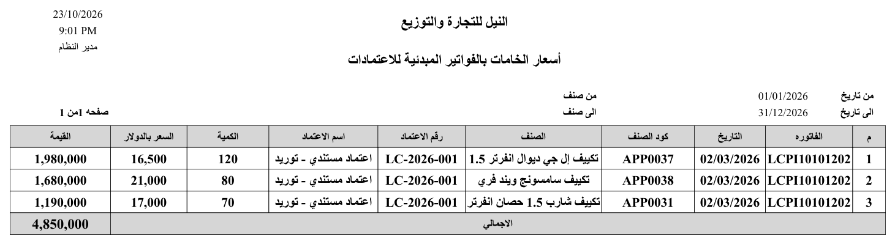

# الاعتمادات المستندية البنكية

الاعتماد المستندي (LC) أداة يستخدمها المستورد لطمأنة المورّد: يتعهّد البنك بدفع قيمة الشحنة للمورّد متى قدّم مستندات الشحن المطابقة للشروط. مثل خطاب الضمان، الاعتماد **يحجز جزءًا من حدّ تسهيلاتك** ويُحمّلك **رسومًا**، ويُتتبَّع كملفٍ رئيسي تتعاقب عليه مستندات فتح وتعديل وإنهاء، مع مجموعتين من الأرقام: **القيم المبدئية** و**القيم الحالية**. وبنيته شبيهة جدًّا ببنية [خطابات الضمان](./letters-of-guarantee.md).

::: info الترخيص المطلوب
الاعتمادات المستندية ضمن ترخيص `accounting-blc`. أما قائمة **نوع الاعتماد البنكي** فضمن ترخيص `accounting-financial-commitments-regulation`.
:::

## دورة حياة الاعتماد

تبدأ كل الشاشات من جذر **البنوك > اعتماد بنكي**:

1. **طلب اعتماد بنكي** — توثيق طلب الاعتماد قبل فتحه (لا أثر محاسبي).
2. **اعتماد بنكي** — الملف الرئيسي بحالته المبدئية «مبدئي».
3. **فتح اعتماد بنكي** — اللحظة التي يفتح فيها البنك الاعتماد فعلًا (يُنشئ قيدًا محاسبيًا، ويحجز التسهيلات، وتتحوّل الحالة إلى «تم إصداره»).
4. **تعديل اعتماد بنكي** — تعديل القيمة أو المدة أو الرسوم (يُحدِّث القيم الحالية).
5. **إنهاء اعتماد بنكي** — إقفال الاعتماد وتحرير ما حُجز من تسهيلات.

## الملف الرئيسي للاعتماد

في شاشة **اعتماد بنكي** (`البنوك > اعتماد بنكي > اعتماد بنكي`) تُعرّف بيانات الاعتماد:

- **المعلومات الأساسية**: الكود والأسماء، و**الكود الإنجليزي**، وربط الاعتماد بـ **طلب اعتماد بنكي** و**عقد المشروع** و**مستخلص مشروع** عند الحاجة.
- **القيم المبدئية للاعتماد البنكي**: أرقام تكتبها في الملف الرئيسي نفسه — **مبلغ الاعتماد** و**العملة**، و**يسلم إلى**، و**من تاريخ / إلى تاريخ**، ونسبة **التغطية** وقيمتها (المبلغ المغطّى نقدًا)، ونسبة **الرسوم** وقيمتها. ولا يغيّرها أي مستند.
- **اعتماد بنكي** (القيم الحالية): **الحالة**، والأرقام نفسها كما كتبها آخر مستند محفوظ على الاعتماد، و**البنك** و**حساب البنك**. وتعرض صفحة **الحركات** تلك المستندات.

قائمة **نوع الاعتماد البنكي** (`البنوك > اعتماد بنكي > نوع الاعتماد البنكي`) ملف تصنيف بسيط — كود واسم عربي وإنجليزي وملاحظات ومحددات. يُختار في عمود **نوع الاعتماد** في سطور [حد التسهيلات](./credit-facilities.md) لتوضيح نوع الاعتماد الذي خُصص له ذلك السطر من السقف. وهو للتصنيف فقط: لا يقرؤه أي مبلغ أو حساب أو تحقق.

### حالات الاعتماد

يمرّ الاعتماد بالحالات: **مبدئي** → **تم إصداره** → **منتهي** / **ألغيت** / **مُسيل**. مستند الفتح يضع الحالة «تم إصداره»، ومستند التعديل يُبقي الحالة كما هي، ومستند الإنهاء يضع ما تختاره من الثلاث الأخيرة في حقل **الحالة**.

## الفتح وحجز التسهيلات

عند تحرير **فتح اعتماد بنكي** (`البنوك > اعتماد بنكي > فتح اعتماد بنكي`) يُنشأ الأثر المحاسبي، وإذا كان على الاعتماد حدّ تسهيلات حُجز منه مبلغ الاعتماد كاملًا. ويغطّي توجيه الفتح جوانب: **قيمة الاعتماد مدين/دائن**، و**مدين/دائن التسهيلات**، و**مدين/دائن الرسوم** (مع **ضريبة الرسوم 1 و2**)، وجانب **التغطية**. (مصدر الحسابات في مرجع [توجيهات المستندات](../support/accounting-document-terms.md).)

::: warning التحقق من حدّ التسهيلات
إذا كان على الاعتماد حدّ تسهيلات، أعاد الفتح حساب ذلك الحدّ، ويُمنع الفتح إذا صار المتبقي في أي سطر من سطوره سالبًا. تفاصيل في [التسهيلات الائتمانية](./credit-facilities.md).
:::

## التعديل والإنهاء

يرفع مستند **تعديل اعتماد بنكي** (`البنوك > اعتماد بنكي > تعديل اعتماد بنكي`) قيمة الاعتماد أو يخفضها، ويغيّر تواريخه أو المبلغ المغطّى، ويسجّل **رسوم التعديلات**. ولا يعرض حقل الاعتماد فيه إلا الاعتمادات التي تجاوزت حالة **مبدئي**. ينسخ المستند الأرقام الحالية للاعتماد للقراءة فقط، وتكتب الأرقام الجديدة في مجموعة **القيم الجديدة**. وعند الحفظ تصير الأرقام الجديدة هي القيم الحالية للاعتماد، وتتجمّع رسوم التعديل في **إجمالي مصاريف التعديل**، وتبقى الحالة والقيم المبدئية كما هي. ولا يمسّ مستند التعديل حدّ التسهيلات.

يُقفل مستند **إنهاء اعتماد بنكي** (`البنوك > اعتماد بنكي > إنهاء اعتماد بنكي`) الاعتماد. حقل **الحالة** فيه مطلوب ويأخذ **منتهي** أو **ألغيت** أو **مُسيل**، وتصير هذه حالة الاعتماد. يأخذ المستند القيم الحالية للاعتماد، وإذا كان على الاعتماد حدّ تسهيلات حرّر مبلغ الاعتماد الوارد في تلك القيم الحالية. ويمكن أن يحمل **رسوم إنهاء الاعتماد البنكي**.

يحتاج مستند التعديل أو الإنهاء إلى مستند سابق على الاعتماد، وإلا رُفض الحفظ بالرسالة:
«الاعتماد البنكي {0} لا يوجد له سند سابق لهذا السند. يرجى عمل سند افتتاحي أولا»

## الإجراءات في هذه الشاشة

زرّان يبنيان بقية السلسلة، كلٌّ منهما في شاشة:

- **إنشاء اعتماد بنكي** (Create Bank LC)، في **طلب اعتماد بنكي** — يحوّل الطلب إلى الملف الرئيسي للاعتماد، ناقلًا أسماءه ونوعه وقيمته وعملته والبنك وحساب البنك والتواريخ و**يسلم إلى** والمبلغ المغطّى والرسوم، ويفتحه كسجل جديد لتراجعه وتحفظه. ويُرفض إذا كان نوع الطلب **مرفوض**، وإذا سبق تحويل الطلب إلى اعتماد.
- **إنشاء فتح اعتماد بنكي** (Create Bank LC Opening Document)، في الملف الرئيسي **اعتماد بنكي** — يفتح مستند **فتح اعتماد بنكي** جديدًا لذلك الاعتماد، مملوءًا ببنكه وحساب بنكه وتواريخه وقيمته وعملته والمبلغ المغطّى والرسوم.

ويحتاج كل زرّ أن يكون سجلّه **محفوظًا** أولًا.

## التقارير

يقرأ التقريران **الاعتماد المستندي** في سلسلة الإمداد (فواتيره المبدئية ومستندات مصروفاته)، لا الاعتماد البنكي الذي تشرحه هذه الصفحة.

| التقرير | يجيب عن |
|---|---|
| أسعار المواد الخام حسب الفواتير المبدئية للاعتماد (SYSR-LCD001) | ربط تكلفة المواد المستوردة بالفواتير المبدئية للاعتماد. |
| تحليل الاعتمادات مرتفعة التكلفة (SYSR-LCD002) | الاعتمادات الأعلى تكلفةً للمقارنة والتحليل. |

## بنكي أم استيرادي؟ — الفرق عن اعتماد سلسلة الإمداد

في نما يوجد اعتمادان مستنديان يحملان الاسم نفسه لكن لكلٍّ غرضه:

- **الاعتماد البنكي (هذه الصفحة)** أداة *خزينة ومصرفية*: يهتم بالتزامك تجاه البنك — كم يحجز من **حدّ تسهيلاتك**، و**رسوم** الفتح والتعديل، و**القيود المحاسبية**. لا يتتبّع شحنات ولا فواتير مبدئية ولا بضاعة، ولا يمسّ المخزون.
- **اعتماد سلسلة الإمداد** (`الإعتمادات > الملفات > الإعتماد المستندي`) عملية *استيراد ومشتريات*: يدير المورّد و**الشحنات** (الحاويات، وبوالص الشحن، والتخليص) و**الفواتير المبدئية**، ويجمّع مصاريف التأمين والشحن والجمارك على البضاعة للوصول إلى **التكلفة الواصلة**، ثم استلامها في المخزون.

باختصار: الاعتماد البنكي يجيب عن «ماذا يفعل هذا الاعتماد بتسهيلاتي ودفاتري؟»، واعتماد سلسلة الإمداد يجيب عن «كيف أدير هذه الشحنة الاستيرادية وتكاليفها حتى دخولها المخزن؟». وهما ميزتان مستقلتان (كيانان وترخيصان مختلفان)، لا وجهان لمستندٍ واحد.

::: info الاستيراد وإدارة الشحنات
لإدارة دورة الاستيراد الكاملة — الشحنات والفواتير المبدئية والتكاليف الإضافية والتكلفة الواصلة — راجِع [الاعتمادات المستندية في سلسلة الإمداد](../../supplychain/letters-of-credit.md).
:::

## للدعم الفني

- **«تعذّر فتح الاعتماد — تجاوز الحدّ»** — المبلغ المحجوز يتجاوز حدّ التسهيلات المرتبط؛ راجِع [التسهيلات الائتمانية](./credit-facilities.md).
- **«ما الفرق بين القيم المبدئية والحالية؟»** — المبدئية تُكتب في الملف الرئيسي ولا يغيّرها أي مستند، والحالية يكتبها آخر مستند محفوظ على الاعتماد.
- **«من أين تأتي حسابات القيمة والتسهيلات والرسوم؟»** — من توجيه **فتح الاعتماد**؛ راجِع [توجيهات المستندات](../support/accounting-document-terms.md).
- آلية المعالجة المحاسبية في [كيف تُعالَج المستندات إلى أثر محاسبي](../support/accounting-request-processing.md).
