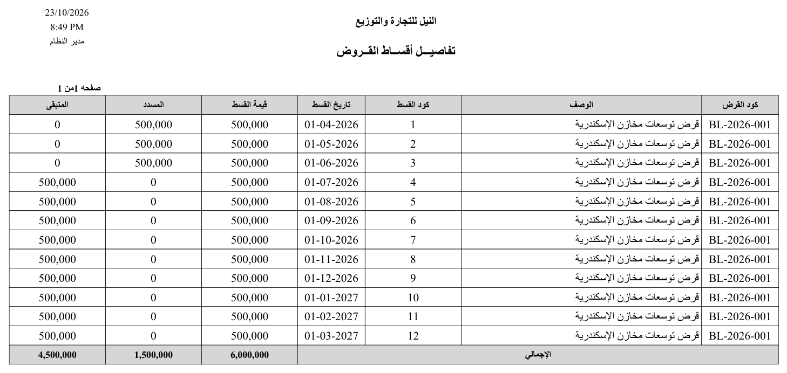

# القروض البنكية

القرض البنكي ليس مجرد مبلغ يدخل حسابك ثم تردّه؛ هو التزام يمتدّ شهورًا أو سنوات، بأصلٍ وفائدةٍ ورسومٍ وجدول أقساط، وقد يخصم من **حدّ تسهيلات** متّفق عليه مع البنك. لذلك لا تُسجّل القروض في نما كقيدٍ يدوي واحد، بل كـ **منظومة مترابطة**: مستند رئيسي يحمل شروط القرض، ثم مستندات حركة تُصدِره وتُسدِّد أقساطه وتحتسب فوائده على مدى عمره.

::: info الترخيص المطلوب
القروض البنكية ضمن ترخيص `accounting-loans` — وهو الترخيص نفسه الذي يغطّي [الودائع الثابتة](./fixed-deposits.md) و[التسهيلات الائتمانية](./credit-facilities.md).
:::

## القصّة من بدايتها

تبدأ كل الشاشات من جذر **البنوك > قروض بنكية** في شجرة القوائم. وتسير دورة حياة القرض هكذا:

1. **طلب إضافة قرض** — تمهيد اختياري لتوثيق طلب القرض قبل اعتماده.
2. **قرض بنكي** — الملف الرئيسي الذي يحمل شروط القرض كاملةً (حالته المبدئية «مبدئي»).
3. **سند إصدار قرض** — اللحظة التي يدخل فيها مبلغ القرض فعلًا (يُنشئ قيدًا محاسبيًا، وتتحوّل حالة القرض إلى «تم إصداره»).
4. **جدولة قرض بنكي** — لإعادة توزيع الأقساط عند الحاجة.
5. **سند احتساب فوائد القرض** — لاحتساب فوائد الفترة وتثبيتها.
6. **سداد أقساط القرض** — تسديد قسط (أو أكثر) بأصله وفائدته وغرامة التأخير إن وُجدت (يُنشئ قيدًا محاسبيًا).
7. **تعديل قرض** — لتعديل بيانات القرض بعد إصداره.

## نوع القرض

قبل تسجيل القروض يُنشأ **نوع القرض** (`البنوك > قروض بنكية > نوع القرض`) كملف تصنيفي يجمع القروض المتشابهة ويوحّد توجيهاتها المحاسبية. وهو أمر تنظيمي يسهّل التقارير والمحاسبة لاحقًا.

## الملف الرئيسي للقرض

في شاشة **قرض بنكي** (`البنوك > قروض بنكية > قرض بنكي`) تُعرّف شروط القرض في ثلاث مناطق رئيسية:

- **المعلومات الأساسية**: **قيمة القرض**، **البنك** و**رقم حساب البنك** الذي يُودَع فيه، **قيمة الرسوم**، و**نوع القرض**. ويمكن ربط القرض بـ **طلب القرض** الذي سبقه وبـ **حدّ التسهيلات** الذي يُخصم منه، وبـ **عقد المشروع** عند تمويل مشروع بعينه.
- **الأقساط**: **عدد الأقساط** و**قيمة القسط** و**الأقساط تبدأ من** (تاريخ أول قسط) و**تُحسب كل** (فترة التكرار، مثلًا كل شهر)، أو الاعتماد على **نموذج جدولة الأقساط** الجاهز.
- **الفوائد**: **نسبة الفائدة السنوية** و**نوع الفائدة** و**الفوائد تبدأ من** و**تُدفع كل**. ومن الخيارات المهمّة هنا: **تُحسب الفوائد مرة واحدة في نهاية الفترة**، و**تاريخ بداية الفوائد هو نفس تاريخ بداية القرض**، و**حساب الفوائد بناءً على القيمة وليس النسبة**، و**التعديل في قيمة آخر فائدة إن وُجد**.

**أنواع الفائدة** المتاحة:

| النوع | المعنى |
|---|---|
| بسيط (Simple) | فائدة ثابتة محسوبة على أصل القرض كاملًا طوال المدة. |
| متناقص (Decreasing) | فائدة على الرصيد المتبقّي، فتتناقص مع كل قسطٍ يُسدَّد من الأصل. |
| يدوي (Manual) | تُدخَل قيم الفوائد يدويًا في جدول الفوائد بدل احتسابها آليًا. |

يضبط الحقلان **أيام التأخير** و**نسبة غرامة التأخير** غرامة القسط المتأخّر عند السداد: القسط المسدَّد في مستند **سداد أقساط القرض** تاريخه بعد تاريخ سداد القسط مضافًا إليه **أيام التأخير** يأخذ غرامة تساوي **نسبة غرامة التأخير** من قيمة القسط، وفيما عدا ذلك تكون الغرامة صفرًا.

### حالات القرض

يمرّ القرض بالحالات التالية، وتتحرّك تلقائيًا مع مستندات الحركة:

| الحالة | متى |
|---|---|
| مبدئي (Initial) | عند حفظ القرض قبل إصداره. |
| تم إصداره (Released) | بعد حفظ سند إصدار القرض، وكذلك كلما أُعيد حساب الحالة وليس في القرض سطر قسط أو فائدة مسدَّد. |
| قيد التنفيذ (In Progress) | عند إعادة حساب الحالة وبعض سطور الأقساط والفوائد مسدَّد وبعضها غير مسدَّد. |
| منتهي (Finished) | عند إعادة حساب الحالة وكل سطور الأقساط والفوائد مسدَّدة. |
| ملغي (Cancelled) | عند حفظ **تعديل قرض** وخيار **إلغاء قرض** مفعّل فيه. |

يُعاد حساب الحالة عند حفظ **سند احتساب فوائد القرض** للقرض، وعند حفظ **سداد أقساط القرض** إذا كان فيه سطور فوائد لهذا القرض. وبعد أن يغادر القرض الحالة «مبدئي» يُرفض أي **سند إصدار قرض** جديد عليه بالرسالة «قيمة الحقل غير صحيحة» على حقل **القرض البنكي**.

## إصدار القرض

ما دام القرض في حالته المبدئية فهو مجرد اتفاق على ورق. عند تحرير **سند إصدار قرض** (`البنوك > قروض بنكية > سند إصدار قرض`) يدخل المبلغ فعلًا: يُنشئ السند قيدًا محاسبيًا يُسجِّل القرض على البنك ويُودَع في الحساب، وتتحوّل حالة القرض إلى «تم إصداره»، وإذا كان على القرض **حدّ تسهيلات** حُجزت منه قيمة القرض المكتوبة في سند الإصدار (انظر [التسهيلات الائتمانية](./credit-facilities.md)). ويغطّي توجيه الإصدار جوانب: **مدين/دائن قيمة القرض**، و**مدين/دائن قيمة الرسوم** (مع **ضريبة الرسوم**)، و**مدين/دائن قيمة الفائدة** — أي من أين تأتي حسابات كلٍّ من أصل القرض ورسومه وفوائده. (تفصيل مصدر هذه الحسابات في مرجع [توجيهات المستندات](../support/accounting-document-terms.md).)

## احتساب الفوائد والسداد

مع مرور فترات القرض يُحرَّر **سند احتساب فوائد القرض** لسطور الفوائد التي حلّ موعدها: حفظه يُنشئ قيدها المحاسبي ويعلّم تلك السطور في القرض بأنها مسدَّدة.

ثم يأتي **سداد أقساط القرض** (`البنوك > قروض بنكية > سداد أقساط القرض`) ليسدّد قسطًا أو أكثر. يعرض السند مجاميع القرض (إجمالي الأقساط والفوائد والمسدَّد والمتبقّي)، ويفصل في الأسطر بين **أصل القسط** و**الفائدة المسدَّدة** و**غرامة التأخير** (تُحتسب آليًا من **أيام التأخير** و**نسبة غرامة التأخير** في القرض). ويُسجِّل السند قيده على جوانب: **مدين/دائن الغرامة**، و**مدين/دائن المبلغ المسدَّد للفائدة**، إضافة إلى جانب الأصل المحصَّل.

## الجدولة والتعديل

إذا تغيّرت ظروف السداد، يضع **جدولة قرض بنكي** سطورَ جدوليه مكان سطور الأقساط والفوائد غير المسدَّدة في القرض، وتبقى السطور التي عليها سداد، وإذا تُرك أحد الجدولين فارغًا بقي ذلك الجانب من القرض كما هو. أما **تعديل قرض** فيعدّل القرض نفسه: يكتب في القرض **قيمة القرض** و**نسبة الفائدة** و**قيمة الفائدة** و**من تاريخ** و**إلى تاريخ** (كلٌّ منها إذا كان مملوءًا فقط)، وإذا فُعّل فيه **إلغاء قرض** نقل القرض إلى الحالة «ملغي».

## الإجراءات في هذه الشاشة

يكاد لا شيء في نظام القروض يُكتب سطرًا سطرًا — فالجداول تُولَّد، ومستندات السداد تجلب المستحق بنفسها.

**في القرض وطلبه ومستند الجدولة:**

- **إنشاء جدول الأقساط** (Generate Installments Table) — يبني جدول الأقساط من قيمة القرض وعدد الأقساط وقيمتها و**بدء الأقساط في** و**يحسب كل**. شغّله كلما غيّرت أيًّا من هذه الأرقام، فيعيد بناء الجدول ليطابقها.
- **إنشاء جدول الفوائد** (Generate Interests Table) — الأمر نفسه لجدول الفوائد، انطلاقًا من تاريخَي البداية والنهاية و**بدء الفوائد في** ودورية الفائدة والنسبة السنوية، ووفق نوع فائدة القرض.
- **إنشاء جدول الأقساط و جدول الفوائد** (Generate Installments And Interests Table) — الجدولان بضغطة واحدة، وهي الطريقة المعتادة لتجهيز قرض جديد.

**وفي طلب القرض** يوجد كذلك:

- **إنشاء القرض** (Generate Bank Loan) — ينشئ القرض نفسه من الطلب المعتمد وينقل شروطه إليه، فلا تعيد إدخالها. يجب حفظ الطلب أولًا، ويُفتح القرض كسجل جديد لتراجعه وتحفظه.

**في سند سداد أقساط القرض:**

- **تجميع الإقساط** (Collect Installments) — تحدّد نطاق **من قرض** / **إلى قرض** (أو بنكًا وحسابًا بنكيًا) ومدى تاريخي، فيملأ المستند بكل قسط **غير مسدَّد** يقع في ذلك المدى، عبر كل القروض المطابقة. وبهذا يسدّد مستند واحد عدة أقساط — أو عدة قروض — دفعة واحدة.
- **تجميع الفوائد** (Generate Interests) — نظيره في الفوائد: يجلب سطور الفوائد المستحقة في المدى نفسه.

**في احتساب فوائد القروض:**

- **تجميع الفوائد** (Collect Interests) — يجمع سطور الفوائد التي لم تُعلَّم مسدَّدة بعد لنطاق القروض والمدى التاريخي المختارَين في جدول الفوائد. وحقل **من قرض** مطلوب؛ فبدونه ينبّهك الزر ولا يفعل شيئًا.

## التقارير

| التقرير | يجيب عن |
|---|---|
| تفاصيل أقساط القرض (SYSR-LON001) | أقساط القروض المختارة الواقعة في فترة تاريخ: قيمة كل قسط والمسدَّد منه والمتبقّي. |
| تفاصيل التسهيلات البنكية (SYSR-LON002) | أقساط القروض التي ما زال لها متبقٍّ، شهرًا بشهر لسنة مالية، مع التصفية بحساب البنك. |

## للدعم الفني

- **«القرض ما زال مبدئيًا ولم يدخل المبلغ»** — لم يُحرَّر سند إصدار القرض بعد؛ الإصدار هو ما يُسجِّل المبلغ في دفتر الأستاذ ويحرّك الحالة إلى «تم إصداره».
- **«من أين تأتي حسابات القرض والرسوم والفوائد؟»** — من توجيه **سند إصدار القرض** و**سداد الأقساط**؛ راجِع [توجيهات المستندات](../support/accounting-document-terms.md).
- **«غرامة التأخير لا تُحتسب»** — تأكّد من ضبط **نسبة غرامة التأخير** على القرض، ومن أن تاريخ مستند السداد بعد تاريخ سداد القسط مضافًا إليه **أيام التأخير** في القرض.
- **«القرض لا يخصم من حدّ التسهيلات»** — تأكّد من ربط القرض بـ **حدّ التسهيلات** الصحيح؛ ويتم الحجز عند حفظ **سند إصدار قرض**. التفاصيل في [التسهيلات الائتمانية](./credit-facilities.md).
- آلية المعالجة المحاسبية في [كيف تُعالَج المستندات إلى أثر محاسبي](../support/accounting-request-processing.md).

## رسائل قد تظهر لك

| الرسالة | لماذا | ما تفعله |
|---|---|---|
| «القسط {0} أكبر من قيمة القسط {1} في القرض {2}» | مجموع ما سُدِّد على كود قسط واحد — هذا المستند مع كل مستندات **سداد أقساط القرض** المعتمدة الأخرى — صار أكبر من قيمة القسط في القرض. | أنقِص المبلغ المسدَّد في هذا المستند، أو تحقّق من أنّ القسط لم يُسدَّد في مستند آخر. |
| «الفائدة التي تاريخها {0} وقيمتها {1} أكبر من قيمة الفائدة {2} في القرض {3}» | الفحص نفسه لتجاوز السداد على جانب الفوائد: المسدَّد من الفائدة لذلك التاريخ صار أكبر من سطر الفائدة في القرض. | صحّح الفائدة المسدَّدة، أو أعِد تشغيل **احتساب فوائد القرض** إن كانت الفائدة المستحقة نفسها خاطئة. |
| «لا يمكن إيجاد سطر قسط بكود {0} في القرض {1}» | سطر دفع يحمل كود قسط لم يبقَ موجودًا في القرض — غالبًا لأنّ **جدولة قرض** أو **مستند تعديل قرض** أعاد بناء الجدول بأكواد مختلفة. | أعِد اختيار القسط في مستند الدفع؛ وإن كان مستند جدولة حذف أقساطًا مسدَّدة فصحّح ذلك المستند. |
| «لا يمكن إيجاد سطر فوائد بتاريخ فائدة {0} وقيمة فائدة {1} في القرض {2}» | والأمر نفسه لسطر سداد فائدة لم يعد زوجُ (التاريخ، القيمة) فيه مطابقًا لأي سطر فوائد في القرض. | أعِد اختيار سطر الفائدة، أو أعِده إلى القرض. |
