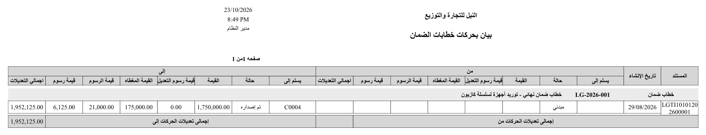

# خطابات الضمان

خطاب الضمان تعهّد يصدره البنك نيابةً عنك لصالح طرفٍ ثالث (جهة حكومية، مالك مشروع...) يضمن وفاءك بالتزامٍ ما — كضمان دخول مناقصة أو حُسن تنفيذ عقد. لا يخرج منه نقدٌ فعلي عند الإصدار، لكنه **يجمّد جزءًا من حدّ تسهيلاتك** لدى البنك ويُحمّلك **رسومًا**. لذلك يتتبّع نما خطاب الضمان كملفٍ رئيسي تتعاقب عليه مستندات حركة تُصدِره وتستلمه وتسلّمه وتعدّله وتنهيه، مع لقطتين دائمًا: **القيم المبدئية** عند الإصدار و**القيم الحالية** بعد التعديلات.

::: info الترخيص المطلوب
خطابات الضمان ضمن ترخيص `accounting-lgt`.
:::

## دورة حياة الخطاب

تبدأ كل الشاشات من جذر **البنوك > خطابات الضمان**:

1. **طلب خطاب ضمان** — توثيق طلب الخطاب قبل إصداره (لا أثر محاسبي).
2. **خطاب ضمان** — الملف الرئيسي بحالته المبدئية «مبدئي».
3. **إصدار خطاب ضمان** — اللحظة التي يصدر فيها البنك الخطاب فعلًا (يُنشئ قيدًا محاسبيًا، وتتحوّل الحالة إلى «تم إصداره»).
4. **استلام / تسليم خطاب ضمان** — تتبّع تداول نسخة الخطاب الورقية مع الجهة المستفيدة.
5. **تعديل خطاب ضمان** — تمديد المدة أو تغيير القيمة أو الرسوم (يُحدِّث القيم الحالية ويُسجّل رسوم التعديل).
6. **إنهاء خطاب ضمان** — إقفال الخطاب عند انتهائه أو إلغائه.

ويُستخدم **مستند افتتاحي خطاب ضمان** لإدخال أرصدة الخطابات القائمة عند بدء العمل على النظام.

## الملف الرئيسي للخطاب

في شاشة **خطاب ضمان** (`البنوك > خطابات الضمان > خطاب ضمان`) تُعرّف بيانات الخطاب:

- **المعلومات الأساسية**: ربط الخطاب بـ **طلب خطاب الضمان** الذي سبقه، وبـ **حدّ التسهيلات** الذي يُحجز منه، وبـ **عقد المشروع** عند الحاجة.
- **القيم المبدئية لخطاب الضمان**: الشروط التي تكتبها في الملف الرئيسي، وتُنسخ إلى القيم الحالية ما دام الخطاب بلا أي مستند — **المبلغ** و**العملة**، **مَن يُسلَّم إليه** الخطاب، **من تاريخ / إلى تاريخ**، **التغطية** (المبلغ المغطّى نقدًا)، **التسهيلات** (الجزء المحجوز من حدّ التسهيلات)، و**الرسوم**.
- **خطاب ضمان (القيم الحالية)**: **نوع الخطاب** و**نوع الضمان** و**الحالة**، إضافةً إلى القيم السارية بعد أي تعديل (المبلغ، التغطية، التسهيلات، رسوم التعديل).

**نوع الضمان** يصنّف غرض الخطاب: **ضمان ابتدائي** (دخول مناقصة)، **ضمان نهائي** (حُسن تنفيذ)، **ضمان دفعة مقدمة**، **ضمان جمركي**، أو أنواع أخرى.

### حالات الخطاب

| الحالة | متى |
|---|---|
| مبدئي (Initial) | عند الحفظ قبل الإصدار. |
| تم إصداره (Issued) | بعد حفظ سند الإصدار. |
| تم استلامه (Received) | بعد حفظ **استلام خطاب ضمان**. |
| توصيل كلي (Totally Delivered) | بعد حفظ **تسليم خطاب ضمان**. |
| منتهي (Finished) | بعد **إنهاء خطاب ضمان** حقل **الحالة** فيه «منتهي» (الإنهاء العادي). |
| ألغيت (Canceled) | بعد **إنهاء خطاب ضمان** حقل **الحالة** فيه «ألغيت». |
| مُسيل (Liquidated) | بعد **إنهاء خطاب ضمان** حقل **الحالة** فيه «مُسيل» (مطالبة المستفيد بقيمة الخطاب). |

## الإصدار وحجز التسهيلات

عند تحرير **إصدار خطاب ضمان** (`البنوك > خطابات الضمان > إصدار خطاب ضمان`) يُنشأ الأثر المحاسبي، وإذا كان على الخطاب حدّ تسهيلات حُجزت منه قيمة الخطاب كاملة. ويغطّي توجيه الإصدار جوانب متعدّدة: **قيمة الخطاب مدين/دائن**، و**مدين/دائن التسهيلات** (الجزء المحجوز من حدّ التسهيلات)، و**مدين/دائن الرسوم** (مع **ضريبة الرسوم 1 و2**)، وجانب **التغطية**. (مصدر هذه الحسابات مشروح في مرجع [توجيهات المستندات](../support/accounting-document-terms.md).)

::: warning التحقق من حدّ التسهيلات
إذا كان على الخطاب **حدّ تسهيلات**، أعاد الإصدار حساب ذلك الحدّ، ويُمنع الإصدار إذا صار المتبقي في أي سطر من سطوره سالبًا. ويُفحص الإصدار أيضًا مقابل سطر الحدّ المطابق لعقد مشروع الخطاب. تفاصيل حدود التسهيلات في [التسهيلات الائتمانية](./credit-facilities.md).
:::

## الاستلام والتسليم والتعديل والإنهاء

تتبع مستندات **الاستلام** و**التسليم** تداول نسخة الخطاب الورقية. ويُستخدم **التعديل** لتمديد مدة الخطاب أو تغيير قيمته أو رسومه — فيُحدِّث القيم الحالية مع الإبقاء على القيم المبدئية كمرجع، ويُسجّل **رسوم التعديل**. وأخيرًا يُقفل **الإنهاء** الخطاب ويحرّر ما حُجز من تسهيلات.

::: warning الإصدار والتعديل وحدهما يحدّدان قيم الخطاب
تعرض مستندات الاستلام والتسليم والإنهاء قيمة الخطاب والمبلغ المغطّى والرسوم، لكنها لا تملك هذه
الأرقام — بل يرثها كل مستند منها من المستند السابق له في سلسلة الخطاب. فـ**الإصدار** هو ما يضع
الأرقام الافتتاحية، و**التعديل** هو ما يغيّرها بعد ذلك، وما عداهما ينقل ما تقوله السلسلة عند تلك
النقطة لا أكثر.

فإن كان مستند تسليم يعرض 200,000 وأردته أن يقرأ 250,000، فلن تفلح الكتابة فوق المبلغ في مستند
التسليم. سيُحفظ المستند فعلًا، لكن الرقم سيعود إلى ما تقوله السلسلة وسيظهر لك هذا التنبيه:
«قيم خطاب الضمان {0} موروثة من السند السابق له في سلسلة الخطاب ولا يمكن تعديلها هنا. استخدم سند تعديل خطاب ضمان لتغيير القيمة أو الرسوم»
أدخل بدلًا من ذلك مستند **تعديل خطاب ضمان** بتاريخ سابق لتاريخ التسليم، وسيلتقط
التسليم الرقم الجديد من تلقاء نفسه. وكذلك لا أثر لتعديل المبلغ في
الملف الرئيسي **خطاب الضمان** على هذه المستندات، للسبب نفسه: فهي تقرأ من السلسلة لا من الملف
الرئيسي.
:::

## الإجراءات في هذه الشاشة

زرّان، كلٌّ منهما في شاشة، يوفّران إعادة إدخال بيانات الخطاب مرتين:

- **إنشاء خطاب ضمان** (Create Letter Of Guarantee)، في **طلب خطاب ضمان** — يحوّل الطلب إلى الملف الرئيسي للخطاب، ناقلًا نوعه وقيمته والبنك وحساب البنك والتواريخ والمبلغ المغطّى والرسوم. ويُفتح الخطاب كسجل جديد لتراجعه وتحفظه. ويُرفض إذا كان نوع الطلب **مرفوض**، وإذا سبق تحويل الطلب إلى خطاب.
- **إنشاء إصدار خطاب ضمان** (Create LGT Issue)، في الملف الرئيسي **خطاب ضمان** — يفتح مستند **إصدار خطاب ضمان** جديدًا لذلك الخطاب، مملوءًا ببنكه وحساب بنكه وتواريخه وقيمته وعملته والمبلغ المغطّى والرسوم. استعمله حين يكون البنك قد أصدر الخطاب فعلًا وتريد إثبات الأثر مباشرة.

ويحتاج كل زرّ أن يكون سجلّه **محفوظًا** أولًا — فالسجل غير المحفوظ لا يوجد فيه ما يُبنى عليه المستند الجديد.

## التقارير

| التقرير | يجيب عن |
|---|---|
| حركة خطابات الضمان (SYSR-LGT001) | حركة كل خطاب: الإصدار والتعديلات والإنهاء وأرصدة التغطية والتسهيلات. |

## للدعم الفني

- **«تعذّر إصدار الخطاب — تجاوز الحدّ»** — المبلغ المحجوز يتجاوز حدّ التسهيلات المرتبط؛ راجِع [التسهيلات الائتمانية](./credit-facilities.md).
- **«ما الفرق بين القيم المبدئية والحالية؟»** — المبدئية تُكتب في الملف الرئيسي، والحالية يكتبها آخر مستند على الخطاب؛ كلاهما يبقى على الخطاب للمقارنة.
- **«من أين تأتي حسابات القيمة والتسهيلات والرسوم؟»** — من توجيه **إصدار خطاب الضمان**؛ راجِع [توجيهات المستندات](../support/accounting-document-terms.md).
- آلية المعالجة المحاسبية في [كيف تُعالَج المستندات إلى أثر محاسبي](../support/accounting-request-processing.md).
