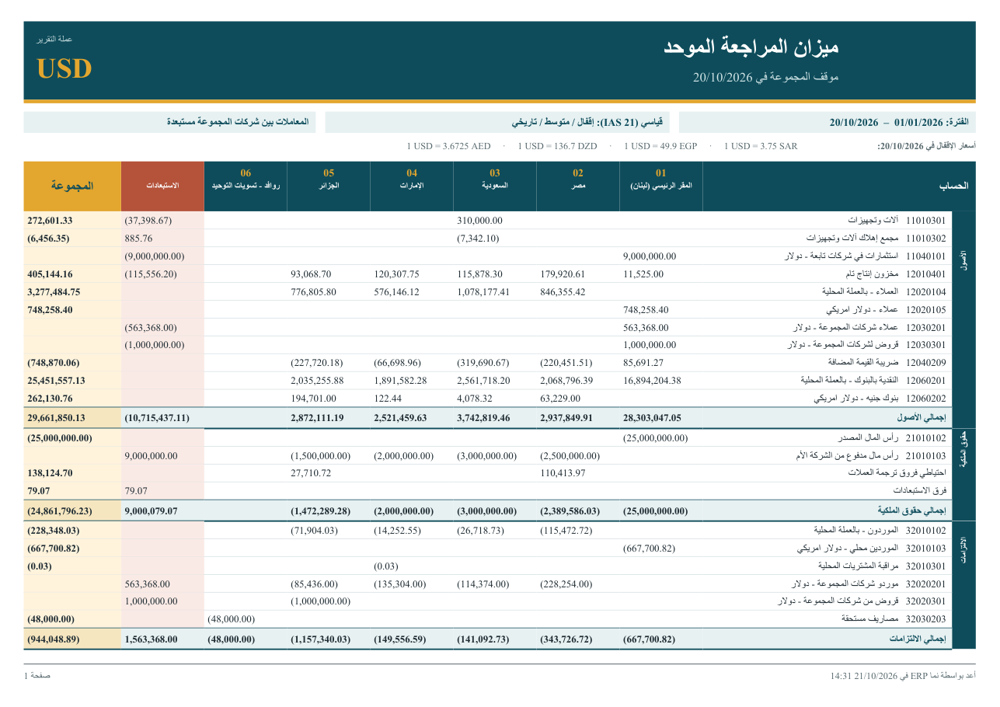
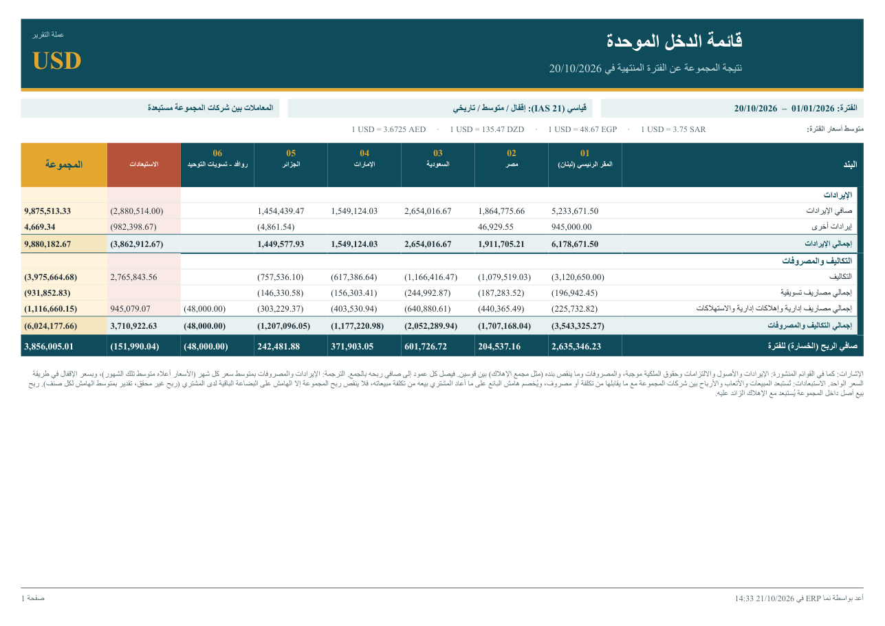
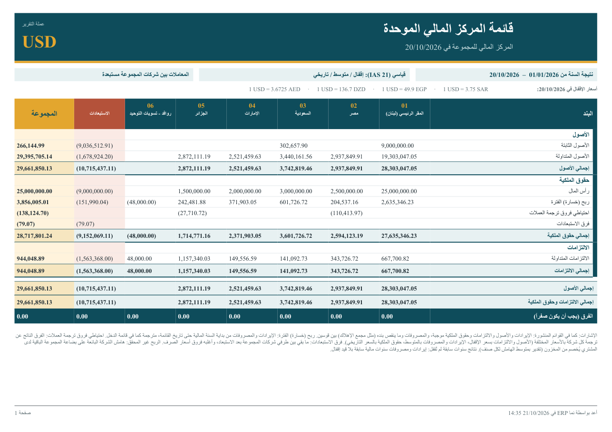
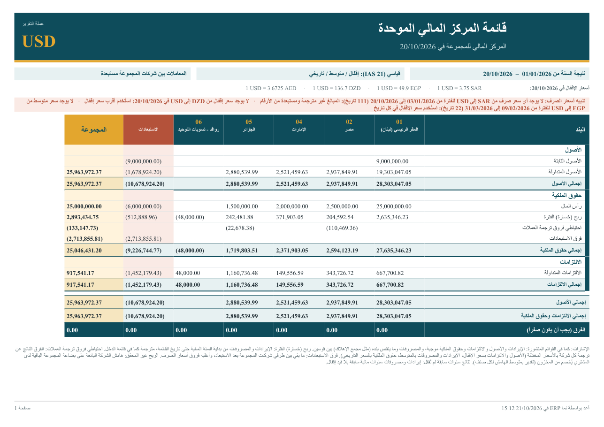

# القوائم المالية الموحدة

القوائم المالية الموحدة تعطي مجموعة الشركات ميزان مراجعة واحدًا وقائمة دخل واحدة وقائمة مركز مالي واحدة، بعملة تقارير واحدة، بعد أن تُستبعد منها المعاملات التي تمّت بين شركات المجموعة. وهي ثلاثة تقارير نظام تقرأ دفاتر كل الشركات في قاعدة البيانات في كل مرة تُشغَّل فيها، فلا شيء يحتاج إلى قيد أو إقفال قبلها.

المجموعة التي تمسك شركاتها كلها في قاعدة بيانات نما واحدة تجد دفاتر كل شركة في مكان واحد بالفعل. لكن تصفية تقرير على عدة شركات ليست توحيدًا. فالتصفية تجمع القيم المحلية كما هي، وحين تمسك كل شركة دفاترها بعملة مختلفة يصبح الجنيه المصري والريال السعودي في مجموع واحد. ثم إنها تحسب المجموعة مرتين. فحين يبيع المقر الرئيسي كتبًا لشركته في مصر، يظهر البيع في المقر والشراء في مصر، والمجموعة ككل لم تبع شيئًا. والتقارير الموحدة تعالج المشكلتين معًا: **تترجم** كل شركة إلى عملة واحدة، و**تستبعد** ما تدين به الشركات لبعضها وما تبيعه وتحمّله على بعضها.

::: info الترخيص المطلوب
التقارير الثلاثة جزء من ترخيص الحسابات الأساسي `accounting`.
:::

## التقارير الثلاثة

| التقرير | الكود | ماذا يجيب |
|---|---|---|
| **ميزان المراجعة الموحد** (Consolidated Trial Balance) | `SYSR-FNS018` | كل حساب، بعمود لكل شركة، ثم الاستبعادات ثم إجمالي المجموعة. وهو ورقة العمل التي تقوم عليها القائمتان الأخريان. |
| **قائمة الدخل الموحدة** (Consolidated Income Statement) | `SYSR-FNS019` | الإيرادات والمصروفات خلال فترة، حتى صافي ربح المجموعة. |
| **قائمة المركز المالي الموحدة** (Consolidated Balance Sheet) | `SYSR-FNS020` | الأصول والالتزامات وحقوق الملكية في تاريخ، ومعها نتيجة السنة واحتياطي فروق ترجمة العملات وفرق الاستبعادات. |

للتقارير الثلاثة شكل واحد. لكل شركة عمود يحمل كودها واسمها، ثم عمود **الاستبعادات**، ثم عمود **المجموعة** وهو مجموع الشركات والاستبعادات. ويذكر رأس التقرير عملة التقرير، ويعرض الفترة وطريقة الترجمة وهل الاستبعاد مفعّل، وأسعار الإقفال التي استعملها التقرير، مثل `1 USD = 49.9 EGP`. وتُطبع التقارير بالعربية أو الإنجليزية حسب لغة المستخدم، وتظهر المبالغ التي تُنقص من قسمها بين قوسين.

### ميزان المراجعة الموحد

يعرض الميزان كل حساب له رصيد، مجمّعًا تحت الشجرات العليا في شجرة الحسابات (الأصول، حقوق الملكية، الالتزامات، الإيرادات، المصروفات)، مع إجمالي لكل قسم. حسابات المركز المالي تظهر برصيدها في **حتى تاريخ**. وحسابات الإيرادات والمصروفات تظهر بحركتها فقط بين **من تاريخ** و**حتى تاريخ**. وفي قسم حقوق الملكية سطران لا يخصّان حسابًا بعينه: **احتياطي فروق ترجمة العملات** و**فرق الاستبعادات**، وشرحهما أدناه. والسطر الأخير **الفرق (يجب أن يكون صفراً)** يتحقق من توازن كل عمود.

### قائمة الدخل الموحدة

تغطي قائمة الدخل الفترة بين **من تاريخ** و**إلى تاريخ**. وهي تطبع افتراضيًا الأقسام العليا (الإيرادات، والتكاليف والمصروفات) والمجموعات التي تليها بمستوى واحد، مع إجمالي فرعي لكلٍّ منها. فعّل **إظهار الحسابات** لتظهر الحسابات نفسها تحت كل مجموعة. وكل عمود يُجمع نزولًا حتى **صافي الربح (الخسارة) للفترة**، فالإيراد موجب والمصروف بين قوسين كما في القوائم المنشورة. ولأن شجرة الحسابات لا تحمل علامة عامة تميّز تكلفة المبيعات، تعرض القائمة إجماليات الأقسام وصافي الربح، بلا سطر مستقل لمجمل الربح أو ربح التشغيل.

### قائمة المركز المالي الموحدة

تأخذ قائمة المركز المالي تاريخًا واحدًا هو **في تاريخ**. وتبحث عن السنة المالية التي يقع فيها هذا التاريخ، وتعدّ إيرادات ومصروفات تلك السنة من أولها نتيجةً للسنة. الأصول والالتزامات وحقوق الملكية موجبة، والمبالغ التي تُنقص من قسمها، كمجمع الإهلاك، بين قوسين. وتحت حقوق الملكية مجموعة **بنود التوحيد** وفيها السطور التي يولّدها التوحيد لا الحسابات:

- **ربح (خسارة) الفترة**: الإيرادات والمصروفات من أول السنة المالية حتى تاريخ القائمة، مترجمة كما تترجمها قائمة الدخل، فيطابق رقم المجموعة صافي ربح قائمة الدخل.
- **نتائج سنوات سابقة لم تُقفل**: إيرادات ومصروفات سنوات مالية سابقة لم ينقلها قيد إقفال إلى حقوق الملكية. ولا يظهر إلا إذا وُجد مثل هذا الرصيد.
- **احتياطي فروق ترجمة العملات** و**فرق الاستبعادات**، كما في الميزان.

وفي الأسفل **إجمالي الأصول** و**إجمالي الالتزامات وحقوق الملكية** و**الفرق (يجب أن يكون صفراً)** للتحقق من كل عمود.

تذهب بنود التوحيد إلى قسم حقوق الملكية في الشجرة. ويعدّ التقرير قسمَ حقوق الملكية هو القسم الذي يحوي حساب الأرباح والخسائر في آخر قيد إقفال. فإن لم يوجد، فقسمًا دائنًا من أقسام المركز المالي يحوي اسمه «حقوق» أو «ملكية» (أو equity)، فإن لم يوجد، فأول قسم دائن من أقسام المركز المالي.

## المدخلات

| المُدخل | التقارير | ماذا يفعل |
|---|---|---|
| **من تاريخ** (From Date) | الميزان، الدخل | بداية الفترة لحسابات الإيرادات والمصروفات. افتراضيًا أول السنة. |
| **حتى تاريخ** (As of Date) | الميزان | التاريخ الذي تؤخذ فيه الأرصدة، وتاريخ أسعار الإقفال. افتراضيًا اليوم. |
| **إلى تاريخ** (To Date) | الدخل | نهاية الفترة، وتاريخ أسعار الإقفال. افتراضيًا اليوم. |
| **في تاريخ** (As of Date) | المركز المالي | تاريخ القائمة، وتاريخ أسعار الإقفال. افتراضيًا اليوم. ونتيجة السنة تبدأ من أول السنة المالية التي يقع فيها. |
| **الشركات (فارغ = الكل)** (Legal Entities) | الثلاثة | الشركات الداخلة في التقرير، تُختار كقائمة. اتركه فارغًا لتدخل كل شركة لها دفتر حسابات. |
| **عملة التقرير** (Reporting Currency) | الثلاثة | العملة التي تُعرض بها المجموعة. اتركه فارغًا ليأخذ التقرير **عملة التقارير** من دفتر حسابات الشركة التي دخلت عليها، أو عملة الدفتر الرئيسية إن لم تُحدَّد. |
| **طريقة ترجمة العملات** (Translation Method) | الثلاثة | **قياسي (IAS 21)** وهو الافتراضي، أو **سعر إقفال واحد**. انظر أدناه. |
| **استبعاد المعاملات بين شركات المجموعة** (Eliminate Intercompany) | الثلاثة | مفعّل افتراضيًا. ألغِ التفعيل لترى الشركات مترجمة ومجموعة فقط. |
| **إظهار الحسابات** (Show Accounts) | الدخل، المركز المالي | يعرض الحسابات تحت كل مجموعة بدل إجماليات المجموعات. |

حدّد **عملة التقارير** في دفتر الحسابات مرة واحدة، فيحصل كل من يشغّل التقارير من تلك الشركة على العملة الصحيحة دون أن يختارها. راجع فقرة دفتر الحسابات في [المفاهيم الأساسية والإعداد المبدئي](./accounting-concepts-and-setup.md).

## كيف تُترجم الشركات

كل شركة تمسك دفاترها بالعملة الرئيسية لدفتر حساباتها. والتقرير يحوّل أرصدة كل شركة إلى عملة التقرير حسابًا حسابًا، بالسعر الذي يتطلبه الحساب. ويأخذ كل حساب سعره من إعداد **سعر الترجمة في التوحيد** (Consolidation Rate):

| سعر الترجمة في التوحيد | السعر المستعمل مع **قياسي (IAS 21)** | حسابات نموذجية |
|---|---|---|
| **اغلاق** (Closing) | سعر الإقفال في تاريخ التقرير | النقدية والعملاء والمخزون والموردون والقروض: كل ما تملكه الشركة أو تدين به اليوم |
| **متوسط** (Average) | متوسط سعر الشهر الذي سُجّل فيه كل مبلغ | الإيرادات والمصروفات |
| **تاريخي** (Historical) | السعر في تاريخ تسجيل كل مبلغ | رأس المال ورأس المال المدفوع من الشركة الأم |

ونادرًا ما يُضبط حسابًا حسابًا. فشجرات قائمة الدخل تأخذ **متوسط** افتراضيًا، وشجرات المركز المالي والأخرى تأخذ **اغلاق**. اضبط **تاريخي** مرة واحدة على شجرة حقوق الملكية فيتبعها كل حساب تحتها. والإعداد وطريقة توارثه مشروحان في [شجرة الحسابات](./chart-of-accounts.md) و[الحسابات](./accounts.md).

وبعض التفاصيل تحدد الرقم بدقة:

- **سعر الإقفال.** سعر الصرف من نوع **يومي** أو **من تاريخ لتاريخ** يُعدّ سعر إقفال من تاريخه حتى السعر التالي، ولا يتجاوز سعر «من تاريخ لتاريخ» تاريخ **إلى تاريخ** الخاص به. فسعر الإقفال في تاريخ التقرير هو آخر سعر من هذين النوعين في ذلك التاريخ أو قبله.
- **السعر المتوسط.** سعر **فترة** يغطي أيام فترته المالية، وسعر **سنوى** يغطي أيام سنته المالية التي لا يغطيها سعر فترة. وإذا لم يوجد سعر متوسط لتاريخ ما، يُستعمل سعر الإقفال في ذلك التاريخ، وينبّه التقرير إلى ذلك.
- **السعر التاريخي.** هو السعر الذي استعمله نما نفسه في ذلك التاريخ: سعر يومي يبدأ في تاريخ السطر، وإلا فمتوسط الفترة، وإلا فسعر الإقفال. وترجمة رأس المال بهذه الطريقة تعيده إلى ما دفعته الشركة الأم فعلًا.
- **سعر إقفال واحد.** كل الحسابات، حتى الإيرادات والمصروفات، تُترجم بسعر الإقفال في تاريخ التقرير. وهو عرض سريع لا قائمة وفق IAS 21.

### احتياطي فروق ترجمة العملات

ميزان الشركة المتوازن لا يبقى متوازنًا إذا تُرجم بثلاثة أسعار مختلفة. فإذا تُرجمت الأصول بسعر اليوم، ورأس المال بسعر يوم دفعه، والأرباح بمتوسطات الشهور، لم تعد الأجزاء تجتمع على صفر، مع أن دفاتر الشركة نفسها متوازنة. ويضع التقرير هذا الفرق في عمود كل شركة باسم **احتياطي فروق ترجمة العملات**. وهو الرقم الذي يُظهره معيار IAS 21 ضمن حقوق الملكية، ويُحسب في كل مرة يُشغَّل فيها التقرير دون أن يُنشأ أي قيد. والشركة التي عملتها هي عملة التقرير ليس لها احتياطي، ومع **سعر إقفال واحد** يكون الاحتياطي صفرًا في العادة.

## كيف تُستبعد المعاملات بين شركات المجموعة

يقوم الاستبعاد على إعداد واحد: علامة **حساب بين شركات المجموعة** (Intercompany) على الحسابات والشجرات. فكل حساب يحملها، أو يقع تحت شجرة تحملها، حساب بين شركات المجموعة. وحين يكون **استبعاد المعاملات بين شركات المجموعة** مفعّلًا، يُعكس رصيد كل حساب من هذه الحسابات في عمود **الاستبعادات**، فيصبح صفرًا في عمود **المجموعة**.

فالإعداد إذن أن تُمسك معاملات شركات المجموعة على حسابات خاصة بها وتُعلَّم. مثلًا:

- العملاء والموردون من شركات المجموعة، و**الحساب الوسيط** لكل شركة (انظر شاشة الشركة في [المحددات والمحددات المركبة](../../platform/shared-master-files/dimensions-and-composite-dimensions.md))؛
- القروض لشركات المجموعة ومنها؛
- استثمار الشركة الأم في الشركات التابعة، ورأس مال الشركات التابعة المدفوع من الشركة الأم؛
- المبيعات لشركات المجموعة وتكلفتها، وأتعاب الإدارة المحمّلة والمستلمة.

علّم الشجرة التي تجمع هذه الحسابات، فيصبح كل حساب تحتها معلّمًا كذلك.

### فرق الاستبعادات

حين يتفق طرفا رصيد بين شركتين، يلغي استبعاد كلٍّ منهما الآخر. فرصيد عملاء بقيمة 563,368 دولارًا في المقر، وأرصدة موردين بالمجموع نفسه في أربع شركات تابعة، لا يتركان شيئًا. لكنهما نادرًا ما يتفقان حتى آخر سنت حين تدخل العملات: فالشركة التابعة تسجل الأتعاب بسعر شهرها، والمقر يسجلها بالدولار. وما يتبقى بعد الاستبعاد يُطبع **فرق الاستبعادات** ضمن حقوق الملكية، وهو ما يُبقي عمود الاستبعادات متوازنًا. الرقم الصغير بقايا أسعار صرف طبيعية. أما الرقم الكبير فيعني في الغالب أن رصيدًا بين الشركات موجود على حساب غير معلّم، أو أن أحد طرفي معاملة لم يُسجَّل أصلًا.

### الربح غير المحقق في المخزون

حين يبيع المقر كتبًا لمصر بهامش ربح ولم تبعها مصر بعد، فالمجموعة لم تربح من هذه الكتب شيئًا. واستبعاد البيع بين الشركتين وتكلفته يزيل البيع نفسه. ثم يقدّر التقرير هامش المقر على ما اشترته مصر من شركات المجموعة خلال الفترة:

- الجزء الذي **ما زالت مصر تحتفظ به** في تاريخ التقرير يُخصم من مخزون مصر، مترجمًا بسعر الإقفال؛
- والجزء الذي **باعته مصر بالفعل** يُخصم من تكلفة مبيعات مصر، فتحمل تكلفة مبيعات المجموعة التكلفة الأصلية لا سعر التحويل.

وهذا ممكن لأن ملف الأصناف مشترك: الصنف نفسه تبيعه شركة وتشتريه أخرى، فيستطيع التقرير أن يطابق بينهما. وهو تقدير، ومن المفيد معرفة كيف يُحسب:

- **البيع بين الشركات** فاتورة مبيعات فيها سطر على حساب بين شركات المجموعة. و**الشراء بين الشركات** استلام مخزني على مستند فيه سطر على حساب بين شركات المجموعة.
- هامش البائع هو قيمة البيع ناقص تكلفة الأصناف المصروفة. ويُحسب متوسطه لكل صنف على كل البائعين من المجموعة خلال الفترة، لأنه لا شيء يربط سجل العميل بشركة من المجموعة، فلا يوجد هامش لكل زوج من الشركات.
- الكمية المحتفظ بها هي رصيد الصنف لدى المشتري في آخر المدة، بحد أقصى ما اشتراه من شركات المجموعة خلال الفترة. أي يُفترض أن المخزون المشترى من المجموعة هو آخر ما يُباع.
- تُحسب مشتريات الفترة وحدها، فلا ربح غير محقق مرحّل من سنوات سابقة. وتُحسب فواتير المبيعات وحدها: أنواع الفواتير الأخرى ومبيعات نقاط البيع والمرتجعات بين الشركات لا تُعدَّل، ويظهر هامشها في فرق الاستبعادات بدلًا من ذلك.
- حساب المخزون وحساب تكلفة المبيعات لكل مشترٍ هما الحسابان اللذان استعملتهما قيوده أكثر من غيرهما لهذه الأصناف.

### أصل يُباع داخل المجموعة

الأصل الثابت الذي تبيعه شركة من المجموعة لأخرى هو بيع بربح عند البائع، وشراء بسعر البيع عند المشتري. أما عند المجموعة فالأصل انتقل فقط. فيُزيل التقرير الربح، ويخصم المبلغ نفسه من حسابات الأصل لدى المشتري، ويعكس الإهلاك الذي حمّله المشتري على هذه الزيادة. والذي يجعل ذلك ممكنًا أمران:

- أن يسجّل مستند استبعاد الأصل لدى البائع الربح أو الخسارة على **حساب أرباح وخسائر معلّم كحساب بين شركات المجموعة** مخصص للبيع لشركات المجموعة. والتقرير يقرأ الربح من سطور الأرباح والخسائر في مستند الاستبعاد وحدها، فيمكن أن تذهب حصيلة البيع مباشرة إلى حساب العميل من شركات المجموعة؛
- وأن يكون الطرف الآخر في مستند شراء الأصل لدى المشتري حسابًا بين شركات المجموعة (حساب المورد من شركات المجموعة).

وإذا اشتُريت عدة أصول من شركات المجموعة، توزَّع الأرباح المستبعدة عليها بنسبة تكلفة شرائها.

## أسعار الصرف التي تحتاجها التقارير

تقرأ التقارير **جدول أسعار صرف تقاطعية** يبنيه نما من شاشة **سعر صرف** (راجع [العملات وأسعار الصرف](../../platform/shared-master-files/currencies-and-exchange-rates.md)). لا تعدّل هذا الجدول بيدك أبدًا، فهو يُعاد بناؤه تلقائيًا للعملات المتأثرة في كل مرة يُحفظ فيها سجل سعر صرف أو يُحذف.

- **أسعار المجموعة وحدها تُحسب.** أسعار الصرف المدخلة والشركة متروكة «عام» هي التي تغذّي التقارير الموحدة. أما السعر المدخل لشركة واحدة فيخدم مستندات تلك الشركة، لكنه لا يُستعمل لترجمة المجموعة.
- **دفتر كل شركة يحوي ما يلزم بالفعل.** دفتر الشركة المصرية يحوي سعر الدولار الذي تستعمله في فواتيرها بالدولار، والتقرير يستعمل هذا السعر لترجمة مصر إلى الدولار. والسعر يُستعمل في الاتجاهين: سعر 49.9 جنيهًا للدولار يترجم الجنيه إلى الدولار أيضًا. وحيث لا يسعّر دفترٌ عملتين إحداهما مقابل الأخرى، قد يربطهما الجدول عبر عملة ثالثة تربطها الدفاتر.
- **حين يسعّر دفتران الزوج نفسه من العملات،** يُقرأ كل اتجاه من أحدهما. فالتصحيح المكتوب في دفتر واحد قد لا يغيّر الاتجاه الآخر، فصحّح الاثنين.
- **حين يغيب سعر، يقول التقرير ذلك.** فإن لم يوجد سعر متوسط لتاريخ ما، يُستعمل سعر الإقفال في ذلك التاريخ. وإن لم يوجد لتاريخٍ سعرٌ من النوع المطلوب أصلًا، يُستعمل أقرب سعر إقفال لهذا الزوج من العملات. وفي الحالتين يُطبع فوق الجدول سطر **تنبيه أسعار الصرف** باللون المرجاني، يذكر زوج العملات ونوع السعر الغائب والتواريخ المتأثرة وما فعله التقرير بدلًا منه. وإن لم يوجد بين عملتين أي سعر على الإطلاق، تعذّرت ترجمة مبالغ تلك العملة فتُستبعد من الأرقام، ويقول التنبيه ذلك. وحين تكتمل الأسعار كلها لا يُطبع سطر التنبيه.

## مجموعة جاهزة للتوحيد

1. **حدّد عملة التقارير** في دفتر حسابات المقر (أو في دفتر كل شركة)، فتأخذها التقارير افتراضيًا.
2. **علّم الحسابات بين الشركات.** ضع أرصدة المجموعة، ومبيعات المجموعة وتكلفتها، ورأس المال والاستثمارات على حسابات خاصة بها، تحت شجرات معلّمة **حساب بين شركات المجموعة**.
3. **اضبط تاريخي على حقوق الملكية.** اجعل **سعر الترجمة في التوحيد = تاريخي** على شجرة حقوق الملكية.
4. **راجع الحساب الوسيط لكل شركة.** يجب أن يكون معلّمًا كحساب بين شركات المجموعة، وشاشة الشركة تنبّهك إن لم يكن.
5. **أدخل الأسعار كأسعار للمجموعة.** أسعار يومية أو من تاريخ لتاريخ للإقفال، وأسعار فترة للمتوسطات الشهرية، والشركة متروكة «عام».
6. **شغّل ميزان المراجعة الموحد أولًا.** تأكد أن الفرق صفر في كل عمود وأن فرق الاستبعادات صغير، ثم اطبع قائمة الدخل وقائمة المركز المالي.

## رسائل قد تظهر لك

| الرسالة | السبب | ما العمل |
|---|---|---|
| «الحساب الوسيط {0} غير محدد كحساب بين شركات المجموعة، لذلك لن تستبعد التقارير الموحدة أرصدته. حدد الحساب، أو إحدى شجرات الحسابات الأعلى منه، كحساب بين شركات المجموعة.» | تنبيه لا رفض، فالشركة تُحفظ. ويظهر حين يُحدَّد الحساب الوسيط لشركة أو يُغيَّر إلى حساب لا يحمل علامة حساب بين شركات المجموعة. | فعّل **حساب بين شركات المجموعة** على الحساب أو على شجرة أعلى منه. |

## صفحات ذات صلة

- [شجرة الحسابات](./chart-of-accounts.md) و[الحسابات](./accounts.md): حقلا حساب بين شركات المجموعة وسعر الترجمة في التوحيد.
- [سندات القيد والتسويات](./journal-entries.md): جاري تحويل الشركات، ومنه التحويل بين عملات مختلفة.
- [تحريك المخزون](../supplychain/moving-stock.md) و[النقل بين الشركات للأصول الثابتة](../fixedassets/movement/fixedassets-intercompany-transfers.md): ما يمكن نقله مباشرة بين الشركات، ومتى يكون البيع والشراء هو الطريق.
- [القوائم المالية](./financial-statements.md): محرك القوائم المالية القابل للتهيئة لشركة واحدة.
