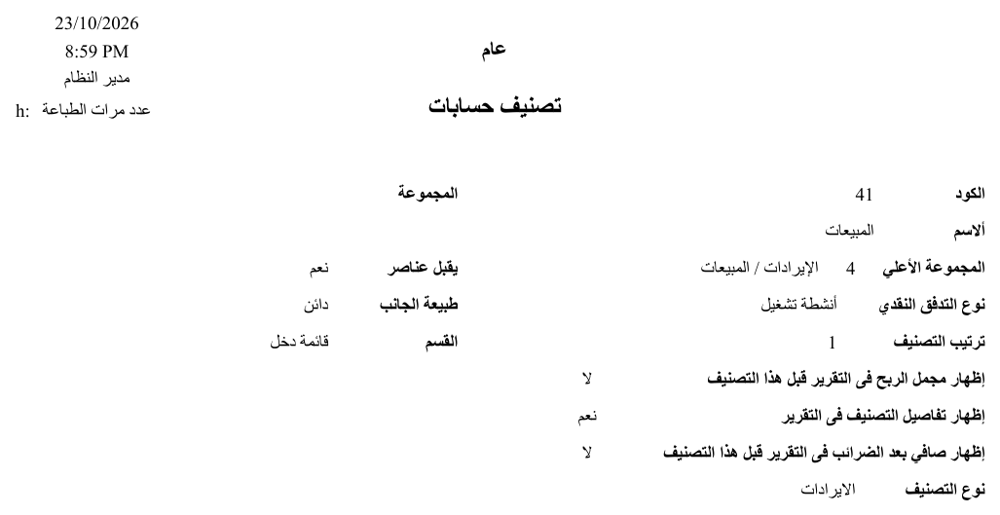

# شجرة الحسابات

شجرة الحسابات هي العمود الفقري لنظامك المحاسبي: هيكل هرمي يُصنِّف كل ما تملكه وتدين به وتكسبه وتنفقه في مجموعات منطقية متفرّعة. في أعلى الشجرة مجموعات كبيرة (الأصول، الالتزامات، حقوق الملكية، الإيرادات، المصروفات)، وتحتها مجموعات أدقّ، وصولًا إلى **الحسابات الطرفية** التي تُسجَّل عليها الأرصدة فعليًا.

هذه الصفحة تشرح كيف تُبنى الشجرة في **شجرة حسابات** (`Accounting > Master Files > Accounts Chart`)، وكيف تُكمِّلها ملفّات التصنيف التي تُغذّي التقارير المالية: **تصنيف الحساب** و**تصنيف الحساب الضريبي**.

::: info الترخيص المطلوب
شجرة الحسابات والتصنيفات جزء من ترخيص المحاسبة الأساسي `accounting`.
:::

## بنية الشجرة الهرمية

كل عقدة في الشجرة لها **مجموعة أعلى** تربطها بأبيها، وبذلك تتكوّن الشجرة. والتمييز الجوهري بين نوعين من العُقَد:

- **عقدة طرفية (ورقة)** — تحمل علامة **يقبل عناصر** (`Accepts Elements`): أي أنها تقبل الحسابات. فحقلا **شجرة المدين** و**شجرة الدائن** في شاشة الحساب لا يعرضان إلا العُقد المفعّلة عليها هذه العلامة. والعقدة الجديدة تبدأ والعلامة مفعّلة.
- **عقدة تجميعية** — العلامة غير مفعّلة عليها. لا يعرضها حقلا الشجرة في شاشة الحساب، وتُجمَّع فيها أرصدة العُقد التي تحتها.

في رأس الشاشة تُدخل **الكود** و**الاسم العربي** و**الاسم الإنجليزي**، و**الكود الإنجليزي** اختياريًا. وفي القسم التالي تُحدِّد موضع العقدة وطبيعتها:

- **المجموعة الأعلى** — العقدة الأب التي تتفرّع منها هذه العقدة (تُترك فارغة لعُقد الجذر).
- **نوع شجرة الحسابات** — يربط العقدة بنوع الشجرة الذي عرّفته في الإعداد المبدئي (انظر [المفاهيم الأساسية والإعداد](./accounting-concepts-and-setup.md)).
- **القسم** (`Class`) — تصنيف القائمة المالية التي تنتمي إليها العقدة: **ميزانية** أو **قائمة دخل** أو **أخرى**. هذا ما يقرّر أين يظهر الحساب في القوائم المالية.
- **طبيعة الجانب** (`Natural Side`) — الجانب الطبيعي للعقدة: **مدين** أو **دائن**. الأصول والمصروفات طبيعتها مدينة، والالتزامات وحقوق الملكية والإيرادات طبيعتها دائنة. هذه القيمة تُحدِّد كيف يُقرأ الرصيد (موجب أم سالب) في التقارير.

::: tip لماذا «طبيعة الجانب» مهمة؟
الرصيد المدين في حساب طبيعته مدينة (كالنقدية) يعني رصيدًا موجبًا طبيعيًا. أما رصيد مدين في حساب طبيعته دائنة (كالمورّدين) فهو إشارة إلى وضع غير معتاد. النظام يستخدم طبيعة الجانب ليعرض الأرصدة بإشاراتها الصحيحة في كشوف الحسابات وموازين المراجعة.
:::

## إعدادات التوحيد

في القسم نفسه حقلان آخران لا يعنيان إلا مجموعة شركات تستعمل [القوائم المالية الموحدة](../financial-reporting/consolidated-statements.md)، وكلاهما ينتقل إلى ما تحت العقدة في الشجرة:

- **حساب بين شركات المجموعة** (`Intercompany`) — يعلّم العقدة بأنها تحمل معاملات مع شركات أخرى من المجموعة: عملاء وموردي المجموعة، والقروض، واستثمار الشركة الأم ورأس المال الذي دفعته، ومبيعات المجموعة وتكلفتها. والتقارير الموحدة تستبعد كل حساب تحت عقدة معلّمة. والعلامة تُورَث: حين تحفظ عقدة أو حسابًا تحت عقدة معلّمة يُعلَّم هو أيضًا. وإلغاء العلامة من الأب يترك الأبناء معلّمين، ويمكنك بعدها إلغاؤها منهم واحدًا واحدًا.
- **سعر الترجمة في التوحيد** (`Consolidation Rate`) — سعر الصرف الذي تترجم به التقارير الموحدة حسابات العقدة: **إغلاق** أو **متوسط** أو **تاريخي**. وإن تُرك فارغًا أخذت العقدة قيمة أقرب عقدة فوقها تحدده، فإن لم تحدده أيٌّ منها اتبعت **القسم**: **متوسط** لقائمة الدخل، و**إغلاق** للميزانية والأخري. وفي الواقع تضبط **تاريخي** مرة واحدة على عقدة حقوق الملكية وتترك الباقي فارغًا.

وحين تغيّر أحد الحقلين، أو **القسم**، على عقدة لها أبناء بالفعل، يحدّث حفظها كل عقدة وحساب تحتها.

## التكويد التلقائي للحسابات

بدل ترقيم الحسابات يدويًا، يتيح قسم **إعدادات صيغة التكويد للملفات** على العقدة أن يَحسب النظام كود كل حساب جديد يُربط بتلك العقدة (العقدة المختارة في **شجرة المدين** للحساب) آليًا وفق صيغة: بادئة تسلسل، وطول للاحقة الرقمية، وأول رقم تبدأ منه. يمكنك كذلك توليد الاسم العربي/الإنجليزي بصيغة محسوبة، وضبط استعلام للتحقق من صلاحية الكود. الفائدة أن كل حساب جديد تحت تلك العقدة يأخذ كودًا متّسقًا مع إخوته دون عناء.

## تصنيف الحساب

شجرة الحسابات تنظّم الحسابات محاسبيًا، لكن التقارير المالية (خصوصًا **قائمة التدفقات النقدية** و**قائمة الدخل**) تحتاج إلى زاوية تصنيف إضافية. هذا دور **تصنيف الحساب** (`Accounting > Master Files > Account Category`): شجرة تصنيف موازية تربط كل حساب بدوره في هذه القوائم.

أهم حقوله:

- **نوع التدفق النقدي** (`Cash Flow Type`) — يحدّد موضع الحساب في قائمة التدفقات النقدية، وقيمه: **أنشطة تشغيل**، **أنشطة استثمارية**، **أنشطة تمويلية**، **حساب نقدية**، **ربح - خسارة**، **تسويات**، أو **غير معني** لما لا يدخل في القائمة.
- **نوع التصنيف المستخدم في التقرير** (`Equation Type`) — يحدّد موضع الحساب في قائمة الدخل: **الإيرادات**، **تكلفة الإيرادات**، **المصروفات**، **الإيرادات الأخرى**، **الضرائب**، أو **غير معني**.
- **القسم** و**طبيعة الجانب** — كما في شجرة الحسابات.
- خيارات العرض في التقرير — **إظهار مجمل الربح في التقرير قبل هذا التصنيف** و**إظهار صافي بعد الضرائب في التقرير قبل هذا التصنيف** و**إظهار تفاصيل التصنيف في التقرير** — تتحكّم في سطور المجاميع التي تُطبع قبل التصنيف وفي مستوى التفصيل الذي يظهر به عند طباعة القوائم.
- **يقبل عناصر** — كما في الشجرة، لكن بصرامة أكبر: فلا يُختار **مجموعة أعلى** لتصنيف آخر إلا تصنيف العلامة غير مفعّلة عليه، ولا يُعطى الحساب إلا تصنيفًا العلامة مفعّلة عليه و**طبيعة الجانب** فيه مثل طبيعة الحساب. والقاعدتان نفسهما تسريان على تصنيف الحساب الضريبي.

## تصنيف الحساب الضريبي

**تصنيف الحساب الضريبي** (`Accounting > Master Files > Account Tax Category`) يشبه تصنيف الحساب لكنه مخصّص للأبعاد الضريبية، ويُستخدم لتجميع الحسابات بحسب معاملتها الضريبية في الإقرارات والتقارير الضريبية. هو الآخر شجرة هرمية تحمل **نوع التدفق النقدي** و**القسم** و**طبيعة الجانب**.

## التقارير

تقرير **شجرة الحسابات** (`SYSR-ACC001`) يطبع الشجرة كاملةً بمستوياتها، وتجده مع بقية تقارير الحسابات الأساسية في صفحة [كشوف الحسابات وميزان المراجعة](../financial-reporting/reports-account-statements-and-trial-balance.md).

ويُطبع تصنيف الحساب على نموذج **تصنيف حساب** (`SYSF-ACC009`)، وفيه التصنيف الأعلى والقسم وطبيعة الجانب ونوع التدفق النقدي ونوع التصنيف المستخدم في التقرير وخيارات الظهور في التقرير:

## على أرض الواقع

- تكاد كل منشأة تحتفظ بشجرتها في **شجرة حسابات**. الشجرة المعتادة فيها نحو 115 عقدة، والعُشر الأكبر أكثر من 150؛ ونحو نصف المنشآت أضافت عُقدًا خاصة بها إلى الشجرة التي تبدأ بها المنشأة الجديدة.
- **تصنيف الحساب** تستعمله نحو 6 من كل 7 منشآت. تبدأ المنشأة الجديدة بنحو 40 تصنيفًا، ونحو 2 من كل 3 منشآت تضيف تصنيفاتها الخاصة، لكن المنشأة المعتادة تحتفظ بما يزيد قليلًا على 40: فالمجموعة الأولى تغطي معظم الحاجة، مع بضعة بنود خاصة بالمنشأة.
- **تصنيف الحساب الضريبي** نادرًا ما يُحتاج إليه: أقل من منشأة من كل 100 تحتفظ بأي سجل منه.

## للدعم الفني

- **«لا أستطيع ربط حساب بعقدة معيّنة»** — يجب أن تحمل العقدة علامة **يقبل عناصر**؛ فحقلا الشجرة في الحساب لا يعرضان عقدة بدونها، وبعد تحديد نوع شجرة الحساب لا يعرضان إلا عُقد ذلك النوع.
- **«الرصيد يظهر بإشارة عكسية في الكشف»** — راجِع **طبيعة الجانب** للحساب؛ خطأ في تحديدها يقلب إشارة الرصيد في التقارير.
- **«حساب لا يظهر في قائمة الدخل/التدفقات النقدية»** — تحقّق من **نوع التصنيف المستخدم في التقرير** و**نوع التدفق النقدي** في تصنيف الحساب؛ القيمة **غير معني** تُخرِج الحساب من القائمة.
- بناء الحسابات الطرفية نفسها (العملة، الأنواع الفرعية، خصائص ضبط القيود والمحددات) موضّح في صفحة [الحسابات](./accounts.md).
