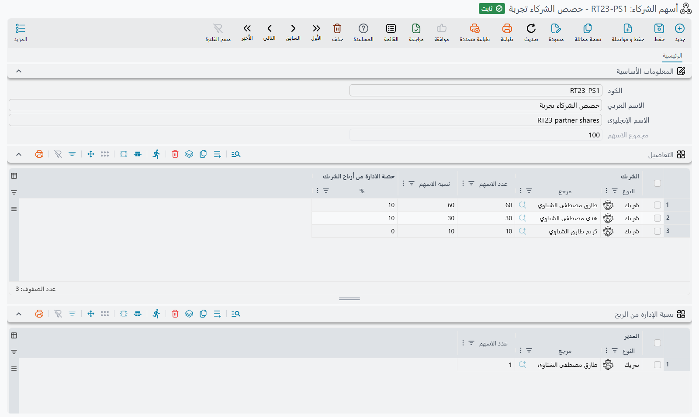

# أسهم الشركاء وتوزيع الأرباح

حين يملك النشاطَ شركاء، تطرح نهايةُ كل فترةٍ السؤالَ نفسه: من ربح هذه الفترة، كم يأخذ كل شريك، وكم يذهب إلى من يدير العمل؟ يجيب نما عن ذلك بشاشتين. **أسهم الشركاء** تسجّل مرةً واحدةً من يملك كم ومن يدير؛ و**مستند توزيع أرباح** يأخذ صافي ربح الفترة ويقسّمه وفق ذلك السجل، ثم يقيّد نصيب كل شريكٍ وكل مدير.

::: info الترخيص المطلوب
يحتاج **مستند توزيع أرباح** إلى ترخيص `accounting`؛ أما **أسهم الشركاء** فملفٌ ضمن ترخيص `basic`. **أسهم الشركاء** تحت **الحسابات > الملفات**، و**مستند توزيع أرباح** تحت **الحسابات > المستندات**.
:::

## أسهم الشركاء — من يملك ماذا

سجل **أسهم الشركاء** (**الحسابات ← الملفات ← أسهم الشركاء**) هو جدول الملكية الذي يقرؤه التوزيع. وفيه جدولان:

- **الأسهم** — سطرٌ لكل شريك: **الشريك**، و**عدد الاسهم** التي يملكها، و**حصة الادارة من أرباح الشريك | %** — الجزء من ربح هذا الشريك الذي يُعطى للإدارة. ويمكن أن يكون الشريك سجل **شريك** (**الحسابات ← الملفات ← شريك**)، أو **موظف**، أو **جهة ذات صلة**.
- **نسبة الإداره من الربح** — سطرٌ لكل مدير، مع **عدد الاسهم** التي يملكها المدير في وعاء الإدارة. والمدير كذلك يمكن أن يكون شريكًا أو موظفًا أو جهةً ذات صلة.

عند الحفظ يجمع نما الأسهم في **مجموع الاسهم** ويحسب **نسبة الاسهم** لكل شريك. فأنت تكتب أعداد الأسهم فقط، والنسب تتبعها. لذلك «60، 30، 10» و«6، 3، 1» تعطيان التقسيم نفسه.

احتفظ بسجل أسهم شركاء واحدٍ لكل هيكل ملكية. وإذا تغيّر الشركاء أو أسهمهم، فعدّل السجل (أو أنشئ سجلًا جديدًا) قبل التوزيع التالي: فالتوزيع يقرأ السجل دائمًا كما هو لحظة حفظ التوزيع.

## مستند توزيع أرباح — تقسيم ربح الفترة

يُملأ **مستند توزيع أرباح** (**الحسابات ← المستندات ← مستند توزيع أرباح**) هكذا:

1. اختر سجل **أسهم الشركاء**. فيمتلئ جدول **نسب الشركاء** بسطرٍ لكل شريك يحمل نسبة الإدارة، ويمتلئ جدول **نسب الإداره** بسطرٍ لكل مدير. وجدول الإدارة يُملأ تلقائيًا ولا يمكن تعديله.
2. أدخل الربح. إما أن تكتبه مباشرةً في **المبلغ**، أو تملأ **الإيرادات** و**التكاليف** و**مصروفات عمومية** وتترك الشاشة تحسبه: **مجمل الربح** هو الإيرادات ناقص التكاليف، و**صافي الربح** هو مجمل الربح ناقص المصروفات العمومية، ويُنسخ صافي الربح إلى **المبلغ**. ويسجّل **من تاريخ** و**إلى تاريخ** الفترة التي يخصّها الربح.
3. لكل شريك، اكتب ما يغيّر نتيجته: **مصروفات إضافية** (مصروفٌ يتحمّله هذا الشريك وحده ويُخصم من نصيبه) و**رأس مال الشريك** (رأس مالٍ يُردّ إليه مع الربح). ويبقى كلاهما على سطر الشريك عند إعادة حفظ المستند.
4. احفظ. تُعاد حسابات كل أرقام الجدولين من سجل أسهم الشركاء عند كل حفظ.

### كيف يُحسب التقسيم

لكل شريك:

- **أصل حصة الارباح** = المبلغ × أسهم الشريك ÷ مجموع الأسهم.
- ربح الشريك هو أصل حصة الأرباح ناقص **مصروفات إضافية**.
- **حصة الادارة من أرباح الشريك | قيمة** = ربح الشريك × **حصة الادارة من أرباح الشريك | %**.
- **ارباح ادارية** (حصة الربح) = ربح الشريك ناقص حصة الإدارة منه. وهذا ما يكسبه الشريك بصفته مالكًا.

مبالغ الإدارة المأخوذة من كل الشركاء تكوّن وعاء الإدارة. ويقسّم جدول **نسب الإداره** ذلك الوعاء بين المديرين بحسب أسهمهم، في عمود **القيمة**. والشريك الذي هو مديرٌ أيضًا يظهر نصيبه من الوعاء على سطره كذلك في **حصته من الإدارة**، و**إجمالي المستحق** = حصة الربح + حصته من الإدارة + رأس مال الشريك: كل ما يدين به النشاط لذلك الشريك من هذا التوزيع.

وفي الرأس، **حصة الإداره** هي الوعاء كله، و**حصة الشركاء** هي المبلغ ناقص كل المصروفات الإضافية ناقص الوعاء. وإذا ترك التقريب كسرًا، أُضيف إلى حصة ربح الشريك الأول، فتطابق السطورُ الرأسَ دائمًا.

::: tip مثال محلول
ثلاثة شركاء يملكون 60 و30 و10 أسهم. الأول والثاني يعطيان الإدارة 10% من ربحهما؛ والثالث لا يعطي شيئًا. والشريك الأول هو المدير الوحيد أيضًا. الإيرادات 15,000 والتكاليف 3,000 والمصروفات العمومية 2,000، فصافي الربح، والمبلغ، 10,000. وعلى الشريك الثاني 500 مصروفات إضافية، ويُستحق للأول 1,000 رأس مال.

| الشريك | أصل حصة الارباح | مصروفات إضافية | حصة الإدارة (10%) | حصة الربح | حصته من الإدارة | رأس مال الشريك | إجمالي المستحق |
|---|---|---|---|---|---|---|---|
| الأول (60) | 6,000 | 0 | 600 | 5,400 | 850 | 1,000 | 7,250 |
| الثاني (30) | 3,000 | 500 | 250 | 2,250 | 0 | 0 | 2,250 |
| الثالث (10) | 1,000 | 0 | 0 | 1,000 | 0 | 0 | 1,000 |

وعاء الإدارة 600 + 250 = 850، يذهب كله إلى الشريك الأول بصفته مديرًا. ويُظهر الرأس حصة الإدارة 850 وحصة الشركاء 10,000 − 500 − 850 = 8,650.
:::

## ما الذي يقيّده

توجيه المستند يحدّد الحسابات. وفيه زوجان من الجوانب المحاسبية:

- **مدين الأرباح** / **دائن الأرباح** — قيدٌ لكل سطر شريك، بقيمة حصة ربح ذلك الشريك.
- **مدين حصة الإداره** / **دائن حصة الإداره** — قيدٌ لكل سطر مدير، بقيمة **القيمة** لذلك المدير.

ويمكن أن تُغذّي **الذمة** في الرأس (خزينة أو حساب بنكي أو حساب) و**ذمة السطر** في كل سطرٍ تلك الجوانب. أما **رأس مال الشريك** و**إجمالي المستحق** فلا يقيّدهما هذا المستند؛ هما على السطور كي ترى، وتطبع، ما يُستحق لكل شريك. وخيارات الجوانب مشروحة تحت [مستند توزيع أرباح](../document-terms/acc-terms-journals-and-closing) في مرجع التوجيهات.

ونموذج المستند المطبوع هو `SYSF-ACC023`.

## للدعم الفني

- **«جدول الشركاء فارغ»** — حقل **أسهم الشركاء** فارغ، أو السجل الذي يشير إليه ليس في جدول **الأسهم** فيه أي سطر.
- **«نصيب شريكٍ خاطئ»** — راجع الأسهم في سجل أسهم الشركاء، ثم **مصروفات إضافية** و**حصة الادارة من أرباح الشريك | %** في السطر. والنسبة في المستند تأتي من سجل أسهم الشركاء.
- **«المدير لم يحصل على شيء»** — وعاء الإدارة مكوّن من **حصة الادارة من أرباح الشريك | %** لكل الشركاء. فإن كانت نسبة كل شريكٍ صفرًا، فلا شيء يُقسَّم بين المديرين.
- **«رأس مال الشريك لم يُقيَّد»** — هذا مقصود؛ رأس مال الشريك يدخل في **إجمالي المستحق** فقط.
- **«المبلغ يعود إلى قيمته كلما غيّرته»** — ما دام في الإيرادات أو التكاليف أو المصروفات العمومية قيمة، فالمبلغ هو صافي الربح دائمًا. أفرغ هذه الحقول الثلاثة لتكتب المبلغ بنفسك.
