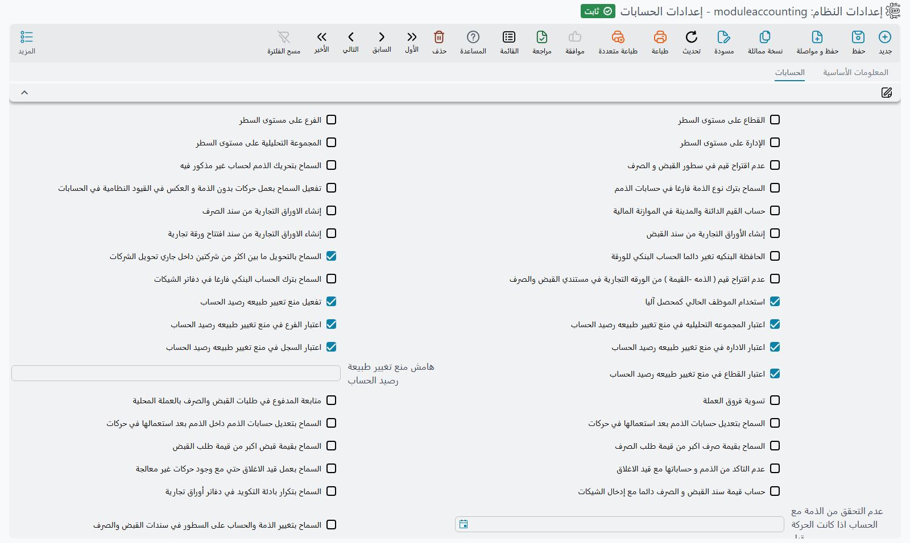

# إعدادات الحسابات (كتالوج خيارات الوحدة)

كثير من سلوكيات الوحدة المحاسبية لا تُبرمَج، بل **تُضبَط** من شاشة إعدادات الوحدة المحاسبية (الحسابات ← الإعدادات ← إعدادات الحسابات). هذه الصفحة كتالوج مرجعي لهذه الخيارات، مجمّعة حسب الغرض: ما الذي يفعله كل خيار، وأي سلوك يغيّره. وهي مصمّمة لتجيب سؤال الدعم المتكرّر: «أين أضبط هذا التصرّف؟».

يعطي عمود **معرّف الحقل** معرّف كل خيار — الاسم الذي تبحث به في سكربت دعم أو ملف استيراد أو نموذج البيانات.



## المحددات في التفاصيل

أما المحددات الخمسة نفسها — والمحدد المركب — فتجدها في [المحددات والمحددات المركبة](/ar/platform/shared-master-files/dimensions-and-composite-dimensions).

| الخيار | معرّف الحقل | الأثر |
|---|---|---|
| إظهار الفرع / الإدارة / المجموعة التحليلية / القطاع في التفاصيل | `value.branchInDetails`، `value.departmentInDetails`، `value.analysisSetInDetails`، `value.sectorInDetails` | إظهار كل محدِّد على مستوى أسطر المستندات لا الرأس فقط. |

## سندات القبض والصرف

| الخيار | معرّف الحقل | الأثر |
|---|---|---|
| عدم اقتراح أسطر في سند القبض/الصرف | `value.doNotSuggestLinesInRVPV` | إيقاف الاقتراح التلقائي لأسطر السند. |
| استخدام المستخدم الحالي كمحصِّل | `value.useCurrentUserAsCollector` | تعبئة المحصِّل بالمستخدم الحالي تلقائيًا. |
| السماح بأكثر من طريقة دفع في سندات القبض/الصرف | `value.allowMultiplePaymentInRVPVDocs` | تفعيل تعدّد طرق الدفع في السند. |
| استخدام القيمة المحلية في القبض والصرف | `value.useLocalAmountInPVAndRV` | اعتماد القيمة المحلية في السند. |
| السماح بتعديل الذمة في تفاصيل القبض/الصرف | `value.allowChangingSubsidiaryInRVPVDetails` | إتاحة تغيير الذمة على مستوى السطر. |
| السماح بتجاوز قيمة السند لقيمة الطلب (قبضًا/صرفًا) | `value.allowPVValueExceedPVRequest`، `value.allowRVValueExceedRVRequest` | السماح بأن يتجاوز السند قيمة طلبه. |
| عدم اقتراح قيم ( الذمه -القيمة ) من الورقه التجارية في مستندي القبض والصرف | `value.doNotSuggestSubsidaryAndAmountBasednFPInRVAndPV` | عند اختيار شيك أو ورقة تجارية أخرى في سند قبض أو صرف، يملأ السند عادةً الذمة والذمة المرتبطة والعملة والسعر والقيمة الفارغة من الورقة. وإذا أُشِّر هذا الخيار يأخذ السند الورقة وحدها ويترك رأسه كما كتبته. |
| حساب قيمة سند القبض و الصرف دائما مع إدخال الشيكات | `value.calcPaymentAndReceiptValueFromChequesWithDataEntry` | تُنسخ قيمة الورقة عادةً إلى قيمة السند ما دامت تلك القيمة فارغة فقط. وإذا أُشِّر الخيار يُعاد حساب قيمة السند مجموعًا لأوراقه كلما اختيرت ورقة، حتى لو كانت فيه قيمة. ولا أثر له ما دام الخيار السابق مؤشَّرًا. |

## حسابات النظام لكل نوع مستند

| الخيار | معرّف الحقل | الأثر |
|---|---|---|
| السماح باستخدام حساب نظام في سند القبض / الصرف / التحويل البنكي / سند القيد | `value.canUseSysAccForRVVoucher`، `value.canUseSysAccForPVVoucher`، `value.canUseSysAccForBankTransfer`، `value.canUseSysAccForJournalEntry` | السماح بانتقاء حساب «خاص بالنظام» يدويًا في كل نوع على حدة. |

كل خيار منها يوقف الفحص لنوع مستند كامل — لكل المستخدمين، ولكل الحسابات، وفي كل التواريخ — فهو أعمّ الطرق الثلاث لفتح حساب نظامي. والأولى أن تستعمل بدلًا منه سجل استثناء مؤرَّخًا؛ والطريقان معًا، وأعلام الحساب التي وراءهما، في [الحسابات النظامية واستثناءات الحركة عليها](../ledger-setup/system-accounts-and-exceptions.md).

## حماية تغيير طبيعة رصيد الحساب

| الخيار | معرّف الحقل | الأثر |
|---|---|---|
| تفعيل منع تغيير طبيعة رصيد الحساب | `value.enablePreventChangAccBalanceNature` | تشغيل الحارس الذي يمنع قلب رصيد الحساب لجانبه غير الطبيعي. |
| هامش منع تغيير طبيعة الرصيد | `value.preventChangAccBalanceNatureMargin` | قيمة سماحية يُتجاوز عندها المنع. |
| اعتبار الإدارة/القطاع/المجموعة التحليلية/محدد الكيان/الفرع في المنع | `value.considerDepInPreventChangAccBalanceNature`، `value.considerSectorInPreventChangAccBalanceNature`، `value.considerAnalysisSetInPreventChangAccBalanceNature`، `value.considerEntityDimInPreventChangAccBalanceNature`، `value.considerBranchInPreventChangAccBalanceNature` | تحديد المحددات التي تُحتسب عند تطبيق المنع. |

(يقابل هذا الخيار علم **منع تغيير طبيعه رصيد الحساب** على [الحساب](../ledger-setup/accounts.md) نفسه.)

## الذمم

| الخيار | معرّف الحقل | الأثر |
|---|---|---|
| السماح بحسابات بلا نوع ذمة | `value.allowAccountsWithoutSubsidiaryType` | السماح بحساب ذمة دون تحديد نوع الطرف. |
| تفعيل السماح بالحركة بدون ذمة | `value.enableAllowTransactionsWithoutSubsidiary` | إتاحة الحركة على حساب ذمة دون طرف. |
| السماح بتحريك الذمم لحساب غير مذكور فيه | `value.allowSubsidiaryOutsiderAccount` | إذا لم يُؤشَّر (وهو الافتراضي) فسطر سند القيد أو السند الذي يذكر عميلًا أو موردًا أو ذمة أخرى يجب أن يستعمل أحد حسابات تلك الذمة نفسها. وإذا أُشِّر يُقبل أي حساب مع أي ذمة. |
| السماح بتعديل حسابات الذمة بعد الاستخدام | `value.allowChangingSubsidiaryAccountsAfterUsage` | في [حساب](../ledger-setup/accounts.md) عليه حركات بالفعل، يسمح بتغيير عملته ونوعه وأنواع الذمم فيه. وإذا لم يُؤشَّر لا تتغير هذه الحقول بعد استعمال الحساب. |
| السماح بتعديل حسابات الذمم داخل الذمم بعد استعمالها في حركات | `value.allowChangingSubsidiaryAccountsInSubsidiariesAfterUsage` | الفكرة نفسها من جهة الطرف: في العميل أو المورد أو أي ذمة أخرى، يسمح باستبدال أحد حساباته (الحساب الرئيسي، الحساب 1 … 20) بعد تسجيل حركات عليه لهذا الطرف. وإذا لم يُؤشَّر يُرفض الحفظ بالرسالة «لا يمكن تغيير الحساب {0} الي الحساب {1}, بسبب وجود الحساب {2} في {3} حركات في سطور القيد النظامي». |
| عدم التحقق من الذمة مع الحساب (حتى تاريخ) | `value.doNotCheckSubsidiaryWithAcount` | تعطيل التحقق من تطابق الذمة والحساب قبل تاريخ. |
| عدم التحقق من الذمم في القيد الختامي | `value.doNotValidateSubsidiariesInClosingEntry` | تجاوز فحص الذمم عند الإقفال. |

## الأوراق التجارية والبنوك

| الخيار | معرّف الحقل | الأثر |
|---|---|---|
| إنشاء أوراق تجارية من سند الصرف / القبض / مستند الافتتاح | `value.createFinancialPapaersFromPaymentVoucher`، `value.createFinancialPapaersFromReceiptVoucher`، `value.createFinancialPapersFromOpeningDocument` | توليد الأوراق التجارية تلقائيًا من هذه المستندات. |
| حذف الأوراق المولَّدة عند حذف المستند المصدر | `value.deleteGeneratedFPWhenDeletingOwnerDoc` | تنظيف الأوراق التابعة تلقائيًا. |
| السماح بترك تاريخ استحقاق الورقة فارغًا | `value.allowFinancialPaperDueDateToBeEmpty` | عدم إلزام تاريخ الاستحقاق. |
| السماح بإشعار على الأوراق المنشأة | `value.allowNoticeOnCreatedPapers` | إتاحة الإشعار البنكي على ورقة بحالة «تم إنشاؤه». |
| السماح بدفتر شيكات بلا حساب بنكي | `value.allowChequeBookWithoutBankAccount` | عدم إلزام ربط الدفتر بحساب بنكي. |
| السماح بالتعامل بالكمبيالات | `value.allowDealingWithBillOfExchange` | تفعيل الكمبيالات إلى جانب الشيكات. |
| تجميع سطور الأوراق ذات أرقام الشيكات المتشابهة | `value.aggregateFPLinesBySimilarChequeNumbers` | دمج الأسطر المتشابهة. |
| الحافظة البنكيه تغير دائما الحساب البنكي للورقة | `value.bankPortfolioAlwaysChangePaperBankAccount` | ترفض الحافظة البنكية عادةً شيكًا يحمل حسابًا بنكيًا مختلفًا بالرسالة «الحساب البنكي فى الورقة التجارية {0} غير متوافق مع الحساب البنكي فى المستند». وإذا أُشِّر الخيار تقبله الحافظة وتنقل الورقة إلى حسابها البنكي. |

## فروق العملة

| الخيار | معرّف الحقل | الأثر |
|---|---|---|
| تسوية فرق العملة | `value.adjustCurrencyDifference` | تفعيل التسوية التلقائية لفروق العملة. |

## الإقفال

| الخيار | معرّف الحقل | الأثر |
|---|---|---|
| السماح بعمل قيد الإغلاق حتى مع وجود حركات غير معالجة | `value.allowClosingEntryWithFailedTransactions` | تجاوز حجب الإقفال عند وجود طلبات أعمال متعثّرة (انظر [كيف تُعالَج المستندات](./accounting-request-processing.md)). |

## الموازنات

هذه الخيارات في مجموعة **اعدادت التأكد من عدم تجاوز الموانات** (هكذا تظهر على الشاشة)؛ وأثرها على الموازنة مشروح في [الموازنات المالية](../planning-and-commitments/financial-budgets.md).

| الخيار | معرّف الحقل | الأثر |
|---|---|---|
| تفعيل الموافقات للموازنات | `value.enableApprovalsForBudgets` | طلب موافقة عند تجاوز الموازنة. |
| تفعيل منع الحفظ للموازنات | `value.enablePreventSavingForBudgets` | رفض الحفظ عند تجاوز الموازنة. |
| استخدام من تاريخ/إلى تاريخ في التحقق والموافقة | `value.useFromDateToDateInBudgetValidationAndApproval` | اعتماد المدى الزمني في فحص الموازنة. |
| اعتبار القطاع / الفرع / الإدارة / المجموعة التحليلية / الذمة / محدد الكيان / المرجع 1–3 / الفترة المالية | `value.budgetValidationOptions.considerSector`، `value.budgetValidationOptions.considerBranch`، `value.budgetValidationOptions.considerDepartment`، `value.budgetValidationOptions.considerAnalysisSet`، `value.budgetValidationOptions.considerSubsidiary`، `value.budgetValidationOptions.considerEntityDimension`، `value.budgetValidationOptions.considerRef1`، `value.budgetValidationOptions.considerRef2`، `value.budgetValidationOptions.considerRef3`، `value.budgetValidationOptions.considerFiscalPeriod` | القيم التي يجب أن يشترك فيها المستند مع سطر الموازنة ليكون هو السطر الذي يُفحص مقابله. |
| حساب القيم الدائنة والمدينة في الموازنة المالية | `value.calcFBudgetCredDebitValues` | يضيف عمودَي مدين ودائن بجوار قيمة كل سنة في سطور الموازنة المالية، يُملآن بحركة الحساب المدينة والدائنة حين تجلب الموازنة الأرصدة الفعلية — لا صافي الرصيد وحده. وهذا الخيار في المجموعة الأولى من الشاشة لا في مجموعة الموازنات. |

## الضريبة والفاتورة الإلكترونية

| الخيار | معرّف الحقل | الأثر |
|---|---|---|
| إضافة حقول الضريبة لسند الصرف / القبض | `value.addTaxFieldsInfoToPaymentVoucher`، `value.addTaxFieldsInfoToReceiptVoucher` | إظهار حقول الضريبة على السندات. |
| إضافة حقول الضريبة 1 / 2 لسند القيد | `value.addTax1FieldsToJournalEntry`، `value.addTax2FieldsToJournalEntry` | إظهار جانبَي الضريبة في القيد اليدوي. |
| تحديث رقم التسجيل الضريبي والسجل التجاري مع الحفظ في فواتير المشتريات المتنوعة | `value.updateTaxRegNoAndCommercialRegNoWithSaveInAccMiscInvoices` | تحديث البيانات الضريبية آليًا. |

## القروض والودائع والتسهيلات

| الخيار | معرّف الحقل | الأثر |
|---|---|---|
| عدد أيام السنة لاحتساب فائدة التسهيل الائتماني (مجموعة **إعدادات التسهيلات الائتمانية**) | `value.daysNumberPerYearOfInterestCalculationForCreditFacility` | أساس احتساب الفائدة (الافتراضي 365). |
| عدم تجميع أسطر سداد فائدة الوديعة بعد تاريخ نهايتها | `value.doNotCollectDepositInterestPaymentLinesAfterDepositEndDate` | ضبط احتساب فائدة الوديعة. |
| عدم التحقق من القروض والودائع قبل تاريخ | `value.doNotValidateLoansAndDepositsBefore` | تجاوز التحقق قبل تاريخ معيّن. |

## القوائم المالية

في مجموعة **إصدار قائمة مالية** خيار واحد يخص محرك [القوائم المالية](../financial-reporting/financial-statements.md).

| الخيار | معرّف الحقل | الأثر |
|---|---|---|
| إظهار قيم المدين والدائن في سطور سند إعداد قائمة مالية | `value.showDebitAndCreditInFSDocLines` | يضيف عمودَي مدين ودائن بجوار كل قيمة فترة وسنة في سطور شاشة إصدار القائمة المالية، فيُظهر كل رقم مُصدَر جانبيه إلى جانب صافيه. |

## التكويد وأخرى

| الخيار | معرّف الحقل | الأثر |
|---|---|---|
| دمج تكويد الحسابات والشجرة | `value.mergeAccountsAndChartsAutoCoding` | توحيد منطق التكويد التلقائي. |
| السماح بتكرار بادئة التكويد في دفتر الأوراق | `value.allowRepeatingAutoCodingPrefixInFPBook` | إتاحة تكرار البادئة. |
| إنشاء قيد نظامي للسطور الفارغة | `value.createTransactionsForEmptyLines` | إذا لم يكتب توجيه المستند أي سطر (كل جوانبه المحاسبية فارغة) يُكتب مع ذلك قيد بلا سطور. وإذا كان معطّلاً يُعالَج هذا المستند دون أي قيد. |
| السماح بالتحويل بين أكثر من شركتين في جاري تحويل الشركات | `value.allowTransBetweenMoreThanTwoComInsideInterComTrans` | تمديد تحويل الشركات لأكثر من طرفين. |

## مسلسل القيود النظامية

كل مستند يُعالَج يكتب قيدًا نظاميًا، ولهذا القيد **مسلسل**. وبلا أي إعداد يبقى للقيد مسلسله المعتاد؛ أما
جدول **إعدادات الرقم المسلسل للقيود النظامية** (`value.info.serialConfigLines`) فيتيح لك ترقيم القيود
بنفسك — مثلًا تسلسل مستقل لكل شركة ولكل سنة، على نحو `C1-2026-00001`.

عند كتابة القيد يُقرأ الجدول من أعلى، و**أول سطر يناسب** القيد هو الذي يرقّمه:

| العمود | معرّف الحقل | ماذا يفعل |
|---|---|---|
| الشركة، الفرع، القطاع، الإدارة، المجموعة التحليلية | `value.info.serialConfigLines.dimensions.legalEntity`، `value.info.serialConfigLines.dimensions.branch`، `value.info.serialConfigLines.dimensions.sector`، `value.info.serialConfigLines.dimensions.department`، `value.info.serialConfigLines.dimensions.analysisSet` | لا ينطبق السطر إلا على القيود التي تحمل هذه المحددات. اترك العمود فارغًا ليقبل أي قيمة. |
| النوع | `value.info.serialConfigLines.entityTypeDF` | لا ينطبق السطر إلا على القيود التي يكتبها هذا النوع من المستندات. والفارغ يعني كل الأنواع. |
| بادئة التكويد | `value.info.serialConfigLines.prefix` | النص الذي يبدأ به المسلسل. |
| صيغة التاريخ | `value.info.serialConfigLines.dateFormula` | نمط تاريخ يُضاف بعد البادئة، مأخوذ من تاريخ قيمة القيد — `yyyy` للسنة، و`MM` للشهر، و`yyyyMM` لكليهما. |
| طول اللاحقة | `value.info.serialConfigLines.suffixLength` | عدد الخانات التي يُكمَّل إليها الرقم المتسلسل (`5` تعطي `00001`). |

يبدأ الرقم المتسلسل من جديد مع كل نص مختلف من البادئة والتاريخ، فالنمط الذي فيه `yyyy` يبدأ تسلسلًا جديدًا كل
سنة دون أي إعداد إضافي. وضع السطور الأدق أولًا: فسطر يقبل كل شيء في أعلى الجدول يرقّم كل القيود ولا يُوصَل
إلى ما تحته أبدًا.

ولأن نمط التاريخ يفرّق بين الحروف الكبيرة والصغيرة، وأشهر خطأين فيه ينتجان سنة خاطئة أو عدد دقائق، ترفضهما
الشاشة بالرسالتين *Date formula can not contain Y capital* و
*Date formula can not contain m small* (وتظهران بالإنجليزية على الشاشات العربية لعدم وجود ترجمة لهما). استعمل `yyyy` و`MM`.

## صيغ استيراد التسويات

يمكن لكل من [التسوية البنكية](../banks-and-cheques/bank-reconciliation.md) و
[تسوية الذمم](../money-in-and-out/subsidiary-reconciliation.md) أن تستورد كشف الطرف الآخر من ملف (`.csv` أو
`.txt` أو `.xls` أو `.xlsx`). ولا يتشابه بنكان في شكل كشفيهما، فيُوصف كل شكل مرة واحدة هنا، في صورة صيغة:

| الخيار | معرّف الحقل | يستعمله |
|---|---|---|
| Bank Reconciliation Formula | `value.bankNamesFormulas` | زرّا **إستيراد ملف البنك** و**إستيراد سطور الذمة** في التسوية البنكية. وأسماء صيغه هي خيارات حقل **بنك** في المستند. |
| Subsidiary Reconciliation Formula | `value.subsidiaryFormulas` | الزرّان نفساهما في تسوية الذمم، التي يعرض حقل اسم الصيغة فيها الأسماء المكتوبة هنا. |

ويظهر اسما الحقلين بالإنجليزية على الشاشات العربية أيضًا. ويحمل كل حقل **صيغة واحدة في كل سطر**: اسم، ثم
`=`، ثم رمز `#` واحد لكل عمود من الملف بترتيب الأعمدة. مثلًا:

```
NBE=#date{dd/MM/yyyy}#narration#ignore#transDebit#transCredit#ignoreLinesFromTop{1}
```

هنا العمود الأول من الملف هو التاريخ، والثاني البيان، والثالث يُتجاهل، والرابع والخامس هما المبلغان، ويُتجاهل
سطر العناوين.

والصياغة هي نفسها صياغة صيغ أجهزة الحضور، المشروحة بالتفصيل في
[صيغ الحضور والانصراف](/ar/modules/hr/attendance-machine-formula). والرموز التي يفهمها استيراد التسوية هي:

| الزر | ما يضيفه | معناه |
|---|---|---|
| **Date** | `#date{dd-MM-yyyy}` | هذا العمود هو تاريخ الحركة، بالنمط المكتوب بين القوسين. |
| **Narration** | `#narration` | هذا العمود هو البيان. ضعه على أكثر من عمود لتُدمج في بيان واحد. |
| **Trans Debit**، **Trans Credit** | `#transDebit`، `#transCredit` | عمودا المبلغ المدين والدائن. تُتجاهل فواصل الآلاف، وينتقل المبلغ السالب إلى الجانب المقابل. |
| **Empty Column** | `#ignore` | عمود يُتخطّى. وأي رمز لا يعرفه الاستيراد يتخطّى عموده أيضًا. |
| **Ignore Lines From Top**، **Ignore Lines From End** | `#ignoreLinesFromTop{1}`، `#ignoreLinesFromEnd{1}` | تخطّي سطور العناوين أو الإجماليات؛ غيّر الرقم حسب الحاجة. |
| **No Date Parsing** | `#noDateParsing` | لملفات Excel: يُبقي خلايا التاريخ نصًا كما تظهر في الورقة، ليقرأها نمط `#date{…}` الذي كتبته. |
| **Trim** | `#trim{date}` | حذف المسافات حول التاريخ قبل قراءته — علاج التواريخ المحاطة بفراغات. |

ورموز التحكم (`#ignoreLinesFrom…` و`#noDateParsing` و`#trim`) تشغل موضعًا في التسلسل رغم ذلك، فضعها دائمًا
**بعد** رموز الأعمدة كلها — فإن وُضعت أولًا دفعت كل الأعمدة موضعًا إلى اليمين. وتُتخطّى السطور التي تاريخها فارغ
أو لا يُقرأ أو يقع خارج تاريخَي التسوية، وتُرتَّب السطور المستوردة بالتاريخ.

وكل الأزرار تكتب في حقل **Bank Reconciliation Formula**، مضيفة رمزها إلى آخره؛ فاكتب صيغ الذمم يدويًا (أو
ابنِ الصيغة في حقل البنك ثم انقلها). وتظهر تسمياتها بالإنجليزية على الشاشات العربية أيضًا. أما أزرار
**Separator** و**Copy Lines** و**Remove Empty Columns** وأزرار **Merge With Previous…** الثلاثة فتخص صيغ أجهزة
الحضور ولا تفعل شيئًا في استيراد التسوية.

## للدعم الفني

- عند أي سؤال «أين أُفعِّل/أُعطِّل هذا السلوك؟» ابدأ من هذه الشاشة قبل الافتراض أنها مشكلة برمجية.
- الخيارات المتعلقة بالحسابات والذمم تتقاطع مع إعداد [الحساب](../ledger-setup/accounts.md) نفسه؛ راجِع الاثنين معًا.
- خيارات الفترات والإقفال تكمّلها صفحة [الإقفال والتحكم في الفترات](../ledger-setup/year-end-and-period-control.md).
