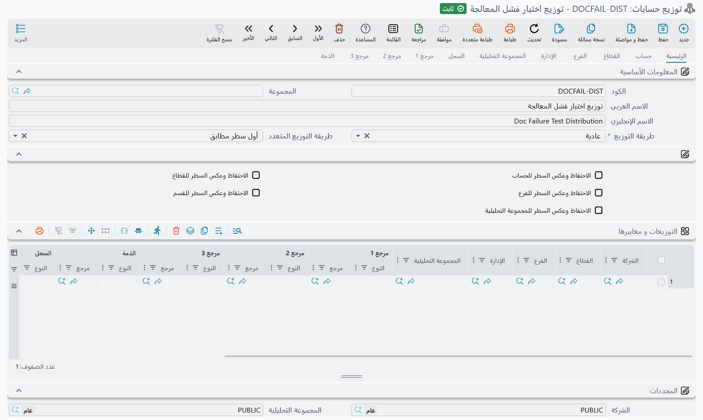

# المحدِّدات ومراكز التكلفة والتوزيع

يجيب الحسابُ عن «ماذا» — نقدية، مبيعات، رواتب. أمّا **المحدِّدات** فتجيب عمّا سوى ذلك: *أيُّ* فرع، *أيُّ* إدارة، *أيُّ* مركز تكلفة، *أيُّ* مشروع. إنّها الإحداثيات الإضافية التي يحملها كلُّ سطرٍ في دفتر الأستاذ، وهي ما يحوّل ميزان مراجعةٍ مسطّحًا إلى تقاريرَ تقطّعها حسب الفرع، أو القطاع، أو مركز التكلفة. تشرح هذه الصفحة مجموعة المحدِّدات كما يراها دفتر الأستاذ، وكيف يمكن للحسابات أن تقيّد المحدِّدات التي تقبلها، وكيف يوزّع **توزيع الحسابات** قيمةً عليها تلقائيًا. أمّا الملفات الرئيسية الخمسة نفسها — أين يُنشأ الفرع أو مركز التكلفة، والمحدد المركب الذي ينوب عن عدة محددات — فتجدها في [المحددات والمحددات المركبة](/ar/platform/shared-master-files/dimensions-and-composite-dimensions).

## مجموعة المحدِّدات

يستطيع كلُّ سطرٍ محاسبي حملَ مجموعةٍ قياسية من المحدِّدات:

- **الشركة** — الشركة التي يخصّها السطر (في قاعدة بياناتٍ متعدّدة الشركات).
- **القطاع** و**الفرع** و**الإدارة** — الإحداثيات التنظيمية.
- **المجموعة التحليلية** — **شجرة مراكز التكلفة** الحرّة (`Basic > Dimensions > Analysis Set`). وخلافًا للقطاع/الفرع/الإدارة الثابتة، المجموعة التحليلية شجرةٌ تصوغها وفق بنية مراكز التكلفة أو المشاريع لديك، فهي أكثر المحدِّدات مرونة.
- **المراجع 1–3** و**السجلّ** — خطّافاتٌ إضافية لتحليلٍ أدقّ.

وإلى جوار هذه، يستطيع الحسابُ حملَ حتى **خمسة أنواع ذمم** (عميل، مورد، موظف، …)، فيُحلَّل الحسابُ الواحد بأكثر من نوع طرف.

## تقييد المحدِّدات على حساب

ليس كلُّ حسابٍ ينبغي أن يقبل كلَّ محدِّد. وعلى الحساب نفسه يمكنك تضييق ذلك:

- **يجب استعماله مع القطاع عام فقط** (ومثله للفرع والإدارة والمجموعة التحليلية) — لا يقبل الحسابُ إلّا القيمة العامة لذلك المحدِّد، دون قيمةٍ محدَّدة،
- **لا يستعمل مع القطاع عام** (ومثله للفرع والإدارة والمجموعة التحليلية) — العكس: يرفض الحسابُ القيمة العامة، فلا بدّ من تسمية قيمةٍ محدَّدة،
- **عدم السماح بترك السجل / مرجع 1 … 3 / الشرح / الشرح 2 فارغا في الحركات على الحساب** — إجبار المستخدم على ملء السجلّ أو مرجعٍ أو شرحٍ على السطور التي تمسّ هذا الحساب.

تُبقي هذه القواعدُ تحليلَك نظيفًا: فحساب مصروف إدارةٍ يمكن جعله *يتطلّب* إدارة، وحساب الإدارة العامة يمكن منعه من التحليل بالإدارات بالكامل.

## توزيع الحسابات: تفريق قيمةٍ تلقائيًا

أحيانًا يلزم تقسيم رقمٍ واحد على محدِّداتٍ كثيرة — إيجارٌ مشترك على كلّ الفروع، أو تكلفة تسويقٍ على عدّة إدارات. وبدل إدخال التقسيم يدويًا في كلّ مرّة، تصف قاعدة **توزيع الحسابات** (`Accounting > Settings > Account Distribution`) كيفية تفريق القيمة، فيطبّقها النظام.

تضبط قاعدة التوزيع، **لكلّ محدِّد** (الحساب، المجموعة التحليلية، الفرع، الإدارة، القطاع، المراجع، الذمة، السجلّ)، كيفية مشاركة ذلك المحدِّد:

- **سياسة** — **بدون** (لا توزيع على هذا المحدِّد)، أو **توزيع المحددات العام فقط** (لا يُوزَّع السطر إلا إذا كانت قيمته هو لهذا المحدِّد هي العامة؛ والسطر الذي يسمّي قيمةً محدَّدة يبقى كما هو)، أو **توزيع الكل** (يُوزَّع كلُّ سطرٍ أيًّا كانت قيمته). وسياسات الحساب والسجلّ والمراجع والذمة لا تعرض إلا **بدون** و**توزيع الكل**،
- **ترتيب** (أيُّ محدِّدٍ يُوزَّع أولًا)، و**أدنى قيمةٍ غير موزّعة** (لا يُجشِّم نفسه التقسيم تحتها)، وخيار **الإبقاء والعكس**،
- وللحالات المتقدّمة، **استعلام** أو **سكربت** يحسب التقسيم ديناميكيًا.

و**نوع التوزيع** إمّا **عادي** أو **متكوّن من توزيعاتٍ أخرى** (توزيعٌ مبنيٌّ من توزيعاتٍ أخرى). وحين تنطبق عدّة سطورٍ من القاعدة، يقرّر إعداد **طريقة التوزيع المتعدد** أيُّها يُطبَّق: **أول سطر مطابق**، أو **توزيع بكل السطور المطابقة على التوالي**، أو **توزيع بكل السطور المطابقة على التوالي مع مراعاة الترتيب**.

وأخيرًا، يمكن أن يقوده **الجانب الآخر** من القيد — «التوزيع بناءً على فرع/إدارة/قطاع/ذمة الجانب الآخر…» — ويُضيَّق بـ**معايير الجانب الآخر**، فيحاكي التقسيمُ كيفية تحليل الطرف المقابل من الحركة.

## للدعم الفني

- **«سطرٌ لا يقبل إدارةً / مجموعةً تحليلية»** — الحساب مقيَّد؛ راجِع قواعد محدِّداته (**يجب استعماله مع … عام فقط** / **لا يستعمل مع … عام**).
- **«النظام يفرض مرجعًا أو بيانًا»** — أحد خيارات **عدم السماح بترك مرجع … / الشرح … فارغا في الحركات على الحساب** معلَّم على ذلك الحساب.
- **«قيمةٌ لا تُقسَّم كما أتوقّع»** — راجِع قاعدة **توزيع الحسابات**: **سياسة** كلّ محدِّد، و**ترتيبه**، و**أدنى قيمةٍ غير موزّعة**، و**طريقة التوزيع المتعدد**.
- **«قائمة مراكز التكلفة خاطئة»** — مراكز التكلفة هي شجرة **المجموعة التحليلية** تحت `Basic > Dimensions`؛ صحّحها هناك.
- لمعرفة مصدر *حسابات* المستند (لا محدِّداته)، راجِع [توجيهات المستندات](./accounting-document-terms.md).
