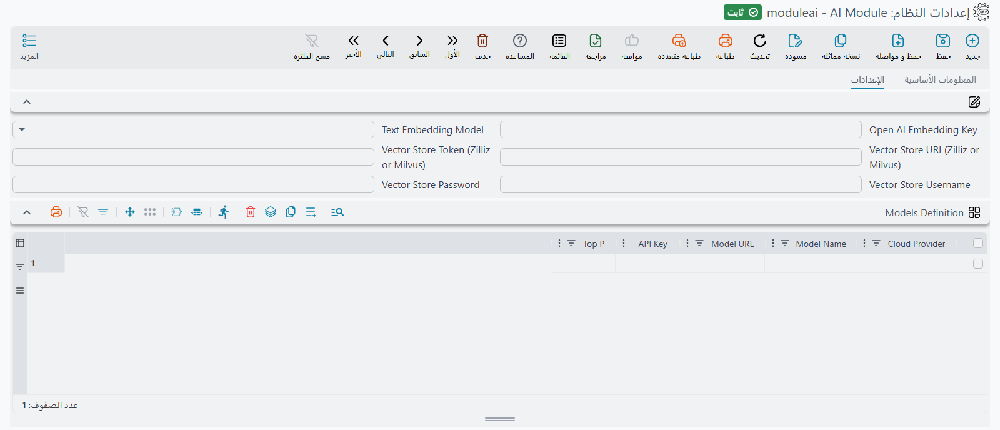

# إعداد وحدة الذكاء الاصطناعي

قبل أن يجيب [المساعد الذكي](./ai-assistant.md) عن سؤال، أو يتصل [عميل MCP](./ai-mcp-server.md) بالنظام، تحتاج الوحدة إلى تهيئة أساسية: **أي نموذج لغوي تستخدمه؟ وبأي مفتاح؟ وأين يُخزَّن الفهرس الدلالي؟** كل ذلك يُضبط في **إعدادات وحدة الذكاء الاصطناعي**، وهي إعدادات عامة على مستوى النظام.

::: info الترخيص المطلوب
تتطلب هذه الإعدادات تركيب وحدة الذكاء الاصطناعي (AI Module) وترخيصها.
:::

## نماذج المحادثة (Models Definition)

قلب الإعداد هو جدول **تعريفات النماذج** (Models Definition): كل سطر فيه نموذج لغوي يصبح متاحًا للاختيار في نافذة المساعد. لكل نموذج:

| الحقل | الدور |
|---|---|
| **مزود الخدمة السحابية** (Cloud Provider) | مزوّد الخدمة (انظر القائمة أدناه) |
| **اسم النموذج** (Model Name) | اسم/معرّف النموذج لدى المزوّد، مثل `gpt-4o` أو `claude-...` |
| **رابط النموذج** (Model URL) | عنوان نقطة الوصول. في رسائل المحادثة لا يقرؤه إلا مزوّدان: DeepSeek، الذي يرجع إلى `https://api.deepseek.com/v1` إن تُرك فارغًا، والمزوّد المتوافق مع OpenAI، الذي يرجع إلى `http://localhost:11434/v1` (أي Ollama محلي)؛ وبقية المزوّدين يتجاهلونه. وعند [إرفاق ملف بالمحادثة](/ar/modules/ai/ai-assistant) يستخدمه أيضًا **OPEN AI** و**Anthropic** و**GEMINI** بدل عنوان المزوّد نفسه إن كان مملوءًا |
| **API Key** | مفتاح المصادقة لدى المزوّد (يُحفظ مشفّرًا) |
| **Top P** | معامل اختياري يتحكم في تنوّع الإجابة. لا يستخدمه إلا مزوّدا Gemini وOpenAI، والباقون يتجاهلونه |

::: tip أكثر من نموذج في آنٍ واحد
عرّف عدة نماذج لتتيح للمستخدم اختيار الأنسب لكل مهمة من قائمة النماذج أعلى نافذة المساعد — نموذج اقتصادي سريع للأسئلة اليومية، وآخر أقوى للتحليل المعقّد.
:::

### المزوّدون المدعومون

اختر أحد هؤلاء السبعة في حقل **مزود الخدمة السحابية** (بالتسميات التي يعرضها الحقل):

| مزود الخدمة السحابية | الخدمة |
|---|---|
| **OPEN AI** | OpenAI |
| **Anthropic** | Anthropic ‏(Claude) |
| **GEMINI** | Google Gemini |
| **DeepSeek** | DeepSeek |
| **Mistral** | Mistral |
| **Zhipu AI** | Zhipu AI |
| **متوافق مع OpenAI** (OpenAI Compatible) | أي نقطة وصول تتحدث بواجهة OpenAI — نموذج مستضاف ذاتيًا مثل Ollama، أو خدمة متوافقة من مزوّد آخر؛ ضع عنوانها في **رابط النموذج** |

## البحث الدلالي وتهيئة التضمين

كثير من قدرات الوحدة تقوم على **البحث الدلالي (Semantic Search)**: بدل مطابقة النص حرفيًا، يحوّل النظام السجلات والوثائق إلى تمثيلات رقمية (Embeddings) تُخزَّن في **قاعدة متجهات (Vector Store)**، فيصبح ممكنًا إيجاد «أقرب» سجل لمعنى ما لا لنصّه فقط. هذا ما يتيح للمساعد أن يفهم اسم عميل تقريبيًا، وأن يختار الأدوات المناسبة لكل سؤال (انظر «كيف يختار المساعد أدواته» في صفحة [المساعد الذكي](./ai-assistant.md)).

### إعدادات الفهرس الدلالي

في إعدادات الوحدة نفسها تُضبط بنية البحث الدلالي:

| الحقل | الدور |
|---|---|
| **مفتاح التضمين الخاص بـ OpenAI** (Open AI Embedding Key) | مفتاح OpenAI المستخدم لتوليد التضمينات |
| **نموذج تضمين النصوص** (Text Embedding Model) | نموذج التضمين: `text-embedding-3-small` أو `text-embedding-3-large` أو `text-embedding-ada-002` |
| **عنوان URI لمخزن المتجهات (Zilliz أو Milvus)** (Vector Store URI) | عنوان قاعدة المتجهات |
| **رمز مخزن المتجهات (Zilliz أو Milvus)** (Vector Store Token) | رمز الوصول إلى قاعدة المتجهات (اختياري) |
| **اسم مستخدم مخزن المتجهات** / **كلمة مرور مخزن المتجهات** (Vector Store Username / Password) | بيانات اعتماد بديلة لقاعدة المتجهات (اختيارية)، ولا تُستخدم إلا إذا مُلئ الحقلان معًا |

يمكن ترك الحقول الستة كلها فارغة. فإذا مُلئ أي واحد منها اشترط الحفظ ملء **مفتاح التضمين الخاص بـ OpenAI** و**نموذج تضمين النصوص** و**عنوان URI لمخزن المتجهات (Zilliz أو Milvus)**.

### اختيار الكيانات المفهرسة

تحديد **أي السجلات تُفهرَس** يتم في شاشة **إعدادات تضمين السجلات للذكاء الاصطناعي** (AI Record Embedding Config): كل سطر فيها يحمل:

- **نوع كيان الملف الرئيسي** (Master File Entity Type): نوع الملف الرئيسي المراد فهرسته (العملاء، الأصناف، الموردون، ...).
- **حقول إضافية للتضمين** (Extra Fields For Embedding): حقول إضافية تُضمَّن في الفهرس لتحسين دقة المطابقة (إلى جانب الكود والاسم).

يُفهرَس سجل النوع المدرج في كل مرة يُحفظ فيها. أما السجلات الموجودة قبل إضافة السطر فيفهرسها زر **تضمين صفوف البيانات** (Embed Data Rows) أعلى الجدول، وهو يمر على كل سجلات كل الأنواع المدرجة. بعد الفهرسة يصبح هذا النوع متاحًا للبحث الدلالي: يستطيع المساعد — وأدوات الاستعلام ذات المدخل المرجعي — إيجاد السجل من نص حر بدل الكود الصريح (انظر [النوع الأول: أداة مبنية على استعلام](./ai-tool-definitions.md#lnwaa-lwl-d-mbny-aal-staalm-Query-Based)).

::: warning المساعد الداخلي يحتاجها، وعملاء MCP لا يحتاجونها
لا يستطيع [المساعد الذكي داخل النظام](./ai-assistant.md) بدء محادثة دون **مفتاح التضمين الخاص بـ OpenAI** و**نموذج تضمين النصوص** و**عنوان URI لمخزن المتجهات (Zilliz أو Milvus)**: فهو يستخدمها ليختار الأدوات التي يعرضها على النموذج مع كل رسالة. أما [عميل MCP](./ai-mcp-server.md) الخارجي فهذا القسم كله اختياري له — الأدوات تعمل بالأكواد الصريحة دون أي تهيئة تضمين، ولا يحتاج قاعدة المتجهات وفهرسة الكيان إلا إيجادُ مرجع من نص حر.

أما أداة البحث في التوثيق (`AINamaERPDocsTool`) فلا تستخدم قاعدة المتجهات إطلاقًا؛ إنها تسأل خدمة البحث في توثيق نما، فكل ما تحتاجه أن يصل الخادم إلى `https://nlm.namasoft.com` عبر HTTPS.
:::

## ما تحتاجه قبل ربط عميل MCP

ربط عميل خارجي عبر [خادم MCP](./ai-mcp-server.md) يتطلب — إضافةً إلى ما سبق — سجل **بيانات اعتماد API** (API Credentials) معتمدًا (**الأساسيات ← المستندات ← بيانات اعتماد API**) ومربوطًا بمستخدم عبر حقل **المستخدم** فيه. تفاصيل العنوان والمصادقة وإعداد العملاء في [دليل خادم MCP لنظام نما](./ai-mcp-server.md).
