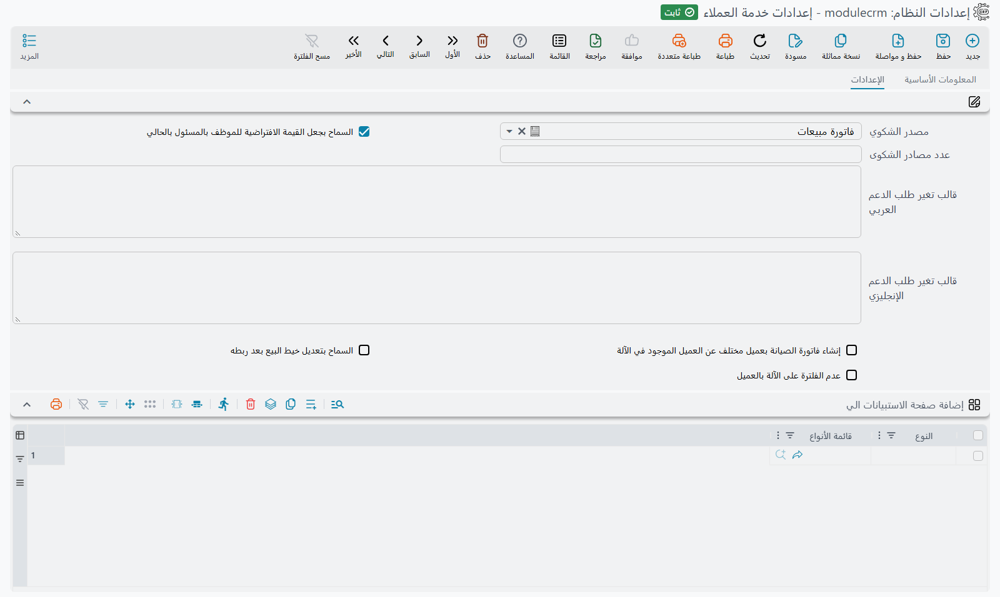

# إعدادات خدمة العملاء

لمنظومة خدمة العملاء شاشة إعدادات خاصة بها، يُوصل إليها من منطقة الإعدادات لا من قائمة خدمة العملاء نفسها: افتح **إدارة النظام ← الإعدادات ← إعدادات النظام** واختر سجل **إعدادات خدمة العملاء**. وهي قصيرة على نحو مريح — ستة خيارات وجدول واحد.

واثنان من هذه الخيارات يغيران طريقة إدخال الموظفين للبيانات يومياً، فيحسن ضبطهما عن قصد لا تركهما على القيمة الافتراضية.

## الخيارات

| الإعداد | بالإنجليزية | معرّف الحقل | ماذا يفعل |
|---|---|---|---|
| **مصدر الشكوى** | Complaint Source | `value.compliantSource` | يملأ حقل *المصدر* مسبقاً في الشكوى الجديدة. والقيمة الافتراضية «فاتورة مبيعات». اضبطه على ما يراه مكتب الدعم عندك أكثر. |
| **السماح بجعل القيمة الافتراضية للموظف بالمسئول بالحالي** | fill Responsible Employee With Current Employee | `value.fillResponsibleEmployeeWithCurrentEmployee` | في خيط البيع الجديد، يجعل الموظف المسؤول هو الموظف المرتبط بالمستخدم الحالي. ومفعّل افتراضياً. |
| **عدد مصادر الشكوى** | Number Of Result Sources Of Complaint | `value.numberOfRows` | يحدد أقصى عدد من المستندات المصدر (فواتير المبيعات أو عقود الخدمة) يقرؤها زر البحث في شاشة الشكوى حين يبحث عن مستندات العميل. والقيمة الفارغة أو الصفر تعني ١٠. |
| **إنشاء فاتورة الصيانة بعميل مختلف عن العميل الموجود في الآلة** | Allow Creating Maintenance Invoice With Customer Different From Machine Customer | `value.createInvoiceWithDifferentCustomer` | بدونه، حفظ طلب أمر صيانة أو أمر صيانة أو بلاغ صيانة أو عقد صيانة أو زيارة صيانة أو معاينة قبل التركيب أو عرض أسعار صيانة أو أمر بيع صيانة فيه آلة يستبدل عميل المستند وجهة الاتصال فيه بعميل الآلة وجهة اتصالها. ومعه، لا يُملأ عميل الآلة وجهة اتصالها إلا إذا كان حقلا المستند فارغين، فتستطيع إبقاء عميل مختلف — مالك عقار أو إدارة رئيسية أو شركة تأمين تدفع مقابل عمل على آلة غيرها. |
| **السماح بتعديل خيط البيع بعد ربطه** | Allow Editing CRM Lead After Connection | `value.allowEditingLeadAfterConnection` | يبقي خيط البيع قابلاً للتعديل بعد تحويله إلى عميل. وبدونه يُرفض حفظ خيط بيع محوَّل إلى عميل بالرسالة «لا يمكن التعديل - تم تحويله لعميل». |
| **عدم الفلترة على الآلة بالعميل** | Do Not Filter Machine By Customer | `value.doNotFilterMachineByCustomer` | يزيل فلتر العميل من قائمة اختيار الآلة في مستندات الصيانة، فتصبح كل الآلات قابلة للاختيار أياً كان مالكها. |
| **إضافة صفحة الاستبيانات إلى** (جدول) | Add Questionnaires Page To | `value.addQuestionairsPageTo` | يسرد الشاشات التي ينبغي أن تكتسب صفحة استبيانات مرتبطة. أضف نوع كيان هنا فتنمو شاشة تحريره بصفحة تعرض الاستبيانات المرتبطة بذلك السجل. |

## خيار أضيق مما يوحي اسمه

**السماح بجعل القيمة الافتراضية للموظف بالمسئول بالحالي** يُقرأ كأنه إعداد عام للمنظومة كلها. وليس كذلك — فشاشة **خيط البيع** وحدها هي التي تلتزم به.

وثمة شاشات أخرى عدة في المنظومة تملأ الموظف المسؤول بالمستخدم الحالي *بصرف النظر عن هذا الإعداد* — منها [الاتصال](/ar/modules/crm/activities/crm-calls) و[مهمة خدمة العملاء](/ar/modules/crm/activities/crm-tasks-and-follow-ups) — ولن يوقفها إطفاؤه. فإن أطفأته متوقعاً توقف الملء التلقائي في كل مكان فستفاجأ. عامله على أنه إعداد لشاشة خيط البيع فحسب.

## ما ليس هنا

لا تحمل شاشة الإعدادات أي خيار لسجل المخاطر ولا لشاشات Kitchen Net، ولا تحمل لمنظومة الصيانة كلها سوى خيارين — تخفيف قاعدة عميل الفاتورة، ومفتاح فلتر الآلة. وكل ما عدا ذلك من سلوك الصيانة يُضبط على توجيهات المستندات بدلاً من هنا. انظر [توجيهات مستندات الصيانة](/ar/modules/crm/document-terms/crm-maintenance-terms).

وإذا أردت أن يفتح المستخدمون طلب دعم مباشرةً من رسالة الخطأ، فهذا أيضاً لا يُضبط هنا: اختر طلب الدعم في حقل **نوع الكيان المستخدم للإبلاغ عن الأخطاء** في الإعدادات العامة — انظر [الإبلاغ عن الأخطاء](/ar/platform/global-config/global-config-sales#lblG-aan-lkhT). والطلبات التي ينشئها طلبات عادية يتعامل معها موظفوك في [مجلد الدعم](/ar/modules/crm/support/crm-support-overview).

التقارير: لا يوجد. ليس لهذه الشاشة نموذج طباعة، ولا تشحن هذه المنظومة أي تقرير نظام (انظر [التقارير والنماذج المطبوعة لخدمة العملاء](/ar/modules/crm/crm-reports-and-forms)).
