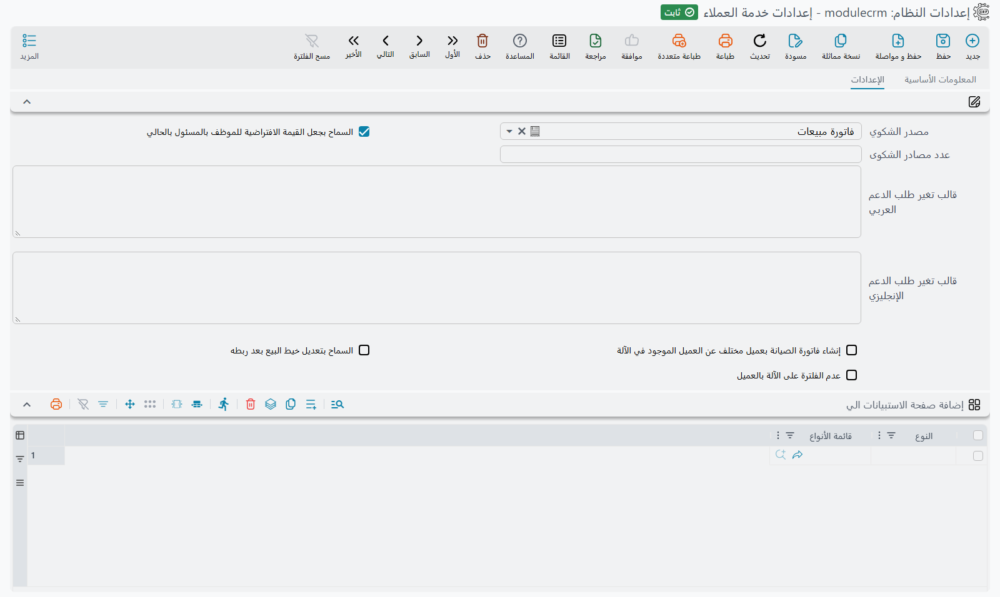

# إعدادات خدمة العملاء

لمنظومة خدمة العملاء شاشة إعدادات خاصة بها، يُوصل إليها من منطقة الإعدادات لا من قائمة خدمة العملاء نفسها: افتح **إدارة النظام ← الإعدادات ← إعدادات النظام** واختر سجل **إعدادات خدمة العملاء**. وهي قصيرة على نحو مريح — ستة خيارات وجدول واحد.

واثنان من هذه الخيارات يغيران طريقة إدخال الموظفين للبيانات يومياً، فيحسن ضبطهما عن قصد لا تركهما على القيمة الافتراضية.

## الخيارات

| الإعداد | بالإنجليزية | معرّف الحقل | ماذا يفعل |
|---|---|---|---|
| **مصدر الشكوي** | Compliant Source | `value.compliantSource` | يملأ حقل *المصدر* مسبقاً في الشكوى الجديدة. والقيمة الافتراضية «فاتورة مبيعات». اضبطه على ما يراه مكتب الدعم عندك أكثر. |
| **السماح بجعل القيمة الافتراضية للموظف بالمسئول بالحالي** | fill Responsible Employee With Current Employee | `value.fillResponsibleEmployeeWithCurrentEmployee` | في خيط البيع الجديد، يجعل الموظف المسؤول هو الموظف المرتبط بالمستخدم الحالي. ومفعّل افتراضياً. |
| **عدد مصادر الشكوى** | Number Of Result Sources Of Complaint | `value.numberOfRows` | يحدد أقصى عدد سطور يعيدها زر البحث في شاشة الشكوى حين يبحث عن مستندات العميل. |
| **إنشاء فاتورة الصيانة بعميل مختلف عن العميل الموجود في الآلة** | Allow Creating Maintenance Invoice With Customer Different From Machine Customer | `value.createInvoiceWithDifferentCustomer` | يخفف قاعدة تطابق عميل فاتورة الصيانة مع عميل الآلة. فعّله إن كنت تفوتر مالك العقار أو الإدارة الرئيسية أو شركة تأمين مقابل عمل على آلة غيرهم. |
| **السماح بتعديل خيط البيع بعد ربطه** | Allow Editing CRM Lead After Connection | `value.allowEditingLeadAfterConnection` | يبقي خيط البيع قابلاً للتعديل بعد تحويله. وبدونه يُقفل الخيط المحوَّل. |
| **عدم الفلترة على الآلة بالعميل** | Do Not Filter Machine By Customer | `value.doNotFilterMachineByCustomer` | يزيل فلتر العميل من قائمة اختيار الآلة في مستندات الصيانة، فتصبح كل الآلات قابلة للاختيار أياً كان مالكها. |
| **إضافة صفحة الاستبيانات الي** (جدول) | Add Questionairs Page To | `value.addQuestionairsPageTo` | يسرد الشاشات التي ينبغي أن تكتسب صفحة استبيانات مرتبطة. أضف نوع كيان هنا فتنمو شاشة تحريره بصفحة تعرض الاستبيانات المرتبطة بذلك السجل. |

## خيار أضيق مما يوحي اسمه

**السماح بجعل القيمة الافتراضية للموظف بالمسئول بالحالي** يُقرأ كأنه إعداد عام للمنظومة كلها. وليس كذلك — فشاشة **خيط البيع** وحدها هي التي تلتزم به.

وثمة شاشات أخرى عدة في المنظومة تملأ الموظف المسؤول بالمستخدم الحالي *بصرف النظر عن هذا الإعداد*، ولن يوقفها إطفاؤه. فإن أطفأته متوقعاً توقف الملء التلقائي في كل مكان فستفاجأ. عامله على أنه إعداد لشاشة خيط البيع فحسب.

## ما ليس هنا

لا تحمل شاشة الإعدادات أي خيار لسجل المخاطر ولا لشاشات Kitchen Net، ولا تحمل لمنظومة الصيانة كلها سوى خيارين — تخفيف قاعدة عميل الفاتورة، ومفتاح فلتر الآلة. وكل ما عدا ذلك من سلوك الصيانة يُضبط على توجيهات المستندات بدلاً من هنا. انظر [توجيهات مستندات الصيانة](/ar/modules/crm/document-terms/crm-maintenance-terms).

كما توجد مجموعة **الاتصال بنظام Nama CRM** في شاشة الإعدادات العامة — رابط الخادم واسم المستخدم وكلمة المرور. وهذه المجموعة لا تخص هذه المنظومة، بل هي الطريقة التي يفتح بها نظامك طلبات دعم لدى منظومة دعم «نما» نفسها ويتابعها، ولا علاقة لها بطلبات الدعم التي يتعامل معها موظفوك في [مجلد الدعم](/ar/modules/crm/support/crm-support-overview).

التقارير: لا يوجد. لا تشحن هذه المنظومة أي تقرير نظام، وليس لهذه الشاشة نموذج طباعة.
