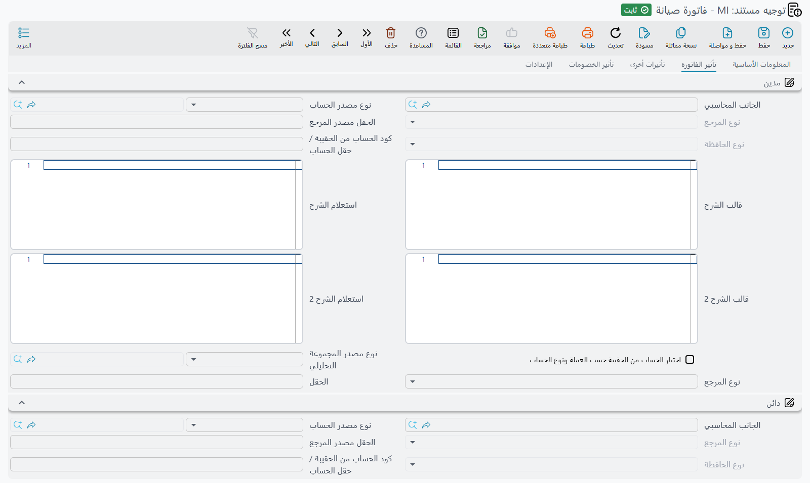

# توجيهات مستندات الصيانة

::: info الترخيص
توجيهات صيانة الآلات تحتاج كود الترخيص `crm-maintenance`، وتوجيهات خدمات الصيانة تحتاج
`crm-maintenance-services`.
:::

منظومتا الصيانة هما المكان الذي تؤدي فيه توجيهات مستندات خدمة العملاء عملًا حقيقيًا. فكل ما يبدو
تلقائيًا في الصيانة — عقد يتفرع إلى سنة كاملة من خطط العمل، وخطة عمل تتحول إلى أوامر، وأمر يسلّم كل
آلة إلى فني في صورة سند تنفيذ، وفاتورة تُخرج قطع الغيار من المخزن — كل ذلك مقاد من توجيه. اضبط
التوجيهات مرة واحدة تسر الدورة كلها بضغطات أزرار، وأخطئ فيها تصمت الأزرار ولا تفعل شيئًا.

إن لم تكن قد قرأت [كيف تعمل توجيهات مستندات خدمة العملاء](/ar/modules/crm/document-terms/crm-terms-basics)
بعد، فابدأ منها: فهي تشرح كتلة الحسابات وكتلة الإنشاء التلقائي وفخّ الجانب الواحد الذي ينطبق هنا
أيضًا.

## توجيه واحد لمنتجَين

منظومة الآلات ومنظومة الخدمات منتجان منفصلان بترخيصين منفصلين، لكن خمسة من إعدادات التوجيه هي حرفيًا
الصورة نفسها مستخدمة مرتين:

| إعدادات التوجيه | مستند الآلات | مستند الخدمات |
|---|---|---|
| توجيه الأمر | أمر صيانة، طلب أمر صيانة | أمر خدمة صيانة |
| توجيه العقد | عقد صيانة | عقد خدمة صيانة |
| توجيه الفاتورة | فاتورة صيانة | فاتورة خدمة صيانة |
| توجيه مردود الفاتورة | مردود فاتورة صيانة | مردود فاتورة خدمة الصيانة |
| توجيه خطة العمل | خطة عمل صيانة | خطة عمل خدمة صيانة |

الشاشات معدّلة لكل مستند — فنسخ الخدمات تستبدل حقول الدفتر والتوجيه الخاصة بها وتُخفي الجوانب
المحاسبية التي لا يستطيع مستند الخدمات استخدامها — لكن الإعدادات تحتها مشتركة. ومستندات الخدمات تفعل أقل
مما يفعله نظيراتها في الآلات — فلا عقود ضمان ولا جداول سداد — لذا يبيّن القسم الأخير من هذه الصفحة ما
تستعمله توجيهات الخدمات.

وهناك أربعة توجيهات غير مشتركة على الإطلاق: توجيه مقايسة الصيانة، وتوجيه تنفيذ أمر الصيانة، وتوجيه
زيارة الصيانة، وتوجيه خطة صيانة خدمة العملاء. أما تنفيذ أمر خدمة الصيانة فليست له **أي إعدادات
توجيه على الإطلاق**.

## أزواج الإنشاء — ما الذي يعمل عليه كل زر إنشاء فعلًا

هذا أهم جدول في تهيئة الصيانة. كل سطر فيه زوج من دفتر وتوجيه يقيم في توجيه واحد وينتج نوعًا واحدًا
من المستندات.

| مضبوط في توجيه | الحقول | معرّفات الحقول | ينتج | متى |
|---|---|---|---|---|
| عقد صيانة | دفتر خطة العمل · توجيه خطة العمل | `termConfig.mnWorkPlanBook` / `termConfig.mnWorkPlanTerm` | خطط عمل صيانة | زر *إنشاء خطط عمل* |
| عقد خدمة صيانة | دفتر خطة عمل خدمة صيانة · توجيه خطة عمل خدمة صيانة | `termConfig.mnSrvWorkPlanBook` / `termConfig.mnSrvWorkPlanTerm` | خطط عمل خدمة صيانة | الزر المقابل |
| خطة عمل صيانة | دفتر أمر الصيانة · توجيه أمر الصيانة | `termConfig.mnOrderBook` / `termConfig.mnOrderTerm` | أوامر صيانة | زر *إنشاء أوامر صيانة* |
| خطة عمل خدمة صيانة | دفتر أمر خدمة صيانة · توجيه أمر خدمة صيانة | `termConfig.mnSrvOrderBook` / `termConfig.mnSrvOrderTerm` | أوامر خدمة صيانة | الزر المقابل |
| أمر صيانة / طلب أمر صيانة | دفتر سند التنفيذ · توجيه سند التنفيذ | `termConfig.mnExecutionBook` / `termConfig.mnExecutionTerm` | سندات تنفيذ أمر صيانة | زرّا *إنشاء سند تنفيذ لكل السطور* و*للسطور المختارة* |
| أمر خدمة صيانة | دفتر وتوجيه سند تنفيذ الخدمة | `termConfig.mnSrvExecutionBook` / `termConfig.mnSrvExecutionTerm` | سندات تنفيذ أمر خدمة صيانة | الأزرار المقابلة |
| أمر صيانة / طلب أمر صيانة | دفتر عقد الضمان · توجيه عقد الضمان | `termConfig.warrantyContractBook` / `termConfig.warrantyContractTerm` | عقد صيانة ضماني | **تلقائيًا** عند الاعتماد إذا كان نوع الأمر *تركيب* |
| فاتورة صيانة / فاتورة خدمة صيانة | دفتر سند صرف مخزني · توجيه سند صرف مخزني، مع *إنشاء سند صرف مخزني بقطع الغيار* و*إنشاء سند صرف مخزني بأصناف الخدمات* | `termConfig.stockIssueBook` / `termConfig.stockIssueTerm`، `termConfig.genStockIssueWithSpareParts`، `termConfig.genStockIssueWithServiceItems` | سند صرف مخزني في سلسلة الإمداد | **تلقائيًا** عند الاعتماد |
| مردود فاتورة صيانة / مردود فاتورة خدمة الصيانة | دفتر سند توريد مخزني · توجيه سند توريد مخزني، مع مفتاحَي *إنشاء سند توريد مخزني بـ…* | `termConfig.stockReceiptBook` / `termConfig.stockReceiptTerm`، `termConfig.genStockReceiptWithSpareParts`، `termConfig.genStockReceiptWithServiceItems` | سند توريد مخزني في سلسلة الإمداد | **تلقائيًا** عند الاعتماد |

اقرأ الجدول باعتباره سلسلة يتضح المثال المرجعي مباشرة. العقد `MC-0021` محفوظ في الدفتر `MC` بالتوجيه
`T-MC-STD`، وهذا التوجيه يسمّي دفتر خطة العمل `WP` والتوجيه `T-WP-STD`، فينتج زر *إنشاء خطط عمل*
الخططَ `WP-0087` … `WP-0098` بواقع خطة لكل شهر. والتوجيه `T-WP-STD` بدوره يسمّي دفتر الأمر `MO`
والتوجيه `T-MO-STD`، فيُنتج زر *إنشاء أوامر صيانة* على إحدى الخطط الأمرَ `MO-0513`. والتوجيه
`T-MO-STD` يسمّي دفتر التنفيذ `OEX` والتوجيه `T-OEX-STD`، فتُنتج أزرار التنفيذ في الأمر السنداتِ
`OEX-0771` … `OEX-0773`. وأخيرًا الفاتورة `MINV-0298` محفوظة في الدفتر `MINV` بالتوجيه `T-MINV-STD`،
الذي يسمّي دفتر الصرف المخزني `SI` والتوجيه `T-SI-CRM`، فينتج عند الاعتماد سند الصرف `SI-1904`.

اكسر أي حلقة في هذه السلسلة بترك دفتر أو توجيه فارغًا، وتتوقف السلسلة عند تلك النقطة.

::: warning الإنشاء يحتاج إلى الدفتر والتوجيه معًا
الأزرار اليدوية ترفض بأدب: ترد برسالة تطلب ضبط الدفتر والتوجيه في التوجيه المذكور، ولا تظهر أي
مستندات. أما التلقائية فلا تقول شيئًا على الإطلاق — الفاتورة التي لا يحمل توجيهها دفتر صرف مخزني
تُعتمد ببساطة دون إنشاء سند صرف، ولا يُخبر أحد بذلك.

تفصيلتان تستحقان الانتباه أثناء التهيئة:

- إنشاء خطط العمل من العقد يحتاج أيضًا إلى **تاريخي بداية العقد ونهايته** مملوءين. وبدونهما يفشل
  الزر مهما كان التوجيه مضبوطًا.
- فحص إنشاء الأوامر وإنشاء سندات التنفيذ لا يعمل إلا حين يكون **الدفتر والتوجيه معًا** فارغين. املأ
  أحدهما واترك الآخر فيصمت الفحص، لذا اضبط الزوج دائمًا معًا.
:::

## أي مستندات الصيانة تصل إلى دفتر الأستاذ

بعضها فقط، ودائمًا عبر جانبَي مدين ودائن في التوجيه.

| المستند | السلوك المحاسبي لتوجيهه |
|---|---|
| أمر صيانة، طلب أمر صيانة | صفحة **التأثير** بزوج واحد من مدين ودائن (`termConfig.debit`، `termConfig.credit`). اضبط الاثنين فينشئ المستند قيدًا من جانبين على سطور قطع الغيار والخدمات. |
| عقد صيانة، عقد خدمة صيانة | صفحة **تأثير الفاتوره** — صورة الفاتورة الكاملة: مدين ودائن (`termConfig.config.debit`، `termConfig.config.credit`)، بجوانب الضرائب والخصومات والنقدي وخصم التقريب (`termConfig.approximationDiscount`). |
| فاتورة صيانة، فاتورة خدمة صيانة | الصورة الكاملة نفسها. وتضيف صفحة **الإعدادات** في **كلا** توجيهَي الفاتورتين مجموعة **مصاريف الخدمة** بأربعة أزواج مدين/دائن لمصاريف الخدمة (`termConfig.serviceFees1Debit` … `termConfig.serviceFees4Credit`) — راجع مفاتيح مصاريف الخدمة في «بقية إعدادات منظومة الآلات» أدناه. وفي فاتورة الآلات أيضاً زوج **مدين الخدمات** / **دائن الخدمات** (Services Debit / Services Credit، `termConfig.servicesDebit` / `termConfig.servicesCredit`): املأ الاثنين فتُقيَّد سطور الخدمات عليهما بدل الطرفين الرئيسيين للفاتورة، فيبقى إيراد العمالة منفصلاً عن إيراد قطع الغيار. واترك أحدهما فارغاً فتستعمل سطور الخدمات الطرفين الرئيسيين. |
| مردود فاتورة صيانة، مردود فاتورة خدمة الصيانة | الصورة نفسها في الاتجاه المعاكس — ومنها زوج مدين الخدمات / دائن الخدمات في مردود فاتورة الآلات. |
| مقايسة صيانة | لا تنشئ أي قيد. |
| أمر خدمة صيانة | لا يعرض توجيهه أي جوانب حسابية، والمستند لا ينشئ أي قيد. |
| تنفيذ أمر صيانة | إعدادات الضريبة فقط. لا ينشئ قيدًا ولا يحرّك مخزونًا. |
| بلاغ الصيانة وأمرا البيع وعرضا الأسعار وزيارة الصيانة والخطط | لا شيء. |

وكما في كل توجيهات خدمة العملاء، لا يحدث التأثير إلا بضبط **الجانبين معًا**. فجانب واحد وحده يعني
لا قيد ولا رسالة خطأ ولا شيء في طلبات الأعمال، لأنه لم يُنشأ أي طلب أصلًا.

## الصرف المخزني: توجيه الفاتورة أو الأزرار اليدوية

::: warning اصرف قطع الغيار بمسار واحد فقط
يُضبط الإنشاء المخزني في توجيه فاتورة الصيانة، كما يفعل `T-MINV-STD` في مثالنا. أما أزرار *صرف قطع
غيار* اليدوية في الأمر وسند التنفيذ والفاتورة فهي **بديل** عن ذلك الإنشاء المقاد بالتوجيه، وليست إضافة
إليه. فهي تفتح مستند سلسلة إمداد مملوءًا مسبقًا ليحفظه أحدهم، دون أي فحص «صُرف بالفعل»، فاستعمال
المسارين معًا لإصلاح واحد يُخرج القطع نفسها من المخزن مرتين. اختر مسارًا واحدًا لكل موقع ودرّب الناس
عليه. راجع [فوترة الصيانة](/ar/modules/crm/maintenance-cycle/crm-maintenance-invoicing).
:::

## عقد الضمان الذي ينشئه أمر التركيب

الأمر الذي يكون نوعه *تركيب* ينشئ تلقائيًا عند الاعتماد عقد صيانة ضمانيًا، مستخدمًا دفتر وتوجيه عقد
الضمان الموجودَين في توجيه الأمر نفسه. وذلك العقد المولّد نسخة كاملة — الآلات وقطع الغيار والخدمات
**وكتلة المبالغ بأكملها**.

::: warning اترك توجيه عقد الضمان بلا جوانب حسابية
عقد الضمان عقد كأي عقد آخر، فإن كان التوجيه الذي تسمّيه في **توجيه عقد الضمان** يحمل مدينًا ودائنًا
مضبوطين، وصلت إيرادات التركيب إلى دفتر الأستاذ مرتين: مرة من الأمر ومرة من العقد الذي ولّده. ولا
شيء ينبّهك.

وجّه حقل **توجيه عقد الضمان** إلى توجيه جوانبه الحسابية فارغة عن قصد. راجع
[أوامر الصيانة](/ar/modules/crm/maintenance-cycle/crm-maintenance-orders).
:::

::: warning طلب أمر الصيانة ليس طلبًا محايدًا
يتشارك طلب أمر الصيانة صورة توجيه الأمر، بصفحة التأثير وكل شيء، وينشئ قيده بالطريقة نفسها التي
ينشئها بها الأمر. فمستند غايته كلها أن *يطلب* عملًا سيصل إلى دفتر الأستاذ لحظة حفظه إن كان توجيهه
يحمل جوانب حسابية. امنح الطلبات توجيهًا خاصًا بها بجوانب متروكة فارغة.
:::

## بقية إعدادات منظومة الآلات

يحمل توجيه الأمر كذلك **عدم نسخ بيانات رأس المستند من بناءاً على** و**عدم نسخ التفاصيل من بناءاً
على** (`termConfig.doNotCopyHeaderDataOfFromDoc`، `termConfig.doNotCopyDetailsOfFromDoc`)، ومجموعة
الضريبة (**سياسة الضريبة** و**خاضع للضريبة** و**يمكن تعديل الضريبة** و**السماح بتعديل ضريبة الفاتورة
في السطر** — `termConfig.taxPlan`، `termConfig.taxable`، `termConfig.modifiableTax`،
`termConfig.allowEditingHdrTaxInDetails`)، و**اعتبار مهام قوالب المهام عند إنشاء عمليات التنفيذ**
(`termConfig.considerTaskTemplatesTasksWhenCreatingExecutions` — أي أخذ قائمة المهام من قالب المهام
في الرأس بدلًا من قالب سطر الآلة)، وفي أمر الآلات وحده إعدادات نقاط المكافآت ومجموعة ودفتر قسيمة
الخصومات (`termConfig.rewardPointsConfig`، `termConfig.discountCouponGroup`،
`termConfig.discountCouponBook`).

ويضيف توجيه الفاتورة **اعتبار سطور مستند بناءً على** (`termConfig.considerLinesOfFromDoc`) و**نسخ
المتبقي الي المدفوع نقدا** (`termConfig.copyRemainingToCash`) و**السعر الافتراضي في قائمة الأسعار**
(`termConfig.priceListDefaultPrice`) و**السماح بدفع مبلغ أكبر من قيمة الفاتورة**
(`termConfig.allowPaymentMoreThanInvoiceAmount` — إن لم يُعلَّم لا تتجاوز سندات القبض صافي الفاتورة)،
وفي فاتورة الآلات حقول نقاط المكافآت وقسيمة الخصومات نفسها. وبقية صفحة **الإعدادات** فيه:

| الخيار | معرّف الحقل | ماذا يفعل |
|---|---|---|
| **استعال سندات الدفع في أعمار الديون** (Use Payment Docs As Debt Ages) | `termConfig.usePaymentDocsAsDebtAges` | في فاتورة الآلات فقط. تُحتسب سطور الدفع الخارجية في الفاتورة — سندات القبض المسجلة عليها — صفوفًا في أعمار الديون أيضًا، فيراها تحليل أعمار الديون. وإن لم يُعلَّم فلا. |
| **خصم مصاريف خدمة 1** … **خصم مصاريف خدمة 4** (Service Fees 1–4 Deduction) | `termConfig.serviceFees1Deduction` … `termConfig.serviceFees4Deduction` | في الفاتورتين. تُعامَل مصاريف الخدمة تلك خصمًا من صافي الفاتورة بدل إضافتها إليه، ويُعكس قيدها تبعًا لذلك. |
| **عدم إضافة التأثيرالمحاسبي لمصاريف الخدمة بدون الجانب المحاسبي** (Do Not Add Service Fees Effect Without Account Side) | `termConfig.doNotAddServiceFeesEffectWithoutAccSide` | في الفاتورتين. سطر مصاريف الخدمة الذي يخلو طرفه المدين أو الدائن الخاص يُستبعد من القيد، بدل تسجيله على الطرفين الرئيسيين للتوجيه. |

وتنتهي صفحة **تأثيرات الخصم** في توجيهَي عقد الصيانة وفاتورة الصيانة — وفي
[توجيه عقد الخدمة](/ar/modules/crm/document-terms/crm-terms-basics) — بجدول **تأثير سندات الدفع**
(External Effects، `termConfig.externalEffectLines`). يضيف كل سطر فيه زوج مدين/دائن إلى قيد المستند
نفسه عن كل سند قبض مسجَّل عليه، بقيمة السند: **للنوع** (`termConfig.externalEffectLines.forType`)
يقصر السطر على نوع واحد من مستندات الدفع، و**يطبق عند توافق مستند الدفع مع المعيار** / **… مع
الاستعلام** (`termConfig.externalEffectLines.applyWhenPaymentDocMatchesCriteria`،
`termConfig.externalEffectLines.applyWhenPaymentDocMatchesQuery`) يفلتران السندات، و**مدين** / **دائن**
(`termConfig.externalEffectLines.debit`، `termConfig.externalEffectLines.credit`) طرفا الزوج المضاف.

ويعرض توجيه الأمر وتوجيه الفاتورة كلاهما خيار **تحديث جدول ضمانات الأعطال في الآلة**
(`termConfig.updateMachineDysfunctionWarranties`)، الذي يكتب سطور ضمانات الأعطال في الآلة.

::: warning علّم «تحديث جدول ضمانات الأعطال في الآلة» في توجيه واحد لا اثنين
إذا كان الخيار مفعّلًا في توجيه الفاتورة وفي توجيه الأمر المصدر معًا، **تُرفض الفاتورة رفضًا صريحًا**
برسالة تذكر الملفين. قرّر أيهما هو المستند الذي يسجّل الضمانات في موقعك — وهو في مثالنا توجيه الأمر
`T-MO-STD` — وأطفئه في الآخر.
:::

أما التوجيهات الأصغر فلا تحمل شيئًا يُذكر: توجيه تنفيذ أمر الصيانة لا يحمل سوى إعدادات الضريبة
الأربعة، وتوجيه زيارة الصيانة لا يحمل سوى *اعتبار سطور مستند بناءً على*
(`termConfig.considerLinesOfFromDoc`)، وتوجيه خطة صيانة خدمة العملاء فارغ تمامًا.

## توجيهات منظومة الخدمات

كل ما سبق ينطبق على منظومة الخدمات مع إعادة تسمية الحقول المشتركة. وهناك نقطتان خاصتان بتوجيهات
الخدمات:

- في توجيه **أمر خدمة صيانة**، دفتر وتوجيه سند تنفيذ الخدمة (`termConfig.mnSrvExecutionBook`،
  `termConfig.mnSrvExecutionTerm`) هما اللذان يقودان أزرار التنفيذ في أمر
  الخدمة. وهما الحقلان الواقعان مباشرة تحت مفتاحَي «عدم النسخ»، وعنواناهما يظهران على الشاشة بغير
  ترجمة في اللغتين.
- في توجيه **فاتورة خدمة صيانة**، علّم **إنشاء سند صرف مخزني بقطع الغيار**
  (`termConfig.genStockIssueWithSpareParts`) لتصرف الفاتورة قطع غيارها
  من المخزن. ويحمل سند الصرف المنشأ سطور قطع الغيار؛ وفي توجيه **مردود فاتورة خدمة الصيانة** يؤدي
  *إنشاء سند توريد مخزني بقطع الغيار* (`termConfig.genStockReceiptWithSpareParts`) الشيء نفسه في الاتجاه المعاكس.

راجع [خدمات أم آلات؟](/ar/modules/crm/services-suite/crm-services-suite-overview) للصورة الأوسع عمّا
تفعله منظومة الخدمات.

و**تنفيذ أمر خدمة صيانة** ليست له أي إعدادات توجيه، فلا يعرض حقل توجيه المستند
فيه سوى خيارات المنصة القياسية. وفي مثالنا يُحفظ `SEX-0090` في الدفتر `SEX` بلا توجيه.
