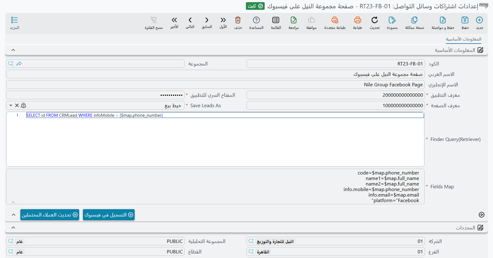

# إعلانات فيسبوك لجمع العملاء المحتملين (Facebook Lead Ads)

تستقبل نما العملاء المحتملين القادمين من إعلانات فيسبوك وإنستغرام ذات نموذج التسجيل وتحفظهم في إدارة علاقات العملاء تلقائياً. فعندما تعلن الشركة بنموذج تسجيل (Lead Form)، يصبح كل من يملأ النموذج عميلاً محتملاً داخل مدير إعلانات Meta فقط، ولا بد أن ينزّل أحدهم القائمة ويكتبها في النظام يدوياً — وحين ينتهي يكون أكثر العملاء حماساً قد فتر. تتولى نما هذه المهمة: لكل صفحة فيسبوك تربطها سجل **إعدادات اشتراكات وسائل التواصل**، ومن بعدها يُحفظ كل نموذج يُرسل من تلك الصفحة على هيئة [خيط بيع](/ar/modules/crm/sales-pipeline/crm-leads.md) (أو [فرصة](/ar/modules/crm/sales-pipeline/crm-potentials.md)) بعد ثوانٍ من ضغط الشخص زر الإرسال.

تجد الشاشة في **خدمة العملاء ← الدعم ← إعدادات اشتراكات وسائل التواصل** / **Customer Relationship Management → Support → Social Media Subscriber Configuration**.

::: info التراخيص
شاشة الإعدادات نفسها لا تحتاج أكثر من التثبيت الأساسي. لكن السجلات التي تحفظها هي خيوط بيع أو فرص، لذا يلزم ترخيص `crm` حتى يُحفظ أي شيء.
:::

## كيف يصل العميل المحتمل إلى نما

هناك طريقان، والإعداد السليم يستخدم الاثنين:

1. **فوراً عبر الـ Webhook.** يتصل فيسبوك بخادم نما في كل مرة يُرسل فيها نموذج على الصفحة. تبحث نما عن سجل الإعدادات الذي يطابق حقل **الصفحة**، وتقرأ إجابات العميل من فيسبوك، ثم تحفظه. لا يضغط أحد على شيء.
2. **عند الطلب بزر تحديث العملاء المحتملين.** يقرأ زر **تحديث العملاء المحتملين** في سجل الإعدادات كل ما جمعته نماذج الصفحة خلال فترة زمنية، ويحفظ ما ليس موجوداً في نما بعد. استخدمه يوم ربط الصفحة (لجلب العملاء الذين سُجّلوا قبل الربط)، وكلما شككت أن الخادم فاته شيء — مثلاً بعد توقفه للصيانة.

وفي الحالتين يحدد إعدادان مصير كل عميل: **Finder Query(Retriever)** يقرر هل هذا الشخص موجود من قبل، و**Fields Map** يقرر ما يُكتب في كل حقل.

## قبل البدء: ما تحتاجه من فيسبوك

يمر الربط عبر تطبيق فيسبوك تملكه شركتك. ينشئه مرة واحدة من يدير حساب المطورين الخاص بالشركة لدى Meta:

1. أنشئ تطبيقاً في Meta for Developers وسجّل **App ID** و**App Secret** الخاصين به.
2. أضف إلى التطبيق خدمة **Facebook Login** واسمح بعنوان خادم نما (مثل `erp.example.com`) ضمن نطاقات التطبيق، حتى تقبل فيسبوك صفحة الدخول التي تفتحها نما.
3. أضف خدمة **Webhooks**، واختر الكائن **Page** واشترك في الحقل `leadgen`. اجعل عنوان الاستدعاء (Callback URL) هو العنوان العام لخادمك متبوعاً بـ `/facebook/` — فلخادم عنوانه `https://erp.example.com/erp/` يكون العنوان `https://erp.example.com/erp/facebook/leads`.
   ويطلب فيسبوك أيضاً **Verify token**. اختر قيمة من عندك — نصاً عشوائياً طويلاً — واكتب القيمة نفسها تماماً في **رمز التحقق من الـ Webhook** في سجل الإعدادات. فعند حفظ الـ Webhook يستدعي فيسبوك عنوان الاستدعاء بهذا الرمز، ولا تجيب نما إلا إذا طابق **رمز التحقق من الـ Webhook** في أحد سجلات إعداداتها. وأي قيمة أخرى تُرفض (HTTP 403)، فيبلغك فيسبوك بأن عنوان الاستدعاء تعذّر التحقق منه. لذا احفظ سجل نما بالرمز أولاً، ثم احفظ الـ Webhook في Meta.
4. يحتاج التطبيق الصلاحيات `pages_show_list` و`pages_manage_metadata` و`pages_read_engagement` و`leads_retrieval`. وإلى أن توافق Meta عليها لتطبيقك، لا تصل العملاء الحقيقيون إلا من أصحاب الأدوار على التطبيق.

يجب أن يكون خادم نما متاحاً من الإنترنت عبر HTTPS، وإلا لن يستطيع فيسبوك توصيل أي شيء إليه.

وتحتاج كذلك إلى **معرّف الصفحة** الرقمي (Page ID) للصفحة التي تريد جمع نماذجها، وتجده في قسم *حول* بالصفحة تحت *شفافية الصفحة*.

## سجل الإعدادات

للشاشة تبويب واحد. وإلى جانب الكود والاسمين المعتادين يحتوي على:

| الحقل (عربي / English) | وظيفته |
|---|---|
| الصفحة (Page) | معرّف صفحة فيسبوك. به يجد العميل القادم سجل إعداداته، لذا لكل صفحة سجل واحد فقط. |
| معرف التطبيق (App ID) | معرّف تطبيق فيسبوك الخاص بشركتك. |
| المفتاح السري للتطبيق (App Secret) | المفتاح السري للتطبيق، ويُحفظ ككلمة مرور. ويجب أن يكون المفتاح السري الحقيقي للتطبيق الذي يتبعه الـ Webhook: فيسبوك يوقّع به كل عميل يرسله، ونما تتجاهل أي استدعاء لا يطابق توقيعه. |
| رمز التحقق من الـ Webhook (Webhook Verify Token) | القيمة نفسها التي كتبتها في **Verify token** عند إعداد الـ Webhook في Meta for Developers. ويقع على الشاشة بعد **الصفحة** مباشرة. |
| Save Leads As | **خيط بيع** أو **فرصة** — ما يتحول إليه كل نموذج مرسل. |
| Finder Query(Retriever) | استعلام SQL يجد السجل الموجود لهذا الشخص إن وُجد. |
| Fields Map | سطر لكل حقل يُملأ في السجل الجديد، بنفس الصيغة التي تستخدمها مسارات الكيانات لملء سجل مُنشأ. |

الحقول السبعة كلها إلزامية. والسجل المحفوظ قبل وجود **رمز التحقق من الـ Webhook** يجب أن يُملأ فيه هذا الحقل في المرة التالية التي يُحفظ فيها؛ وحتى ذلك الحين تظل صفحته تستقبل العملاء كما كانت، ما دام **المفتاح السري للتطبيق** صحيحاً. ومجموعة المحددات أسفل الشاشة — الشركة والفرع وغيرهما — تُنسخ إلى كل عميل يحفظه هذا السجل، فالشركة التي لكل فرع فيها صفحة خاصة تحصل على عملاء كل فرع مختومين بفرعهم الصحيح.



### إجابات نموذج التسجيل

تصل كل إجابة في نموذج فيسبوك إلى نما باسم حقل السؤال، وتقرؤها بكتابة `$map.` متبوعة بذلك الاسم. أسئلة فيسبوك القياسية أسماؤها `full_name` و`email` و`phone_number`؛ أما السؤال المخصص فيستخدم المفتاح الظاهر له في إعدادات النموذج. والعملاء الذين يجلبهم زر **تحديث العملاء المحتملين** يحملون أيضاً `campaign_name` و`campaign_id` و`ad_name`.

### Finder Query(Retriever)

يجب أن يعيد الاستعلام معرّف (id) السجل المطابق، ويمكنه قراءة إجابات النموذج بالطريقة نفسها بين أقواس معقوفة. لاعتبار نموذجين بنفس رقم الهاتف عميلاً واحداً:

```sql
SELECT id FROM CRMLead WHERE infoMobile = {$map.phone_number}
```

إذا أعاد الاستعلام سجلاً، **يحدّث** الـ Webhook ذلك السجل بالإجابات الجديدة. أما **تحديث العملاء المحتملين** فلا يفعل: يترك السجلات الموجودة كما هي ويعدّها *متجاوزة*. وإذا لم يُعد الاستعلام شيئاً يُنشأ سجل جديد في الحالتين.

### Fields Map

خريطة نموذجية عند اختيار **Save Leads As = خيط بيع**:

```
code=$map.phone_number
name1=$map.full_name
name2=$map.full_name
info.mobile=$map.phone_number
info.email=$map.email
platform="Facebook"
```

احتفظ بسطر `code=` واجعله يقرأ إجابة من النموذج بـ `$map.`: فزر **تحديث العملاء المحتملين** يستخدم القيمة التي يقرؤها هذا السطر ليتعرّف على نموذجين من الشخص نفسه في التشغيلة الواحدة.

وللصيغة الكاملة — القيم الثابتة بين علامتي تنصيص، والبحث بـ SQL، والقيم المشروطة — راجع مرجع خريطة الحقول في [Generate Entity From Entity](/entity-flows/core/EAGenerateEntityFromEntityAction).

### ما تملؤه نما من تلقاء نفسها

مهما كانت الخريطة، يحصل كل خيط بيع أو فرصة يُحفظ من فيسبوك على **مصدر الخيط** = **مواقع التواصل الاجتماعي** (Social Networks).

ويتخطى **تحديث العملاء المحتملين** عملاء الاختبار الخاصين بفيسبوك — التي ترسلها أداة اختبار إعلانات التسجيل، وتبدأ إجاباتها بـ `<test lead:` أو تستخدم `test@meta.com`.

## ربط صفحة خطوة بخطوة

1. أنشئ سجل الإعدادات، واملأ الحقول السبعة والمحددات، ثم **احفظه**. بعدها أكمل الـ Webhook في Meta for Developers بالرمز نفسه (الخطوة 3 من القائمة السابقة).
2. اضغط **التسجيل في فيسبوك** (Login To Facebook). يُفتح تبويب جديد في المتصفح فيه زر دخول فيسبوك. سجّل الدخول بحساب فيسبوك يدير الصفحة، وامنح كل صلاحية يطلبها فيسبوك.
   يحفظ التبويب الرمز من خلال جلستك في نما، لذا اضغط الزر وأنت مسجّل الدخول إلى نما في المتصفح نفسه، بمستخدم تمنحه صلاحياته مستوى **Edit After Commit** على **إعدادات اشتراكات وسائل التواصل**. وإلا يعرض التبويب **Error saving Facebook login:** متبوعة برفض الخادم، ولا يُحفظ شيء.
3. حين يعرض التبويب **You correctly logged in to facebook**، تكون نما قد حفظت رمز وصول طويل الأمد للصفحة واشتركت بالصفحة في إشعارات العملاء الخاصة بتطبيقك. أغلق التبويب.
4. اضغط **تحديث العملاء المحتملين** لجلب العملاء المسجلين قبل اليوم. يسألك عن **من تاريخ** و**إلى تاريخ**؛ اتركهما فارغين لقراءة آخر 30 يوماً.
5. أرسل نموذجاً تجريبياً على الصفحة، وتأكد من ظهوره في قائمة خيوط البيع خلال ثوانٍ.

إذا فقد الشخص الذي سجّل الدخول دوره على الصفحة لاحقاً، أو غيّر كلمة مرور فيسبوك، يتوقف الرمز عن العمل. اضغط **التسجيل في فيسبوك** مرة أخرى بحساب يدير الصفحة.

::: warning توقف وصول العملاء عبر الـ Webhook؟
افحص **المفتاح السري للتطبيق** أولاً. فنما تتحقق من كل استدعاء عملاء مقابل التوقيع الذي يحسبه فيسبوك بالمفتاح السري للتطبيق، وتتجاهل بصمت أي استدعاء توقيعه خاطئ أو غائب: لا يُحفظ أي عميل، ويُكتب في سجل الخادم (log) سطر كهذا يحمل معرّف الصفحة، وهو بالإنجليزية دائماً:

*Rejected a Facebook webhook call for page 1234567890: its signature does not match the app secret*

انسخ المفتاح السري من جديد من الإعدادات الأساسية للتطبيق في Meta for Developers — التطبيق الذي يتبعه الـ Webhook — إلى **المفتاح السري للتطبيق**، واحفظ، وأرسل عميلاً تجريبياً. ثم اضغط **تحديث العملاء المحتملين** للأيام التي فاتت الـ Webhook.
:::

## قراءة نتيجة تحديث العملاء المحتملين

عند الانتهاء يعرض **تحديث العملاء المحتملين** ما فعله، بالإنجليزية في الواجهتين:

*Sync finished - {0} saved, {1} skipped (already exist)*

`{0}` هو عدد السجلات الجديدة، و`{1}` عدد العملاء الذين وجدهم Finder Query من قبل. وإذا تعذّر حفظ بعض العملاء تتحول الرسالة إلى تحذير فيه عدد الفاشلين ورقم الهاتف أو البريد أو الاسم لكل منهم بين قوسين، متبوعة بسبب رفض كل واحد:

*Sync finished - {0} saved, {1} skipped (already exist), {2} failed ({3})*

غالباً ما يُرفض العميل لأن خريطة الحقول تركت حقلاً إلزامياً فارغاً، أو أنتجت كوداً يخص سجلاً آخر. صحّح الخريطة واضغط **تحديث العملاء المحتملين** مرة أخرى لنفس التواريخ — فالعملاء الذين حُفظوا في المرة الأولى يُتجاوزون الآن.

## رسائل قد تظهر لك

| الرسالة | السبب | ما العمل |
|---|---|---|
| *No Facebook access token is stored. Please run "Login to Facebook" first.* (بالإنجليزية في الواجهتين) | ضُغط **تحديث العملاء المحتملين** قبل أن يسجّل أحد الدخول إلى فيسبوك من هذا السجل. | اضغط **التسجيل في فيسبوك** وأكمل الدخول، ثم أعد المحاولة. |
| *Sync finished - {0} saved, {1} skipped (already exist), {2} failed ({3})* | رُفض بعض العملاء؛ والأسباب تلي الرسالة. | صحّح خريطة الحقول أو البيانات التي تقرؤها، وشغّل **تحديث العملاء المحتملين** مرة أخرى. |
