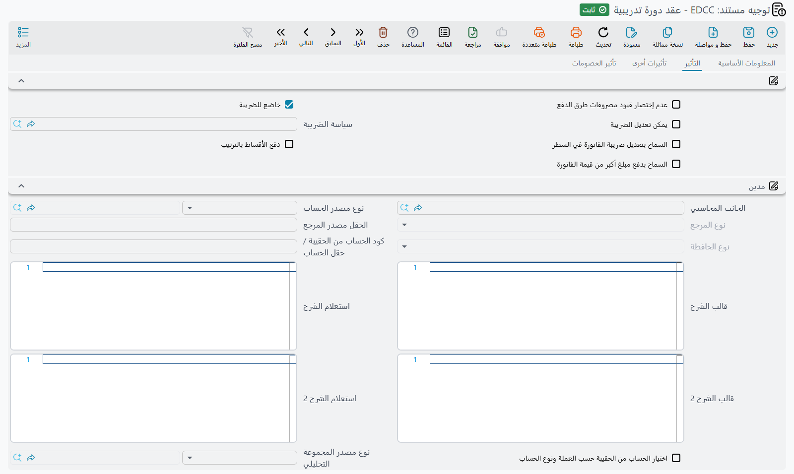

# توجيهات مستندات التعليم

افتح قائمة التعليم تجد خمس مجموعات من الملفات والمستندات — الطلاب وأولياء الأمور، والحضور والانصراف،
والسيارات، والوجبات، والرحلات — ولا تجد بينها شاشة إعدادات. فلا مكان تقول فيه «إيراد رسوم التدريب
يذهب إلى الحساب ٤٢٠١»، أو «المديونية تُحمَّل على ولي الأمر لا على المتدرب». هذا القرار يعيش حيث يعيش
كل قرار محاسبي في نما: على **توجيه المستند**، ذلك الحقل الجالس بجوار دفتر المستند في أعلى الشاشة.

وهذا في التعليم أهم منه في معظم الوحدات، لأن مستندين اثنين فقط في الوحدة كلها يصلان إلى دفتر الأستاذ:
[عقد الدورة التدريبية](./education-course-contracts) و[إلغاؤه](./education-contract-cancellation).
أما بقية الوحدة فتسجل معلومات ولا تُنشئ قيدًا. فتوجيه هذين المستندين هو عمليًا كل الإعداد المحاسبي
للوحدة.

## شاشة واحدة وتوجيهان

لكل من المستندين توجيهه الخاص، والاثنان مبنيان من الشاشة نفسها، فمن تعلَّم أحدهما تعلَّم الآخر. وكل
توجيه مرتبط بنوع مستنده: توجيه أُنشئ لعقد الدورة التدريبية لا يصلح على مستند إلغاء عقد دورة تدريبية
والعكس. لذلك يحتاج أي ضبط عملي إلى **توجيهين على الأقل** — توجيه العقد ومرآته — وغالبًا أكثر من ذلك،
زوج لكل فرع أو لكل نشاط.

وللشاشة ثلاثة تبويبات: **التأثير** (Effect)، و**تأثيرات أخرى** (Other Effects)، و**تأثير الخصومات**
(Discount Effects).

## الجانب المحاسبي، تُقرأ مرة واحدة

كل ما في هذه التبويبات تقريبًا هو **جانب محاسبي** — نصف قيد — وتتكرر مجموعة الحقول نفسها مرارًا،
فتستحق أن تُقرأ مرة واحدة هنا.

| الحقل | ماذا يقرر |
|---|---|
| الجانب المحاسبي (Side Configuration) | هل يُستعمل هذا الجانب أصلًا، وكيف يتصرف كجانب في القيد |
| نوع مصدر الحساب (Account Source type) | من أين يأتي الحساب: حساب ثابت تسميه على التوجيه، أم بحث يتبع مرجعًا على المستند |
| نوع المرجع / الحقل مصدر المرجع | حين يتبع الحساب المستند — أي مرجع يُقرأ منه، وأي حقل على ذلك المرجع |
| نوع الحافظة (Subsidiary Account Type) | أي نوع من الذمم يُختم به سطر القيد الناتج |
| كود الحساب من الحقيبة / حقل الحساب | الحساب المأخوذ من حقيبة حسابات، للإعدادات المبنية على الحقائب |
| احتساب الحساب حسب العملة من الحقيبة | يختار حساب الحقيبة المطابق لعملة السطر ونوع الحساب |
| قالب البيان / استعلام البيان، وقالب البيان ٢ / استعلامه | سطرا الوصف المكتوبان على سطر القيد — إما قالب بمتغيرات وإما استعلام |
| نوع مصدر المجموعة التحليلية، نوع المرجع / على الحقل | من أين تأتي المجموعة التحليلية على سطر القيد — ثابتة أو مقروءة من مرجع على المستند |

## تبويب التأثير — الزوج الذي يحمل الصفقة

يضم التبويب مجموعتين: **مدين** (Debit، `termConfig.config.debit`) و**دائن** (Credit، `termConfig.config.credit`). وبينهما تُسجَّل الرسوم نفسها، وكل ما في
التبويبين الآخرين تفصيل فوق ذلك.

وأيّ معنى يذهب إلى أي مجموعة يقرره **اتجاه المستند** لا تفضيلك أنت. فعقد الدورة التدريبية يسير
للخارج — فهو بيع تدريب لمن يوقّعه — ولذلك مجموعة **مدين** فيه هي جانب *الطرف*، أي المديونية التي
تحطّ على المتدرب أو ولي الأمر أو أي جهة أخرى تدفع، ومجموعة **دائن** هي جانب *الشركة*، أي إيراد
الرسوم. أما مستند إلغاء عقد دورة تدريبية فيسير في الاتجاه المعاكس، فتنقلب الأدوار على توجيهه:
مجموعة **مدين** تصبح جانب الشركة ومجموعة **دائن** تصبح جانب الطرف.

::: tip توجيه الإلغاء هو توجيه العقد بمجموعتين متبادلتين
اضبط توجيه العقد أولًا، ثم ابنِ توجيه الإلغاء بأن تضع ما ضبطته تحت «مدين» في «دائن» وما ضبطته تحت
«دائن» في «مدين». الحسابات هي الحسابات نفسها، والمتغير الوحيد هو المجموعة التي تجلس فيها. واعكسها
خطأً فسيؤكد الإلغاء قيد العقد بدل أن ينقضه.
:::

كما أن الجانبين يُقوَّمان بطريقتين مختلفتين، وهذا ما يربك الناس. فجانب الطرف يُسجَّل بـ **ما هو
مستحق فعلًا** — صافي قيمة السطر ناقصًا ما حُصِّل على سطور الدفع في المستند. أما جانب الشركة فيُسجَّل
بـ **إجمالي السطر قبل الخصومات والضرائب**، لأن الخصومات والضرائب لكل منها جانباها الخاصان في
التبويبين الآخرين، وإلا لحُسبت مرتين.

وتحمل مجموعة **دائن** كذلك خيار **إختصار القيود** (Shorten Ledger، `termConfig.config.shortenLedger`)، الذي يدمج سطور القيد المتطابقة
حتى لا ينتج عقد يقيّد ثلاثين متدربًا بالشروط نفسها ثلاثين زوجًا متشابهًا من السطور.

وعلى التبويب خيار يغيّر سلوك أموال المستند نفسه لا الحساب الذي تصيبه:

| الخيار | معرّف الحقل | ماذا يفعل |
|---|---|---|
| **دفع الأقساط بالترتيب** | `termConfig.payInstallmentsInOrder` | يفرض سداد أقساط [جدول الأقساط](./education-payment-schedules) من الأقدم إلى الأحدث. واتركه مغلقًا ليمكن سداد أي قسط في أي وقت |

## من أين يأتي الحساب فعلًا

الغرض كله من *مصدر الحساب* في الجانب هو أن يخدم توجيه واحد عقودًا كثيرة ويظل يضع كل مديونية على حساب
الطرف الصحيح. وعلى هذين المستندين هناك أربعة مراجع يستطيع المصدر أن يتبعها، وهي التي تستحق أن تبني
توجيهاتك حولها:

- **الطالب** — المتدرب المسمّى في سطر التفاصيل. ويُقرأ الحساب من ملف ذلك الطالب نفسه، فتحطّ مديونية
  كل سطر على متدربه.
- **ولي الأمر** — وليس حقلًا على المستند، بل **ولي أمر الطالب المذكور في السطر**. وبهذا تحاسب المدرسة
  الأب بينما يظل الابن مسجَّلًا في سطر العقد.
- **ذمة المستند** — حقل **الذمة** في رأس المستند. ولأن هذا الحقل يقبل طالبًا أو ولي أمر أو عميلًا،
  فهذا هو المصدر الذي تستعمله حين يكون الدافع هو من يقول العقد إنه الدافع — بما في ذلك شركة تدفع
  تدريب موظفيها.
- **ذمة السطر** — عمود **الذمة** في سطر التفاصيل، للحالة التي يوزّع فيها عقد واحد سطوره على جهات
  دافعة مختلفة.

والطلاب وأولياء الأمور ذمم محاسبية بحد ذاتهم، وهذا ما يجعل الثلاثة الأولى تعمل: الملف يحمل الحسابات،
والتوجيه يكتفي بأن يقول أي مرجع يُتبَع.

أما جانب الإيراد فلا يتبع شيئًا عادةً — تسمّي له حسابًا ثابتًا على التوجيه، أو تأخذ الحساب من حقيبة
حسابات.

## تبويب تأثيرات أخرى — النقدية والضرائب الأربع

يمنح هذا التبويب حسابات للمال الذي ليس هو الصفقة نفسها.

- **النقدي** (Cash، `termConfig.cash`) — الجانب المستعمل للمال المقبوض عند التوقيع. واتركه فارغًا يبقَ ذلك المبلغ على
  جانب مدين أو دائن الرئيسي بدل أن يكون له سطر مستقل.
- **ضريبة ١** و**ضريبة ٢** و**ضريبة ٣** و**ضريبة ٤** (`termConfig.tax`، `termConfig.tax2`،
  `termConfig.htax`، `termConfig.htax2`) — لكل منها مجموعة، وكل مجموعة تحمل جانب الضريبة
  و**الجانب الآخر** (`termConfig.taxesOtherSide.tax1OtherSide` … `termConfig.taxesOtherSide.tax4OtherSide`) المقابل الذي تُسجَّل الضريبة في مواجهته. وهنا تحطّ قيم الضرائب المكتوبة في أعمدة
  الضرائب على سطور التفاصيل.

## تبويب تأثير الخصومات

لكل مستوى خصم على سطور التفاصيل مجموعة هنا، وكذلك لخصم رأس المستند، ولكل منها جانبها وجانبها الآخر:
**خصم 1** (`termConfig.lineDiscount`)، و**تخفيض الفاتورة** (`termConfig.invoiceDiscount`)، ومن **خصم 2**
إلى **خصم 8** (`termConfig.firstDiscountAcc` … `termConfig.seventhDiscountAcc`)، وجوانبها الأخرى
(`termConfig.taxesOtherSide.discount1OtherSide` … `termConfig.taxesOtherSide.discount8OtherSide`،
و`termConfig.taxesOtherSide.headerDiscountOtherSide`).
اضبط المستويات التي تستعملها عقودك فعلًا فقط — فالمجموعة التي لم يُضبط لها جانب لا تنتج قيدًا ببساطة،
ويبقى الخصم مطويًا داخل المبالغ.

## مثال عملي — مديونية رسوم مقابل إيراد رسوم

مركز تدريب في الرياض يحاسب المتدربين مباشرة ويسجِّل كل دخل التدريب على حساب إيراد واحد.

**توجيه «عقد تدريب – الرياض»**، منشأ لعقد الدورة التدريبية:

| المجموعة | الضبط |
|---|---|
| مدين | نوع مصدر الحساب = **ذمة المستند**، مع نوع الحافظة الخاص بمديونيات المتدربين — فيحطّ الطرف المدين على الحساب الذي يحمله الطالب أو ولي الأمر أو العميل الموجود في الرأس |
| دائن | نوع مصدر الحساب = **حساب ثابت**، ٤٢٠١ إيراد رسوم التدريب |

يُعتمد عقد يقيّد متدربَين بـ ١٢٬٠٠٠ لكل منهما. فيكون القيد ٢٤٬٠٠٠ مدينًا على حساب مديونية الدافع —
مختومًا بذلك الدافع كذمة — مقابل ٢٤٬٠٠٠ دائنًا على ٤٢٠١. وإن قُبض منها ٤٬٠٠٠ بالبطاقة عند التوقيع على
سطور الدفع في العقد، سُجِّلت هذه الـ ٤٬٠٠٠ على الحساب المسمّى على طريقة الدفع نفسها، وحمل جانب الدافع
الـ ٢٠٬٠٠٠ الباقية.

و**توجيه «إلغاء عقد تدريب – الرياض»**، المنشأ لمستند إلغاء عقد دورة تدريبية، هو الضبط نفسه
بمجموعتين متبادلتين:

| المجموعة | الضبط |
|---|---|
| مدين | نوع مصدر الحساب = **حساب ثابت**، ٤٢٠١ إيراد رسوم التدريب |
| دائن | نوع مصدر الحساب = **ذمة المستند**، بنوع الحافظة نفسه أعلاه |

فإلغاء ١٥٬٠٠٠ من ذلك العقد يسجِّل ١٥٬٠٠٠ مدينًا على ٤٢٠١ مقابل ١٥٬٠٠٠ دائنًا على الدافع — مرآةً
تامة للجزء الذي يُنقَض.

::: info غيّر التوجيه، وتبقى المستندات القديمة على قيدها القديم
يُقرأ التوجيه لحظة معالجة المستند، وتعديله لا يعود ليعيد كتابة قيود موجودة بالفعل. فإذا صححت توجيهًا
كان يحمل حسابًا خاطئًا، فالمستندات المعتمدة تحت الإعداد القديم تحتاج إلى إعادة معالجة — وإجراء
**إعادة توليد التأثيرات المحاسبية** في شريط الأدوات يعيد إصدار القيد للمستندات التي تختارها بالتوجيه
كما هو الآن.
:::

## الدفاتر، وكيف يُختار التوجيه

كل مستند تعليمي يحمل سجلَّين في أعلى شاشته يسهل الخلط بينهما. فـ**الدفتر** يقرر مسلسل ترقيم المستند
وبعض السلوكيات الصغيرة، و**التوجيه** يقرر كيف يتصرف المستند وأيّ قيد يُنشئ. ويستطيع التوجيه أن يقيّد
الدفاتر التي يعمل معها، عبر جدول الدفاتر المسموح بها أو عبر قاعدة، وبهذا ينتهي كل دفتر مقترنًا
بالتوجيه الذي يخصه — دفتر الرياض مع توجيه الرياض، ودفتر تدريب الشركات مع توجيه الشركات. والتفاصيل في
صفحة [دفاتر المستندات](/ar/platform/documents-and-records/document-books)، أما حقول التوجيه المشتركة بين كل وحدات نما
فموصوفة في [توجيهات المستندات](/ar/modules/supplychain/document-terms/doc-term-general).
