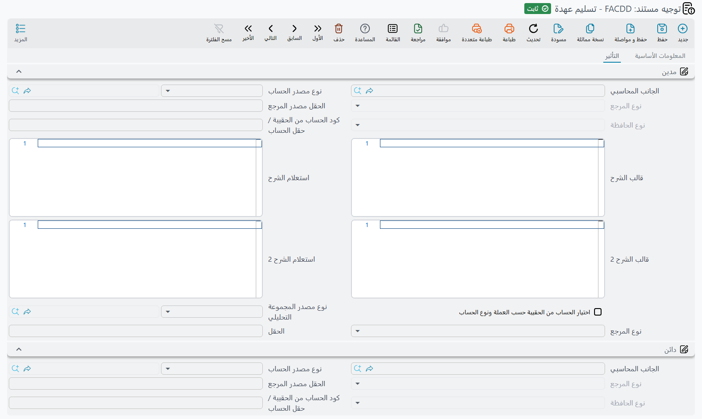

# توجيهات العهد وإعتمادات الأصول

سلسلتان في هذه الوحدة تحتفظان بمحاسبتهما الخاصة، وكلتاهما مضبوطة بطريقة تختلف عن مستندات الأصول الرئيسية
بما يكفي لتستحق صفحة خاصة بها.

**العهد** سجل مستقل — حواسيب محمولة وهواتف وعُدد تُسلَّم للموظفين — لا يُهلَك أبدًا، فتوجيهاته ليست عن
التكلفة والإهلاك أصلًا، بل عن نقل قيمة من حائز إلى آخر. أما **الاعتمادات المستندية** فمشكلتها معاكسة: عدة
مستندات تجمع تكاليف على مدى شهور، ومستند ختامي واحد يحوّل الإجمالي المتراكم إلى تكلفة أصل.

## توجيهات العهد

مستندات العهد ليس لها حسابات أصل ترتد إليها، ولذلك — بخلاف مستندات الأصول الثابتة — يوفّر التوجيه
**جانبَي** كل قيد. وتوجيهات العهد الأربعة كلها توصيل حسابات ولا شيء غير ذلك.

### توجيه شراء العهدة

شراء عهدة فاتورة، وتوجيهه يُقرأ كذلك. وهو ثلاث صفحات: هوية التوجيه وإعداداته الضريبية، ثم تأثير الفاتورة،
ثم التأثيرات الأخرى.

تحمل صفحة الإعدادات نفس خيارات الضريبة الموجودة في توجيه شراء الأصل الثابت — **خاضع للضريبة** (`termConfig.taxable`)
و**سياسة الضريبة** (`termConfig.taxPlan`) و**الضريبة قابلة للتعديل** (`termConfig.modifiableTax`) وتعديل ضريبة الرأس في
التفاصيل (`termConfig.allowEditingHdrTaxInDetails`) — إضافة إلى **الربط مع أسطر الفاتورة في المستند المحاسبي**
(`termConfig.linkWithInvoiceLinesInAccountingDocument`)، الذي يربط كل سطر قيد بسطر الفاتورة الذي أنتجه.

وتحمل صفحة **تأثير الفاتورة** جانبَي قيد الشراء — مجموعة **مدين** (`termConfig.config.debit`) ومجموعة **دائن**
(`termConfig.config.credit`) — إضافة إلى خيار اختصار القيد (`termConfig.config.shortenLedger`) وقاعدة ترتيب السداد
(`termConfig.payInstallmentsInOrder`) ومفتاح الربط مع أسطر الفاتورة مرة أخرى، و**السماح بدفع مبلغ أكبر من قيمة الفاتورة**
(`termConfig.allowPaymentMoreThanInvoiceAmount`). فحين يكون هذا الأخير مغلقًا يُرفض سند الدفع الذي يجعل المتبقي على
الشراء أقل من صفر بالرسالة:
«المتبقي {0} فى المستند {1} أصبح بالسالب»
وفعّله لتقبل الدفع الزائد. أما صفحة **التأثيرات الأخرى** فتحمل مجموعة الضريبة 1 (`termConfig.tax`، ومعها خيار الجانب
الآخر `termConfig.taxesOtherSide.tax1OtherSide`) ومجموعة النقدية (`termConfig.cash`).

فحين تشتري الواحة الحاسب المحمول `CDY-0033` بمبلغ 6,000:

| | مدين | دائن |
|---|---|---|
| قيمة العهد — *الجانب المدين في التوجيه* | 6,000 | |
| المورد — *الجانب الدائن في التوجيه* | | 6,000 |

ولاحظ ما **لم** يحدث: الـ 6,000 لم تصر مصروفًا. هي جالسة في الحساب الذي سمّيته على الجانب المدين، تنتظر أن
تُسنَد إلى شخص. وهذا هو مقصد سجل العهد كله، وتوجيه التسليم أدناه هو ما يحرّكها.

### توجيه تسليم العهدة

مستند التسليم هو حيث تصير العهدة المشتراة مسؤولية شخص بعينه. وتوجيهه صفحة واحدة تحمل جانبًا محاسبيًا مدينًا
(`termConfig.config.debit`) وجانبًا دائنًا (`termConfig.config.credit`)، وليس عليها غير ذلك.

والضبط الذي يجعل تقارير العهد تعمل هو هذا: اجعل **المدين** حسابًا يُحلّ من **الموظف**، فتستقر عُهَد كل
شخص في ذمته الخاصة، واجعل **الدائن** الحساب الذي أودع الشراء القيمة فيه — «عهد بالمخزن» أو أيًّا كان ما
سمّيته. فيصير تسليم الحاسب إلى خالد المطيري نقلًا لمبلغ 6,000 من المخزن إلى خالد.

والمبلغ المقيَّد هو سعر العهدة مضروبًا في النسبة التي يأخذها ذلك الحائز، فسيارة مشتركة بنسبة 60/40 بين
موظفين تُنتج سطرين مجموعهما سعرها.

### توجيه نقل العهدة

النقل يحرّك العهدة من حائز إلى آخر، وهو حركتان في مستند واحد: قيمة تخرج من عند من كانت لديه، وقيمة تدخل عند
من صارت لديه. ولذلك يحمل التوجيه **زوجين من الجوانب المحاسبية** — زوجًا للحائزين الذين تغادرهم العهدة
(`termConfig.custodyLinesConfig.debit` / `termConfig.custodyLinesConfig.credit`)، وزوجًا للحائزين الذين تنضم إليهم
(`termConfig.currentLinesConfig.debit` / `termConfig.currentLinesConfig.credit`).

وفي الحالة المعتادة يشير الزوجان إلى نفس الحسابين في توجيه التسليم، فيكون الأثر عكسًا عن الحائز القديم
وتحميلًا على الجديد. أما إبقاؤهما قابلين للضبط منفصلين فهو ما يتيح لك توجيه نقل إلى فرع آخر عبر حساب وسيط.

### توجيه التخلص من العهدة

التخلص ينهي حياة العهدة — خردة أو بيعًا أو فقدًا أو إعدامًا. ويحمل توجيهه زوجين من الجوانب المحاسبية أيضًا:
زوجًا **يُصفّي القيمة التي كانت العهدة تحملها** (`termConfig.custodyLinesConfig.debit` /
`termConfig.custodyLinesConfig.credit`)، وزوجًا **لقيمة التخلص** نفسها (`termConfig.disposalConfig.debit` /
`termConfig.disposalConfig.credit`).

::: info لا يوجد حساب مكسب ولا خسارة هنا
بخلاف التخلص من الأصل الثابت، لا يحمل توجيه التخلص من العهدة حساب مكسب ولا حساب خسارة. فإن بيع حاسب محمول قيمته
المحمولة 6,000 بمبلغ 1,500، لا يُحسب الفرق في سطر منفصل — بل على الحسابات التي تسمّيها في الزوجين أن
تستوعبه. فاخترها على هذا الأساس: معظم المواقع توجّه زوج التخلص إلى حساب إعدام تحديدًا ليجد الفرق مكانًا
معقولًا يستقر فيه.
:::

## توجيهات الاعتمادات المستندية

سلسلة الاعتماد المستندي أربعة مستندات، وثلاثة منها فيها ما يُضبط.

### الاعتماد والفاتورة المبدئية

**اعتماد الأصول** نفسه بلا توجيه على الإطلاق — فهو المجلد الذي تتعلق به المستندات الثلاثة الأخرى، لا مستند
مالي.

و**فاتورة الاعتماد المبدئية** لا تُنتج قيدًا. هذا هو المستند الذي يسرد البضاعة — المكبس أ بـ 300,000 والمكبس
ب بـ 200,000 في اعتماد الواحة `LC-2026-004` — وتلك الأرقام **أساس توزيع** لا تكلفة. هي تخبر النظام كيف يوزّع
المصروفات؛ ولا ترسمل بنفسها أبدًا، ولذلك لا حسابات في توجيهها.

لكن في صفحة الإعدادات من توجيهها مفتاحًا واحدًا: **إنشاء الأصول إذا لم تكن موجودة**
(`termConfig.createAssetIfNotFound`). فحين يكون مفعّلًا، يُنشئ حفظ الفاتورة المبدئية بطاقة أصل ثابت في حالتها المبدئية
لكل سطر لا يسمّي أصلًا بعد — آخذًا نوع الأصل والاسم ومجموعة الترميز والتصنيفات من السطر — ثم يكتب الأصل الجديد على
السطر، فتجد مستندات المصروف والتكليف التالية أصلًا تحمّل عليه. ولا يعمل ذلك إلا إذا كان إعداد الوحدة
«إضافة أعمدة إنشاء الأصول إلى سندات الشراء و الإفتتاح» مفعّلًا أيضًا؛ فإن أُغلق أيٌّ منهما وجب أن يشير كل سطر إلى
أصل مسجَّل سلفًا. راجع [إعدادات الوحدة](/ar/modules/fixedassets/fixedassets-configuration.md).

### توجيه مستند المصروف

كل تكلفة تنزل على الشحنة تُدخل على مستندات المصروف: قيمة البضاعة من المورد، والشحن، والرسوم الجمركية،
والتخليص، والتأمين، ومصاريف البنك. وتوجيهه صفحة واحدة، وهي الصفحة التي تضبط فيها جانبَي قيد المصروف —
الحساب الذي تُجمَّع فيه التكلفة ريثما يأتي المستند الختامي (`termConfig.config.debit`)، وحساب من يُستحق له المال
(`termConfig.config.credit`).

والجانب الثاني أطرف مما يبدو. فلأنه جانب محاسبي كامل، يمكنه أن يُحلّ لكل مستند بدل أن يكون حسابًا ثابتًا:
وجّهه إلى **شركة التأمين** أو **شركة التخليص الجمركي** المسجَّلة على الاعتماد، فيجعل كل مستند مصروف الشركةَ
الصحيحة دائنة تلقائيًا، بدل إجبار حساب تصفية واحد على النيابة عن الجميع.

وتحمل الصفحة نفسها:

- **أربعة أزواج ضرائب**، كل زوج حساب مدين وحساب دائن (`termConfig.tax1Debit` / `termConfig.tax1Credit` …
  `termConfig.tax4Debit` / `termConfig.tax4Credit`)؛
- **زوج خصم** (`termConfig.discount1Debit` / `termConfig.discount1Credit`)؛
- **عدم التأثير في التكاليف** (`termConfig.donotAffectOnCost`) — المفتاح الذي يعلّم السطر بأنه مقيَّد لكنه مستبعد من التكلفة النهائية،
  للمصاريف التي تريدها في الأستاذ لا في قيمة الماكينة؛
- **خاضع للضريبة** (`termConfig.taxable`) و**يمكن تعديل الضريبة** (`termConfig.editableTaxes`) و**سياسة الضريبة** (`termConfig.taxPlan`).

وفي `LC-2026-004` تجمع مستندات المصروف 615,000: بضاعة 500,000، وشحن 40,000، ورسوم جمركية 60,000، وتخليص
15,000.

### توجيه سند التكليف — التوجيه الذي يأخذ حساب الأصل نفسه

المستند الختامي يجمع نصيب كل أصل من كل ما جمعته مستندات المصروف، ويكتبه على الأصل بوصفه تكلفته، ويدخل
الماكينات الخدمة. وقيده يعكس ما بنته مستندات المصروف.

وهنا الحقيقة التي تفاجئ الناس، وهي سبب بدو شاشة هذا التوجيه شبه فارغة: **سند التكليف يجعل الحساب الرئيسي
لكل أصل مدينًا، مأخوذًا من الأصل — لا من التوجيه.** فمهما ضبطت هذا التوجيه، يأتي جانب الأصل من حافظة حسابات
الماكينة، الموروثة عادةً من نوع الأصل. فليس في التوجيه إلا شيء واحد يُضبط: **حساب التصفية على الجانب
الدائن** (`termConfig.config.credit`)، وهو الحساب الذي جعلته مستندات المصروف مدينًا وهذا المستند يفرّغه الآن.

وفي `LC-2026-004`، بتوزيع الـ 615,000 حسب القيمة — 60% للمكبس أ و40% للمكبس ب:

| | مدين | دائن |
|---|---|---|
| حساب تكلفة `PRS-0001` المكبس أ — *من الأصل* | 369,000 | |
| حساب تكلفة `PRS-0002` المكبس ب — *من الأصل* | 246,000 | |
| تصفية الاعتماد المستندي — *الجانب الدائن في التوجيه* | | 615,000 |

والنتيجة العملية أن **إيصال ماكينة مستوردة إلى حساب التكلفة الصحيح مسألة نوع أصل لا مسألة توجيه**. فإن كان
المكبس أ ينزل في الحساب الخطأ، فانظر في `FAT-MCH — آلات ومعدات` وفي حافظة حسابات المكبس نفسه؛ فتغيير توجيه
سند التكليف لن يحرّكه.

راجع [سند التكليف](/ar/modules/fixedassets/letters-of-credit/fixedassets-lc-cost-document.md) لتعرف ماذا
يفعل ذلك المستند بالأصول أيضًا — من مدخلات الإهلاك، وتغيير الحالة، وإغلاق الاعتماد.
