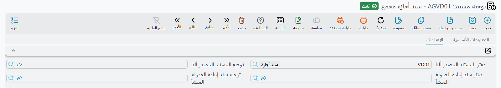

# توجيهات الحضور والإجازات

قلّما تؤثر مستندات الإجازات والحضور محاسبيًا بنفسها — فالإجازة لا تحرّك مالًا بل تحرّك رصيدًا، والمال
يتبع لاحقًا في سند الراتب. ولذلك فتوجيهات هذه العائلة معنيّة أساسًا بـ**ما الذي يُنشأ أيضًا** عند حفظ
المستند، ونادرًا بالحسابات.

أما الآليات المشتركة — ما التوجيه، ولماذا لا تسمّي معظم التوجيهات المجمعة إلا دفترًا وتوجيهًا،
والمفاتيح المحاسبية الثلاثة المختلفة الأسماء — ففي
[توجيهات الرواتب والتصفية](/ar/modules/hr/document-terms/hr-terms-salary-and-dues).

## توجيه سند الإجازة

توجيه سند الإجازة مجموعة صغيرة من الآثار الجانبية.

| الخيار | الحقل | ماذا يفعل |
|---|---|---|
| **إنشاء سند تفويض** | `termConfig.generateDelegation` | يُنشئ حفظُ الإجازة سندَ **تفويض** أيضًا من الموظف إلى **الموظف البديل** في سند الإجازة، من تاريخ بداية الإجازة إلى تاريخ عودتها، فيتولى أحدهم رسميًا مسؤوليات الغائب مدة غيابه. ولا يُنشأ التفويض إلا إذا كان في سند الإجازة **موظف بديل** وكان حقل **بناءً على** فيه مملوءًا (كما في سند إجازة منشأ من مستند آخر)؛ وإلا فلا يُنشأ شيء. |
| **دفتر سند التفويض** | `termConfig.generatedDelegationBook` | الدفتر الذي يودَع فيه التفويض. فإن عُلِّم المفتاح وبقي هذا الدفتر فارغًا لم يُنشأ تفويض. |
| **تغيير حالة الموظف عند تطابق تاريخ البداية مع تاريخ اليوم فقط** | `termConfig.changeEmpStateIfDateMatchToday` | يغيّر حفظُ سند الإجازة حالةَ الموظف إلى الحالة المذكورة في **تغيير حالة الموظف إلى** على سبب الإجازة، وإلا فعلى نوع الإجازة. وإذا عُلِّم هذا الخيار فإن إجازة تاريخ بدايتها بعد اليوم لا تغيّر الحالة عند حفظها؛ وتتغير الحالة في تاريخ البداية أو بعده، حين يُحفظ السند ثانيةً أو حين يعمل عليه مسار الكيان *Change Employee State From Query Based On Vacation Documents* (اسمه بالإنجليزية فقط). واتركه مطفأً فتغيّر إجازةٌ مسجّلة قبل ثلاثة أسابيع حالةَ الموظف اليوم. |
| **دفتر / توجيه سند إعادة الجدولة المنشأ** | `termConfig.generatedLoanRescheduleBook` و `termConfig.generatedLoanRescheduleTerm` | حين يكون **تأجيل السلف خلال فترة الإجازة** مُعلَّمًا في سند الإجازة، يُنشئ حفظه **سند إعادة جدولة أقساط سلفة مجمع** يؤخر أقساط الموظف غير المسددة. وهذان الحقلان يسميان دفتر ذلك السند وتوجيهه، ويجب أن يكونا لنوع سند إعادة جدولة أقساط سلفة مجمع. |

لا تُؤجَّل السلف إلا لسند إجازة مُعلَّم فيه **تأجيل السلف خلال فترة الإجازة** — فالتوجيه وحده لا يؤجل شيئًا.
وإذا عُلِّم الخيار وكان هذا الدفتر أو التوجيه فارغًا، رُفض حفظ السند (راجع [سندات الإجازة](/ar/modules/hr/vacations/vacation-documents)).

## توجيهات الإجازات المجمعة

ثلاثة مستندات مجمعة تغطي دفعة من الموظفين، وتوجيهاتها تفعل ما تفعله التوجيهات المجمعة عادة: تسمّي
دفتر وتوجيه ما تنشئه.

| التوجيه | الحقول | ماذا يُنشئ |
|---|---|---|
| **سند إجازة مجمع** | `termConfig.generatedAggVacationDocTerm` و `termConfig.generatedAggVacationDocBook`، وله كذلك *دفتر وتوجيه سند إعادة الجدولة المنشأ* | سند إجازة لكل سطر. وإذا كان **تأجيل السلف خلال فترة الإجازة** مُعلَّمًا في السند المجمع نفسه، أنشأ كذلك سند إعادة جدولة أقساط سلفة مجمع واحدًا في ذلك الدفتر والتوجيه، ويُرفض إن كان أحدهما فارغًا. |
| **سند إجازة مجمع لأكثر من موظف** | `termConfig.generatedAggVacationDocTerm` و `termConfig.generatedAggVacationDocBook` | سند إجازة لكل موظف، بلا إعادة جدولة للسلف. |
| **سند مباشرة عمل إجازة مجمعة** | `termConfig.generatedWorkStartingDocBook` | سندات مباشرة العمل التي تسجّل عودة دفعة من الموظفين. ولاحظ أنه لا يسمّي إلا **دفترًا**، فلا حقل توجيه هنا. |

## توجيه صرف بدل الأجازة

دفع بدل إجازة لم تُؤخذ من قلائل مستندات عائلة الحضور التي تؤثر محاسبيًا، فيحمل توجيهه زوجًا واحدًا من
الجوانب المحاسبية في صفحة *التأثير*، يظهر تحت عنواني المجموعتين **مدين** و**دائن**. ومعرّفا حقليهما
`termConfig.debit2` و `termConfig.credit2`، ولا زوج غيرهما.

وأهم حقوله **معادلة حساب قيمة البدل** `termConfig.compensationCalcFormula`: معادلة حساب المفرد التي
تقرر كم يساوي يومُ إجازة غير مأخوذة فعلًا. أهو الراتب الأساسي وحده أم الأساسي مع البدلات؟ الجواب هنا
لا على المستند، ولهذا كان وجود توجيهَي بدل بمعادلتين مختلفتين ترتيبًا طبيعيًا.

وتوجيه البدل **المجمَّع** هو القصير المعتاد: *دفتر صرف بدل أجازة* و*توجيه صرف بدل أجازة*
(`termConfig.compensationBook` و `termConfig.compensationTerm`).

انظر [بدل الإجازة وترحيلها](/ar/modules/hr/vacations/vacation-compensation-and-transfer).

## توجيه رصيد العطلات وأيام الراحة

يعوّض هذا المستند الموظفين عن العطلات الرسمية وأيام الراحة الأسبوعية التي عملوها، بالإضافة إلى رصيد
إجازة لا بدفع نقدي. وتوجيهه يقول **أي رصيد**:

| الخيار | الحقل | ماذا يفعل |
|---|---|---|
| **نوع إجازة لبدل أيام الراحة** | `termConfig.restDaysCompensationVacationType` | نوع الإجازة الذي يُضاف إليه يوم الراحة الأسبوعية المعمول. |
| **نوع إجازة لبدل أيام العطلات الرسمية** | `termConfig.holidaysCompensationVacationType` | نوع الإجازة الذي تُضاف إليه العطلة الرسمية المعمولة. |
| **إعادة حساب الحضور والانصراف النظامي** | `termConfig.reCalculateEmpAttendanceLines` | يعيد حفظُ المستند تشغيلَ حساب الحضور النظامي للموظف، فتُقرأ الأيام المعوَّضة من جديد بدل أخذها من الحساب السابق. |

وتوجيه النوعين إلى نوع إجازة واحد أمر مشروع وشائع؛ أما الفصل بينهما فيتيح للعميل أن يعطي عمل يوم
الراحة وعمل العطلة قواعد انتهاء أو ترحيل مختلفة، لأن تلك تعيش على نوع الإجازة.

::: tip التعويض رصيدًا لا نقدًا
لأن هذا المستند يضيف إلى رصيد إجازة فلن يظهر شيء في قسيمة الراتب. فإن كان العميل يتوقع مالًا فالأداة
مفرد راتب مدفوع بمؤشري إضافي يوم الراحة والعطلة، لا هذا المستند. انظر
[الوقت الإضافي والتأخير](/ar/modules/hr/attendance/overtime-and-lateness).
:::

## توجيها الأذون والمأموريات المجمعة

كلاهما على الشكل الخالص ذي الحقلين:

- **إذن انصراف مجمع** — *توجيه إذن الانصراف* `termConfig.leavePermissionTerm` و*دفتر إذن الانصراف*
  `termConfig.leavePermissionBook`.
- **سند مأمورية مجمع** — *توجيه سند المأمورية* `termConfig.missionDocTerm` و*دفتر سند المأمورية*
  `termConfig.missionDocBook`.

أما مستندا الإذن والمأمورية المفردان فـ**لا توجيه خاصًا بهما أصلًا** — فكل ما يحكمهما في
[إعدادات الموارد البشرية](/ar/modules/hr/setup/hr-configuration) (حدود الأذون وأولويات التداخل وهل
يضيف أي منهما إلى الوقت الإضافي) أو على المستند نفسه. فإن كنت تبحث عن إعداد يغيّر سلوك المأمورية
فالتوجيه ليس موضعه.

## صفحات ذات صلة

- **[توجيهات الرواتب والتصفية](/ar/modules/hr/document-terms/hr-terms-salary-and-dues)** — الآليات
  المشتركة ومستندات المال.
- **[سندات الإجازات](/ar/modules/hr/vacations/vacation-documents)** — المستندات نفسها.
- **[أنواع الإجازات والأرصدة](/ar/modules/hr/vacations/vacation-types-and-balances)** — ما هي
  الأرصدة المعوَّضة.
- **[الأذون والمأموريات](/ar/modules/hr/attendance/leave-permissions-and-missions)**
- **[إعدادات الموارد البشرية](/ar/modules/hr/setup/hr-configuration)** — حيث تعيش قواعد الحضور فعلًا.
