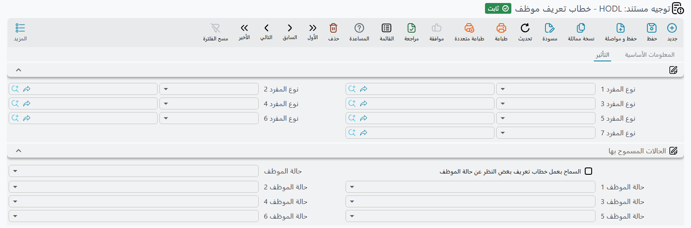

# توجيهات التوظيف والعلاقات الحكومية

هذه هي المستندات التي تغيّر **من يكون الموظف** لا ما يُدفع له: العرض الذي يعيّنه، ومستند التحديث الذي
يغيّر راتبه أو إدارته، والنقل، وإنهاء الخدمة، وفي دول الخليج أوراقُ الإقامة والكفالة والتأشيرات التي
تُبقيه موظفًا بصفة نظامية.

ولا يكاد أي منها يؤثر محاسبيًا. فتوجيهاتها معنيّة بما الذي يُنشأ أيضًا وبما يُسمح للمستند بتغييره.

أما الآليات المشتركة — ما التوجيه، ولماذا لا تسمّي معظم التوجيهات المجمعة إلا دفترًا وتوجيهًا،
والمفاتيح المحاسبية الثلاثة المختلفة الأسماء — ففي
[توجيهات الرواتب والتصفية](/ar/modules/hr/document-terms/hr-terms-salary-and-dues).

## العروض الوظيفية

**توجيه العرض الوظيفي** فيه حقل واحد فقط، وهو يجيب عن سؤال يصادفه كل تركيب: *عدم تغيير تاريخ تعيين
الموظف لتاريخ العرض الوظيفي* `termConfig.doNotChangeHiringDateOfEmployee`. فحفظ عرض وظيفي مقدَّم لموظف
قائم، وفيه **تاريخ البداية** مملوء، يضبط عادةً **تاريخ المباشرة الفعلية** و**تاريخ التعيين** للموظف كليهما على تاريخ
البداية ذاك. أشّر هذا الخيار فيُترك تاريخ التعيين كما هو (ويتغير تاريخ المباشرة الفعلية مع ذلك) — وهو المطلوب حين يكون
العرض إعادة إصدار أو تصحيحًا أو إجراءً شكليًا لمن يعمل منذ شهور.

**وتوجيه عرض وظيفي لمتقدم للعمل** يكرر ذلك الخيار ويضيف الزوج الذي يجعله مستندًا مجمَّعًا: *دفتر العرض
الوظيفي المنشأ* و*توجيه العرض الوظيفي المنشأ* (`termConfig.genJobOfferBook` و
`termConfig.genJobOfferTerm`) — دفتر وتوجيه العروض الوظيفية المنشأة من المرشحين.

والتوظيف في [العروض الوظيفية والاختبارات](/ar/modules/hr/recruitment/job-offers-and-tests).

## تحديث بيانات الموظف

مستند تحديث بيانات الموظف هو الطريق الذي يُسجَّل به كل تغيير على الموظف تقريبًا: زيادة أو نقل أو موقع
وظيفي جديد أو تغيير استحقاق إجازات. وتوجيهه فيه ثلاثة حقول، اثنان منها عن المخصصات.

| الخيار | الحقل | ماذا يفعل |
|---|---|---|
| **دفتر مستند إعادة احتساب مخصصات موظف** | `termConfig.employeeProvisionBook` | دفتر مستند إعادة احتساب المخصصات الذي ينشئه التحديث. |
| **توجيه مستند إعادة احتساب مخصصات موظف** | `termConfig.employeeProvisionTerm` | توجيهه. |
| **نسخ الحقول Boolean للموظف** | `termConfig.copyBooleanFieldsToEmployee` | تُنسخ حقول «نعم/لا» العامة الخمسة من مستند التحديث إلى ملف الموظف، لا القيم والمراجع وحدها. والعنوان المشحون يُبقي الكلمة الإنجليزية *Boolean*. |

وزوج المخصصات أهم مما يبدو. فالزيادة تغيّر ما ينبغي أن يكون عليه مخصص نهاية الخدمة، فيُنشئ حفظُ مستند
التحديث (أو يحدّث) مستندَ إعادة احتساب مخصصات موظف — لكن فقط إذا تغيّرت قيمة مفرد واحد على الأقل
نوعُ مفرده مُعلَّم فيه **يُنشأ مستند تسوية عند تغيير قيمته**، وفقط إذا كان الدفتر والتوجيه كلاهما مملوءين
هنا. والزوج الفارغ هنا سبب شائع لمخصصات
تتوقف بلا ضجيج عن ملاحقة تغيّرات الرواتب.

**وتوجيه التحديث المجمَّع** يسمّي *دفتر مستند تحديث بيانات موظف* و*توجيه مستند تحديث بيانات الموظف*
للمستندات المفردة، ويضيف تسامحَين: *السماح بترك الموظف فارغا في المفردات*
`termConfig.allowEmptyEmployeeInComponents` و*السماح بترك الموظف فارغا في الإجازات*
`termConfig.allowEmptyEmployeeInVacations`. وكلاهما يتيح للدفعة أن تحمل سطور مفردات أو إجازات بلا
موظف، وهكذا يُطبَّق سطر قالب على كل من تجمعه الدفعة بدل تكراره لكل شخص.

## النقل وإنهاء الخدمة

**توجيه سند نقل موظف** يحمل *بدون تأثير محاسبي* `termConfig.withoutAccountingEffect` وحده. فالنقل
ينشئ افتراضيًا قيدًا ينقل أرصدة الموظف المفتوحة في حسابات الميزانية من المحددات القديمة إلى الجديدة،
وتأشير هذا الخيار يمنع ذلك القيد. والقيد نفسه مشروح في
[نقل الموظف](/ar/modules/hr/recruitment/employee-relocation).

**وتوجيها إنهاء الخدمة** — المجمَّع للمستند والمجمَّع للطلب — يتشاركان حقلًا واحدًا موروثًا من شكل
مشترك: *دفتر إنهاء الخدمة المنشأ* `termConfig.generatedFiringBook`. ولا يضيف أي منهما شيئًا من عنده.
وحفظ المستند المجمَّع ينشئ مستندًا لكل سطر في هذا الدفتر: **سند إنهاء الخدمة** لكل سطر من سند إنهاء
خدمة مجمع، و**طلب إنهاء الخدمة** لكل سطر من طلب إنهاء خدمة مجمعة. وإذا كان الدفتر فارغًا رُفض الحفظ
بالرسالة «يجب ملء دفتر إنهاء الخدمة في التوجيه {0}».

أما ما تدفعه نهاية الخدمة فليس هنا، بل في توجيه تصفية المستحقات، المشروح في
[توجيهات الرواتب والتصفية](/ar/modules/hr/document-terms/hr-terms-salary-and-dues).

## توجيه خطاب التعريف

خطاب التعريف هو الخطاب الذي يطلبه الموظف ليقدمه إلى بنك أو سفارة: يؤكد أنه يعمل هنا وكم يتقاضى.
وتوجيهه يقرر **أي راتب يذكره الخطاب**.

**سبع خانات مفردات.** *نوع المفرد 1* إلى *نوع المفرد 7* (`termConfig.componentType1` …
`termConfig.componentType7`) تسمّي أنواع مفردات الراتب التي يُجمع منها **الراتب الشهري** في الخطاب.
وهذا هو سبب وجود أكثر من توجيه خطاب تعريف: فخطاب لبنك قد يذكر الأساسي وبدل السكن، وخطاب لطلب تأشيرة
يذكر الحزمة كاملة. وكيف يُقرأ المبلغ من سندات الرواتب مشروح في
[نظرة عامة على العلاقات الحكومية](/ar/modules/hr/government-relations/government-relations-overview).

## توجيهات العلاقات الحكومية الخليجية

ثلاثة مستندات مجمعة تقود الأوراق الحكومية، وثلاثتها على شكل الحقلين — دفتر وتوجيه الطلبات المفردة
التي تنشئها الدفعة:

| التوجيه | الحقول |
|---|---|
| **طلب تجديد إقامة مجمع** | *دفتر طلب تجديد إقامة* `termConfig.residenceReqBook` و*توجيه طلب تجديد إقامة* `termConfig.residenceReqTerm` |
| **طلب نقل كفالة مجمع** | *دفتر طلب نقل كفالة* `termConfig.generatedHOSponsorshipTransferDocBook` و*توجيه طلب نقل كفالة* `termConfig.generatedHOSponsorshipTransferDocTerm` |
| **طلب تأشيرة خروج وعودة مجمع** | *دفتر طلب تأشيرة خروج وعودة* `termConfig.hoExitReEntryVisaBook` و*توجيه طلب تأشيرة خروج وعودة* `termConfig.hoExitReEntryVisaTerm` |

ويضيف توجيه تجديد الإقامة ما لا يضيفه الآخران: جدول **الجنسيات المُستثناة**
`termConfig.excludedNationalities`. فالموظفون الذين تكون **الجنسية** عندهم مذكورة فيه يتخطاهم إجراء
**تجميع الموظفين** — وهكذا تترك دورةُ
التجديد مواطني البلد نفسه، أو أي فئة تُدار إقامتها خارج النظام.

والعلاقات الحكومية في
[نظرة عامة على العلاقات الحكومية](/ar/modules/hr/government-relations/government-relations-overview)
و[تجديد الإقامة](/ar/modules/hr/government-relations/residence-renewal) و
[التأمينات الاجتماعية والكفالة](/ar/modules/hr/government-relations/social-insurance-and-sponsorship).

## صفحات ذات صلة

- **[توجيهات الرواتب والتصفية](/ar/modules/hr/document-terms/hr-terms-salary-and-dues)** — الآليات
  المشتركة ومستندات المال.
- **[توجيهات التأمينات](/ar/modules/hr/document-terms/hr-terms-insurance)** — التأمين الصحي وتأمين
  السيارات، النصف الآخر من الأوراق الخليجية.
- **[بيانات الموظف في الموارد البشرية](/ar/modules/hr/setup/employee-hr-information)** — ما يغيّره
  مستند التحديث.
- **[إنهاء الخدمة](/ar/modules/hr/end-of-service/firing-and-termination)**
