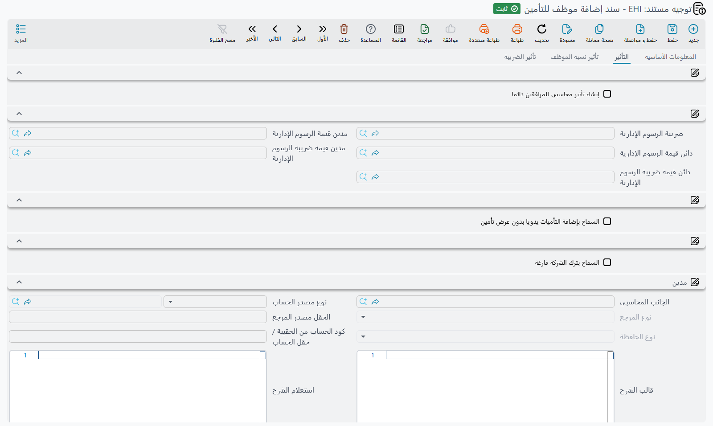

# توجيهات التأمينات

في موديول الموارد البشرية منتجا تأمين لا صلة بينهما. **التأمين الصحي للموظفين** — إضافة الموظفين
ومرافقيهم إلى بوليصة طبية وترقيتهم والمطالبة عليها — يحتاج ترخيص التأمين الصحي الخليجي
(`humanresource-gulf-health-insurance`). و**تأمين السيارات** — بوليصة أسطول وسيارات تُضاف إليها
وتُزال منها وأقساط تُثبَّت عليها — يحتاج ترخيص تأمين السيارات (`humanresource-car-insurance`).

والجامع بينهما أن كليهما يؤثر محاسبيًا فعلًا، وأن في كليهما طرفًا ثالثًا يُصدر لك فاتورة، وأن كليهما
يحمل ضريبة. ولذلك فتوجيهاتهما أكثر توجيهات الموديول حسابات بعد تصفية المستحقات.

أما الآليات المشتركة — ما التوجيه، ولماذا لا تسمّي معظم التوجيهات المجمعة إلا دفترًا وتوجيهًا،
والمفاتيح المحاسبية الثلاثة المختلفة الأسماء — ففي
[توجيهات الرواتب والتصفية](/ar/modules/hr/document-terms/hr-terms-salary-and-dues).

## توجيهات التأمين الصحي

خمسة مستندات — التأمين نفسه، والترقية، وطلب الترقية، والحذف، والتعميد — تتشارك شكلًا مشتركًا طويلًا، ثم
يضيف كل منها قليلًا من عنده. أما سند التعويض الطبي فله توجيه مستقل مشروح في آخر هذا القسم.

### ما يحمله كل توجيه تأمين صحي

**صفحة التأثير.** ثلاث مجموعات من الجوانب المحاسبية عناوينها **مدين** و**دائن** و**التخفيض**. ومعرّفات
حقولها `termConfig.debit2` و `termConfig.credit2` و `termConfig.firstDiscountAcc` — والرقم «2» في
المعرّفات تاريخي، فلا زوج أول في هذه التوجيهات.

**صفحة تأثير نسبه الموظف.** تُقيَّد حصة الموظف نفسه من القسط على زوج خاص بها، يظهر كذلك تحت عنواني
المجموعتين **مدين** `termConfig.coveringDebit` و**دائن** `termConfig.coveringCredit`. ولحصة الموظف من
الضريبة زوجها إلى جواره: *مدين ضريبة الموظف* `termConfig.empTaxDebit` و*دائن ضريبة الموظف*
`termConfig.empTaxCredit`. وتُظهر الصفحة نفسها *دائن قيمة التأمين السابقة* `termConfig.previousInsValueCredit`
و*مدين قيمة التأمين السابقة* `termConfig.previousInsValueDebit` في كل توجيهات التأمين الصحي، لكن سند
الترقية وحده يستعملهما — ولا أثر لهما في الأربعة الأخرى.

**صفحة تأثير الضريبة.** جانبا الضريبة تحت عنواني المجموعتين **مدين** `termConfig.tax` و**دائن**
`termConfig.tax2`؛ و*سياسة الضريبة* `termConfig.taxPlan` تسمّي السياسة؛ و*يمكن تعديل الضريبة*
`termConfig.modifiableTax` يتيح للمستخدم تجاوز الضريبة المحسوبة على المستند؛ و*قيمة الضريبة تحسب بعد
الخصم* `termConfig.taxAfterDiscount` يقرر أتُحسب الضريبة على الإجمالي أم على الصافي بعد الخصم.

**الرسوم الإدارية.** يتقاضى المؤمِّن رسم مناولة، ويُتابَع على حدة: *مدين قيمة الرسوم الإدارية*
`termConfig.administrativeFeesValueDebit` و*دائنها* `termConfig.administrativeFeesValueCredit`، و*مدين
قيمة ضريبة الرسوم الإدارية* `termConfig.administrativeFeesTaxValueDebit` و*دائنها*
`termConfig.administrativeFeesTaxValueCredit`، و*ضريبة الرسوم الإدارية* `termConfig.administrativeFeesTaxPlan`
الخاصة بها — لأن الرسم كثيرًا ما يُضرَّب بمعدل غير معدل القسط.

**تسامحان.**

| الخيار | الحقل | ماذا يفعل |
|---|---|---|
| **السماح بترك الشركة فارغة** | `termConfig.allowEmptyCompany` | يجوز حفظ مستند التأمين دون تسمية شركة التأمين. |
| **السماح بإضافة التأميات يدويا بدون عرض تأمين** | `termConfig.allowManualInsuranceValues` | يجوز كتابة القيم مباشرة بدل مجيئها من عرض تأمين. وهذا توجيه تأمين شخص خارج مسار العروض المعتاد. وليس على توجيه طلب الترقية. والعنوان المشحون يخطئ إملاء «التأمينات». |

و**إنشاء تأثير محاسبي للمرافقين دائما** `termConfig.genAccountingEffectsForAttendants` — ينتج
المرافقون تأثيرهم المحاسبي دائمًا بدل طيّه داخل تأثير الموظف. ولا يظهر إلا في توجيهي **سند إضافة موظف
للتأمين** و**سند حذف تأمين موظف**.

### ما يضيفه كل مستند

**توجيه سند ترقية تأمين** هو المثير. فترقية فئة تأمين أحدهم في منتصف السنة تعني عكس جزء مما قُيِّد،
ولذلك يحمل مجموعة عنوانها *دائن ومدين فئة التأمين السابقة* فيها جوانب الترتيب **السابق**: *دائن فئة
التأمين السابقة* `termConfig.previousInsCategoryCredit` و*مدين فئة التأمين السابقة*
`termConfig.previousInsCategoryDebit`، إضافة إلى *مدين ضريبة القيمة المستردة* `termConfig.refundTaxDebit`
و*دائن ضريبة القيمة المستردة* `termConfig.refundTaxCredit` لضريبة الجزء المسترد. ويُقرأ لهذا المستند
أيضًا زوج *قيمة التأمين السابقة* الذي في صفحة تأثير نسبه الموظف.

ويحمل كذلك **استخدام سند ترقية تأمين لخفض فئة تأمين الموظف**
`termConfig.useHealthInsuranceUpgradeDocToDowngradeEmpInsurance` — المستند نفسه، معكوسًا، ينقل الموظف
إلى فئة **أرخص**. وبدونه لا يصعد مستند الترقية إلا صعودًا، ويصير الخفض بالحذف وإعادة الإضافة.

**توجيه طلب ترقية تأمين** يستعمل شاشة توجيه الترقية نفسها، بلا *السماح بإضافة التأميات يدويا بدون عرض
تأمين*. والطلب لا ينشئ قيدًا، فالخيار الوحيد فيه الذي يغيّر شيئًا هو *استخدام سند ترقية تأمين لخفض فئة
تأمين الموظف*: إن أُشِّر جاز أن يسمّي الطلب فئة أدنى، وإلا رُفض السطر الذي يسمّي الفئة نفسها أو فئة أدنى
بالرسالة:

«لايمكن الترقية إلى نفس الفئة او فئة اقل»

أما الجوانب المحاسبية في توجيه الطلب فمهمَلة.

**توجيه حذف التأمين الصحي** يضيف *عدم احتساب القيمة مع الحفظ* `termConfig.doNotOverrideValueWithSave`:
تُبقى قيمة الاسترداد التي كتبها المستخدم بدل إعادة حسابها مع كل حفظ. وهو مفيد حين يخبرك المؤمِّن
بالمبلغ المسترد بالضبط ولا يطابق ما يحسبه النظام.

**توجيه اعتماد التأمين الصحي** لا يضيف شيئًا فوق الشكل المشترك.

**توجيه سند التعويض الطبي** مستقل وقصير: صفحة *التأثير* بزوج واحد من الجوانب المحاسبية، يظهر تحت عنواني
المجموعتين **مدين** `termConfig.debit2` و**دائن** `termConfig.credit2`، ولا زوج غيرهما.

والتأمين الصحي في
[التأمين الصحي للموظفين](/ar/modules/hr/health-insurance/employee-health-insurance).

## توجيهات تأمين السيارات

أربعة مستندات — البوليصة، وإضافة سيارة، وإزالة سيارة، وقيد إثبات القسط — توجيهاتها متشابهة، لكن كلًّا
منها يُظهر مجموعة مختلفة من الحقول نفسها. وفي الأربعة صفحة *التأثير* تبدأ بالمجموعتين نفسيهما:

- **الحسابات** — *دائن* `termConfig.credit` و*مدين* `termConfig.debit`، للقسط نفسه.
- **الضرائب** — *دائن 2* `termConfig.credit2` و*مدين 2* `termConfig.debit2`، وهما جانبا الضريبة، و*سياسة
  الضريبة* `termConfig.taxPlan`.

ثم تختلف:

| الحقل | البوليصة | الإضافة | الإزالة | إثبات القسط |
|---|---|---|---|---|
| مجموعة **الخصومات** — *دائن التخفيض* `termConfig.discountCredit` و*مدين التخفيض* `termConfig.discountDebit` | ✓ | — | ✓ | ✓ |
| مجموعة **قيمة الرسوم** — *دائن الرسوم* `termConfig.feesCredit` و*مدين الرسوم* `termConfig.feesDebit` | ✓ | — | — | — |
| مجموعة **ضرائب على الرسوم** — *دائن ضرائب على الرسوم* `termConfig.feesTaxesCredit` و*مدين ضرائب على الرسوم* `termConfig.feesTaxesDebit` | ✓ | — | — | — |
| *إستخدام المستند كمصدر تكلفة في المقاولات* `termConfig.useAsSourceCostDoc` | ✓ | ✓ | — | ✓ |
| *حساب تكلفة اليوم من الصافي بعد الخصم* `termConfig.calculateDayCostFromValueAfterDiscount` | ✓ | ✓ | — | ✓ |
| *مدين تكلفة المقاولات* `termConfig.contractingCostDebit` و*دائنها* `termConfig.contractingCostCredit` | ✓ | ✓ | — | ✓ |
| *يمكن تعديل الضريبة* `termConfig.modifiableTax` | ✓ | ✓ | — | — |
| سلسلة قيد إثبات القسط (أدناه) | ✓ | ✓ | — | — |
| *السماح بإضافة التأمينات بدون طلب عرض تأمينات أو عرض تأمينات* `termConfig.allowAddingInsuranceWithoutRequestOrOffer` | ✓ | ✓ | — | — |
| *السماح بإضافة السيارة للتأمين مرة أخرى إذا وجدت في البوليصة* `termConfig.allowAddingCarToInsuranceIfItFoundInPolicy` | — | ✓ | — | — |

فتوجيه **الإزالة** أنحفها — الحسابات والضرائب والخصم فقط — وتوجيه **البوليصة** وحده فيه الرسوم.

::: warning عنوانا الرسوم مستعاران من موديول آخر
عنوانا *مدين الرسوم* و*دائن الرسوم* يقرآن «مدين/دائن رسوم انهاء خطاب الضمان»، ولا صلة لذلك بتأمين
السيارات. والحقلان يعملان عملهما الصحيح، وإنما نُسخ العنوان من موضع آخر. فاقرأهما على أنهما رسوم
التأمين.
:::

**التكلفة والمعدل اليومي.** *حساب تكلفة اليوم من الصافي بعد الخصم* يقرر أتُشتق تكلفة اليوم الواحد لتأمين
سيارة من القسط الإجمالي أم من الصافي بعد الخصم — وهو ما يهم لأن ذلك الرقم اليومي هو ما يُحمَّل حين تنضم
سيارة إلى البوليصة أو تغادرها في منتصف السنة. و*إستخدام المستند كمصدر تكلفة في المقاولات* وجانبا
*تكلفة المقاولات* يحمّلان التأمين على تكلفة مشروع مقاولات.

**سلسلة قيد إثبات القسط.** ثلاثة حقول تعمل معًا في توجيهي البوليصة والإضافة:

| الخيار | الحقل | ماذا يفعل |
|---|---|---|
| **إنشاء قيد إثبات استحقاق قسط تأمين السيارة** | `termConfig.generateInsuranceInstallmentProofDoc` | يُنشئ حفظُ المستند القيدَ الذي يثبت استحقاق قسط التأمين أيضًا. |
| **دفتر / توجيه قيد إثبات استحقاق قسط تأمين السيارة** | `termConfig.proofDocBook` و `termConfig.proofDocTerm` | أين يودَع ذلك القيد وكيف يؤثر. |
| **حفظ قيد إثبات استحقاق قسط تأمين السيارة المنشأ كمسودة** | `termConfig.saveInsuranceInstallmentProofDocAsDraft` | يُنشأ القيد مسودةً فيراجعه أحدهم قبل أن يؤثر. |

و**السماح بإضافة التأمينات بدون طلب عرض تأمينات أو عرض تأمينات** نظير تسامح التأمين الصحي اليدوي في
جانب السيارات: يجوز إضافة التأمين دون طلب أو عرض خلفه.

و**السماح بإضافة السيارة للتأمين مرة أخرى إذا وجدت في البوليصة**، في توجيه الإضافة وحده، يجيز إضافة سيارة
موجودة في البوليصة مرة أخرى. وذلك خطأ في العادة، لكنه مشروع حين تُعاد سيارة بعد إزالة في منتصف المدة.

## توجيه إجراء سيارة

[إجراء سيارة](/ar/modules/hr/employee-services) يسجّل ما كلّفته سيارة الشركة — إصلاحًا أو حادثًا أو تجديد
رخصة — ويقسم تلك التكلفة بين الشركة والموظف المسئول. وتوجيهه يقرر أين يقع كل جزء من القسمة.

في التوجيه صفحتان. وكل زوج أدناه لا ينشئ قيودًا إلا إذا مُلئ جانباه **كلاهما**.

**التأثير** — جزء الشركة:

| الخيار | الحقل | ماذا يفعل |
|---|---|---|
| **مدين** / **دائن** (عنوانا المجموعتين) | `termConfig.coveringDebit` و `termConfig.coveringCredit` | الجزء الذي تتحمله الشركة من تكلفة كل سطر قبل الضريبة — التكلفة ناقص نصيب الموظف المسئول. |
| **الضريبة - دائن** / **الضريبة - مدين** (مجموعة *الضريبة*) | `termConfig.taxCredit` و `termConfig.taxDebit` | نصيب الشركة من الضريبة. وإن كان زوج ضريبة المسؤول في الصفحة الأخرى فارغًا أخذ هذا الزوج الضريبة كلها. |
| **سياسة الضريبة** | `termConfig.taxPlan` | السياسة التي يوضع معدلها في نسبة ضريبة كل سطر حين يُختار التوجيه في المستند. |
| **تحديث نسبة الضريبة** | `termConfig.updateTaxPercent` | **مؤشَّر افتراضيًا**: تبقى نسبة الضريبة في كل سطر كما تركها المستخدم عند الحفظ. وإن أُزيل التأشير أعاد كل حفظ نسبة ضريبة كل سطر إلى معدل سياسة الضريبة. |
| **عدم نسخ من تاريخ وإلى تاريخ لتاريخ بداية ونهاية رخصة السيارة** | `termConfig.doNotCopyFromDateAndToDateToCarLicenceDate` | في العادة ينسخ حفظ إجراء *تجديد رخصة* تاريخي «من» و«إلى» في السطر إلى تاريخي بداية رخصة السيارة ونهايتها (إذا لم يكن تاريخ النهاية الجديد أسبق من الحالي في السيارة). أشِّره لتبقى تواريخ رخصة السيارة كما هي. |

**تاثيرتحمل المسؤلية** (هكذا يُكتب العنوان على الشاشة) — جزء الموظف المسئول:

| الخيار | الحقل | ماذا يفعل |
|---|---|---|
| **مدين** / **دائن** (عنوانا المجموعتين) | `termConfig.debit2` و `termConfig.credit2` | نصيب الموظف المسئول من تكلفة كل سطر قبل الضريبة — وهو في العادة ذمة على الموظف. |
| **دائن ضريبة المسؤول** / **مدين ضريبة المسؤول** | `termConfig.respTaxCredit` و `termConfig.respTaxDebit` | نصيب الموظف المسئول من الضريبة. وإن كان زوج ضريبة الشركة فارغًا أخذ هذا الزوج الضريبة كلها. |

## صفحات ذات صلة

- **[توجيهات الرواتب والتصفية](/ar/modules/hr/document-terms/hr-terms-salary-and-dues)** — الآليات
  المشتركة ومستندات المال.
- **[توجيهات التوظيف والعلاقات الحكومية](/ar/modules/hr/document-terms/hr-terms-employment-and-government)**
- **[التأمين الصحي للموظفين](/ar/modules/hr/health-insurance/employee-health-insurance)**
- **[إعدادات الجانب المحاسبي](/ar/platform/shared-master-files/accounting-side-config)** — كيف يجد جانب المدين أو الدائن
  حسابه.
