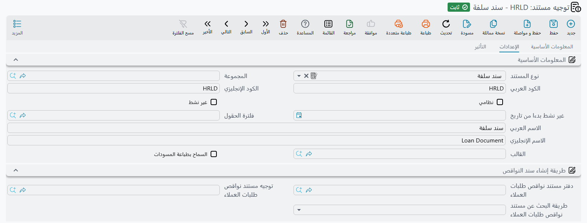

# توجيهات السلف والمكافآت والجزاءات

هذه المستندات كلها تحرّك مالًا ليس راتبًا: سلفة تُصرف، وقسط يُحصَّل، ومكافأة تُمنح، وجزاء يُخصم. ولذلك
فهي — بخلاف عائلة الإجازات — تؤثر محاسبيًا في أغلبها، وتوجيهاتها معنيّة بالحسابات أساسًا.

أما الآليات المشتركة — ما التوجيه، ولماذا لا تسمّي معظم التوجيهات المجمعة إلا دفترًا وتوجيهًا،
والمفاتيح المحاسبية الثلاثة المختلفة الأسماء — ففي
[توجيهات الرواتب والتصفية](/ar/modules/hr/document-terms/hr-terms-salary-and-dues).

## عائلة السلف

أربعة مستندات تصنع حياة السلفة: السلفة نفسها، وسند سداد عليها، وسند إعفاء يُسقط جزءًا منها، وسند
إعادة جدولة يحرّك أقساطها. ويسبقها جميعًا مستند خامس هو طلب السلفة.

**توجيه سند السلفة** فيه صفحة *التأثير* بمجموعتي **مدين** و**دائن** — الجانبان المحاسبيان
`termConfig.config.debit` و `termConfig.config.credit` — وثلاثة خيارات خاصة به:

| الخيار | الحقل | ماذا يفعل |
|---|---|---|
| **بدون تاثير محاسبي** | `termConfig.withoutAccountingEffect` | يمنع قيد المستند. |
| **تجاهل الشروط الواجب توافرها في سند السلفة** | `termConfig.ignoreConditionsForLoanDocument` | يتخطى شروط نوع السلفة — مدة الخدمة والمبلغ الأقصى وقائمة حالات الموظف في [إعدادات الموارد البشرية](/ar/modules/hr/setup/hr-configuration) وغيرها. وهذا توجيه الاستثناء، للسلفة التي وافقت عليها الإدارة رغم القواعد. |
| **انشاء الاقساط مع الحفظ** | `termConfig.generateInstallmentsWithSave` | يُبنى جدول الأقساط تلقائيًا عند حفظ المستند بدل انتظار ضغط المستخدم زر إنشاء الأقساط. |

**توجيه طلب سلفة** فيه صفحة *الرئيسية* بخياري السلفة ولا شيء غيرهما — فالطلب لا ينشئ قيدًا:

| الخيار | الحقل | ماذا يفعل |
|---|---|---|
| **تجاهل الشروط الواجب توافرها في سند السلفة** | `termConfig.ignoreConditionsForLoanDocument` | يُحفظ الطلب دون فحص شروط نوع السلفة، تمامًا كما في سند السلفة. |
| **انشاء الاقساط مع الحفظ** | `termConfig.generateInstallmentsWithSave` | إذا لم تكن في الطلب سطور أقساط بنى الحفظُ جدولَ الأقساط من المبلغ وعدد الأقساط وتاريخ بدء السداد. أما السطور الموجودة فتُترك كما هي. |

**توجيها سند السداد وسند الإعفاء** لا يحمل أي منهما إلا الجانبين المحاسبيين، **مدين**
`termConfig.config.debit` و**دائن** `termConfig.config.credit`. فكل ما يتعلق بمقدار المسدَّد أو المعفى
على المستندات، والتوجيه لا يقول إلا أين يقع.

**توجيه السلفة المجمَّع** يسمّي *توجيه سند السلفة المنشأ* و*دفتر سند السلفة المنشأ*
(`termConfig.generatedHRLoanDocTerm` و `termConfig.generatedHRLoanDocBook`) للسلف المفردة التي ينشئها،
ويضيف **مدين مبلغ السداد** و**دائن مبلغ السداد** (`termConfig.paymentAmountDebit`
و `termConfig.paymentAmountCredit`) لجانب الصرف في الدفعة. وليس على شاشته خيار تجاهل الشروط، فتُفحص
شروط نوع السلفة على كل سطر من الدفعة.

**وتوجيه إعادة جدولة الأقساط المجمَّع** على شكل الحقلين: *دفتر سند إعادة جدولة أقساط سلفة*
`termConfig.loanInstallRescheduleBook` و*توجيه سند إعادة جدولة أقساط سلفة*
`termConfig.loanInstallRescheduleTerm`.

والسلف نفسها في [سندات السلف](/ar/modules/hr/loans/hr-loan-documents) و
[تسويات السلف](/ar/modules/hr/loans/hr-loan-adjustments).

## توجيه المكافآت والجزاءات

المكافأة أو الجزاء مبلغ يُعلَّق على موظف لأمر فعله. وتوجيهه يقرر أين يؤثر، والأهم **متى يشعر به
الموظف**.

| الخيار | الحقل | ماذا يفعل |
|---|---|---|
| **مدين** / **دائن** | `termConfig.debit` و `termConfig.credit` | الجانبان المحاسبيان. |
| **له تأثير محاسبي** | `termConfig.withAccountingEffect` | التأشير يعني أن المستند **يؤثر** — عكس معنى «بدون تاثير محاسبي» في سند الراتب. |
| **احتساب المدين والدائن من نوع المكافأة** | `termConfig.calcDebitAndCreditFromRewardAndPenalty` | تأتي الحسابات من **نوع** المكافأة أو الجزاء لا من الجانبين أعلاه. وهكذا يخدم توجيه واحد قائمة أنواع مكافآت يؤثر كل منها في موضع مختلف. |
| **طريقة صرف المكافأة / الجزاء** | `termConfig.issueMethod` | إما **الصرف فورًا** فيُدفع المبلغ أو يُخصم وحده في حينه، وإما **الصرف مع الراتب** فينتظر ويظهر في قسيمة الراتب التالية. |

::: warning طريقة الصرف تغيّر من يدفع ومتى
«الصرف مع الراتب» هو الاختيار المعتاد: تصل المكافأة الموظف عبر الرواتب، فتُضرَّب وتُسجَّل كغيرها. أما
«الصرف فورًا» فيدفعها خارج قسيمة الراتب، وهو ما يريده بعض العملاء لمكافأة فورية نقدية — لكنه يعني
أيضًا أن المبلغ لن يكون في سند الراتب، وعلى من يطابق الرواتب بالقيود أن يعلم ذلك.
:::

وتوجيه المكافآت والجزاءات **المجمَّع** حقوله في مجموعة *الإنشاء التلقائي*. فـ*دفتر المستند*
`termConfig.generationConfigurations.generationBook` و*توجيه المستند*
`termConfig.generationConfigurations.generationTerm` يسميان دفتر وتوجيه مستندات المكافآت والجزاءات
المفردة التي تنشئها الدفعة — والدفتر مطلوب، وطريقة صرف المستندات المنشأة تؤخذ من ذلك التوجيه. و*إنشاء
تأثير محاسبي* `termConfig.generateAccountingEffects` يقرر هل تنشئ الدفعة قيود المستندات التي أنشأتها.

وفي التوجيه نفسه خيار **السماح بتكرار الموظف مع نفس المكافأة / الجزاء**
`termConfig.allowRepeatingEmployeeWithSameReward`. وهو مطفأ افتراضيًا، فيُرفض المستند المجمع إذا ظهر الموظف
نفسه في سطرين بنفس المكافأة أو الجزاء — وهو غالبًا إدخال مكرر. فعّله حين تمنح الدفعة الواحدة الموظفَ المكافأة
نفسها مرتين عن حق، كمكافأتي عمل إضافي منفصلتين في شهر واحد.

والمكافآت والجزاءات في
[المكافآت والجزاءات](/ar/modules/hr/discipline/rewards-and-penalties).

## توجيه المخالفات الحكومية

مستند المخالفة الحكومية — الغرامة التي تأتي من جهة لا من مدير — له أقصر توجيه في الموديول: زوج واحد
من الجوانب المحاسبية في صفحة *التأثير*، يظهر تحت عنواني المجموعتين **مدين** و**دائن**. ومعرّفا حقليهما
`termConfig.debit2` و `termConfig.credit2`، ولا زوج غيرهما.

وهذا المستند **يؤثر** محاسبيًا، ويستحق ذلك التصريح لأن شقيقه طلب الصرف الحكومي لا يؤثر. فإن سأل عميل
لماذا تظهر المخالفة الحكومية في القيود ولا يظهر طلب الصرف، فهذا هو السبب، وهو مقصود.

والمخالفات الحكومية في
[المخالفات الحكومية](/ar/modules/hr/government-relations/government-penalties).

## صفحات ذات صلة

- **[توجيهات الرواتب والتصفية](/ar/modules/hr/document-terms/hr-terms-salary-and-dues)** — الآليات
  المشتركة ومستندات المال.
- **[سندات السلف](/ar/modules/hr/loans/hr-loan-documents)** · **[أنواع السلف](/ar/modules/hr/loans/hr-loan-types)**
- **[المكافآت والجزاءات](/ar/modules/hr/discipline/rewards-and-penalties)**
- **[إعدادات الجانب المحاسبي](/ar/platform/shared-master-files/accounting-side-config)** — كيف يجد جانب المدين أو الدائن
  حسابه.
