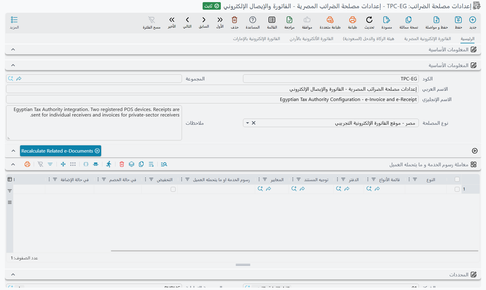

# الفاتورة الإلكترونية في نما

لم تعد معظم مصالح الضرائب تقبل الفاتورة المطبوعة كسجل للبيع. لا بد أن تصل الفاتورة إليها إلكترونيًا، بالصيغة التي تحددها، وفي المهلة التي تفرضها — بل إن الفاتورة في بعض الدول لا تصبح صحيحة قانونًا إلا بعد أن تعتمدها المصلحة وتعيدها موقّعة. والسعودية ومصر والأردن والإمارات لكلٍّ منها منظومتها الخاصة، وقواعدها الخاصة في مَن يحق له الإرسال، وشكل كود الصنف، والمهلة المتاحة لتصحيح الخطأ.

يضع نما آلة واحدة خلفها جميعًا. فمهما كانت الدولة التي تعمل بها، الأجزاء التي تتعامل معها واحدة، ولا يتغير سوى القابس في نهايتها. تشرح هذه الصفحة تلك الآلة المشتركة — ما مكوناتها، وكيف تسافر الفاتورة من مستند مبيعات محفوظ إلى سجل حكومي مقبول، وأين تبحث حين لا تصل. وحين تفهمها، يصير دليل الدولة الذي تحتاجه قراءةً قصيرة، لأنه لا يغطي إلا ما يختلف فعلًا.

## المكونات الثلاثة

**إعدادات مصلحة الضرائب** هو السجل الذي يحمل كل ما يخص علاقتك بمصلحة واحدة: أي منظومة تخاطب، وبيانات الاعتماد التي تعرّفك، والأكواد التي يجب أن تُترجَم إليها أصنافك وضرائبك، والقواعد التي تحدد ما يُرسَل ومتى. تُنشئ سجلًا لكل مصلحة ولكل منشأة — فالشركة المسجَّلة في دولتين لها سجلان، وكذلك المجموعة التي تُقدِّم فروعها إقراراتها منفصلة.

**مستندات المبيعات نفسها** لا تحتاج معاملة خاصة. يحرر الموظفون الفواتير والمرتجعات والإيصالات كما اعتادوا تمامًا. وما يجعل المستند مؤهَّلًا للإرسال تحدده الإعدادات، لا المستند.

**مستند إرسال المستندات إلى مصلحة الضرائب** هو المركبة. يجمع المستندات المستحقة، ويعرضها لك سطورًا، ويحملها إلى المصلحة. وكل إرسال قمت به يبقى محفوظًا كأحد هذه السجلات، ومعه ردّ المصلحة — وهذا ما يجعل بالإمكان أن تُثبت، بعد أشهر، ما الذي أُرسل بالضبط.

## تشغيل الفاتورة الإلكترونية

قبل أن تصير الشاشات مفيدة، يحتاج النظام أن يعرف صفحة أي دولة يعرضها داخل فواتيرك. من **الإعدادات العامة**، الصفحة الثانية، اضبط **صفحة الفاتورة الإلكترونية المعروضة**:

<GlobalConfigOption option-code="value.info.einvoicePageShowType" />

والخيارات هي **الفاتورة الإلكترونية المصرية**، و**هيئة الزكاة والدخل (السعودية)**، و**الفاتورة الإلكترونية بالأردن**، وصفحة الإمارات، أو **كل الصفحات** إن كنت تُقدِّم إقراراتك في أكثر من دولة. وبعد تغيير القيمة نفّذ **إعادة توليد الواجهة (Regen UI)** — فالصفحة الإضافية لن تظهر على المستندات قبل ذلك.

ثم أنشئ سجل الإعدادات واختر **نوع المصلحة**. يحدد هذا الحقل وحده الدولة والبيئة معًا:

| نوع المصلحة | الدولة | البيئة |
|---|---|---|
| السعودية - موقع الفاتورة الإلكترونية للمطورين | السعودية | بيئة المطورين (Sandbox) |
| السعودية موقع الفاتورة الإلكترونية التجريبي | السعودية | البيئة التجريبية (Simulation) |
| السعودية - موقع الفاتورة الإلكترونية | السعودية | الإنتاج الفعلي |
| مصر - موقع الفاتورة الإلكترونية التجريبي | مصر | البيئة التجريبية |
| مصر - موقع الفاتورة الإلكترونية | مصر | الإنتاج الفعلي |
| الأردن - الفاتورة الإلكترونية | الأردن | الإنتاج الفعلي |
| الإمارات (Orchida) التجريبي والفعلي | الإمارات | التجريبي والفعلي |

::: tip ابدأ دائمًا من المنظومة التجريبية
اختيار النوع يملأ لك حقل **API URL** تلقائيًا، لذا فالانتقال لاحقًا من التجريبي إلى الفعلي مسألة تغيير هذا الحقل وحده. جرّب سيناريوهاتك الحقيقية — فاتورة عادية، ومرتجع، وسطر معفى، وعميل فرد بلا رقم ضريبي — على المنظومة التجريبية أولًا. فالرفض هناك لا يكلّفك شيئًا، أما الرفض على المنظومة الفعلية فيُسجَّل في ملفك لدى المصلحة.
:::

أما إثبات هويتك أمام المصلحة فهو الجزء الوحيد المختلف فعلًا من دولة لأخرى: السعودية تصدر لك شهادة عبر تسلسل اعتماد يقوده رمز تحقق لمرة واحدة (OTP)، ومصر تُسجِّل كل جهاز إرسال وتمنحك Client ID و Client Secret، وغيرهما يختلف كذلك. وهذا محلّه أدلة الدول أدناه.

## ما الذي تحدده الإعدادات

الإعدادات طويلة، لكنها لا تجيب سوى عن خمسة أسئلة. ومعرفة السؤال الذي ينتمي إليه الحقل تجعل العثور عليه أيسر كثيرًا.

**من نحن؟** — رقم التسجيل الضريبي، وكود النشاط، والفرع أو الشركة التي يُؤخذ منها العنوان والسجل التجاري ويُرسَلان بوصفهما بيانات البائع. تتحقق المصالح من عنوان البائع بتفصيل شديد، ولذلك فإن عنوان الفرع الناقص من أشيع أسباب فشل أول إرسال.

**أي المستندات مؤهَّلة؟** — هذا السؤال يُجاب عنه من جهة المستندات لا هنا. يُرسل المستند عندما يكون **الدفتر** أو **التوجيه** الخاص به مُعلَّمًا عليه **إرسال الي مصلحة الضرائب** ويحدد هذه الإعدادات في حقل **إعدادات الضريبة**؛ والمستند الذي لا يفعل دفتره ولا توجيهه ذلك لا يُجمَّع أبدًا. والإعدادات لا تضيف إلا حدود التواريخ الموضحة أدناه.

**كيف تُترجَم أصنافنا وضرائبنا؟** — لا تقبل المصالح أكواد أصنافك الداخلية ولا مسميات ضرائبك كما هي. هنا تحدد مصدر كود الصنف وطريقة تركيبه، ومصدر وصف الصنف، وكيف تُقابَل كل خانة من خانات الضرائب الأربع بنوع الضريبة ونوعها الفرعي لدى المصلحة — بما في ذلك الكود الذي يُرسَل للسطور المعفاة وصفرية النسبة والخارجة عن النطاق، وهل تُرسَل الضريبة ذات القيمة الصفرية أصلًا.

**متى يجوز الإرسال؟** — يرسم **بدء الإرسال من تاريخ** الخطَّ الذي لا يُرسَل ما قبله، حتى لا يجرف تشغيلُ الخاصية فواتيرَ العام الماضي. ويُلزمك **أقصى عدد أيام لإرسال الفواتير** و**أقصى عدد أيام لإلغاء الفواتير المُرسلة** بمهل المصلحة.

**كم في المرة الواحدة؟** — كم مستندًا يذهب في الطلب الواحد إلى المصلحة، وكم سطرًا يجوز أن تجمعه العملية الواحدة. وكلاهما مهم في أيام الحجم العالي: فالكبير أكثر من اللازم تنتهي مهلته لدى المصلحة، والصغير أكثر من اللازم يجعلك تُنشئ مستندات إرسال طوال بعد الظهر.

## إعدادات مشتركة في صفحة كل دولة

تتكرر في صفحة كل دولة مجموعة من الإعدادات تعمل بالطريقة نفسها أيًّا كانت الدولة. نشرحها هنا مرة واحدة، وتحيل إليها أدلة الدول. ومعرّف الحقل بجوار كل منها هو ما تبحث عنه في أدوات الاستيراد أو تذكره للمطوّر.

### سعر الوحدة والكميات والتقريب

يمر سطر الفاتورة في نما بعدة خطوات — السعر، وحتى ثمانية خصومات، وتخفيض الفاتورة، وأربع ضرائب — بالترتيب الذي تحدده إعدادات الضريبة للسطر. ولا تستقبل المصلحة إلا سعر وحدة واحدًا لكل سطر، فلا بد أن تحدد الإعدادات الخطوة التي يُقرأ منها هذا السعر.

| الحقل | معرّف الحقل | ماذا يفعل |
|---|---|---|
| **مصدر سعر الوحدة** | `unitPriceSource` | الخطوة التي يُؤخذ منها سعر الوحدة المُرسل: **السعر الاساسي** (الافتراضي)، أو **خصم 1**–**خصم 8**، أو **تخفيض الفاتورة**، أو **ضريبة 1**–**ضريبة 4**. والخصومات حتى هذه الخطوة ومعها تكون داخل السعر بالفعل، فلا تُرسل مرة أخرى خصومات. أما الضرائب التي يشملها السعر فتُستبعد منه. |
| **نوع مصدر سعر الوحدة** | `unitPriceType` | أي قيمة من تلك الخطوة تُستخدم. **الصافي بعد مصدر سعر الوحدة** (الافتراضي) هو قيمة السطر بعد تطبيق الخطوة. و**وعاء مصدر سعر الوحدة** هو القيمة التي حُسبت عليها الخطوة. |
| **عدد كسور الكمية** | `quantityFractionalPlaces` | عدد الخانات العشرية التي تُرسل بها الكمية. والصفر أو الفراغ يعني عدد الخانات نفسه الذي تستخدمه الدولة للمبالغ. |
| **تجاهل وتقريب القيمة إذا كان عدد خانات الكسر أكبر من المسموح به** | `ignoreAndRoundAmountIfScaleIsInvalid` | حين يكون حاصل ضرب سعر الوحدة في سعر العملة بخانات عشرية أكثر مما تسمح به المصلحة، يتوقف المستند بالرسالة أدناه. علّم هذا الخيار ليُقرَّب المبلغ بدلًا من ذلك. |
| **اقصي عدد للسطور عند تجميع مستندات الضرائب** | `maxNumberOfLinesWhenCollectTaxAuthDocs` | عدد السطور التي يجوز أن يجمعها **تجميع مستندات الضرائب** في المرة الواحدة. إذا تُرك فارغًا يُطبَّق الحقل الذي يحمل الاسم نفسه في الإعدادات العامة، وإذا كان فارغًا هو أيضًا فالعدد 750. |

::: tip مثال
سطر فيه 10 وحدات بسعر 100، و**خصم 1** بنسبة 10%، وضريبة قيمة مضافة 15%. إذا كان **مصدر سعر الوحدة** هو **السعر الاساسي**، تستقبل المصلحة سعر وحدة 100 وخصمًا قدره 100. وإذا جعلته **خصم 1** مع **الصافي بعد مصدر سعر الوحدة**، تستقبل سعر وحدة 90 بلا خصم، لأن الخصم صار داخل السعر.
:::

ورسالة التقريب ليس لها نص عربي، فتظهر بالإنجليزية في الشاشات العربية:

*Unit price is {0} and currency rate is {1} multiplication result is {2} with {3} scale, result scale should be {4} or less*

### إعدادات الخصومات (Discount Configs)

يحدد نما افتراضيًا موضع كل خصم من مكانه في حساب السطر. فالخصم المطبَّق قبل الضرائب يُرسل خصمًا على السطر، والخصم المطبَّق بعد الضرائب يُرسل خصمًا بعد الضريبة، ويُعامل تخفيض الفاتورة كخصم قبل الضريبة. وجدول **إعدادات الخصومات** (`discountConfigs`) يغيّر ذلك لكل خصم على حدة.

| العمود | معرّف الحقل | ماذا يفعل |
|---|---|---|
| **التخفيض** | `discountConfigs.discount` | **تخفيض الفاتورة** أو **خصم 1**–**خصم 8**. اتركه فارغًا لسطر يشمل كل الخصومات. |
| **وقت حساب الخصم (قبل او بعد الضريبة)** | `discountConfigs.einvoiceDiscountLocation` | **قبل الضريبة**، أو **بعد الضريبة**، أو **تجاهل** فلا يظهر الخصم في الفاتورة الإلكترونية. |
| **استعلام قيمة الخصم** | `discountConfigs.discountValueFormula` | استعلام يُنفَّذ على سطر الفاتورة، وتُرسل نتيجته قيمةً للخصم بدلًا من القيمة الموجودة في السطر. |
| **يضاف إلى سعر الوحدة** | `discountConfigs.addToUnitPrice` | يعيد إضافة الخصم إلى سعر الوحدة المُرسل، فترى المصلحة السعر قبل ذلك الخصم. |

يقرأ نما السطور من الأعلى ويستخدم أول سطر يطابق، لذلك ضع سطر الخصم المحدد فوق السطر الذي تركت فيه **التخفيض** فارغًا. ولا يجوز أن يتكرر الخصم الواحد، فيرفض الحفظ التكرار برسالة «الخصم {0} مُكرر في السطر {1}»، أو برسالة «السطر {0} لكل الخصومات مكرر» لسطر ثانٍ تُرك فيه **التخفيض** فارغًا.

### معاملة رسوم الخدمة و ما يتحمله العميل

هذا الجدول (`serviceFeesAndChargesToCustomerConfigs`) موجود في صفحة **الرئيسية** من الإعدادات، لا في صفحة دولة. وهو يخبر نما بما يفعله بـ**مصاريف خدمة 1**–**4** في المستند، وبالسطور المعلَّم عليها **يتحمله العميل**، وهو عمود في سطور مرتجعات المبيعات ومستخلصات المقاولات. والسطر الذي يتحمله العميل لا يُرسل أبدًا سطرًا مستقلًا.

الأعمدة الخمسة الأولى تختار المستندات التي ينطبق عليها السطر، والعمود الفارغ يطابق كل شيء. والباقي يحدد ما يُفعل بمبلغ واحد.

| العمود | معرّف الحقل | ماذا يفعل |
|---|---|---|
| **النوع** | `serviceFeesAndChargesToCustomerConfigs.entityType` | نوع مستند واحد ينطبق عليه السطر. |
| **قائمة الأنواع** | `serviceFeesAndChargesToCustomerConfigs.entityTypeList` | عدة أنواع مستندات ينطبق عليها السطر. |
| **الدفتر** | `serviceFeesAndChargesToCustomerConfigs.book` | يقصر السطر على مستندات هذا الدفتر. |
| **توجيه المستند** | `serviceFeesAndChargesToCustomerConfigs.term` | يقصر السطر على مستندات هذا التوجيه. |
| **المعايير** | `serviceFeesAndChargesToCustomerConfigs.criteriaDefinition` | يقصر السطر على المستندات المطابقة للمعايير. |
| **رسوم الخدمة او ما يتحمله العميل** | `serviceFeesAndChargesToCustomerConfigs.serviceFeesOrChargedToCustomer` | المبلغ الذي يعالجه السطر: **مصاريف خدمة 1**–**4**، أو **يتحمله العميل**، وهو إجمالي السطور التي يتحملها العميل. |
| **التخفيض** | `serviceFeesAndChargesToCustomerConfigs.discount` | علّمه ليُرسل المبلغ خصمًا موزَّعًا على بقية سطور المستند بنسبة صافي قيمتها. وهو مطلوب مع **يتحمله العميل**. |
| **في حالة الخصم** | `serviceFeesAndChargesToCustomerConfigs.discountCase` | مع تعليم **التخفيض**: خانة الخصم، **خصم 1**–**8**، التي تحمل حصة كل سطر. مطلوب. |
| **في حالة الإضافة** | `serviceFeesAndChargesToCustomerConfigs.additionCase` | مع ترك **التخفيض** غير معلَّم. **صنف** يُرسل رسم الخدمة سطرًا إضافيًا في الفاتورة. والاختيارات الأخرى، **Service 1 Fees Tax**–**Service 4 Fees Tax**، تحتاج **وقت حساب ضريبة المبيعات**. مطلوب. |
| **الصنف** | `serviceFeesAndChargesToCustomerConfigs.item` | مع **صنف**: الصنف الذي يُرسل تحته السطر الإضافي. يحمل السطر كود هذا الصنف وكمية واحدة، وسعره هو رسم الخدمة. مطلوب. |
| **وقت حساب ضريبة المبيعات** | `serviceFeesAndChargesToCustomerConfigs.taxLocation` | خانة الضريبة، **ضريبة 1**–**ضريبة 4**، المستخدمة مع اختيارات **Service N Fees Tax**. مطلوب معها. |

::: tip مثال
شركة تضيف رسوم توصيل إلى فواتير المبيعات في **مصاريف خدمة 1**. سطر فيه **رسوم الخدمة او ما يتحمله العميل** = **مصاريف خدمة 1**، و**التخفيض** غير معلَّم، و**في حالة الإضافة** = **صنف**، وصنف اسمه «توصيل»، يُرسل تلك الرسوم سطرًا إضافيًا في كل فاتورة إلكترونية تحت كود صنف التوصيل.
:::

ورسالتان تحرسان الجدول عند الحفظ:

- «الحقل {0} يجب ان يكون مفعلا في حالة ان تكون قيمة الحقل {1} ب {2}». سطر **يتحمله العميل** ترك فيه **التخفيض** غير معلَّم. علّمه.
- «لا يمكنك اختيار ضريبة خدمات في الحقل {0} لنفس نوع الخدمة في الحقل {1}». سطر جعل رسم الخدمة نفسه ضريبةً لنفسه، مثل **مصاريف خدمة 1** مع **Service 1 Fees Tax**.

ورسم الخدمة الذي ليس له سطر في الجدول يُعامل بطريقة كل دولة. فالسعودية والأردن ترسلانه رسمًا على مستوى المستند، كما في قسم «رسوم الخدمة المرسلة رسمًا على المستند» في [دليل الهيئة](./zatca-guide.md).

## الإرسال: اجمع، تحقق، أرسل

افتح **مستند إرسال المستندات إلى مصلحة الضرائب** جديدًا، واختر الإعدادات، وحدد المدى الذي تريد تغطيته — مدى تواريخ، أو مدى مستندات، أو تضييقًا بالشركة أو الفرع أو الإدارة أو القطاع أو مجموعة التحليل.

1. **تجميع مستندات الضرائب** يملأ الجدول بكل مستند مؤهَّل في ذلك المدى لم يُقبَل بعد. ولم يغادر شيء بعد.
2. **التأكد من صحة المستندات** يُطبِّق قواعد المصلحة على السطور المجمَّعة ويخبرك بما سيُرفَض — هوية مشترٍ ناقصة، أو صنف بلا كود مسجَّل، أو حقل عنوان متروك فارغًا. صحّح المستندات الأصلية، ثم أعد التجميع، وكرر حتى يخلو الجدول من الملاحظات.
3. **مطالعة المستندات قبل الإرسال** يعرض لك الرسالة التي ستُرسَل بالضبط، حين لا تكفي رسالة التحقق لتفسير نفسها.
4. **توقيع المستندات إلكترونيًا** (أو **توقيع المستندات المختارة**) يضع التوقيع الرقمي حيث تشترطه الدولة.
5. **إرسال المستندات المختارة فقط** يُرسل السطور التي أشّرت عليها، و**إرسال المستندات التي لم تُرسل** يُرسل كل ما على السجل ولم يذهب بعد.

::: tip تحقق قبل الإرسال، في كل مرة
يفحص التحقق المستندات المجمَّعة دون أن يُرسل شيئًا. وهو الفرق بين أن تصحح عشر فواتير في هدوء وبين أن تُسجَّل عليك عشر حالات رفض في ملفك الضريبي.
:::

### ماذا تعني الحالات

يحمل كل سطر حالةً تجيب عن سؤال «أين هذا المستند الآن؟»:

| الحالة | المعنى |
|---|---|
| **لم يرسل بعد** | مجمَّع ولم يُرسَل. |
| **تم إرساله** | قبِلته المصلحة. |
| **لم يتم إرساله بشكل صحيح** | أُرسل ورُفض. ويحمل السطر سبب المصلحة — صحّح المستند الأصلي وأعد الإرسال. |
| **ملغي** | سُحب بعد القبول، خلال المهلة التي تسمح بها المصلحة. |
| **مرفوض** | رفضته المصلحة بعد القبول. |
| **مرفوض من المستلم** | رفضه المشتري خلال النافذة التي تمنحها له المنظومة. ولا خطأ في بياناتك — العميل هو من اعترض على المستند. |

و**فحص حالة المستندات المُرسلة للضرائب** يعيد سؤال المصلحة عن السطور التي أرسلتها ويحدّث حالتها، وهي الطريقة التي تظهر بها الحالات الثلاث الأخيرة عادةً: فهي تقع بعد نجاح إرسالك، بمبادرة من طرف آخر.

ومن الفاتورة نفسها يفتح **عرض الفاتورة في موقع الفاتورة الإلكترونية** المستندَ على بوابة المصلحة — وهو أسرع ردٍّ على عميل يقول إنه لا يراها.

## أن تعمل المنظومة دون أن يراقبها أحد

التجميع والإرسال يدويًا مقبولان وأنت تستقر على المنظومة، ولا يحتملان الاستمرار بعد ذلك. وتتولى الأمر مساراتٌ مجدولة:

- **[التجميع والتوقيع والإرسال آليًا](/entity-flows/core/EAAutoCollectSignAndSentEInvoice)** — يُشغّل الدورة كاملة دون تدخل: يجمع المستندات المؤهَّلة، وينشئ سجلات الإرسال، ويوقّعها، ويرسلها.
- **[الإرسال الآلي للفاتورة الإلكترونية](/entity-flows/core/EAAutoSendEInvoice)** — يُرسل كل فاتورة على حدة فور اعتمادها، لمن يريد أن يكون المستند في سجل المصلحة خلال دقائق لا بين عشية وضحاها.
- **[فحص المستندات المرفوضة من المستلم](/entity-flows/core/EACheckTaxAuthorityRejectedByReceiverDocuments)** — يراقب الإرسالات الحديثة طوال نافذة مراجعة المشتري، ويعيد إليك حالات الرفض والإلغاء التي كنت ستعرفها من العميل.

وهناك كذلك مسارٌ لإعادة المحاولة، يمرّ على مستندات الإرسال التي ما زالت تحمل سطورًا في حالة *لم يرسل بعد* أو *لم يتم إرساله بشكل صحيح* ويعيد إرسالها على دفعات. ويستحق الجدولة حتى لو كنت تجمع وترسل يدويًا، لأنه يحوّل ليلةً تعطّلت فيها منظومة المصلحة إلى حدثٍ بلا أثر.

## حين لا يصل المستند

ابدأ من السطر ثم اتّسع. يحمل سطر الإرسال رسالة المصلحة نفسها، وهي محددة عادةً: مشترٍ بلا رقم ضريبي وبلا مستند هوية مقبول، أو صنف كوده غير مسجَّل، أو ضريبة بلا فئة مقابِلة، أو عنوان ينقصه رقم المبنى. وفي مصر، الرسائل التي يُظهرها نما نفسه قبل أن يُرسل أي شيء مذكورة في قسم «رسائل قد تظهر لك» في [دليل مصر](./egypt-einvoice-guide.md)، ومعها رسالة رفض التوقيع التي تأتي من البوابة. ورسائل السعودية في القسم نفسه من [دليل زاتكا](./zatca-guide.md). ابحث في هذه الجداول عن النص الذي أرسله العميل. صحّح ذلك على المستند الأصلي لا على مستند الإرسال — فمستند الإرسال لقطة، وسيلتقط التجميع التالي النسخة المصححة.

وإذا قبِلت المصلحة مستندًا ثم غيّرته بعد ذلك، يحسم إجراءا التصدير الخلاف. فـ**تصدير XML المُرسَل/المعتمَد للسطور المختارة** يعطيك الرسالة التي تحتفظ بها المصلحة فعلًا، و**تصدير XML الحالي للسطور المختارة** يعيد توليدها من بيانات اليوم. فإن اختلفتا، فقد عُدِّل المستند بعد إرساله — وهو ما يعني في معظم الدول أنه لا بد من إلغائه وإعادة إصداره، لا تصحيحه في صمت.

والمهل هي السبب الشائع الآخر. فالمستند الأقدم من **أقصى عدد أيام لإرسال الفواتير** لا يُجمَّع أصلًا، وهو ما يبدو كأن النظام يتجاهله. وذلك مقصود: المصلحة سترفضه. وقبوله عندئذٍ يمرّ عبر إجراء الإرسال المتأخر لدى المصلحة نفسها، لا عبر تغيير شيء في نما.

## أدلة الدول

| الدولة | الدليل |
|---|---|
| 🇸🇦 السعودية | [هيئة الزكاة والضريبة والجمارك (فاتورة)](./zatca-guide.md) — الاعتماد، والتصديق مقابل الإبلاغ، وفئات ضريبة القيمة المضافة، وهوية المشتري |
| 🇪🇬 مصر | [الفاتورة والإيصال الإلكتروني](./egypt-einvoice-guide.md) — الاتصال، وهوية المشتري، وأكواد الأصناف EGS و GS1، والإيصالات وأجهزة نقاط البيع، والبيانات البنكية، والتوقيع، والإلغاء |
| 🇦🇪 الإمارات | [الفاتورة الإلكترونية في الإمارات عبر Orchida osTax](./uae-orchida-einvoice-guide.md) |
| 🇯🇴 الأردن | [JoFotara](./jofotara-jordan-guide.md) — بيانات الدخول، وهوية المشتري، وما تعيده المنصّة مع كل فاتورة |
