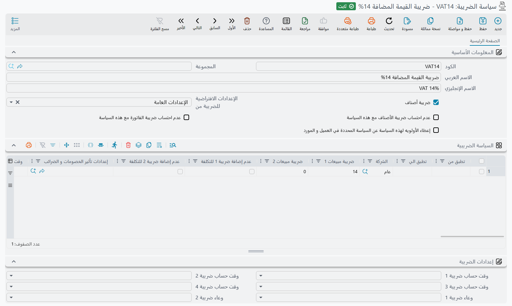

# دليل نظام الخصومات وحساب الضرائب على الفواتير - دليل شامل
## نظرة عامة

يشرح هذا الدليل كيف يحسب نما خصومات سطر الفاتورة وضرائبه: أي إعدادات ضريبة يستخدمها المستند، وبأي ترتيب تُطبَّق الخصومات والضرائب، والخيارات التي تغيّر كل خطوة. كل خيار مذكور باسمه على الشاشة، ومعرّف الحقل بجانبه في الجداول.

::: tip الميزات الرئيسية
- دعم 8 خصومات تسلسلية على مستوى السطر بالإضافة إلى خصم واحد على مستوى الرأس
- 4 أنواع ضرائب قابلة للإعداد مع نقاط تطبيق مرنة
- تفاعلات معقدة بين الخصومات والضرائب وترتيب مخصص
- دعم متعدد العملات ومتعدد المعدلات
- خيارات إعداد شاملة لسيناريوهات الأعمال المختلفة
- يمكن إعداد الضريبة كإضافة أو خصم
:::

## فهم تدفق الحساب

### تسلسل الحساب الأساسي

عند معالجة فاتورة، يتبع نما تسلسل الحساب العام التالي:

1. **حساب إجمالي السطر**: الكمية × سعر الوحدة = إجمالي السطر
2. **تطبيق خصومات السطر**: تطبيق Discount1 حتى Discount8 بالتسلسل
3. **تطبيق خصم الرأس**: تطبيق خصم واحد على الفاتورة بالكامل
4. **حسابات الضرائب**: تطبيق Tax1 حتى Tax4 عند النقاط المُعدَّة
5. **الإجماليات النهائية**: حساب صافي المبالغ والأرصدة المتبقية

::: info ملاحظة مهمة
يمكن تغيير الترتيب بسجل **إعدادات تأثير الخصومات و الضرائب** (راجع قسم «إعداد التأثيرات المتقدمة» أدناه)، فتُطبَّق الخصومات والضرائب بالترتيب الذي يحتاجه العمل.
:::

## أي إعدادات ضريبة تُطبَّق

خيارات الضريبة المشروحة في الأقسام التالية لا تُختار لكل مستند على حدة. ومنها موضع كل ضريبة في التسلسل، والمبلغ الذي تُحسب عليه، وهل السعر يشملها. هذه الخيارات تنتقل معًا كحزمة واحدة هي *إعدادات الضريبة*، ويأخذ المستند حزمته من أحد ثلاثة أماكن. يفحصها نما بهذا الترتيب ويتوقف عند أول مكان يعطي إجابة:

1. **سياسة الضريبة في المستند.** إذا حدد رأس المستند **سياسة الضريبة**، فالحقل **الإعدادات الافتراضية للضريبة من** في تلك السياسة هو الذي يقرر:
   - **الإعدادات العامة**: تُستخدم خيارات الضرائب في [تبويب الضرائب في الإعدادات العامة](/ar/platform/global-config/global-config-taxes).
   - **من راس المستند**: تُستخدم **إعدادات الضريبة** المعبأة في سياسة الضريبة نفسها.
   - **من سطور المستند**: يُستخدم أول سطر في جدول **السياسة الضريبية** داخل السياسة يطابق المستند. يطابق السطر إذا تحققت الشروط الثلاثة:
     - **الشركة** فيه هي شركة المستند، أو فارغة؛
     - تاريخ المستند يقع بين **تطبق من** و**تطبق الي** (التاريخ الفارغ يترك ذلك الطرف مفتوحًا)؛
     - **النوع** أو **قائمة الأنواع** فيه يشمل نوع المستند، أو كلاهما فارغ.

     إذا لم يطابق أي سطر انتقل نما إلى الخطوة 2.
   - إذا تُرك الحقل فارغًا: ينتقل نما إلى الخطوة 2.
2. **سياسة الضريبة في السطر**، وهي سياسة الصنف، وتُقرأ بالطريقة نفسها.
3. **تبويب الضرائب في الإعدادات العامة**، إذا لم تعطِ أي من السياستين إجابة. والمستند الذي لا يحمل سياسة ضريبة في رأسه ولا في صنفه يأتي إلى هنا مباشرة.

مثال: سياسة ضريبة مضبوطة على **من سطور المستند** فيها سطران: الأول للشركة أ بدءًا من 1 يناير 2025، والثاني بشركة فارغة. فاتورة الشركة ب تستخدم السطر الثاني. وكذلك فاتورة الشركة أ المؤرخة في ديسمبر 2024، لأن السطر الأول لم يكن قد بدأ بعد. ترتيب السطور مهم: ضع السطور الخاصة فوق السطر العام.

### حقول إعداد خطة الضريبة

#### حقول خطة الضريبة الأساسية

| اسم الحقل | حقل قاعدة البيانات | الوصف | التأثير |
|------------|------------------|-------|---------|
| **ضريبة أصناف** (Item Plan) | `itemPlan` | يجعل الخطة خطة أصناف | مفعّل: تُعرض الخطة في حقل السياسة الضريبية في الصنف. غير مفعّل: تُعرض في حقل السياسة الضريبية في التوجيه. ولا يجوز تفعيله مع **عدم احتساب ضريبة الأصناف مع هذه السياسة** |
| **عدم احتساب ضريبة الأصناف مع هذه السياسة** (No Item Taxes With This Policy) | `noItemTaxesWithThisPolicy` | تعطيل Tax1 وTax2 | إذا فُعِّل في السياسة الضريبية لرأس المستند، تصبح ضريبة 1 وضريبة 2 صفراً في كل السطور بغض النظر عن المعدلات |
| **عدم احتساب ضريبة الفاتورة مع هذه السياسة** (No Invoice Taxes With This Policy) | `noInvoiceTaxesWithThisPolicy` | تعطيل Tax3 وTax4 | إذا فُعِّل في السياسة الضريبية للسطر (من الصنف)، تصبح ضريبة 3 وضريبة 4 صفراً في ذلك السطر بغض النظر عن المعدلات |
| **Prioritize This Policy Over Policy Specified In Customer and Supplier** | `priorityPolicyOverCusOrSup` | التحكم في أولوية السياسة | عند التفعيل، تتجاوز هذه الخطة إعدادات ضريبة العميل/المورد |
| **الإعدادات الافتراضية للضريبة من** (Default Tax Configuration) | `defaultTaxConfig` | مصدر إعداد الضريبة | الخيارات: **الإعدادات العامة** (الافتراضي في الخطة الجديدة)، **من رأس المستند**، **من سطور المستند** |
| **Tax Configuration** | `taxConfiguration` | إعدادات سلوك الضريبة المضمنة | تحتوي على جميع قواعد حساب الضريبة |
| **Legal Entity Taxes** | `legalEntityTaxes` | معدلات الضريبة حسب الشركة والتاريخ | قائمة بمعدلات الضريبة الخاصة بكل شركة |
| **Subsidiary Accounts** | `subsidiaryAccounts` | إعدادات على مستوى الحساب | تحتوي على علامات الإعفاء الضريبي |

#### حقول ضريبة الشركة

يحتوي كل سطر في جدول **السياسة الضريبية** على:

| اسم الحقل | حقل قاعدة البيانات | الوصف |
|------------|------------------|-------|
| **Legal Entity** | `legalEntity` | شركة محددة أو null للجميع |
| **Effective From** | `effectiveFrom` | تاريخ بدء سريان معدلات الضريبة |
| **Effective To** | `effectiveTo` | تاريخ انتهاء سريان معدلات الضريبة |
| **Tax 1** | `tax1` | معدل Tax1 (نسبة مئوية أو قيمة) |
| **Tax 2** | `tax2` | معدل Tax2 (نسبة مئوية أو قيمة) |
| **Entity Type** | `entityType` | نوع المستند المحدد |
| **Entity Type List** | `entityTypeList` | أنواع مستندات متعددة |
| **Revision ID** | `revisionId` | إصدار الصنف الذي ينطبق عليه هذا المعدل؛ وإن كان فارغًا انطبق على كل الإصدارات |
| **Tax Configuration** | `taxConfiguration` | إعداد تجاوز لهذه الشركة |



## إعداد نظام الخصومات

### أنواع الخصومات

#### خصومات السطر (Discount 1-8)
- **التطبيق التسلسلي**: يُطبَّق كل خصم بعد السابق
- **قاعدة قابلة للإعداد**: يمكن لكل خصم تطبيق مبالغ أساسية مختلفة
- **نسبة مئوية أو قيمة**: يمكن تحديده كنسبة مئوية أو مبلغ ثابت
- **تحكم فردي**: لكل خصم إعداد مستقل

#### خصم الرأس
- **على مستوى الفاتورة**: يُطبَّق على إجمالي الفاتورة بالكامل
- **التوزيع النسبي**: يُوزَّع على جميع سطور الفاتورة بشكل نسبي
- **توقيت قابل للإعداد**: يمكن تطبيقه في نقاط مختلفة من تسلسل الحساب

### حقول إعداد الخصم

الخيارات التي تحدد وعاء كل خصم وسلوكه (**وعاء خصم N** ومثله لخصم الرأس، و**احتساب نسبة خصم N من القيمة**، ومجموعة **خصم ضريبة 1** إلى **خصم ضريبة 4** لكل خصم) تُضبط في تبويب الخصومات في الإعدادات العامة، وهي مشروحة هناك بخياراتها ومعرّفات حقولها: انظر [الخصومات في الإعدادات العامة](/ar/platform/global-config/global-config-discounts).

### كيفية حساب الخصومات

#### الخصومات النسبية
```
Discount Amount = (Base Amount × Discount Percentage) ÷ 100
New Total = Base Amount - Discount Amount
```

#### الخصومات بقيمة ثابتة
```
Discount Amount = Fixed Discount Value
New Total = Base Amount - Discount Amount
```

#### الخصومات الشاملة للضريبة
إذا فُعِّل **خصم ضريبة N** في مجموعة الخصم، تُستخرج تلك الضريبة أولًا من وعاء الخصم، ثم تُطبَّق نسبة الخصم على الباقي. وطريقة حساب جزء الضريبة تتوقف على شمول السعر لتلك الضريبة:
```
Tax Part = Base Amount - (Base Amount × 100) ÷ (100 + Tax Percentage)    (Price Includes Tax N on)
Tax Part = (Base Amount × Tax Percentage) ÷ 100                          (Price Includes Tax N off)
Discount Amount = ((Base Amount - Tax Part) × Discount Percentage) ÷ 100
```

::: tip خصومات تختفي عند تغيير التوجيه أو العميل
قد يؤدي تغيير التوجيه أو التاريخ الفعلي أو الذمة أو العميل إلى إعادة احتساب سعر كل سطر وخصمه، وعندها تُستبدل الخصومات المُدخلة يدويًا. ما الذي يسبب ذلك، وخيارات التوجيه التي توقفه، موجودة في قسم [التحكم في تحديث الأسعار](/ar/modules/supplychain/document-terms/doc-term-pricing-taxes-discounts#ltHkm-fy-tHdyth-lsaar-Price-Update-Control) في صفحة التوجيه.
:::

## إعداد نظام الضرائب

### خيارات الضريبة

تحمل إعدادات الضريبة المجموعة نفسها من الخيارات لكل ضريبة من الضرائب الأربع، أيًّا كان المكان الذي جاءت منه من الأماكن الثلاثة أعلاه: موقع الضريبة، ووعاؤها، وكونها خصمًا، وكونها قيمة لا نسبة، وكون القيمة للإجمالي لا لكل وحدة، وشمول السعر لها، واستبعادها من الإجمالي، واستخدام نسبتها قيمةً إضافية. وكل خيار منها مشروح مرة واحدة بخياراته في صفحة [الضرائب والفاتورة الإلكترونية في الإعدادات العامة](/ar/platform/global-config/global-config-taxes). وفي السياسة الضريبية تقع الخيارات نفسها على رأس السياسة (معرّفات مثل `taxConfiguration.tax1Location`) وعلى كل سطر من سطور جدول **السياسة الضريبية** (`legalEntityTaxes.taxConfiguration.tax1Location`). ويبيّن باقي هذا القسم كيف تجتمع في الحساب.

### الضريبة كإضافة أو خصم

إضافة الضريبة إلى إجمالي الفاتورة أو طرحها منه يتوقف على الخيار **ضريبة N خصم**:

#### عندما تُضاف الضريبة إلى الإجمالي (ضريبة قياسية)
- **الإعداد**: **ضريبة N خصم** غير مفعّل
- **الحساب**: الإجمالي الجديد = الوعاء + مبلغ الضريبة
- **حالة الاستخدام**: ضريبة القيمة المضافة (VAT)، ضريبة المبيعات (GST)
- **مثال**: 
  ```
  Line Total: $100
  Tax1 (15%): $15
  Final Total: $100 + $15 = $115
  ```

#### عندما تخفض الضريبة الإجمالي (ضريبة خصم)
- **الإعداد**: **ضريبة N خصم** مفعّل
- **الحساب**: الإجمالي الجديد = الوعاء − مبلغ الضريبة
- **حالة الاستخدام**: ضريبة الاستقطاع (Withholding Tax)، الخصومات، الحسومات
- **مثال**:
  ```
  Line Total: $100
  Tax3 (5% withholding): $5
  Final Total: $100 - $5 = $95
  ```

### طرق حساب الضرائب

#### الضرائب النسبية

| الإعداد | مبلغ الضريبة | السطر بعد الضريبة |
|---|---|---|
| تُضاف إلى السعر (**السعر يشمل الضريبة N** و**ضريبة N خصم** غير مفعّلين) | الوعاء × النسبة ÷ 100 | الوعاء + الضريبة |
| مدرجة في السعر (**السعر يشمل الضريبة N** مفعّل) | الوعاء − الوعاء × 100 ÷ (100 + النسبة) | الوعاء (السعر يحمل الضريبة أصلًا) |
| خصم (**ضريبة N خصم** مفعّل) | الوعاء × النسبة ÷ 100 | الوعاء − الضريبة |

#### الضرائب بقيمة ثابتة

عند تفعيل **ضريبة N قيمة و ليست نسبة** يكون المعدل مبلغًا لا نسبة:

| الإعداد | مبلغ الضريبة |
|---|---|
| **قيمة ضريبة N للإجمالي و ليس لكل وحدة** غير مفعّل | المعدل × الكمية |
| **قيمة ضريبة N للإجمالي و ليس لكل وحدة** مفعّل | المعدل، مرة واحدة للسطر كله |

## إعداد التأثيرات المتقدمة

### إعدادات تأثير الخصومات و الضرائب

إذا لم يناسبك التسلسل الثابت، أنشئ سجل **إعدادات تأثير الخصومات و الضرائب** (*الأساسيات ← الملفات*) واختره في حقل **إعدادات تأثير الخصومات و الضرائب** ضمن إعدادات الضريبة. عندها يتحكم هذا السجل في التسلسل بالكامل:

#### إعداد ترتيب التأثيرات

| اسم الحقل | حقل قاعدة البيانات | الوصف |
|------------|------------------|-------|
| **Effects Order** | `effectsOrder` | قائمة تحدد تسلسل التأثيرات |
| **Effect 1 Type** | `effect1Type` | نوع التأثير الأول (Tax1-4, Discount1-8, HeaderDiscount) |
| **Effect 1 Basis Lines** | `effect1BasisLines` | قواعد الحساب للتأثير 1 |
| **Effect 2 Type** | `effect2Type` | نوع التأثير الثاني |
| **Effect 2 Basis Lines** | `effect2BasisLines` | قواعد الحساب للتأثير 2 |
| ... | ... | ... |
| **Effect 13 Type** | `effect13Type` | نوع التأثير الثالث عشر |
| **Effect 13 Basis Lines** | `effect13BasisLines` | قواعد الحساب للتأثير 13 |

#### إعداد سطر أساس التأثير

يحتوي كل سطر أساس تأثير على:

| اسم الحقل | الوصف | التأثير |
|------------|-------|---------|
| **Source Type** | القيمة المستخدمة (MainPrice, CurrentTotal, Discount1-8, Tax1-4, إلخ) | يحدد القيمة الأساسية |
| **Source Value** | الجانب المحدد من المصدر (Value, AfterValue, Percentage) | يحدد القيمة الدقيقة للاستخراج |
| **Source Operation** | العملية الرياضية (Add, Subtract, Multiply, Divide, CalcPercentage, CalcInversePercentage) | كيفية تطبيق القيمة |

### العمليات الحسابية المخصصة

يدعم النظام هذه العمليات لحسابات التأثيرات المخصصة:

| العملية | الصيغة | حالة الاستخدام |
|---------|--------|---------------|
| **Add** | `total + value` | الجمع القياسي |
| **Subtract** | `total - value` | الطرح القياسي |
| **Multiply** | `total × value` | حسابات القياس |
| **Divide** | `total ÷ value` | عمليات القسمة |
| **CalcPercentage** | `(total × value) ÷ 100` | حسابات النسبة المئوية |
| **CalcInversePercentage** | `total - (total ÷ ((100 + value) ÷ 100))` | استخراج الضريبة الشاملة |

## خيارات الإعداد الخاصة

### معالجة الأصناف المجانية

وضع العلامة في مربع **صنف مجاني** على سطر المستند يفعل شيئًا أدق من «جعل السطر مجانيًا». فـ**سعر الوحدة** يبقى كما كُتب تمامًا، لم يُمَس، وظاهرًا لمن يقرأ المستند. أما ما يُصفَّر فهو كل ما يلي سعر الوحدة: **السعر الكلي** للسطر، وكل **صافي** من خصم 1 حتى خصم 8. ثم لا يُضاف السطر بعد ذلك أبدًا إلى **الإجمالي** في المستند.

ولأن سعر الوحدة يبقى بينما تخرج القيمة من الإجمالي، فإن هذا المربع هو كذلك الطريق العملي لوضع **صنف اختياري** أمام العميل في عرض السعر — سطر يقرأ سعره ولا يشمله إجمالي العرض. وهذه نتيجةٌ لطريقة تسعير الصنف الممنوح لا خاصيةٌ قائمة بذاتها: فالسطر يظل معناه *مجاني*، ويظل يتصرف كصنف ممنوح في كل موضع آخر من النظام.

| اسم الحقل | حقل قاعدة البيانات | الوصف | التأثير |
|------------|------------------|-------|---------|
| **No Taxes For Free Item** | `noTaxesForFreeItem` | تعطيل الضرائب على الأصناف المجانية | تصبح جميع الضرائب صفراً للسطور المحددة كمجانية |

**الصافي على السطر المجاني ليس صفرًا تلقائيًا.** فالخصومات تُصفَّر، أما نسب الضرائب فلا — إذ يظل السطر المجاني يُسهم بضريبته في صافي المستند وإن لم يُسهم بشيء في الإجمالي. فعّل **عدم احتساب ضريبة للصنف المجاني** إن كان المقصود ألا تكلّف الهدية شيئًا البتة؛ وتركه مطفأً هو السبب المعتاد في أن يخرج الإجمالي أعلى قليلًا مما يستطيع أحد تفسيره.

::: danger الالتزام بقوائم الأسعار يرفض السطور المجانية المصنوعة يدويًا
حين يكون **الالتزام بقوائم الأسعار** مفعَّلًا في توجيه المستند، يُرفض عند الحفظ أي سطر مجاني لم ينتجه عرض ترويجي، برسالة «الصنف المجاني غير صحيح {0}». فالنظام يفترض أن السطر المجاني جاء من عرض، فيقارنه بمحرك العروض، ولا يجد ما كان ليولّد هذا السطر.

والمفتاح الذي يسمح بمروره هو **تجاهل الالتزام بقوائم الأسعار مع الصنف المجاني** في [صفحة التسعير في التوجيه](/ar/modules/supplychain/document-terms/doc-term-pricing-taxes-discounts). ومع إطفاء الالتزام بقوائم الأسعار لا يعمل الفحص من أصله — ولهذا يُحفَظ السطر المجاني نفسه بلا اعتراض تحت توجيه ويُرفض تحت آخر.
:::

وثمة إعدادان آخران في التوجيه يخصّان هذا الباب. أولهما **عدم حساب الأسعار و الخصومات والأصناف المجانية إذا وجد سعر الوحدة**، في صفحة التسعير نفسها، ويمنع محرك التسعير من الكتابة فوق سعر وحدة أدخله أحدهم بيده. وثانيهما أنه إذا انتهى السطر المجاني إلى سعر وحدة صفري رغم ذلك، فإن مسار الكيان [EARecalcFreeLinesUnitPriceIfZero](/entity-flows/supplychain/EARecalcFreeLinesUnitPriceIfZero) يعيد تشغيل التسعير على تلك السطور وحدها ويعيد إليها سعرًا.

### استخدام القيمة الإضافية

الخيارات **عدم إضافة قيمة إضافية 1 إلى إجمالي السعر** إلى **عدم إضافة قيمة إضافية 4 إلى إجمالي السعر** (`doNotUseTax1PercentageAsAdditionalValue1` … `doNotUseTax4PercentageAsAdditionalValue4`) تحدد هل يُضاف الرقم المكتوب في حقل نسبة الضريبة في السطر إلى السعر الكلي للسطر قيمةً إضافية. وهي مشروحة مع باقي خيارات الضريبة في صفحة [الضرائب والفاتورة الإلكترونية في الإعدادات العامة](/ar/platform/global-config/global-config-taxes).

### إعفاءات الضريبة لحسابات الموازنة

يمكن إعداد إعفاءات ضريبية للعملاء والموردين في حسابات موازنتهم:

| اسم الحقل | الوصف | التأثير |
|------------|-------|---------|
| **Tax 1 Exempt** | `subsidiaryAccounts.tax1Exempt` | عند التفعيل، تصبح Tax1 صفراً لهذه الجهة |
| **Tax 2 Exempt** | `subsidiaryAccounts.tax2Exempt` | عند التفعيل، تصبح Tax2 صفراً لهذه الجهة |
| **Tax 3 Exempt** | `subsidiaryAccounts.tax3Exempt` | عند التفعيل، تصبح Tax3 صفراً لهذه الجهة |
| **Tax 4 Exempt** | `subsidiaryAccounts.tax4Exempt` | عند التفعيل، تصبح Tax4 صفراً لهذه الجهة |

### الخصم الإضافي على مستوى المستند (مصلحة الضرائب المصرية)

يمكن إبلاغ البوابة المصرية بخصم نقدي (فوري) يُمنح بعد الضريبة في حقلها المستقل **الخصم الإضافي**: فحقل **موقع الخصم الإضافي على مستوى المستند** في **إعدادات مصلحة الضرائب** يحدد خانة الخصم التي تحمله، ويجب أن تأتي تلك الخانة بعد كل الضرائب في حساب السطر. والقاعدة، والرسالة التي تظهر حين تقع الخانة قبل ضريبة، ومثال محسوب، كلها في [دليل الفاتورة الإلكترونية المصرية](/ar/modules/invoicing/egypt-einvoice-guide) تحت «إعدادات السطر الأخرى».

## سيناريوهات وأمثلة شائعة

### السيناريو 1: ضريبة القيمة المضافة القياسية مع خصم تجاري

**الإعداد:**
- **وعاء خصم 1**: السعر الإساسي (Total Price)
- **وقت حساب ضريبة 1**: تخفيض الفاتورة (Header Discount)
- **السعر يشمل الضريبة 1**: غير مفعّل
- **ضريبة 1 خصم**: غير مفعّل

**الحساب:**
```
Line Total: $1,000
Discount 1 (10%): $100
After Discount: $900
VAT (15%): $135
Final Total: $900 + $135 = $1,035
```

### السيناريو 2: تسعير شامل للضريبة مع خصم

**الإعداد:**
- **السعر يشمل الضريبة 1**: مفعّل
- **وعاء خصم 1**: السعر الإساسي (Total Price)
- **خصم ضريبة 1** في مجموعة خصم 1: مفعّل

**الحساب:**
```
Quoted Price (includes 15% VAT): $1,150
VAT Component: $150
Net Price: $1,000
Discount Base (net): $1,000
Discount (10%): $100
Final Net: $900
Final VAT: $135
Final Total: $1,035
```

### السيناريو 3: إعداد ضريبة الاستقطاع

**الإعداد:**
- **ضريبة 3 خصم**: مفعّل (يجعلها خصماً)
- **وقت حساب ضريبة 3**: تخفيض الفاتورة (Header Discount)
- **ضريبة 3 غير مضافة الي الإجمالي**: غير مفعّل

**الحساب:**
```
Line Total: $1,000
VAT (15%): $150
Subtotal: $1,150
Withholding (5%): $50 (deducted)
Final Total: $1,150 - $50 = $1,100
```

### السيناريو 4: ترتيب تأثيرات معقد

**الإعداد باستخدام إعدادات تأثير الخصومات و الضرائب:**
```
Effect 1: Discount1 (10% trade discount)
Effect 2: Discount2 (5% volume discount)  
Effect 3: Tax1 (15% VAT)
Effect 4: HeaderDiscount ($25 promotional)
Effect 5: Tax3 (3% withholding)
```

**الحساب:**
```
Line Total: $1,000
After Discount1: $900
After Discount2: $855
After Tax1: $855 + $128.25 = $983.25
After Header Discount: $958.25
After Withholding: $958.25 - $28.75 = $929.50
```
