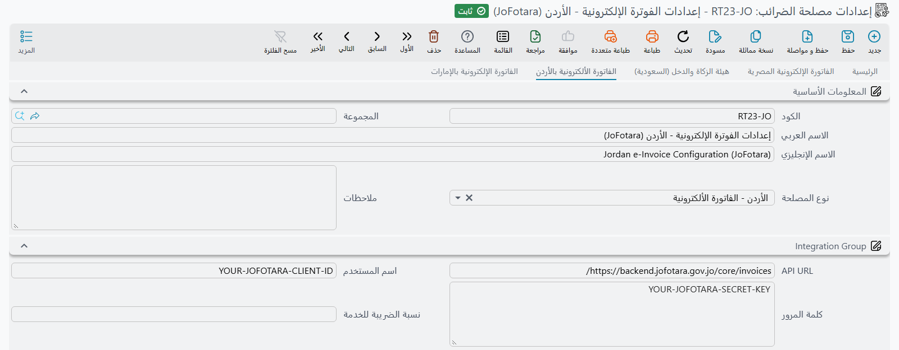

# التكامل مع «فوترة» الأردنية (JoFotara)

تدير دائرة ضريبة الدخل والمبيعات في الأردن منصة الفوترة الوطنية **JoFotara**. كل فاتورة مبيعات وكل مرتجع لا بد أن يصل إليها، وترد المنصة بأن تعيد إليك نسخة موقّعة من فاتورتك نفسها ومعها رمز الاستجابة السريعة الذي يُطبع على نسخة العميل. وهذه التفصيلة الأخيرة هي ما يجعل التعامل مع الأردن مريحًا: أنت لا توقّع شيئًا بنفسك، ولا يقف بينك وبين الدائرة مزوّد خدمة معتمد — إذ يرسل نظام نما إلى المنصة مباشرة.

أما كيفية تجميع الفواتير وفحصها وإرسالها فهي الآلية نفسها الموصوفة في [دليل الفوترة الإلكترونية](./e-invoices-guide.md)، فاقرأه أولًا. هذه الصفحة تتناول ما هو أردني بحت فقط.

## ما الذي يختلف في الأردن

بالمقارنة مع جيرانه، التكامل الأردني هو الأقصر.

| | كيف يعمل الأردن |
|---|---|
| **التسجيل الأولي** | لا يوجد. لا طلب شهادة، ولا كلمة مرور لمرة واحدة، ولا خطوة اعتماد. تنسخ بيانَي اعتماد من المنصة وتبدأ الإرسال. |
| **البيئات** | واحدة. لا توجد بيئة تجريبية أردنية للتمرّن — فنوع المصلحة الذي تختاره هو المنصة الحقيقية. |
| **التوقيع** | تتولاه المنصة. لا يوقّع نظام نما الفاتورة، ولا تظهر إجراءات التوقيع على مستند الإرسال الأردني. |
| **رمز الاستجابة السريعة** | تعيده المنصة مع الفاتورة المقبولة بدلًا من توليده محليًا. |
| **العملة** | الدينار الأردني دائمًا. |

## الاتصال بالمنصة

ابدأ بتفعيل صفحة الدولة. من **الإعدادات العامة**، الصفحة الثانية، اضبط **عرض صفحة الفاتورة الإلكترونية الخاصة بـ** على **الفاتورة الألكترونية بالأردن** (أو **كل الصفحات** إذا كنت تقدّم إقرارات في أكثر من دولة)، ثم نفّذ **إعادة توليد الواجهة (Regen UI)** حتى تظهر الصفحة.

بعد ذلك أنشئ **إعدادات مصلحة الضرائب** — *الأساسيات ← إعدادات مصلحة الضرائب ← إعدادات مصلحة الضرائب* — واضبط **نوع المصلحة** على **الأردن - الفاتورة الألكترونية**. اختيارُه يملأ لك **API URL** (`apiUrl`)؛ اتركه كما هو ما لم تنشر الدائرة عنوانًا جديدًا.

يعرّفك على المنصة بيانان، وكلاهما يأتي من حسابك على بوابة JoFotara:

| الحقل في صفحة الأردن | ما تضعه فيه |
|---|---|
| **اسم المستخدم** (`userName`) | معرّف العميل (Client Id) الصادر لمنشأتك من JoFotara |
| **كلمة المرور** (`password`) | المفتاح السري (Secret Key) المرتبط بذلك المعرّف |

يُرسَل هذان مع كل طلب، ولذلك فإن تغيير المفتاح السري على البوابة يجب أن يُحدَّث هنا في اليوم نفسه وإلا بدأ الإرسال يفشل.

::: warning لا توجد بيئة تجريبية للأردن
تمنحك السعودية ومصر مكانًا للتمرّن. الأردن لا يفعل — فنوع المصلحة الوحيد هو الحقيقي. تمرّن إذًا على عدد صغير من المستندات الحقيقية منخفضة القيمة التي تقبل أن تراها في سجلك الضريبي، ومرّر كل شيء على إجراء **التأكد من صحة المستندات** قبل أي إرسال.
:::

## من تكون أنت في نظر المنصة

يسأل الأردن عن البائع أقل بكثير مما تسأل عنه السعودية. فلا عنوان وطني يُستكمل ولا رقم مبنى يُلاحَق — إذ تحمل بيانات البائع الخارجة من نظامك اسمَ المنشأة ورقم تسجيلها الضريبي وبلدها فقط. وتغذّيها ثلاثة إعدادات:

- **حساب معرف الفرع من** (`branchIdDimension`) يحدد المحدِّد — شركة أو فرع أو قطاع وما إلى ذلك — الذي يُؤخذ سجلّه بوصفه مُصدِر الفاتورة. اسمه وبلده هما ما يسافر مع الفاتورة، فلا بد أن يكون سجلًا حقيقيًا مضبوط الدولة.
- **رقم التسجيل الضريبى** (`taxRegNo`) هو رقم ضريبة المبيعات لمنشأتك، ويُرسَل بوصفه المعرّف الضريبي للبائع.
- **نوع النشاط للفرع** (`activityType`) هو رمز نشاط الممول الذي صدر به تسجيلك. يطلبه الأردن ويُرسَل في كتلة مستقلة خاصة بالبائع مع كل فاتورة، ولذلك فإن خلوّ **نوع النشاط للفرع** هو أول ما ينبغي فحصه حين تبدأ المنصة برفض المستندات.

## من يكون العميل في نظر المنصة

تتحدد هوية المشتري من حقل **الكيان القانونى للشركة** في البيانات الضريبية للعميل، ويترجمها نظام نما إلى نظام الهوية الذي تتوقعه JoFotara:

| الكيان القانوني للعميل | الهوية المُرسَلة | القيمة مأخوذة من |
|---|---|---|
| **جهة حكومية** أو **قطاع خاص** | الرقم الضريبي | **رقم التسجيل الضريبى** لدى العميل |
| **فرد** | الرقم الوطني | **رقم البطاقة الشخصيه** لدى العميل |
| **اجنبي**، أو متروك فارغًا | رقم جواز السفر | **رقم البطاقة الشخصيه** لدى العميل |

والنتيجة العملية أن حقل الكيان القانوني ليس حقلًا تجميليًا في الأردن. فعميل مؤسسي تُرك كيانه **فرد** يُهمَل رقمه الضريبي ويُرسَل رقم بطاقته الشخصية بدلًا منه، وهو ما لن تستطيع المنصة مطابقته بأي ممول مسجَّل.

وفيما عدا الهوية، لا يُرسَل عن المشتري سوى الاسم والرمز البريدي والمحافظة والدولة.

## ما الذي يقبله الأردن

| المستند | مدعوم |
|---|---|
| الفاتورة | نعم |
| المرتجع (إشعار دائن) | نعم |
| الإشعار المدين | لا |

كل ما يرسله نظام نما إلى JoFotara هو **فاتورة ضريبة المبيعات العامة** — أي الفاتورة التجارية المعتادة — ويُرسَل المرتجع بوصفه إشعارًا دائنًا مقابلها. ولا بد أن يحمل المرتجع إشارة راجعة إلى الفاتورة التي يعكسها: رقمها ومعرّفها الفريد وإجماليها الأصلي. ويملأ الإرسال هذه البيانات من ارتباط المستند المصدر بالفاتورة التي أُنشئ منها، ومن ثَم فإن مرتجعًا أُنشئ بلا هذا الارتباط لا يجد ما يشير إليه.

::: warning الإشعارات المدينة لا تذهب إلى الأردن
لا وجود للإشعار المدين في JoFotara. فإذا جُمِّع مستند معرَّف كإشعار مدين ضمن إعدادات أردنية توقّف الإرسال وأخبرك بذلك. صحّح موقف العميل بمرتجع وفاتورة جديدة بدلًا من ذلك.
:::

## القيم والعملة والضريبة

تُعبَّر كل قيمة في الفاتورة الأردنية بـ**الدينار الأردني** أيًّا كانت عملة المستند المصدر. وحين تختلف العملتان يحوّل نظام نما أرقام المستند بالسعر المحفوظ على المستند نفسه، فتصل المنصةَ فاتورةٌ متسقة حسابيًا بالدينار لا مزيجًا من عملتين.

أما الضريبة فتُوصَف كما يصفها بقية عالم UBL: يحمل كل سطر فئته الضريبية ونسبتها وفق قائمة الفئات الأممية، وتحمل الضريبة نفسها نوعها وفق قائمة أنواع الضرائب الأممية. وأيُّ خانة من خانات الضريبة الأربع تقابل أيَّ رمز فيُضبط في مجموعات الضرائب على صفحة الإعدادات، تمامًا كما في بقية الدول. والخصوصية الأردنية الوحيدة أن **السطر المعفى أو ذا النسبة الصفرية يُرسَل تحت الفئة `Z`**، فهذا ما تربط به ضريبةً صفرية.

ويستحق **عدد كسور الكمية** (`quantityFractionalPlaces`) نظرة قبل الانطلاق. فالأردن يتحقق من أن سعر الوحدة مضروبًا في الكمية ينتج فعلًا إجمالي السطر، بعدد الخانات العشرية الذي أعلنته هنا. فإذا كانت أسعارك تحمل دقة أكبر مما أعلنت، لن تطابق العمليةُ الحسابية التي تجريها المنصة الإجمالياتِ التي أرسلتَها.

::: tip اسم الصنف في السطر هو كود الصنف
لا تطلب JoFotara كودًا مسجَّلًا للصنف كما تفعل مصر — بل تعرّف البضاعة في كل سطر باسم. ويملأ نما هذا الاسم من إعدادات كود الصنف، **حساب الكود الضريبي للصنف من** (`itemCodeFrom`) و**قالب كود الصنف** (`itemCodeTemplate`)، لا من قالب الوصف. وهو افتراضيًا **كود مصلحة الضرائب** في الصنف، أو كود الصنف إن كان فارغًا. ولترسل اسمًا يفهمه القارئ، اجعل **حساب الكود الضريبي للصنف من** = **من قالب كود الصنف** وابنِ الاسم في **قالب كود الصنف**.
:::

## بقية صفحة الأردن

تغطي الأقسام السابقة ما هو أردني. أما بقية حقول الصفحة فتعمل كما في كل دولة:

| الحقل | معرّف الحقل | ماذا يفعل |
|---|---|---|
| **حقول رسوم الخدمة**، **رسوم الخدمة شاملة الضريبة**، **نسبة الضريبة للخدمة**، **استبعاد رسوم الخدمة الغير معرفة** | `chargesFeeFields`، `chargesFeeIncludeTax`، `chargesFeeTaxPercent`، `excludeServiceFeesWithNoConfigs` | طريقة إرسال رسوم الخدمة رسمًا على الفاتورة كلها. تعمل كما في السعودية — انظر قسم «رسوم الخدمة المرسلة رسمًا على المستند» في [دليل الهيئة](./zatca-guide.md). |
| **مصدر سعر الوحدة**، **نوع مصدر سعر الوحدة** | `unitPriceSource`، `unitPriceType` | الخطوة التي يُقرأ منها سعر الوحدة في حساب السطر. انظر قسم «سعر الوحدة والكميات والتقريب» في [الدليل العام](./e-invoices-guide.md). |
| **تجاهل وتقريب القيمة إذا كان عدد خانات الكسر أكبر من المسموح به** | `ignoreAndRoundAmountIfScaleIsInvalid` | يقرّب سعر الوحدة الزائد الدقة بدلًا من إيقاف المستند. القسم نفسه. |
| **اقصي عدد للسطور عند تجميع مستندات الضرائب** | `maxNumberOfLinesWhenCollectTaxAuthDocs` | عدد السطور التي يجوز أن يجمعها التجميع الواحد. القسم نفسه. |
| **لا ترسل مكونات الأصناف المجمعة** | `dontSendAssemblyComponentLines` | يرسل الصنف المجمَّع سطرًا واحدًا بدلًا من مكوناته. |
| **حساب اكواد أنواع الضرائب من** | `taxCodesType` | المصدر الذي يُقرأ منه نوع كل ضريبة وفئتها: هذه الصفحة (الافتراضي)، أو السياسة الضريبية في التوجيه أو الصنف أو العميل. |
| مجموعات *الضريبة 1*–*الضريبة 4* | `taxesCodes.tax1TaxAuthType`، `taxesCodes.tax1TaxAuthSubType`، وهكذا | نوع الضريبة وفئتها المرسلان لكل خانة ضريبة. والزوج *الصفري* (`taxesCodes.tax1ZeroTaxAuthType`، `taxesCodes.tax1ZeroTaxAuthSubType`) يُرسل بدلًا منهما حين تكون الضريبة في السطر صفرًا. و**إرسال الضريبة N بصفر** (`taxesCodes.sendTax1WithZero`) يرسل الضريبة بنسبة صفر وقيمة صفر. و**عدم إرسال ضريبة N عند عدم وجود أكواد لها** (`doNotSendTax1IfNoCode`) يُسقط الخانة التي لا أكواد لها. |
| جدول **مصادر أكواد الضرائب** | `taxCodesSource` | يتجاوز **حساب اكواد أنواع الضرائب من** لأنواع مستندات أو دفاتر أو توجيهات أو معايير أو تواريخ فعلية أو محددات بعينها. وأول سطر يطابق هو المعتمد. |
| **أقصي عدد أيام لإرسال الفواتير** | `maxDaysToSendInvoice` | أقصى عمر للمستند ليظل قابلًا للإرسال؛ 3 أيام إذا تُرك فارغًا. وما دام دفتره أو توجيهه يرسل إلى JoFotara فلا يمكن حفظ مستند أقدم، والمستند الذي يتجاوز الحد لا يُجمَّع بعد ذلك. |
| **بدء الإرسال من تاريخ** | `startSendingFromDate` | المستندات المؤرخة قبل هذا اليوم لا تُرسل أبدًا. |
| **عدد الأيام للسماح بإنشاء مستندات مستقبلية** | `futureDaysToAllowSaveDoc` | كم يومًا للأمام يجوز أن يؤرَّخ مستند يذهب إلى JoFotara. والصفر يعني لا يجوز. |
| جدول **إعدادات الخصومات** | `discountConfigs` | يرسل الخصم قبل الضريبة أو بعدها أو لا يرسله، لكل خصم على حدة. انظر قسم «إعدادات الخصومات» في [الدليل العام](./e-invoices-guide.md). |

وستة حقول في الصفحة لا تؤثر في الفاتورة الأردنية: **تشغيل قالب وصف الصنف على (اسم 1 للصنف افتراضيا)**، و**قالب الوصف**، و**تشغيل قالب كود نما على (كود الصنف افتراضيا)**، و**قالب كود نما**، و**اقصي عدد حروف لكود الصنف الداخلي**، و**موقع الخصم الإضافي على مستوى المستند**. وجدول رسوم الخدمة في صفحة **الرئيسية** ينطبق كذلك — انظر قسم «معاملة رسوم الخدمة و ما يتحمله العميل» في [الدليل العام](./e-invoices-guide.md).

## الإرسال، وما يعود منه

يسير الإرسال نفسه بالتسلسل المعتاد على **إرسال مستندات الي مصلحة الضرائب**: **تجميع مستندات الضرائب**، ثم **التأكد من صحة المستندات**، ثم **إرسال المستندات المختارة فقط** أو **إرسال المستندات التي لم تُرسل**. أما إجراءات التوقيع وفحص الحالة فغائبة عمدًا — ففي الأردن لا شيء يُوقَّع ولا شيء يُستعلَم عنه لاحقًا، لأن المنصة تحسم الأمر وتردّ في المكالمة نفسها.

حين تقبل المنصة مستندًا تهبط ثلاثة أشياء على سطره:

| العمود | ما يحمله |
|---|---|
| **حالة المستند بمصلحة الضرائب** | حالة المنصة نفسها للفاتورة المقبولة |
| **Signed Invoice Base 64** | النسخة الموقّعة من فاتورتك كما أعادتها JoFotara |
| **Qr Code Base 64** | رمز الاستجابة السريعة الذي يُطبع على نسخة العميل |

وتصير حالة السطر **تم ارساله**.

وحين ترفض، تصير حالة السطر **لم يتم ارساله بشكل صحيح** ويُكتب شرح المنصة في **اخطاء المستند من مصلحة الضرائب** — وغالبًا يكون أكثر من رسالة، رسالة لكل قاعدة لم تتحقق. صحّح المستند المصدر لا سطر الإرسال، ثم أعد التجميع وأعد الإرسال. ويبقى الرفض مسجَّلًا على مستند الإرسال، فلا يضيع شيء بالمحاولة.

::: tip كل فاتورة تحمل رقمًا تسلسليًا
يتوقع الأردن أن تشكّل فواتير المنشأة الواحدة تسلسلًا واحدًا غير منقطع، ولذلك يختم كل إرسال الفاتورةَ بالرقم التالي في هذا التسلسل وهي خارجة. والعدّاد ملك لسجل الإعدادات ويُحفَظ لك — لا شيء تضبطه. غير أن ذلك يعني أن إعدادات ثانية أُنشئت للمنشأة نفسها ستبدأ العدّ من أوله، ومن هنا ينبغي أن يكون للمنشأة الواحدة سجل إعدادات أردني واحد لا غير.
:::
