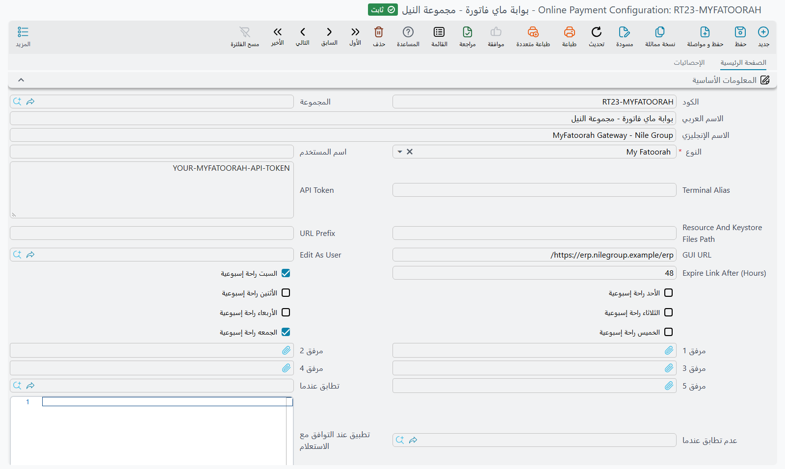

# تكامل المدفوعات الإلكترونية (Online Payments Integration)

وحدة المدفوعات الإلكترونية في نما تتيح لك قبول المدفوعات مباشرةً من عملائك عبر بوابات دفع آمنة (KNet وMyFatoorah وجيديا)، وعبر فواتير سداد من GoPay في السعودية. سواء كنت ترسل رابط دفع لفاتورة واحدة أو تُنشئ مئات روابط الدفع للأرصدة المستحقة، تُدير هذه الوحدة العملية كاملةً من إنشاء الرابط وحتى تأكيد الدفع وإنشاء سند القبض تلقائيًا.

## فهم مسار الدفع (Understanding the Payment Flow)

عندما ينقر العميل على رابط الدفع، إليك ما يجري خلف الكواليس:

1. **التحقق من الرابط (Link Validation)** - يتحقق النظام من صلاحية الرابط (لم تنته مدته) ومن أن المستند لا يزال يستلزم الدفع
2. **عرض صفحة الدفع (Payment Page Display)** - يرى العميل صفحة دفع مخصصة تعرض المبلغ المستحق وتفاصيل المستند
3. **إعادة التوجيه للبوابة (Gateway Redirect)** - عند الاستعداد للدفع، يُعاد توجيه العميل إلى بوابة الدفع (KNet أو MyFatoorah). أما جيديا فتعمل بطريقة مختلفة: يفتح الرابط صفحة جيديا نفسها (راجع [جيديا](#jydy-Geidea))
4. **معالجة الدفع (Payment Processing)** - تعالج البوابة الدفع وتُعيد النتيجة
5. **معالجة النجاح (Success Handling)** - عند نجاح الدفع، يمكن لنما تلقائيًا تشغيل مسارات كيان وإضافة الدفعة إلى المستند وإنشاء سندات قبض
6. **صفحة التأكيد (Confirmation Page)** - يرى العميل صفحة نجاح أو خطأ مع تفاصيل المعاملة

## بوابات الدفع المدعومة (Supported Payment Gateways)

### KNet (الكويت)

KNet هي شبكة الدفع الوطنية في الكويت. للتكامل مع KNet، ستحتاج إلى:

| الحقل | معرّف الحقل | الوصف |
|-------|----------|-------------|
| **اسم المستخدم** (User Name) | `userName` | معرّف بوابة KNet الخاصة بك (tranportal ID) |
| **Terminal Alias** | `terminalAlias` | الاسم المستعار المخصص لطرفيتك من KNet |
| **GUI URL** | `guiUrl` | العنوان العام لخادمك الذي ستُستقبل عليه استجابات الدفع |
| **URL Prefix** | `urlPrefixIdentifier` | معرّف فريد لروابط الدفع الخاصة بك (مثل "mycompany") |
| **Resource And Keystore Files Path** | `resourceAndKeystoreFilesPath` | مسار الخادم الذي يحتوي على ملفي `resource.cgn` و`keystore.bin` من KNet |

::: warning هام
يتطلب KNet وجود ملفَّي شهادة (`resource.cgn` و`keystore.bin`) يجب وضعهما على خادمك. يتم توفير هذين الملفين من KNet أثناء تسجيل التاجر وتحتوي على مفاتيح التشفير الخاصة بك.
:::

### MyFatoorah

MyFatoorah بوابة دفع شائعة في منطقة الشرق الأوسط تدعم طرق دفع متعددة منها البطاقات وApple Pay وخيارات الدفع المحلية.

| الحقل | معرّف الحقل | الوصف |
|-------|----------|-------------|
| **API Token** | `apiToken` | رمز API الخاص بك في MyFatoorah من لوحة تحكم التاجر |
| **GUI URL** | `guiUrl` | العنوان العام لخادمك لاستقبال استجابات الدفع |

MyFatoorah أسهل في الإعداد إذ تستخدم المصادقة عبر API بدلًا من ملفات الشهادات.

### جيديا (Geidea)

جيديا جهة تحصيل بطاقات في السعودية والإمارات ومصر. وبخلاف KNet وMyFatoorah لا يدفع العميل في صفحة من نما: يطلب نما من جيديا رابط دفع، وتستضيف جيديا صفحة الدفع، ثم يسأل نما جيديا هل دُفع الرابط.

| الحقل | معرّف الحقل | الوصف |
|-------|----------|-------------|
| **اسم المستخدم** (User Name) | `userName` | المفتاح العام للتاجر (merchant public key) لدى جيديا. مطلوب. |
| **API Token** | `apiToken` | كلمة سر الـ API التي أصدرتها جيديا مع ذلك المفتاح. مطلوب. |
| **رابط الـ API الأساسي** (API Base URL) | `apiBaseUrl` | اتركه فارغًا ليختار نما عنوان جيديا من عملة المستند: الريال السعودي إلى المنصة السعودية، والدرهم إلى منصة الإمارات، والجنيه المصري إلى المنصة المصرية، وتُرفض أي عملة أخرى. ولا تملأه إلا لاستعمال عنوان آخر، كبيئة اختبار أعطتك إياها جيديا. |
| **أقل مبلغ للدفع** / **أقصى مبلغ للدفع** | `minPaymentAmount`، `maxPaymentAmount` | نطاق المبالغ التي يرسلها نما إلى جيديا. الفارغ أو الصفر يعني بلا حد من تلك الجهة. والمبلغ الصفري أو السالب مرفوض دائمًا. |
| **GUI URL** | `guiUrl` | العنوان العام لخادمك. تستدعيه جيديا حين يُدفع الرابط، لكن فقط إن كان عنوان `https` عامًا؛ أما على خادم محلي أو `http` عادي فيعرف نما بالدفعات بسؤال جيديا (راجع [تحصيل الدفعات عبر جيديا](#tHSyl-ldfaat-aabr-jydy-Taking-payments-with-Geidea)). |

يُحفظ إعداد جيديا دون مسار كيان للنجاح ودون طريقة دفع، لأن زر الفاتورة ونقاط البيع يحصّلان الدفعة قبل حفظ المستند. أما الروابط المرسلة لمستندات محفوظة فتطبّق الدفعة عبر [إجراءات الدفع](#jrt-ldfaa---tmt-syr-laaml-baad-ldfaa-Payment-Actions---Automating-Post-Payment-Workflows)، فاملأها إن كنت تستعمل الروابط.

## إعداد تكوين المدفوعات الإلكترونية (Setting Up Online Payment Configuration)

انتقل إلى **Basic > Documents > Online Payment Configuration** لإنشاء إعدادات بوابة الدفع.

### الإعداد الأساسي (Basic Setup)

1. **أنشئ تكوينًا جديدًا** وأعطه رمزًا دالًا (مثل "KNET-MAIN" أو "MYFATOORAH-PROD")
2. **اختر النوع (Type)** (`type`) - اختر K-Net أو My Fatoorah أو جيديا
3. **أدخل بيانات اعتماد البوابة** بحسب مزودك (راجع الحقول أعلاه)
4. **حدد GUI URL** (`guiUrl`) - وهو عنوان خادمك العام، مثل `https://yourcompany.com/erp/`
5. **Edit As User** (`editAsUser`) - المستخدم الذي يعمل نما باسمه حين يحدّث رد KNet المستند. وإن تُرك فارغًا استُعمل المستخدم `admin`.



### إعدادات انتهاء صلاحية الروابط (Link Expiration Settings)

روابط الدفع لا تبقى صالحة إلى الأبد. يمكنك التحكم في مدة صلاحيتها:

- **Expire Link After (Hours)** (`expireLinkAfter`) - عدد الساعات قبل انتهاء صلاحية الرابط. إذا تُرك فارغًا، تنتهي صلاحية الروابط بعد سنة.

النظام ذكي في حساب الانتهاء - يمكنه تجاهل عطل نهاية الأسبوع والإجازات عند الحساب. اضبط ذلك باستخدام:

- **أيام الراحة الأسبوعية** (`saturdayIsWeekend` … `fridayIsWeekend`) - حدد أي الأيام هي إجازات الأسبوع (الجمعة/السبت لدول الخليج، السبت/الأحد في مناطق أخرى)
- **العٌطلات الرسمية** (`holidays`: `holidays.holidayDate`، `holidays.remarks`) - أضف تواريخ محددة يجب استبعادها من حسابات الانتهاء

على سبيل المثال، إذا ضبطت "انتهاء الصلاحية بعد 24 ساعة" والجمعة/السبت إجازة أسبوعية، فإن رابطًا أُنشئ الخميس الساعة 10 صباحًا لن تنتهي صلاحيته إلا الأحد الساعة 10 صباحًا (متجاوزًا الجمعة والسبت).

### قوالب الدفع (Payment Templates)

تتحكم القوالب فيما يراه عملاؤك في كل مرحلة من مراحل الدفع. يدعم كل قالب عناصر نائبة ديناميكية تُستبدل بقيم المستند الفعلية.

| القالب | معرّف الحقل | متى يُعرض |
|----------|----------|-----------------|
| **نموذج الدفع** (Payment Template) | `paymentActions.paymentTemplate` | صفحة الدفع الأولية التي تعرض تفاصيل الفاتورة وزر "Pay Now" |
| **Success Template** | `paymentActions.successTemplate` | يُعرض بعد نجاح الدفع |
| **Error Template** | `paymentActions.errorTemplate` | يُعرض عند فشل الدفع أو رفضه |
| **Bad Transaction Template** | `paymentActions.badTransactionTemplate` | يُعرض عند عدم الموافقة على المعاملة |
| **Expired Link Template** | `paymentActions.expiredLinkTemplate` | يُعرض عند النقر على رابط منتهي الصلاحية |
| **Totally Paid Template** | `paymentActions.totallyPaidTemplate` | يُعرض عند سداد الفاتورة بالكامل مسبقًا |
| **Not Found Document Template** | `paymentActions.notFoundDocumentTemplate` | يُعرض عند عدم وجود المستند |
| **Type Not Supported For Payment Template** | `paymentActions.typeNotSupportedForPaymentTemplate` | يُعرض عندما لا يدعم نوع المستند المدفوعات الإلكترونية |

::: tip تحميل القوالب الافتراضية
انقر على زر **"Calculate Default Templates"** لتحميل قوالب HTML الافتراضية للنظام. يمكنك بعد ذلك تخصيصها لتتناسب مع هوية علامتك التجارية.
:::

### استخدام العناصر النائبة في القوالب (Using Placeholders in Templates)

تدعم القوالب محرك قوالب نما. يمكنك تضمين حقول المستند باستخدام الأقواس المعقوفة:

```html
<h2>Invoice #{code}</h2>
<p>Amount Due: {currency.code} {netTotal}</p>
<p>Customer: {customer.name1}</p>
```

بعد الدفع، يمكنك أيضًا الوصول إلى استجابة الدفع:

```html
<p>Transaction ID: {opResponse.transId}</p>
<p>Authorization: {opResponse.auth}</p>
<p>Amount Paid: {opResponse.amt}</p>
<p>Date: {opResponse.date}</p>
```

#### مرجع خريطة استجابة الدفع (`$map.opResponse`)

كائن `opResponse` متاح في القوالب (عبر `{$map.opResponse.fieldName}`) وفي مسارات الكيان (عبر `x=$map.opResponse.fieldName`). الحقول المتاحة تختلف باختلاف بوابة الدفع:

::: details حقول استجابة KNet (انقر للتوسيع)
```json
{
  // Core Transaction Data
  "result": "CAPTURED",           // Transaction result (CAPTURED, NOT CAPTURED, etc.)
  "amt": "150.000",               // Transaction amount
  "auth": "123456",               // Authorization code from bank
  "ref": "789012345678",          // Reference number
  "transId": "1234567890123456",  // Transaction ID
  "paymentId": "12345678901234",  // Payment ID
  "trackId": "9876543210",        // Your tracking ID
  "date": "01/15/2025 14:30:00",  // Transaction date/time

  // Card Information
  "card": "************1234",     // Masked card number
  "type": "VISA",                 // Card type (VISA, MASTERCARD, etc.)
  "member": "CARDHOLDER NAME",    // Cardholder name
  "expMonth": "12",               // Card expiry month
  "expYear": "2027",              // Card expiry year

  // Currency & Amount
  "currency": "414",              // Currency code (414 = KWD)
  "convertedCrncyCD": "",         // Converted currency code (if applicable)

  // User Defined Fields
  "udf1": "",                     // Custom field 1
  "udf2": "",                     // Custom field 2
  "udf3": "",                     // Custom field 3
  "udf4": "",                     // Custom field 4
  "udf5": "",                     // Custom field 5
  "custid": "",                   // Customer ID

  // 3D Secure / Authentication
  "eci": "",                      // Electronic Commerce Indicator
  "cavv": "",                     // Cardholder Authentication Verification Value
  "xid": "",                      // 3D Secure transaction ID
  "authStatus": "",               // Authentication status
  "enrolmntStatus": "",           // 3D Secure enrollment status

  // Error Information
  "error": "",                    // Error code
  "error_text": "",               // Error description
  "errorMessage": "",             // Combined error message (on failure)

  // Response Codes
  "responseCode": "",             // Gateway response code
  "avr": "",                      // Address verification result
  "cvv2Verification": "",         // CVV2 verification result

  // Additional Technical Fields
  "action": "1",                  // Action type (1 = Purchase)
  "language": "en",               // Language code
  "responseURL": "",              // Callback URL
  "errorURL": "",                 // Error callback URL
  "alias": "",                    // Terminal alias
  "tranportalId": "",             // Tranportal ID
  "rawResponse": ""               // Raw response from gateway
}
```
:::

::: details حقول استجابة MyFatoorah (انقر للتوسيع)
```json
{
  // Core Transaction Data (Success)
  "amt": "150.000",               // Paid amount
  "date": "15/01/2025",           // Transaction date
  "paymentId": "07012345678901",  // MyFatoorah payment ID
  "transId": "1234567890123456",  // Transaction ID
  "ref": "REF123456",             // Reference ID
  "auth": "AUTH123",              // Authorization ID

  // Error Information (Failure)
  "errorMessage": "MF002: Bank declined" // Error message with code
}
```

**رموز أخطاء MyFatoorah في `errorMessage`:**
- `MF001` - فشل مصادقة 3DS
- `MF002` - رفض البنك (رصيد غير كافٍ، بطاقة غير صالحة)
- `MF003` - حجب بوابة الدفع (كشف الاحتيال)
- `MF004` - رصيد غير كافٍ
- `MF005` - انتهت مهلة الجلسة
- `MF006` - إلغاء المعاملة
- `MF007` - انتهت صلاحية البطاقة
- `MF008` - جهة إصدار البطاقة لا تستجيب
- `MF009` - رفض من إدارة المخاطر
- `MF010` - رمز CVV غير صحيح
- `MF020` - فشل غير محدد
:::

#### الاستخدام في مسارات الكيان (Using in Entity Flows)

عند ضبط مسارات الكيان التي تعمل بعد الدفع (Success Entity Flow أو Error Entity Flow)، يمكنك الوصول إلى هذه القيم باستخدام المتغير `$map`:

```
// In entity flow parameter expressions:
x=$map.opResponse.auth           // Get authorization code
x=$map.opResponse.amt            // Get paid amount
x=$map.opResponse.transId        // Get transaction ID
x=$map.opResponse.errorMessage   // Get error message (on failure)
```

### إجراءات الدفع - أتمتة سير العمل بعد الدفع (Payment Actions - Automating Post-Payment Workflows)

هنا تكمن القوة الحقيقية. عند نجاح الدفع (أو فشله)، يمكنك تشغيل إجراءات تلقائية في النظام.

| الحقل | معرّف الحقل | الغرض |
|-------|----------|---------|
| **On Success Entity Flow** | `paymentActions.successEntityFlow` | مسار كيان يعمل بعد نجاح الدفع (مثل تعليم الفاتورة مدفوعة، تغيير الحالة، إرسال إشعار) |
| **On Error Entity Flow** | `paymentActions.errorEntityFlow` | تشغيل هذا المسار عند فشل الدفع |
| **طريقة الدفع** (Payment Method) | `paymentActions.paymentMethod` | إضافة سطر دفع للمستند تلقائيًا باستخدام هذه الطريقة |
| **تطابق عندما** / **عدم تطابق عندما** | `paymentActions.entityWhenMatched`، `paymentActions.entityWhenNotMatched` | قصر إجراءات الرأس على المستندات التي تطابق (أو لا تطابق) تعريف معايير |
| **تطبيق عند التوافق مع الاستعلام** / **منع التطبيق عند التوافق مع الاستعلام** | `paymentActions.applyWhenQuery`، `paymentActions.doNotApplyWhenQuery` | الشيء نفسه باستعلام |

**طريقة الدفع** مفيدة بشكل خاص - عند تعيينه، يضيف النظام تلقائيًا دفعة على الفاتورة عند نجاح الدفع الإلكتروني، مما قد يُشغّل إنشاء سند القبض إذا تم تكوينه.

### إجراءات الدفع الشرطية (Conditional Payment Actions)

أحيانًا تحتاج إلى سلوكيات مختلفة بحسب نوع المستند أو شروط معينة. مجموعة **Details** تتيح إنشاء قواعد شرطية:

| الحقل | معرّف الحقل | الغرض |
|-------|----------|---------|
| **للنوع** (For Type) | `details.forType` | تطبيق هذه القاعدة فقط على نوع مستند محدد (مثل فاتورة مبيعات، أمر مبيعات) |
| **قائمة الأنواع** (Entity Type List) | `details.entityTypeList` | أو تطبيقها على أنواع مستندات متعددة من قائمة محددة مسبقًا |
| **تطبيق عند التوافق مع الاستعلام** | `details.paymentActions.applyWhenQuery` | شرط استعلام يجب أن يكون صحيحًا لتطبيق هذه القاعدة |
| **منع التطبيق عند التوافق مع الاستعلام** | `details.paymentActions.doNotApplyWhenQuery` | تجاهل هذه القاعدة عند تحقق هذا الشرط |

لكل سطر تفاصيل إجراءات دفع خاصة به (`details.paymentActions.*`: المعايير، ومسارا النجاح والخطأ، وطريقة الدفع، والقوالب الثمانية)، بحيث يمكنك وضع مسارات نجاح وطرق دفع وقوالب مختلفة لسيناريوهات مختلفة.

**مثال:** قد ترغب في:
- فواتير المبيعات تُشغّل مسار "Mark as Paid" وترسل بريدًا إلكترونيًا
- أوامر المبيعات تُشغّل مسار "Confirm Order" وترسل بريدًا إلكترونيًا مختلفًا
- الفواتير ذات القيمة العالية (أكثر من 1000) ترسل إشعارًا إضافيًا لمدير المبيعات

### تعيين الحقول (Fields Mapping - KNet)

لتكامل KNet، يمكنك تمرير بيانات إضافية إلى بوابة الدفع باستخدام حقول User Defined Fields (UDF1-UDF5) ومعرّف العميل:

| نوع الحقل | الوصف |
|------------|-------------|
| **UDF1 - UDF5** | حقول مخصصة تظهر في تقارير التسوية الخاصة بك في KNet |
| **CustomerId** | معرّف العميل للمعاملة |

الجدول هو **قوالب قيم الحقول** (`fieldsMapLines`)؛ اختر حقل البوابة في **الحقل** (`fieldsMapLines.field`). وعمود **قالب القيمة** (`fieldsMapLines.valueTemplate`) يدعم العناصر النائبة، بحيث يمكنك تعبئة هذه الحقول ديناميكيًا:

```
{customer.code}
{code}
{netTotal}
```

### إعداد مصدر الفرع (Subsidiary Source Configuration)

عند استخدام **Payment Links Creation Document** لإنشاء الروابط بالجملة، تحتاج إلى إخبار النظام بالحقل الذي يحتوي على العميل/الفرع لكل نوع مستند:

| الحقل | معرّف الحقل | الغرض |
|-------|----------|---------|
| **النوع** (Entity Type) | `paymentLinksCreationDocSubsidiarySourceLines.entityType` | نوع المستند (مثل SalesInvoice) |
| **Field ID** | `paymentLinksCreationDocSubsidiarySourceLines.fieldId` | الحقل الذي يحتوي على مرجع الذمة (مثل `customer`) |

يُستخدم هذا التعيين عند تجميع الفواتير حسب العميل لإنشاء روابط الدفع بالجملة.

## إنشاء روابط الدفع (Generating Payment Links)

هناك طريقتان لإنشاء روابط الدفع:

### الطريقة الأولى: إنشاء الرابط المباشر (Method 1: Direct Link Generation)

للمستندات التي تدعم المدفوعات الإلكترونية (مثل فواتير المبيعات)، يمكنك إنشاء رابط دفع مباشرةً. يُنشئ النظام عنوان URL مشفرًا يحتوي على:
- معرّف تكوين الدفع
- نوع المستند ومعرّفه
- طابع وقت الانتهاء

صيغة URL تبدو مثل: `https://yourserver.com/erp/op/prefix/ENCRYPTED_DATA`

::: tip إنشاء الروابط تلقائيًا عبر مسارات الكيان
يمكنك إنشاء روابط دفع KNet تلقائيًا باستخدام مسار الكيان **EAGenerateKNetPaymentURLs**. هذا مفيد عندما تريد إنشاء روابط الدفع كجزء من سير عمل آلي (مثل عند اعتماد فاتورة). يُنشئ المسار عناوين URL مباشرة للبوابة وعناوين إعادة توجيه، ويخزنها في حقول المستند المحددة. راجع [توثيق EAGenerateKNetPaymentURLs](../../../entity-flows/core/EAGenerateKNetPaymentURLs.md) للاطلاع على المعاملات وتفاصيل الإعداد.
:::

### الطريقة الثانية: روابط الدفع بالجملة (Method 2: Bulk Payment Links)

انتقل إلى **Basic > Documents > Payment Links Creation Document** للإنشاء بالجملة.

تتيح هذه الأداة القوية:
1. تصفية المستندات حسب النوع والنطاق الزمني والدفتر والتوجيه أو الفترة
2. إيجاد الفواتير التي تستحق أقساطها خلال عدد محدد من الأيام
3. تجميع المبالغ حسب العميل
4. إنشاء روابط الدفع لجميع العملاء المحددين مرة واحدة

#### استخدام مستند إنشاء روابط الدفع (Using the Payment Links Creation Document)

1. **اختر نوع المستند (Select Document Type)** - اختر فاتورة مبيعات أو أمر مبيعات أو فاتورة مشتريات متنوعة
2. **حدد المعايير (Set Filters)** - حدد نطاقات التواريخ والدفاتر والتوجيهات أو الفترات لتضييق نطاق المستندات
3. **فلتر الأيام المتبقية (Remaining Days Filter)** - ابحث عن الأقساط المستحقة خلال X من الأيام
4. **انقر "Collect Docs"** - يبحث النظام عن المستندات المطابقة ويجمعها حسب العميل
5. **راجع التفاصيل (Review the Details)** - اطلع على الفواتير/الأقساط الفردية في تبويب التفاصيل
6. **راجع سطور الروابط (Review Link Lines)** - اطلع على المبالغ المجمعة لكل عميل مع بيانات التواصل
7. **احفظ وأنشئ الروابط (Save and Create Links)** - انقر "Create Payment Links" لإنشاء روابط لجميع العملاء

يقوم النظام تلقائيًا بـ:
- تجميع الفواتير حسب العميل
- سحب بيانات تواصل العميل (البريد الإلكتروني، الجوال)
- إنشاء روابط دفع فردية لكل عميل
- تخزين الروابط للرجوع إليها لاحقًا

#### حقول سطور الروابط (Link Lines Fields)

| الحقل | معرّف الحقل | الوصف |
|-------|----------|-------------|
| **الذمة** (Subsidiary) | `linksLines.subsidiary` | العميل/المورد |
| **إسم العميل** | `linksLines.customerName` | يُملأ تلقائيًا من الذمة |
| **الإيميل** | `linksLines.customerEmail` | البريد الإلكتروني لتسليم رابط الدفع |
| **كود الدولة** | `linksLines.customerMobileCountryCode` | رمز الدولة لتسليم الرسائل النصية |
| **رقم الموبايل** | `linksLines.customerMobileNumber` | رقم الهاتف لتسليم الرسائل النصية |
| **مرجع العميل** | `linksLines.customerReference` | مرجعك الخاص للعميل، يُمرَّر إلى MyFatoorah مع الرابط |
| **القيمة** | `linksLines.value` | إجمالي المبلغ المطلوب تحصيله |
| **رابط الدفع** | `linksLines.paymentLink` | الرابط المُنشأ (بعد النقر على "Create Payment Links") |

#### خيارات الإشعارات (MyFatoorah) (Notification Options)

يمكن لـ MyFatoorah إرسال رابط الدفع تلقائيًا للعملاء:
- **LNK** - إنشاء الرابط فقط (بدون إرسال تلقائي)
- **EML** - الإرسال عبر البريد الإلكتروني
- **SMS** - الإرسال عبر الرسائل النصية
- **ALL** - الإرسال عبر البريد الإلكتروني والرسائل النصية معًا

يختار النظام تلقائيًا الخيار المناسب بناءً على حقول التواصل التي تقدمها.

## تتبع المعاملات (Transaction Tracking)

كل محاولة دفع تُسجَّل في **Online Payment Transaction System Entry**. يتتبع هذا السجل:

| الحقل | الوصف |
|-------|-------------|
| **Document** | الفاتورة/الأمر المدفوع |
| **Online Payment Config** | تكوين الدفع المستخدم |
| **Track ID / Invoice ID** | معرّف معاملة البوابة |
| **Transaction Status** | الحالة الحالية (Initial, Captured, Paid, إلخ) |
| **Paid Amount** | المبلغ المدفوع |
| **Authorization Number** | رمز ترخيص البنك |
| **Transaction ID** | معرّف معاملة البوابة |
| **Reference** | مرجع إضافي من البوابة |
| **Link Status** | هل الرابط صالح أم مدفوع أم منتهي الصلاحية |

## إنشاء سند القبض تلقائيًا (Automatic Receipt Voucher Creation)

حين يدفع العميل رابطًا من **مستند إنشاء روابط الدفع**، يستطيع نما إنشاء سندات القبض للمستندات التي غطاها الرابط. ويُضبط ذلك في توجيه المستند، في صفحة **الإعدادات**:

| الحقل | معرّف الحقل | الوصف |
|-------|----------|-------------|
| **طريقة إِنشاء سندات القبض** | `termConfig.receiptVouchersCreationMethod` | **بدون** لا ينشئ شيئًا. **سند قبض لكل فاتورة** ينشئ سندًا لكل مستند مدفوع. **سند قبض لكل ذمة** ينشئ سندًا لكل عميل يغطي كل مستنداته في الرابط. |
| **توجيه سند القبض** | `termConfig.receiptVoucherTerm` | توجيه السندات المُنشأة. |
| **دفتر سند القبض** | `termConfig.receiptVoucherBook` | دفتر السندات المُنشأة. |
| **قالب قيم افتراضية** | `termConfig.defaultValuesTemplate` | يُطبَّق على كل سند جديد قبل ملء أي شيء آخر. |
| **Fields Map** | `termConfig.fieldsMap` | ينسخ قيمًا أخرى من مستند إنشاء روابط الدفع إلى السند. |

يحصل كل سند على سطر لكل مستند مدفوع على حساب العميل، وسطر قسط لكل قسط، فتسدد الدفعة الأقساط الصحيحة. ويُعتمد السند فورًا. وإن وُجد سند بالفعل للمستند نفسه (أو للعميل نفسه في حالة «لكل ذمة») أضاف نما إليه بدل إنشاء سند ثانٍ.

## تحصيل الدفعات عبر جيديا (Taking payments with Geidea)

هناك أربع طرق لتحصيل دفعة جيديا. الأوليان تحصّلان الدفعة والعميل أمامك، فتُحفظ الفاتورة مدفوعة. والأخيرتان ترسلان رابطًا لمستند موجود.

### زر «ادفع عن طريق جيديا» في فاتورة المبيعات

في فاتورة المبيعات زر **ادفع عن طريق جيديا** بجوار جدول الدفعات. ولاستعماله أنشئ **طريقة دفع** واجعل حقل **Online Payment Configuration** (`onlinePaymentConfig`) فيها هو إعداد جيديا. ثم:

1. اضغط **ادفع عن طريق جيديا**. يستعمل نما سطر الدفع الذي تقف عليه أو يضيف سطرًا. والمبلغ هو قيمة ذلك السطر، أو مبلغ الفاتورة إن كان السطر فارغًا.
2. تعرض النافذة المبلغ وتطلب **جوال العميل**. اضغط **إرسال الرابط برسالة SMS** لترسل جيديا الرابط للعميل نصيًا، أو **عرض رمز QR** ليمسحه العميل من شاشتك. و**نسخ الرابط** ينسخ الرابط لأي قناة أخرى.
3. ما دامت النافذة تعرض «في انتظار دفع العميل» يسأل نما جيديا كل خمس ثوانٍ.
4. حين يدفع العميل تُغلق النافذة وتملأ سطر الدفع: طريقة الدفع، ومعرّف دفعة جيديا في **رقم العملية** (`paymentLines.authorizationNumber`)، والمبلغ المدفوع فعلًا.

إن أغلقت النافذة قبل أن يدفع العميل، يحذف نما الرابط لدى جيديا فلا يستطيع أحد دفع فاتورة لم تُحفظ. أما الرابط الذي دفعه العميل في الأثناء فيُحتفظ به ويُستعمل.

وإن لم تكن طريقة الدفع في السطر مرتبطة بجيديا، يستعمل نما أول طريقة دفع مرتبطة بها. وعند حفظ الفاتورة يُراجَع كل سطر دفع جيديا مع جيديا من جديد: يجب أن تؤكد جيديا أنه مدفوع، وألا يكون مستعملًا في مستند آخر، وألا تزيد قيمته على ما حصّلته جيديا.

### في نقاط البيع

طريقة الدفع في نقاط البيع المرتبطة بإعداد جيديا تُظهر زر **الدفع عن طريق مزود الدفع** بجوار سطر الدفع. ويفتح نافذة مشابهة فيها **إرسال رابط الدفع (رسالة نصية)** و**عرض رمز QR للدفع**.

### رابط لمستند محفوظ

مسار الكيان **EAGenerateGeideaPaymentLink** ينشئ رابط جيديا لمستند محفوظ يدعم الدفع الإلكتروني، كفاتورة المبيعات. ومدخلاته: كود الإعداد، وحقل النص الذي يُكتب فيه الرابط، والحقل الذي يحمل اسم العميل (مثل `customer.name1`)، وكود دولة الجوال (حقل، أو قيمة ثابتة مثل `'+966'`؛ والفارغ يأخذ دولة العملة)، وحقل رقم الجوال، وحقل البريد الإلكتروني، وهل ترسل جيديا الرابط عبر **SMS** أو **Email** أو **Both**. والمستند المدفوع بالكامل مرفوض.

وحين يدفع العميل تستدعي جيديا **GUI URL** الخاص بك، فيطبّق نما الدفعة عبر إجراءات الدفع في الإعداد كما في البوابات الأخرى. وإن تعذّر على جيديا الوصول إلى خادمك، فشغّل مسار الكيان **EACheckGeideaPaymentLinks**: على مستند يراجع روابط ذلك المستند المفتوحة، ومن مهمة مجدولة يراجع كل روابط جيديا المفتوحة.

### مستند إنشاء روابط الدفع

مع إعداد جيديا، ينشئ **Create Payment Links** رابط جيديا لكل سطر عميل وتُرسله جيديا عبر الرسائل النصية والبريد الإلكتروني معًا. ويحتاج العميل إلى رقم جوال أو بريد إلكتروني. وحين يُدفع الرابط يُوزَّع المبلغ على مستندات ذلك العميل في جدول التفاصيل بالترتيب، وتُنشأ سندات القبض كما يحدد [توجيه المستند](#nsh-snd-lqbD-tlqyyan-Automatic-Receipt-Voucher-Creation).

## GoPay: فواتير سداد في السعودية

يعمل GoPay بعكس البوابات السابقة. فبدل رابط الدفع، يرفع نما المستند إلى GoPay **فاتورةَ سداد**، فيدفعها العميل من خدمة سداد في أي بنك سعودي برقم السداد، ويُبلغ GoPay نما حين تُدفع. ويُعدّ من **الأساسيات ← المستندات ← إعدادات GoPay**.

| الحقل | معرّف الحقل | الوصف |
|-------|----------|-------------|
| **اسم المستخدم** / **كلمة المرور** | `userName`، `password` | بيانات دخولك إلى GoPay. مطلوبان. |
| **نوع رابط GoPay** | `goPayURLType` | **Test URL** (الافتراضي) لمنصة الاختبار، و**Production URL** عند التشغيل الفعلي. |
| **معرف النشاط** | `entityActivityId` | نشاط GoPay الذي تُصدر الفواتير تحته. مطلوب، ومتى كان في جدول الأنشطة سطور وجب أن يكون أحدها. |
| **السماح بالدفع الجزئي** | `allowPartialPayment` | يسمح للعميل بدفع الفاتورة على أجزاء. |
| **استخدام الفواتير المتكررة** | `useRecurringInvoicing` | يُصدر الفواتير على حساب GoPay لكل عميل بدل فواتير مفردة؛ انظر أدناه. |
| **Public Key** | `publicKey` | المفتاح الذي أعطاك إياه GoPay. يستعمله نما للتحقق من أن كل إشعار دفع صادر فعلًا من GoPay. مطلوب. |
| **إنشاء سند قبض بعد الدفع** | `createRVAfterPayment` | حين يُبلغ GoPay بدفعة، ينشئ نما سند قبض مسودة لها. |
| **حفظ سند القبض كـ** | `saveReceiptAsUser` | المستخدم الذي يُنشأ السند باسمه، ومنه يأخذ السند محدداته. مطلوب إن فُعّل الخيار السابق. |
| **حقول سند القبض** | `rvFieldsMap` | ينسخ قيمًا من المستند المدفوع إلى سند القبض، بالصيغة نفسها لخريطة الحقول في مسارات الكيان. ويجب أن يعطي السند **دفترًا**، وإلا لم يُنشأ. |

زر **إحضار الأنشطة من GoPay** يملأ جدول **أنشطة GoPay** (`goPayActivities`) بالأنشطة المسجلة لحسابك: **معرف النشاط** (`goPayActivities.entityActivityId`)، و**اسم النشاط** (`goPayActivities.activityName`)، و**الاسم العربي للنشاط** (`goPayActivities.activityNameAr`)، و**الاسم الإنجليزي للنشاط** (`goPayActivities.activityNameEn`)، و**رقم الحساب البنكي** (`goPayActivities.iban`)، و**الكود** (`goPayActivities.code`)، و**الحالة** (`goPayActivities.status`). انسخ المعرّف الصحيح إلى **معرف النشاط**.

### الفواتير المتكررة وحسابات GoPay

مع **استخدام الفواتير المتكررة** يحصل كل عميل على **حساب GoPay** (**الأساسيات ← المستندات ← حساب GoPay**) رقمه هو رقم السداد الذي يدفع إليه، وتُضاف كل فاتورة إليه بتاريخ استحقاق. وينشئ نما الحساب أول مرة يرفع فيها فاتورة لذلك العميل. وصفحة **إعدادات إنشاء حساب** (`accountCreationConfig`) تحدد الطريقة، سطرًا لكل نوع مستند:

| العمود | معرّف الحقل | الوصف |
|--------|----------|-------------|
| **نوع المستند** / **قائمة الأنواع** | `accountCreationConfig.documentType`، `accountCreationConfig.entityTypeList` | المستندات التي يغطيها السطر. والمستند الذي لا يطابقه سطر مرفوض. |
| **Reference Number Expression** | `accountCreationConfig.referenceNumberExpression` | القيمة التي تعرّف العميل لدى GoPay، تُقرأ من المستند. والفارغ يستعمل معرّف العميل نفسه. والعميل الذي له حساب بذلك المرجع يُعاد استعمال حسابه. |
| **Extra Fields Map** | `accountCreationConfig.extraFieldsMap` | ينسخ قيمًا أخرى من المستند إلى حساب GoPay الجديد، كاسم العميل ورقم هويته. |

### إرسال الفواتير واستقبال الدفعات

يُرسَل المستند بزر **إرسال الفاتورة إلى GoPay** الذي يسأل عن **إعدادات GoPay** و**تاريخ الإنتهاء**؛ ويسحبه **إلغاء الفاتورة في GoPay**؛ ويرسل **إرسال فواتير مجمعةإلى GoPay** في قائمة **المزيد** بشاشة القائمة عدة مستندات معًا. وهذه الأزرار موجودة في قيود استحقاق أقساط الإيجار؛ راجع [قيود إثبات استحقاق أقساط الإيجار](/ar/modules/realestate/rent/realestate-rent-accrual-ledger). وكل فاتورة مُرسلة تظهر في **الفواتير** في الإعداد وفي حساب GoPay للعميل، برقم السداد والمبلغ والمدفوع والمتبقي.

وكل دفعة يُبلغ بها GoPay تظهر في **تنبيهات الدفع من GoPay** في الإعداد، والفاشلة منها مع خطئها. والقبض النقدي الذي تسجّله في نما لفاتورة GoPay يمكن إبلاغ GoPay به عبر مسار الكيان [EAPostGoPayOfflinePayment](/entity-flows/core/EAPostGoPayOfflinePayment)، كي لا تبقى الفاتورة مفتوحة هناك.

## اعتبارات الأمان (Security Considerations)

- تستخدم روابط الدفع تشفيرًا قويًا لحماية معرّفات المستندات والتكوينات
- تنتهي صلاحية الروابط تلقائيًا بناءً على تكوينك
- يتحقق النظام من وجود المستندات وأنها لا تزال تستلزم الدفع قبل المعالجة
- تُسجَّل جميع محاولات الدفع لأغراض التدقيق
- يجب الحفاظ على سرية رموز API وبيانات الاعتماد وعدم مشاركتها

## سيناريوهات شائعة (Common Scenarios)

### السيناريو الأول: دفع فاتورة بسيطة (Scenario 1: Simple Invoice Payment)

1. أنشئ Online Payment Configuration لبوابتك
2. أعدّ القوالب الافتراضية واختياريًا مسار كيان للنجاح
3. أنشئ روابط الدفع من فواتيرك
4. شارك الروابط مع العملاء عبر البريد الإلكتروني أو المراسلة
5. يدفع العملاء ويتولى النظام الباقي

### السيناريو الثاني: تحصيل كشف حساب شهري (Scenario 2: Monthly Statement Collection)

1. أنشئ Payment Links Creation Document
2. فلتر الفواتير غير المدفوعة من الشهر السابق
3. أنشئ روابط لجميع العملاء ذوي الأرصدة المستحقة
4. يرسل MyFatoorah تلقائيًا روابط الدفع عبر البريد الإلكتروني/الرسائل النصية
5. تتبع المدفوعات عند ورودها

### السيناريو الثالث: قواعد مختلفة لأنواع مستندات مختلفة (Scenario 3: Different Rules for Different Document Types)

1. في Online Payment Configuration، أضف سطور تفاصيل
2. حدد قواعد مختلفة لفواتير المبيعات مقابل أوامر المبيعات
3. اضبط مسارات نجاح وطرق دفع وقوالب مختلفة لكل منها
4. يطبّق النظام تلقائيًا القواعد الصحيحة بناءً على نوع المستند

## رموز الأخطاء (MyFatoorah) (Error Codes)

عند فشل المدفوعات، يوفر MyFatoorah رموز أخطاء محددة:

| الرمز | المعنى |
|------|---------|
| MF001 | فشل مصادقة 3DS (كلمة مرور خاطئة، غير مسجّل، أو مشكلة في جهة الإصدار) |
| MF002 | رفض البنك (بطاقة غير صالحة، رصيد غير كافٍ، بطاقة منتهية) |
| MF003 | حجب البوابة (بطاقة غير مدعومة، كشف الاحتيال، قواعد الأمان) |
| MF004 | رصيد غير كافٍ |
| MF005 | انتهت مهلة الجلسة |
| MF006 | إلغاء المعاملة من المستخدم |
| MF007 | البطاقة منتهية الصلاحية |
| MF008 | جهة إصدار البطاقة لا تستجيب |
| MF009 | رفض من إدارة المخاطر |
| MF010 | رمز الأمان (CVV) غير صحيح |
| MF020 | فشل غير محدد |

تساعد رموز الأخطاء هذه أنت وعملاءك على فهم سبب فشل الدفع والإجراء التصحيحي المطلوب.

## رسائل قد تظهر لك

| الرسالة | لماذا | ما تفعله |
|---|---|---|
| «يجب عليك إدخال الحقل {0} او {1} لنجاح عملية الدفع» | **ملف إعدادات الدفع الإلكتروني** لا **مسار كيان للنجاح** فيه ولا **طريقة دفع** — في الرأس إن لم تكن هناك سطور تفاصيل، أو في سطر تفاصيل لا يرث أيًّا منهما من الرأس. | املأ أحدهما في الرأس أو في كل سطر تفاصيل؛ فبدونهما لا إجراء تالٍ لعملية دفع ناجحة. |
| «لا يمكنك ترك أكثر من سطر بدون تحديد النوع في السطر رقم {0} و {1}» | سطران في جدول مصادر الذمم تركا **نوع الكيان** فارغًا؛ فالسطر الفارغ الواحد هو الحالة العامة، واثنان التباس. والرقمان هما رقما السطرين. | أعطِ أحدهما نوع كيان، أو احذفه. |
| «لا يمكن ترك سطور روابط الدفع فارغة» | يُحفظ **مستند إنشاء روابط دفع** وجدول الروابط فيه فارغ. | املأ سطور الروابط (أو شغّل الزر الذي يملؤها) قبل الحفظ. |
| «الذمة {0} لها سطر في سطور روابط الدفع ولكن ليس لها سطر في التفاصيل» | ذمة موجودة في جدول الروابط بلا سطر مقابل في تفاصيل المستند، فلا مبلغ يُبنى منه رابط. | أضِف الذمة إلى جدول التفاصيل، أو احذف سطر روابطها. |
| «لا يمكنك حذف سطور روابط الدفع التي لديها رابط دفع» | تُحذف من مستند محفوظ سطورٌ تحمل رابط دفع مُنشأ بالفعل؛ والرابط حيٌّ عند مزوّد الخدمة. | أبقِ تلك السطور. والرابط الذي لا يجوز استخدامه يُلغى عند المزوّد لا من هنا. |
| «لا يمكن دفع المبلغ {0} عن طريق جيديا، المبالغ المسموح بها من {1} إلى {2}» | المبلغ خارج **أقل مبلغ للدفع** / **أقصى مبلغ للدفع** في الإعداد، أو صفر. والحد 0 يعني بلا حد. | حصّل الباقي بطريقة أخرى، أو غيّر الحدود. |
| «رقم جوال العميل أو بريده الإلكتروني مطلوب لإنشاء رابط دفع جيديا» | تحتاج جيديا وسيلة للوصول إلى العميل. | املأ الجوال أو البريد في سطر الرابط، أو في الحقول التي يقرؤها مسار الكيان. |
| «العملة {0} غير مدعومة في جيديا» | المستند بعملة غير الريال السعودي والدرهم والجنيه المصري، و**رابط الـ API الأساسي** فارغ. | املأ **رابط الـ API الأساسي** بالعنوان الذي أعطتك إياه جيديا لتلك العملة. |
| «رفضت جيديا الطلب: {0}» | رفضت جيديا الطلب، وسببها يلي النقطتين. | صحّح ما يذكره سبب جيديا وأعد المحاولة. |
| «لا توجد طريقة دفع مرتبطة بإعدادات دفع إلكتروني من نوع جيديا» | لم يجد **ادفع عن طريق جيديا** طريقة دفع حقلها **Online Payment Configuration** إعدادٌ من نوع جيديا. | اربط طريقة دفع بإعداد جيديا. |
| «الدفع عن طريق {0} لم تؤكده جيديا، استخدم ادفع عن طريق جيديا لتحصيله» | سطر دفع يستعمل طريقة دفع جيديا، لكن **رقم العملية** فيه ليس دفعة أكدتها جيديا. | حصّل الدفعة بزر **ادفع عن طريق جيديا** بدل كتابة السطر يدويًا. |
| «عملية الدفع {0} في جيديا مستخدمة بالفعل في المستند {1}» | دفعة جيديا نفسها موجودة في مستند آخر محفوظ. | حصّل دفعة جديدة لهذا المستند. |
| «قيمة الدفع {0} أكبر من المبلغ المدفوع عن طريق جيديا {1}» | رُفعت قيمة السطر بعد تحصيل الدفعة. | أعد السطر إلى المبلغ المدفوع، وحصّل الفرق منفصلًا. |
| «ملف إعدادات الدفع الإلكتروني ليس ماي فاتورة أو جيديا» | مستند إنشاء روابط الدفع يشير إلى إعداد KNet. | اختر إعداد MyFatoorah أو جيديا. |
| *Entity activity id {0} must exist in go-pay activities* | **معرف النشاط** في إعدادات GoPay ليس من سطور **أنشطة GoPay**. تظهر هذه الرسالة بالإنجليزية في الواجهة العربية أيضًا. | اختر معرّفًا من الجدول، أو أحضر الأنشطة من جديد. |
| «يجب اختيار دفتر لسند القبض فى ملف إعدادات GoPay» | وصلت دفعة من GoPay لكن **حقول سند القبض** لا تعطي السند دفترًا. | أضف الدفتر إلى خريطة الحقول. |
| «النوع {0} لا يدعم خدمة GoPay» | نوع المستند لا يمكن إرساله إلى GoPay. | لا ترسل إلا المستندات الموصوفة في [GoPay](#GoPay-fwtyr-sdd-fy-lsaawdy). |
