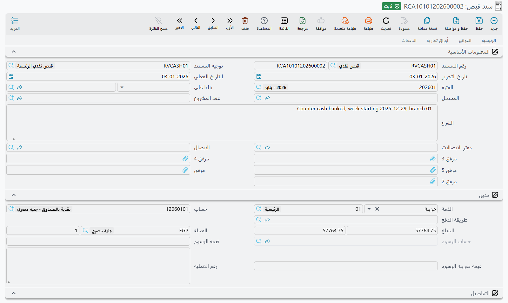

<rtl>

# ربط سندات الدفع بالفواتير

يدعم نظام **نما** ربط الفواتير بسندات الدفع بمرونة عبر سيناريوهات متعددة.

## تعريف سندات الدفع

يقصد بسندات الدفع في هذا السياق أي **سند قبض أو صرف نقدية أو ما يعادله**. وتشمل:

* **سند قبض (Receipt Voucher):** يمثل قبض نقدية دائمًا.
* **سند صرف (Payment Voucher):** يمثل صرف نقدية دائمًا.
* **تحويل بنكي (Bank Transfer):**

    * يمثل قبض نقدية افتراضيًا.
    * يمكن توجيهه ليصبح **سند قبض** أو **سند صرف** عبر خيار: `تعامل في أعمار الديون ومصاريف طرق الدفع مثل`

* **سند قبض إلكتروني (Electronic Receipt Voucher):**

    * يعمل كسند قبض افتراضيًا.
    * يمكن تغييره لسند صرف بنفس خيار التوجيه.
* **سند إشعار مدين (Debit Note):**

    * يعمل كسند قبض افتراضيًا.
    * يمكن تغييره لسند صرف بنفس خيار التوجيه.
* **سند إشعار دائن (Credit Note):**

    * يعمل كسند صرف افتراضيًا.
    * يمكن تغييره لسند قبض بنفس خيار التوجيه.
* **مرتجعات الفواتير:** يمكن اعتبارها كوسيلة دفع بشرط تفعيل الخيار:`addReturnToInvoicePayment`

  وهو خيار موجود بتوجيه المرتجع لتحديد إن كان سيُضاف إلى سندات الدفع ويُخصم من المتبقي.

## ما المقصود بربط الفواتير بالسندات؟

عند ربط فاتورة بسند دفع، يقوم النظام بتحديث حقل `المتبقي` (`money.remaining`) في الفاتورة، والذي يمثل الرصيد المتبقي للتحصيل أو السداد.

## ما المقصود بالفواتير في هذا السياق؟

المقصود بالفواتير هنا هو **أي مستند يترتب عليه استحقاق آجل**، سواء كان:

* **لصالح الشركة** (مثل فواتير البيع)، أو
* **على الشركة** (مثل فواتير الشراء).

ويتم الربط بين الفواتير وسندات الدفع وفق القواعد التالية:

* **فاتورة البيع:** تُربط بسندات **القبض**.
* **مرتجع المبيعات:** يُربط بسندات **الصرف**،
  كما يمكن اعتباره بديلًا عن سند قبض، ويُربط بفاتورة البيع كأنه سند قبض.
* **فاتورة الشراء:** تُربط بسندات **الصرف**.
* **مرتجع المشتريات:** يُربط بسندات **القبض**،
  كما يمكن اعتباره بديلًا عن سند صرف، ويُربط بفاتورة الشراء كأنه سند صرف.

---

## تفعيل المتابعة الآلية للربط

قبل البدء، يجب **تفعيل الخيار التالي في الإعدادات العامة**:
`usePayReceiptDocsSysEntries`

**(بالعربية: استعمال الجداول النظامية لمتابعة ربط الصرف والقبض بالفواتير)**

### جدول `PayReceiptDocsSysEntry`

بمجرد تفعيل الخيار أعلاه، يتتبع النظام الربط بين السندات والفواتير في جدول نظامي خاص:

| الحقل                | الوظيفة                                                              |
| -------------------- | -------------------------------------------------------------------- |
| `valueDate`          | تاريخ التنفيذ الفعلي للسند                                           |
| `creationDate`       | تاريخ إنشاء السند                                                    |
| `owner`              | مرجع السند (القبض أو الصرف)                                          |
| `target`             | مرجع الفاتورة المرتبطة                                               |
| `currency`           | العملة المستخدمة في السند                                            |
| `paymentLocalAmount` | قيمة الصرف بالعملة المحلية                                           |
| `paymentAmount`      | قيمة الدفع بالعملة الأساسية للسند                                    |
| `receiptLocalAmount` | قيمة القبض بالعملة المحلية                                           |
| `receiptAmount`      | قيمة القبض بالعملة الأساسية للسند                                    |
| `cloned`             | حقل منطقي (`true/false`) يُستخدم في حالة النسخ – سيتم شرح ذلك لاحقًا |

---

## طرق ربط سند الدفع بالفاتورة

يمكن ربط سندات الدفع (مثل سندات القبض) بفواتير المبيعات من خلال الحقول التالية:

### 1. في رأس السند:

* **`fromDoc` (بناءًا على):**
  يحدد الفاتورة أو المستند المرتبط بالسند.

### 2. في تفاصيل السند:

* **`lines.originDoc` (# المستند):**
  مرجع الفاتورة في جدول التفاصيل.

### 3. في جدول الفواتير داخل السند:

* **`invoices.invoice` (الفاتورة):**
  يربط الفاتورة بسند الدفع بشكل مباشر.

---

## السماح بدفع قيمة أكبر من المتبقي بالفاتورة

في بعض حالات العمل، قد يتطلب الأمر **دفع مبلغ يتجاوز المتبقي في الفاتورة**.
لتفعيل هذا السلوك، يمكن استخدام الخيار التالي في **توجيه الفاتورة**:
`allowPaymentMoreThanInvoiceAmount` `السماح بدفع مبلغ أكبر من قيمة الفاتورة`

---

## نسخ سندات الدفع من الأوامر إلى الفواتير

عند اتباع سيناريو يبدأ بـ **أمر بيع** يتم عليه إصدار **سند قبض جزئي**، ثم يُنشأ بناءً عليه **فاتورة مبيعات**، من الطبيعي أن يُخصم هذا المبلغ من المتبقي في الفاتورة.

لتنفيذ ذلك، فعّل الخيار التالي في **توجيه فاتورة المبيعات**:

`clonePayReceiptEntry` `نسخ الجداول النظامية لمتابعة ربط الصرف والقبض الخاصة ببناءًا على للسند`

### تأثير التفعيل:

* عند حفظ الفاتورة، يقوم النظام **بنسخ كل سندات القبض المرتبطة بأمر البيع** الذي تم إنشاء الفاتورة بناءً عليه.
* وإذا تم لاحقًا **إضافة سند قبض جديد على أمر البيع**، فسيتم **ربطه تلقائيًا بالفاتورة** أيضًا.
* وإذا تم **حذف أو تعديل سند القبض**، سيقوم النظام **بتحديث أثره على المتبقي في كل من أمر البيع والفاتورة**.

## على أرض الواقع

* سندات الصرف من أكثر المستندات حركةً: نحو 9 من كل 10 منشآت تُصدرها، والمنشأة المعتادة أكثر من ألف سند في السنة، وهذا أكثر من سندات القبض لديها.
* ربط سندات القبض بفواتير المبيعات هو الحالة اليومية: نحو 4 من كل 5 منشآت تُصدر سندات قبض تُصدر أيضًا فواتير مبيعات. وزر **تجميع سندات** في السند يملأ جدول الفواتير بمستندات الطرف المفتوحة في خطوة واحدة؛ انظر [سندات القبض والصرف](../accounting/money-in-and-out/receipts-and-payments.md).
* ليس كل سند صرف يُقفل فاتورة. فنحو 2 من كل 5 منشآت تُصدر سندات صرف تُشغّل الرواتب أيضًا، والرواتب المدفوعة بسندات الصرف تُسدّد الرواتب المستحقة لا فواتير.
* نحو منشأة من كل 5 تمرّ مدفوعاتها بطلب صرف أولًا. الطلب يسبق السند، وتبقى الفاتورة تُربط على السند نفسه، بأحد الحقول الثلاثة المذكورة أعلاه.
* أخذ دفعة مقدمة أو أقساط على أمر البيع قبل الفوترة نمط شائع، كما لدى تجار السيارات مثلًا. وهذا هو السيناريو الذي وُضع له الخيار `clonePayReceiptEntry`؛ انظر قسم «نسخ سندات الدفع من الأوامر إلى الفواتير» أعلاه.

</rtl>
