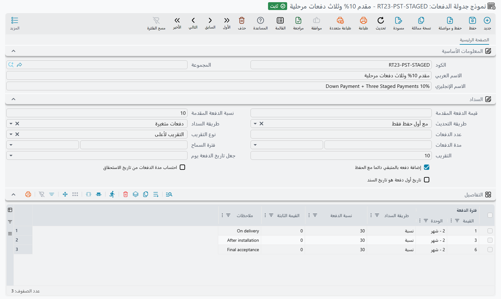

# دليل المستخدم لجداول الدفع (Payment Schedules)

## نظرة عامة

تتيح ميزة جداول الدفع (Payment Schedules) في نظام نما تحديد شروط دفع مرنة وخطط تقسيط لمستندات المبيعات والمشتريات. يغطي هذا الدليل إعداد نماذج جداول الدفع واستخدامها وتطبيقها على هذه المستندات.

## فهم جداول الدفع

تتيح جداول الدفع للشركات:
- تحديد خطط دفع بالتقسيط للعملاء
- إعداد الدفعات المقدمة وشروط الدفع الآجلة
- حساب تواريخ الدفع والمبالغ تلقائيًا
- متابعة تحصيل المدفوعات مقابل الأقساط المجدولة
- إدارة خطط الدفع ذات القيمة الثابتة والنسبة المئوية

### المكونات الرئيسية

1. **نموذج جدولة الدفعات (Payment Schedule Template):** ملف رئيسي يحدد شروط الدفع القابلة لإعادة الاستخدام
2. **سطور الجدول (Schedule Lines):** أقساط الدفع الفردية مع تواريخها ومبالغها
3. **متابعة الدفع (Payment Tracking):** متابعة نظامية للمدفوعات الفعلية مقابل المبالغ المجدولة

## نماذج جداول الدفع

نماذج جداول الدفع هي ملفات رئيسية تحدد شروط الدفع القياسية التي يمكن تطبيقها على مستندات كثيرة.

### حقول النموذج

#### البيانات الأساسية
- **الرمز (Code):** معرّف فريد للنموذج
- **الاسم (Name):** اسم وصفي للنموذج
- **الوصف (Description):** وصف تفصيلي لشروط الدفع

#### إعداد الدفع

##### إعدادات الدفعة المقدمة
- **قيمة الدفعة المقدمة (Down Payment Value):** مبلغ ثابت للدفعة المقدمة
- **نسبة الدفعة المقدمة (Down Payment Percentage):** نسبة مئوية من الإجمالي كدفعة مقدمة

عند اختيار النموذج في مستند، تُكتب الدفعة المقدمة في حقل **المدفوع نقدا (Paid)** في المستند، فتغطي الأقساط ما يتبقى بعدها فقط.

::: warning
لا يمكن تحديد قيمة ثابتة ونسبة مئوية للدفعة المقدمة في آن واحد. اختر إحدى الطريقتين فقط.
:::

##### طريقة السداد (Payment Type)
- **دفعات متغيرة (Variable Payments):** مبالغ مختلفة لكل قسط
- **دفعات متساوية (Equal Payments):** نفس المبلغ موزعًا على جميع الأقساط

##### طريقة التحديث (Updating Type)
أيًّا كانت قيمة هذا الخيار، فاختيار النموذج في مستند يملأ جدول دفعاته على الشاشة. والخيار يحدد هل يعيد حفظ المستند بناء الجدول من النموذج:
- **يدوي (Manual)** (القيمة الافتراضية في النموذج الجديد): الحفظ لا يعيد بناء الجدول أبدًا
- **مع أول حفظ فقط (With First Save):** يُعاد بناء الجدول عند حفظ المستند أول مرة فقط
- **مع كل حفظ (With Every Save):** يُعاد بناء الجدول عند كل حفظ

::: tip
استخدم "مع أول حفظ فقط" للعقود التي يجب أن تبقى فيها شروط الدفع ثابتة بعد الاتفاق الأولي.
:::

#### إعداد الدفعات المتساوية

عند استخدام نوع الدفعات المتساوية:
- **عدد الدفعات (count):** عدد الأقساط
- **مدة الدفعات (period):** الفترة الزمنية بين الدفعات
  - القيمة: رقم (مثال: 30)
  - الوحدة: يوم / أسبوع / شهر / سنة
- **فترة السماح (Grace Period):** التأخير الأولي قبل أول دفعة
  - القيمة: رقم
  - الوحدة: يوم / أسبوع / شهر / سنة

#### الإعدادات المتقدمة
- **التقريب (Approx):** قيمة تقريب مبالغ الدفع
- **نوع التقريب (Rounding Type):** كيفية تقريب قيم الدفع
- **جعل تاريخ الدفعة يوم (Make Payment Date at Day):** يوم من أيام الأسبوع، كالأحد. عند حفظ المستند، كل تاريخ استحقاق لا يقع في ذلك اليوم يُرحَّل إلى أقرب يوم مثله بعده، فتقع كل الدفعات يوم أحد مثلًا
- **إضافة دفعة بالمتبقي دائما مع الحفظ (Always Add Remaining Payment With Save):** عند حفظ المستند، إذا كان مجموع سطور جدولته أقل مما بقي للسداد، يُضاف سطر أخير بالفرق
- **احتساب مدة الدفعات من تاريخ الاستحقاق (Calculate Payments Period From Due Date):** حساب فترات الدفع من تاريخ استحقاق المستند بدلًا من تاريخه
- **تاريخ أول دفعة هو تاريخ السند (First Payment Date Is Document Date):** في الدفعات المتساوية عند اختيار النموذج في مستند، يقع القسط الأول في تاريخ المستند بدلًا من مدة واحدة بعده



## إنشاء نماذج جداول الدفع

### الخطوة الأولى: الوصول إلى نماذج جداول الدفع

انتقل إلى: **المشتريات > الملفات > نموذج جدولة الدفعات** (Purchases > Master Files > Payment Schedule Template). والشاشة نفسها موجودة أيضًا تحت **المبيعات > الملفات**.

### الخطوة الثانية: إنشاء نموذج جديد

1. انقر على **جديد** لإنشاء نموذج
2. أدخل البيانات الأساسية:
   - الرمز (مطلوب)
   - الاسم (مطلوب)
   - الوصف (اختياري)

### الخطوة الثالثة: إعداد طريقة الدفع

#### للدفعات المتساوية:
```
Payment Type: Equal Payments
count: 12
period: 30 Days
Grace Period: 0 Days
```

#### للدفعات المتغيرة:
```
Payment Type: Variable Payments
Configure individual payment lines in the Details grid
```

### الخطوة الرابعة: تعيين الدفعة المقدمة (اختياري)

اختر إحدى الطريقتين:
- **قيمة ثابتة:** أدخل مبلغًا محددًا
- **نسبة مئوية:** أدخل النسبة (0-100)

### الخطوة الخامسة: إعداد سطور الدفع (للدفعات المتغيرة فقط)

في جدول التفاصيل، لكل سطر دفع:

| الحقل | الوصف | مثال |
|-------|-------|------|
| نوع الدفعة (Payment Type) | قيمة ثابتة أو نسبة مئوية | نسبة مئوية |
| نسبة الدفعة (Payment Percentage) | نسبة مما بقي للسداد بعد الدفعة المقدمة | 25% |
| القيمة الثابتة (Fixed Value) | مبلغ دفع ثابت | 5,000 |
| مدة السداد (Payment Period) | المدة حتى هذه الدفعة؛ راجع قسم «حسابات التواريخ» أدناه لمعرفة التاريخ الذي تُحسب منه | 30 يومًا |
| ملاحظات (Remarks) | ملاحظات حول هذه الدفعة | القسط الأول |

::: info
عند استخدام الدفعات بالنسبة المئوية، تأكد من أن مجموع جميع النسب مضافًا إليها الدفعة المقدمة يساوي 100%.
:::

### الخطوة السادسة: إعداد سلوك التحديث

اختر نوع التحديث:
- **يدوي (Manual):** للنماذج التي لا ينبغي أن تحسب تلقائيًا
- **مع أول حفظ فقط (With First Save):** للعقود الثابتة
- **مع كل حفظ (With Every Save):** للتسعير الديناميكي

### الخطوة السابعة: حفظ النموذج

انقر على **حفظ** لتخزين النموذج للاستخدام في المستندات.

## أنواع الدفع وطرقه

### طريقة الدفعات المتساوية

يقوم النظام تلقائيًا بتقسيم المبلغ المتبقي إلى أقساط متساوية:

**صيغة الحساب:**
```
Payment Amount = (Total - Down Payment) / Number of Payments
Last Payment = Adjusted for rounding differences
```

**مثال:**
- إجمالي الفاتورة: 120,000
- قيمة الدفعة المقدمة: 20,000
- المتبقي: 100,000
- عدد الدفعات: 10
- كل دفعة: 10,000

### طريقة الدفعات المتغيرة

حدد مبالغ أو نسبًا مخصصة لكل قسط:

**بالنسبة المئوية:**
```
Payment Amount = Remaining (after the down payment) × Payment Percentage
```

**بقيمة ثابتة:**
```
Payment Amount = Specified Fixed Value
```

**مثال مختلط:**
| الدفعة | النوع | القيمة | المبلغ |
|--------|-------|--------|--------|
| 1 | نسبة مئوية | 30% | 36,000 |
| 2 | ثابت | - | 20,000 |
| 3 | نسبة مئوية | 25% | 30,000 |
| 4 | نسبة مئوية | 28.33% | 34,000 |

## تطبيق النماذج على مستندات المبيعات

يمكن تطبيق نماذج جداول الدفع على أي مستند فيه حقل **نموذج الدفع (Payment Template)**، ومنها:
- عروض أسعار المبيعات وأوامر البيع وفواتير المبيعات
- عروض أسعار المشتريات وأوامر الشراء وفواتير المشتريات
- مستندات وحدات أخرى، مثل عقود المقاولات ومستخلصاتها، ومشتريات الأصول الثابتة، وعقود الدورات

### عملية التطبيق

1. **فتح مستند المبيعات**
2. **اختيار نموذج الدفع** في قسم جدول الدفع
3. **يحسب النظام** الجدول بناءً على:
   - المبلغ الإجمالي للمستند
   - إعدادات النموذج
   - إعدادات نوع التحديث
4. **مراجعة الجدول المُنشأ** في جدول الدفعات
5. **التعديلات اليدوية:** عدّل السطور عند الحاجة. النموذج المضبوط على **مع كل حفظ** يعيد بناء السطور عند كل حفظ، و**مع أول حفظ فقط** عند الحفظ الأول، فتحل محل تعديلاتك
6. **حفظ المستند** لإتمام الجدول

### معلومات الجدول المُنشأ

لكل دفعة مجدولة:
- **تاريخ الدفع (Payment Date):** محسوب بناءً على فترات النموذج
- **قيمة الدفع (Payment Value):** المبلغ المحسوب
- **نسبة الدفع (Payment Percent):** نسبة من الإجمالي
- **المتبقي (Remaining):** المبلغ المستحق بعد الدفعات
- **كود القسط (Installment Code):** معرّف فريد للمتابعة

## حسابات جدول الدفع

### حسابات التواريخ

تاريخ البداية هو تاريخ المستند، أو تاريخ استحقاقه إذا عُلِّم **احتساب مدة الدفعات من تاريخ الاستحقاق**. ثم تتوقف التواريخ على وقت بناء الجدول.

**عند حفظ المستند** والنموذج مضبوط على **مع أول حفظ فقط** أو **مع كل حفظ**:
```
Equal Payments:
  First Payment Date = Start Date + Grace Period
  Next Payment Date  = Previous Payment Date + period
Variable Payments:
  Each line's date   = Document Date + that line's Payment Period
```

**عند اختيار النموذج في المستند**:
```
Equal Payments:
  First Payment Date = Start Date + period
                       (Start Date itself when First Payment Date Is Document Date is ticked)
  Next Payment Date  = Previous Payment Date + period
Variable Payments:
  First line's date  = Start Date + first line's Payment Period
  Each later line    = Previous line's date + that line's Payment Period
```

لذلك فالنموذج الذي تحدد سطوره الشهور 1، 2، 3 … من تاريخ المستند (كما في السيناريو الخامس أدناه) يجب ضبطه على **مع أول حفظ فقط** أو **مع كل حفظ**، حتى يعيد حفظ المستند بناء التواريخ من تاريخ المستند.

### حسابات المبالغ

#### مع الدفعة المقدمة:
```
Remaining Amount = Total - Down Payment - External Payments
Payment Amount = Remaining Amount × Payment Configuration
```

#### التقريب والتجريد:
```
Rounded Payment = Round(Payment Amount, Approximation, Rounding Type)
Last Payment = Remaining Amount - Sum of Previous Payments
```

### رسائل قد تظهر لك

تُقارَن نسب النموذج الذي فيه سطور تفاصيل بـ 100، مع احتساب نسبة الدفعة المقدمة. ويجب أن يكون مجموعها 100 بالضبط، إلا إذا كان أحد السطور من نوع **قيمة ثابتة** أو كان **إضافة دفعة بالمتبقي دائما مع الحفظ** معلَّمًا - فعندئذ يكفي ألا يتجاوز 100، لأن المبلغ الثابت أو دفعة المتبقي الآلية تغطي الباقي.

| الرسالة | لماذا | ما تفعله |
|---|---|---|
| «مجموع نسب الدفعات يجب أن يكون مائة» | نسب النموذج، ومعها الدفعة المقدمة، لا يبلغ مجموعها 100، ولا يوجد سطر بقيمة ثابتة، وخيار إضافة دفعة بالمتبقي دائما مع الحفظ غير معلَّم. | صحّح النسب، أو علّم **إضافة دفعة بالمتبقي دائما مع الحفظ** ليصير النقص دفعة أخيرة. |
| «مجموع النسب لا يمكن أن يكون أكبر من مائة» | مجموع النسب، ومعها الدفعة المقدمة، يزيد على 100. | خفّضها. |
| «يجب إدخال قيمة الدفعة أو قيمة النسبة» | **قيمة الدفعة المقدمة** و**نسبة الدفعة المقدمة** مملوءتان معًا. | أفرغ إحداهما. |
| «يجب إدخال قيمة فترة الدفعة» | سطر فيه وحدة **مدة السداد** بلا رقم. | اكتب عدد الأيام أو الأسابيع أو الشهور أو السنوات. |
| «مجموع الدفعات {0} لا يساوي قيمة المتبقي {1}» | تظهر في الفاتورة: سطور جدولة الدفعات لا يبلغ مجموعها ما بقي للسداد بعد الدفعة المقدمة والمدفوعات الخارجية. | صحّح سطور الجدولة. ويمكن إيقاف هذا التحقق بخيار **عدم مقارنة المتبقي بإجمالي الدفعات في الفواتير** في الإعدادات العامة. |


## السيناريوهات الشائعة

### السيناريو الأول: دفعة مقدمة 50%، والرصيد خلال 30 يومًا

```
Template Configuration:
- Down Payment Percentage: 50%
- Updating Type: With First Save
- Payment Type: Equal Payments
- count: 1
- Grace Period: 30 Days
```

### السيناريو الثاني: أقساط شهرية على مدار عام

```
Template Configuration:
- Down Payment: 0
- Payment Type: Equal Payments
- count: 12
- period: 1 Month
- First Payment Date Is Document Date: Yes
```

### السيناريو الثالث: خطة دفع مخصصة

```
Template Configuration:
- Payment Type: Variable Payments
- Updating Type: With First Save
- Details (Payment Period counted from the document date):
  Line 1: 30% immediately
  Line 2: 30% after 30 days
  Line 3: 40% after 60 days
```

### السيناريو الرابع: دفعات ربع سنوية مع فترة سماح

```
Template Configuration:
- Payment Type: Equal Payments
- Updating Type: With First Save (the grace period is applied when the document is saved)
- count: 4
- period: 3 Months
- Grace Period: 15 Days
- Make Payment Date at Day: Sunday (each due date moves forward to the next Sunday)
```

### السيناريو الخامس: عشرة أقساط شهرية ودفعتان إضافيتان

عميل يريد سداد فاتورة على اثني عشر قسطًا: عشرة أقساط شهرية بنسبة 5% لكل قسط، وقسطان إضافيان بنسبة 25% في الشهرين الخامس والعاشر.

```
Template Configuration:
- Payment Type: Variable Payments
- Updating Type: With First Save
- Details (each line a Percentage, period in Months):
  Lines 1-10: 5% at months 1, 2, ... 10
  Line 11: 25% at month 5
  Line 12: 25% at month 10
```

تُكوّن الأسطر الشهرية العشرة 50%، والدفعتان الإضافيتان الـ50% الباقية، فيصبح المجموع 100%. وعند حفظ الفاتورة يتولد في كلٍّ من الشهرين 5 و10 **قسطان** بالتاريخ نفسه — واحد بنسبة 5% وآخر بنسبة 25%.

::: details ملف JSON للاستيراد المباشر
```json
{
  "paymentType": "VariablePayments",
  "updatingType": "WithFirstSave",
  "roundingType": "CEILING",
  "details": [
    {
      "paymentPeriod": {
        "value": 1,
        "uom": "Month"
      },
      "paymentType": "Percentage",
      "paymentPercent": 5
    },
    {
      "paymentPeriod": {
        "value": 2,
        "uom": "Month"
      },
      "paymentType": "Percentage",
      "paymentPercent": 5
    },
    {
      "paymentPeriod": {
        "value": 3,
        "uom": "Month"
      },
      "paymentType": "Percentage",
      "paymentPercent": 5
    },
    {
      "paymentPeriod": {
        "value": 4,
        "uom": "Month"
      },
      "paymentType": "Percentage",
      "paymentPercent": 5
    },
    {
      "paymentPeriod": {
        "value": 5,
        "uom": "Month"
      },
      "paymentType": "Percentage",
      "paymentPercent": 5
    },
    {
      "paymentPeriod": {
        "value": 6,
        "uom": "Month"
      },
      "paymentType": "Percentage",
      "paymentPercent": 5
    },
    {
      "paymentPeriod": {
        "value": 7,
        "uom": "Month"
      },
      "paymentType": "Percentage",
      "paymentPercent": 5
    },
    {
      "paymentPeriod": {
        "value": 8,
        "uom": "Month"
      },
      "paymentType": "Percentage",
      "paymentPercent": 5
    },
    {
      "paymentPeriod": {
        "value": 9,
        "uom": "Month"
      },
      "paymentType": "Percentage",
      "paymentPercent": 5
    },
    {
      "paymentPeriod": {
        "value": 10,
        "uom": "Month"
      },
      "paymentType": "Percentage",
      "paymentPercent": 5
    },
    {
      "paymentPeriod": {
        "value": 5,
        "uom": "Month"
      },
      "paymentType": "Percentage",
      "paymentPercent": 25
    },
    {
      "paymentPeriod": {
        "value": 10,
        "uom": "Month"
      },
      "paymentType": "Percentage",
      "paymentPercent": 25
    }
  ]
}
```

افتح نموذج جدولة دفعات جديدًا، ثم **المزيد ← Import Into Current Record** والصق الملف — راجع [الاستيراد إلى السجل المفتوح أمامك](/ar/platform/import-export/importing-records.md#lstyrd-l-lsjl-lmftwH-mmk).
:::

## مستندات الدفع ومتابعة الأقساط

بمجرد إنشاء جداول الدفع وتطبيقها على مستندات المبيعات، يوفر النظام متابعة شاملة عبر مستندات الدفع التي يمكنها تمييز الأقساط على أنها مدفوعة.

### سندات القبض وسندات الصرف

يتضمن كل من **سندات القبض (Receipt Vouchers)** و**سندات الصرف (Payment Vouchers)** جدول **الأقساط (Installment Lines)** الذي يُمكّن من متابعة الدفع مقابل الأقساط المجدولة:

- **سندات القبض:** تُستخدم أساسًا لمستندات المبيعات لتسجيل مدفوعات العملاء
- **سندات الصرف:** تُستخدم أساسًا لمستندات المشتريات لتسجيل مدفوعات الموردين

### جدول سطور الأقساط

يحتوي جدول سطور الأقساط في مستندات الدفع على الحقول الرئيسية التالية:

| الحقل | الاسم بالعربية | الوصف |
|-------|----------------|-------|
| **Installment doc** | مستند القسط | مرجع المستند الذي يحتوي على جدول الدفع |
| **Installment Code** | كود القسط | كود فريد يُعرّف القسط المحدد |
| **Paid Value** | القيمة المدفوعة | المبلغ المدفوع مقابل هذا القسط |
| **Due Date** | تاريخ الاستحقاق | تاريخ استحقاق القسط الأصلي |
| **Remaining** | المتبقي | الرصيد المستحق بعد هذا الدفع |
| **Net value** | الصافي | القيمة الإجمالية للقسط |
| **Collection Discount** | خصم التحصيل | خصم يُمنح على هذا القسط عند تحصيله — للسداد المبكر مثلًا. ويُحسب ضمن المدفوع من القسط مع **القيمة المدفوعة**، فيُسدَّد القسط وإن كان المال المدفوع أقل. ويقيّده السند عبر جانبَي **خصم التحصيل** في توجيهه. ولا يمكن أن يكون سالبًا: «خصم التحصيل لا يمكن أن يكون سالبًا». |

### منطق معالجة الدفع

عند حفظ مستند الدفع، يرجع النظام إلى كل مستند يسدّد أقساطه، ثم:

1. **يحدّث المبلغ المدفوع:** يجمع كل سطور الدفع على القسط (ومعها خصم التحصيل إن وُجد) في المدفوع نظاميًا لهذا القسط في المستند المصدر
2. **يعيد حساب الأرصدة المتبقية:** عبر جميع الأقساط ذات الصلة
3. **يتحقق من ترتيب الدفع** إذا تطلّبه مستند الأقساط (راجع قسم «فرض ترتيب الدفع» أدناه)
4. **يمنع الدفع الزائد:** لا يجوز أن تتجاوز المبالغ المدفوعة قيم الأقساط

### عملية متابعة الدفع

#### الخطوة الأولى: إنشاء مستند الدفع
1. افتح سند قبض أو سند صرف
2. أدخل معلومات الدفع الأساسية (العميل/المورد، المبلغ، التاريخ)
3. انتقل إلى تبويب **الأقساط (Installment Lines)**

#### الخطوة الثانية: إضافة مدفوعات الأقساط
1. انقر على **إضافة سطر** في جدول الأقساط
2. اختر **مستند القسط**: فاتورة مبيعات أو استبدال مبيعات أو فاتورة مشتريات، أو مستند بيع أو تحصيل أو عقد إيجار من العقارات
3. اختر **كود القسط** المحدد من المستند
4. أدخل **القيمة المدفوعة** (يمكن أن تكون دفعة جزئية أو كاملة)
5. كرر العملية لأقساط متعددة إذا لزم الأمر

#### الخطوة الثالثة: التحقق من الدفع
يتحقق النظام تلقائيًا من:
- عدم تجاوز مبالغ الدفع لأرصدة الأقساط: «كود القسط {0} في المستند {1} تعدى قيمة القسط بمقدار {2} في الحقل {3}»
- اتباع ترتيب الدفع لتسلسل تاريخ الاستحقاق (إذا كان مُهيَّأً)
- وجود الأقساط المُشار إليها في المستند المصدر: «كود القسط {0} غير موجود بالمستند {1}»
- ألا يزيد مجموع سطور الأقساط على مبلغ السند: «إجمالي المبلغ {0} وهو أقل من إجمالي الأقساط {1}». والخيار **عدم التأكد من إجمالي الدفعات مع إجمالي السند** في توجيه السند يوقف هذا التحقق، والخيار **التحقق من مطابقة المتبقي لإجمالي الأقساط** يشترط تساويهما

#### الخطوة الرابعة: تطبيق الأثر
عند حفظ مستند الدفع:
- تُحدَّث أرصدة الأقساط عبر النظام
- تعرض مستندات المبيعات/المشتريات ذات الصلة حالة الدفع المحدّثة
- تعكس تقارير الأعمار معلومات الدفع الجديدة
- تُحدَّث حسابات العميل/المورد

### دعم الدفع من مستندات متعددة

يمكن لمستندات الدفع معالجة أقساط من مستندات مصدر متعددة في معاملة واحدة:

```
Receipt Voucher RV-2024-001
├── Customer: ABC Company
├── Total Amount: 150,000
└── Installment Lines:
    ├── Invoice INV-001, Installment #1: 50,000
    ├── Invoice INV-001, Installment #2: 25,000
    └── Invoice INV-002, Installment #1: 75,000
```

### فرض ترتيب الدفع

لا يُتحقق من الترتيب إلا إذا كان خيار **دفع الأقساط بالترتيب (Pay Installments In Order)** معلَّمًا في توجيه المستند الذي يحمل الأقساط (فاتورة المبيعات أو فاتورة المشتريات وغيرهما). وإذا لم يُعلَّم، وهو الافتراضي، يمكن دفع الأقساط بأي ترتيب. وإذا عُلِّم، يُرفض الدفع لقسط ما دام قسط تاريخ استحقاقه أسبق لم يُدفع بالكامل:

«القسط {0} في المستند {1} الذي تاريخ استحقاقه {2} لم يدفع بالكامل , لا يمكن دفع القسط {3} قبل دفع هذا القسط»

### نظام سجلات دفع الأقساط

خلف الكواليس، يُسجَّل كل سطر أقساط في سند محفوظ قيدًا لدفع القسط يتتبع:
- **مستند الدفع (Payment Document):** أي سند قبض/صرف قام بالدفع
- **مستند القسط (Installment Document):** أي مستند مبيعات/مشتريات يحتوي على القسط
- **كود القسط (Installment Code):** القسط المحدد الذي تم سداده
- **نوع الأثر (Effect Type):** أي مبلغ مدفوع في القسط يحدّثه، ويحدده الخيار **تأثير الأقساط (installment Effect)** في توجيه السند: **محصلة نظاميا** أو **محصل بأوراق تجارية** أو **مطلوب تحصيله**
- **القيمة المدفوعة (Paid Value):** المبلغ المطبّق على القسط
