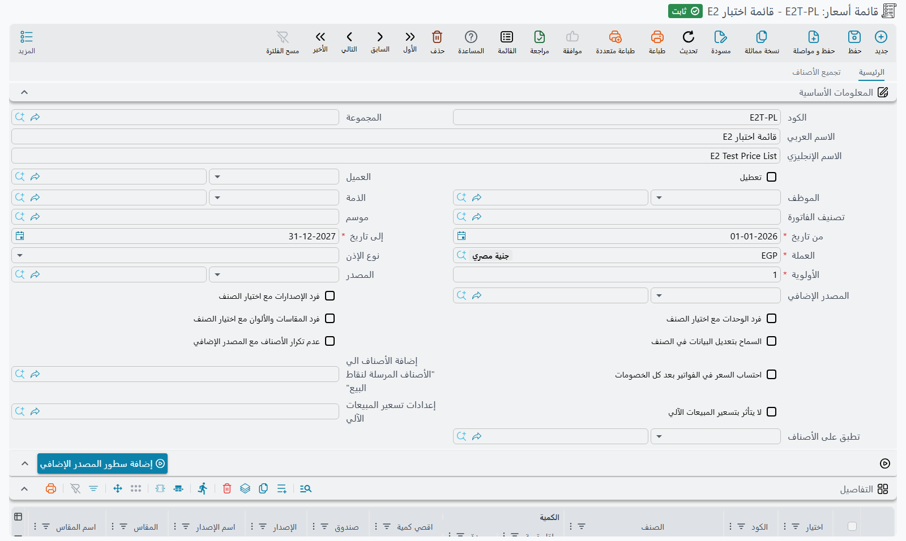

# دليل إدارة الأسعار والعروض (Pricing and Offers Management Guide)

يغطي هذا الدليل الشامل نظام التسعير في نما، بما في ذلك قوائم الأسعار وعروض المبيعات وآليات التسعير الآلي التي تساعد على الحفاظ على أسعار دقيقة وتنافسية طوال عمليات البيع.

## نظرة عامة (Overview)

يوفر نما محرك تسعير متطوراً يدعم:
- **قوائم أسعار المبيعات** (Sales Price Lists) - هياكل تسعير ثابتة للأصناف
- **عروض المبيعات** (Sales Offers) - تسعير ترويجي قائم على الخصومات
- **تحديثات الأسعار الآلية** (Automated Price Updates) - تعديلات أسعار يقودها النظام
- **التسعير متعدد المحددات** (Multi-dimensional Pricing) - دعم لفئات العملاء والمواسم والتصنيفات

## قوائم أسعار المبيعات (Sales Price Lists)

### التنقل (Navigation)
**مسار القائمة**: المبيعات > قوائم الأسعار والعروض > قائمة أسعار

### الغرض (Purpose)
تحدد قوائم أسعار المبيعات هياكل تسعير موحدة لأصناف المخزون، مما يتيح للشركات الحفاظ على أسعار متسقة عبر شرائح العملاء المختلفة والفترات الزمنية وسيناريوهات الأعمال.

### الميزات الرئيسية (Key Features)

#### إعداد الرأسية (Header Configuration)

**المعلومات الأساسية:**
- **الرمز** (Code) - معرّف فريد لقائمة الأسعار
- **الاسم** (Name) - اسم وصفي لسهولة التعريف
- **الأولوية** (Priority) - تحدد أي قائمة أسعار تأخذ الأسبقية عند تطبيق أكثر من قائمة
- **العملة** (Currency) - العملة الأساسية لجميع الأسعار في القائمة

**إدارة نطاق التاريخ:**
- **من تاريخ** (From Date) - تاريخ البدء الذي تصبح فيه الأسعار سارية
- **إلى تاريخ** (To Date) - تاريخ الانتهاء الذي تنتهي فيه الأسعار

**استهداف العملاء:**
- **العميل** (Customer) - ربط بعملاء محددين أو فئات أو تصنيفات عملاء
- **تصنيف الفاتورة** (Invoice Classification) - تطبيق على أنواع فواتير محددة
- **محددات السعر 1-5** (Price Classifiers 1-5) - نظام تصنيف متعدد المحددات

#### تفاصيل قائمة الأسعار (Price List Details)

تحتوي كل قائمة أسعار على سطور تفصيلية شاملة مع خيارات إعداد واسعة:

**تحديد الصنف واختياره:**
- **الصنف** (Item) - صنف المخزون الرئيسي للتسعير
- **رمز الصنف** (Item Code) - طريقة بديلة لتحديد الصنف
- **محددات الصنف** (Item Dimensions) - دعم محددات كامل:
  - اللون، المقاس، Revision ID، Lot ID، الأرقام التسلسلية (الأول والثاني)
  - Box، المقاييس، Sub-item، المخزن، Locator
  - نسب نشط/غير نشط لمتغيرات الصنف
- **تطبيق على الأصناف** (Apply On Items) - ربط بمجموعات الأصناف أو نطاقات التسعير
- **تطبيق فقط إذا كان الصنف في الفاتورة** (Apply Only If Item In Invoice) - تفعيل تسعير مشروط

**هيكل التسعير:**
- **السعر الافتراضي** (Default Price) - سعر البيع القياسي للصنف
- **السعر المخصص** (Custom Price) - سعر تجاوز للظروف الخاصة
- **أدنى سعر** (Min Price) - أدنى سعر بيع مسموح به
- **أعلى سعر** (Max Price) - أعلى سعر بيع مسموح به
- **السعر بعد الضريبة 1/2** (Price After Tax 1/2) - خيارات تسعير شاملة للضريبة
- **هذه الوحدة فقط** (This Unit Only) - قيود سعر خاصة بالوحدة

**إعداد الكميات ووحدة القياس:**
- **الكمية** (Quantity) - الحد الأدنى للكمية المشتراة للشريحة السعرية
- **أقصى كمية** (Max Qty) - الحد الأقصى للكمية لهذا المستوى السعري
- **وحدة القياس** (Unit of Measure) - وحدة قياس التسعير
- **الكمية بوحدة القياس الأساسية** (Qty In Base UOM) - الكمية المحولة بالوحدة الأساسية

**استهداف العملاء والتصنيف:**
- **العميل** (Customer) - استهداف عميل محدد أو فئة أو تصنيف
- **محددات السعر 1-5** (Price Classifiers 1-5) - تصنيف سعر متعدد المحددات
- **المحددات** (Dimensions) - قيود محددات عامة
- **تصنيف الفاتورة** (Invoice Classification) - تسعير خاص بنوع المستند
- **الصلاحية الأمنية** (Security Capability) - متطلبات صلاحيات المستخدم

**إدارة الوقت والدفعات:**
- **من تاريخ/إلى تاريخ** (From Date/To Date) - فترة صلاحية السعر
- **من/إلى رقم دفعة** (From/To Lot ID) - فترات تسعير خاصة بالدفعة

**ميزات متقدمة:**
- **إيقاف الخصومات** (Stop Discounts) - يمنع تطبيق الخصومات على هذا الصنف
- **محدد لتغيير السعر** (Selected For Price Change) - يحدد الأصناف لتحديثات الأسعار الجماعية
- **الصنف المجاني هو نفس صنف الفاتورة** (Free Item Is Same As Invoice Item) - تسعير ذاتي المرجع
- **إلغاء تفعيل قائمة الأسعار** (Deactivate Price List) - إلغاء تفعيل على مستوى السطر
- **الأصل** (Origin) - مرجع إلى قائمة الأسعار المصدر للتتبع

**حقول العرض والمرجع:**
- **اسم اللون** (Color Name) - اسم عرض لون الصنف
- **اسم المقاس** (Size Name) - اسم عرض مقاس الصنف
- **اسم المراجعة** (Revision Name) - اسم عرض مراجعة الصنف

**تخزين البيانات الموسعة:**
- **حقول رقمية (n1-n5)** - بيانات رقمية مخصصة
- **حقول مرجع (ref1-ref5)** - بيانات مرجع مخصصة
- **حقول نصية (text1-text5)** - معلومات نصية مخصصة
- **حقول تاريخ (date1-date5)** - تتبع تواريخ مخصصة

**تتبع النظام:**
- **معرّف الأمر/معرّف السطر المنشأ منه** (Created From Order ID/Line ID) - يتتبع إنشاء قائمة الأسعار من أوامر البيع لأغراض التدقيق

#### ميزات التسعير المتقدمة (Advanced Pricing Features)

**محدثات الأسعار (Price Updaters):**
يوفر النظام آلية تحديث أسعار متطورة من 5 مراحل مع قدرات حساب وتقريب شاملة:

**نظرة عامة على عملية التحديث:**
يُنفّذ زر **تحديث الأسعار** (Update Prices) تحديثات الأسعار من خلال عملية متسلسلة من 5 مراحل، حيث يمكن إعداد كل محدّث بشكل مستقل ويعمل على نتيجة المرحلة السابقة. ويرفض التنفيذ إذا كانت القائمة بلا سطور أو كانت المحدّثات الخمسة كلها فارغة.

**منطق المعالجة المتسلسلة:**
1. **المرحلة 1**: سعر المصدر → محدّث السعر 1 → حقل الوجهة 1
2. **المرحلة 2**: النتيجة السابقة → محدّث السعر 2 → حقل الوجهة 2
3. **المرحلة 3**: النتيجة السابقة → محدّث السعر 3 → حقل الوجهة 3
4. **المرحلة 4**: النتيجة السابقة → محدّث السعر 4 → حقل الوجهة 4
5. **المرحلة 5**: النتيجة السابقة → محدّث السعر 5 → حقل الوجهة النهائي

**إعداد حقل المصدر:**
- **حقل المصدر** (Source Field) - يحدد السعر الابتدائي للحسابات:
  - السعر الافتراضي، السعر المخصص، أدنى سعر، أعلى سعر
  - حقول قائمة على تكلفة الصنف، آخر سعر بيع
  - السعر الثابت - يستخدم قيمة السعر الثابت على مستوى الرأسية
- **السعر الثابت** (Fixed Price) - مبلغ ثابت على مستوى الرأسية يُستخدم عندما يكون حقل المصدر "FixedPrice"

**تعيين حقل الوجهة:**
- **حقل الوجهة** (Destination Field) - الحقل الهدف النهائي لتحديثات الأسعار
- **حقول الوجهة 1-4** (Destination Fields 1-4) - أهداف المراحل الوسيطة
- **السلوك الافتراضي**: إذا لم تُحدد وجهة، يُستخدم حقل المصدر كوجهة؛ وإذا لم يُحدد مصدر ولا أي وجهة، فكلاهما **السعر الافتراضي**

**إعداد محدّث السعر (لكل مرحلة):**
كل من محدّثات الأسعار الخمس تدعم:

**أنواع العمليات** (Operation Types):
- **جمع** (Add) - يضيف قيمة أو نسبة إلى السعر الحالي
- **طرح** (Subtract) - يطرح قيمة أو نسبة من السعر الحالي
- **ضرب** (Multiply) - يضرب السعر الحالي في قيمة (النسب المئوية غير مسموح بها)
- **قسمة** (Divide) - يقسم السعر الحالي على قيمة (النسب المئوية غير مسموح بها)

**أنواع القيم** (Value Types):
- **قيمة ثابتة** (Fixed Value) - مبلغ نقدي مطلق
- **نسبة مئوية** (Percentage) - نسبة من السعر الحالي (مع عمليات الجمع/الطرح فقط)

**ضبط التقريب** (Rounding Control):
- **نوع التقريب** (Rounding Type) - طريقة التقريب الرياضية
- **قيمة التقريب** (Rounding Value) - مستوى الدقة للتقريب
- **مقياس العملة** (Currency Scale) - ضبط تلقائي للمنازل العشرية بناءً على إعداد العملة

**التحكم في تطبيق السطور:**
- **تطبيق على الخطوط** (Applied On Lines):
  - **الكل** (All) - تطبيق على جميع سطور قائمة الأسعار
  - **المحددة** (Selected) - فقط السطور المحددة بـ "محدد لتغيير السعر"
  - **غير المحددة** (Not Selected) - السطور غير المحددة لتغيير الأسعار

**التحقق من الصحة ومعالجة الأخطاء:**
- **التحقق من النسب المئوية**: النظام يمنع قيم النسب مع عمليات الضرب/القسمة: «النسبة تستعمل فقط مع الجمع و الطرح»
- **معالجة المحدثات الفارغة**: يتخطى المعالجة لإعدادات المحدثات الفارغة
- **تكامل العملة**: يطبق تلقائياً قياس الأرقام العشرية الخاص بالعملة
- **تصفية السطور**: يحترم إعدادات التطبيق على مستوى السطر

**التجميع الجماعي للأصناف (تجميع الأصناف):**
تجميع آلي للأصناف لملء قائمة الأسعار مع معايير تصفية شاملة:

**الاختيار القائم على النطاق:**
- **نطاق الصنف** (Item Range) - اختيار نطاق رمز الصنف
- **نطاقات الفئة** (Category Ranges) - تصفية 5 مستويات للفئات
- **نطاقات التصنيف** (Classification Ranges) - تصفية 5 مستويات لفئات الصنف
- **نطاق العلامة التجارية** (Brand Range) - اختيار قائم على العلامة التجارية
- **نطاق القسم** (Section Range) - تصفية القسم
- **نطاقات المحددات** (Dimensional Ranges) - تصفية الفرع والقطاع ومجموعة التحليل والإدارة

**خيارات النشر التلقائي:**
- **نشر الوحدات** (Spread Units) - ينشئ سطوراً لجميع متغيرات وحدة قياس الصنف
- **نشر المراجعات** (Spread Revisions) - يتضمن جميع متغيرات مراجعة الصنف
- **نشر الألوان/الأحجام** (Spread Colors/Sizes) - يوسع لجميع تركيبات الألوان/الأحجام

**حساب متوسط سعر التكلفة (حساب السعر من متوسط التكلفة):**
تسعير آلي قائم على التكلفة مع حساب تكلفة في الوقت الفعلي:

**الإعداد:**
- **نسخ متوسط التكلفة إلى** (Average Cost Destination Field) - حقل السعر الذي يُكتب فيه متوسط تكلفة كل سطر
- **يؤثر في** (Destination Field) - يُستخدم بدلًا منه إذا كان الحقل السابق فارغًا؛ وإذا كانا فارغين تُكتب التكلفة في **السعر الافتراضي**
- **تطبيق على الخطوط** (Applied On Lines) - التحكم في تطبيق السطور

**عملية الحساب:**
- يسترجع متوسط تكاليف الوقت الفعلي من نظام المخزون
- يأخذ في الاعتبار محددات الصنف (اللون، المقاس، المراجعة، الدفعة) في حساب التكلفة
- يطبق قيود المحددات التجارية (الفرع، الإدارة، الشركة)
- يحدث حقول الوجهة المحددة بالتكاليف المحسوبة

**إجراءات مساعدة إضافية:**
- **تعطيل** (`deactivatePriceList`) في الرأسية - تعليمه ينسخه إلى كل السطور إذا كان خيار سلسلة الإمداد **استعمال غير نَشِطْ على مستوى السطور بقوائم أسعار المبيعات** مفعّلًا
- **إضافة سطور المصدر الإضافي** (Add additional source lines) - يدمج السطور من قوائم أسعار مصدر إضافية
- **فرد بيانات السطر المحدد** (Spread Selected Line Data) - يوسع السطور المحددة عبر المحددات

### إدارة قوائم الأسعار (Price List Management)

#### إنشاء قوائم الأسعار (Creating Price Lists)

1. **الانتقال** إلى المبيعات > قوائم الأسعار والعروض > قائمة أسعار
2. **تعيين معلومات الرأسية**:
   - أدخل رمزاً فريداً واسماً وصفياً
   - حدد نطاق التاريخ للصلاحية
   - اضبط مستوى الأولوية (الأرقام الأصغر = أولوية أعلى)
   - اختر العملاء المستهدفين أو مجموعات العملاء

3. **إعداد تحديثات الأسعار** (اختياري):
   - إعداد ما يصل إلى 5 محدثات أسعار للحسابات الآلية
   - اختر حقول المصدر (التكلفة، السعر السابق، إلخ)
   - حدد العمليات الرياضية وقواعد التقريب

4. **إضافة سطور التفاصيل**:
   - اختر الأصناف يدوياً أو استخدم الاستيراد الجماعي
   - أعدّ محددات الصنف والكميات
   - اضبط الأسعار أو استخدم المحدثات للحساب التلقائي

#### تحديثات الأسعار الجماعية (Bulk Price Updates)

**من المستندات المصدر:**
- **المصدر** (Source) - استيراد من قوائم أسعار أو فواتير أو أوامر قائمة
- **المصدر الإضافي** (Additional Source) - دمج مصادر متعددة
- **تضمين الخصومات** (Include Discounts) - الأخذ بالتسعير الترويجي

**معايير التصفية:**
- نطاقات الأصناف (من الصنف إلى الصنف)
- نطاقات الفئات عبر 5 مستويات تصنيف
- تصفية الإدارة والفرع والقطاع
- قيود مجموعة التحليل

### تكامل النظام (System Integration)

#### منطق تحديد السعر (Price Resolution Logic)

من أين يأتي السعر الأساسي لسطر المستند (سطر قائمة أسعار مطابق، ثم آخر سعر بيع، ثم أسعار الصنف نفسه)، وبأي ترتيب تعدّله شرائح الكمية والعروض والكوبونات بعد ذلك، مشروح في قسم «كيف تتراكم الطبقات» بصفحة [التسعير والعروض والكوبونات](/ar/modules/supplychain/pricing-offers-and-coupons). وبين سطور قوائم الأسعار المطابقة يفوز الرقم الأصغر في **الأولوية**.

## عروض المبيعات (Sales Offers)

### التنقل (Navigation)
**مسار القائمة**: المبيعات > قوائم الأسعار والعروض > عرض

### الغرض (Purpose)
توفر عروض المبيعات إدارة متطورة للخصومات والعروض الترويجية، مما يمكّن الشركات من إنشاء حملات ترويجية معقدة مع أنواع خصومات متعددة وأصناف مجانية وتطبيقات مشروطة.

### أنواع العروض والتجميعات (Offer Types and Collections)

#### 1. خصومات الأصناف (Item Discounts)
**التجميع**: `details`
يوفر هياكل خصم متطورة خاصة بالصنف مع استهداف شامل ومنطق مشروط:

**استهداف الصنف واختياره:**
- **الصنف** (Item) - صنف المخزون المحدد لتطبيق الخصم
- **رمز الصنف** (Item Code) - طريقة بديلة لتحديد الصنف
- **محددات الصنف** (Item Dimensions) - دعم محددات كامل يشمل:
  - اللون، المقاس، Revision ID، Lot ID، الأرقام التسلسلية
  - Box، المقاييس، Sub-item
  - التسعير الخاص بالمخزن وLocator
- **الأصناف المرتبطة** (Related Items) - تطبيق على مجموعات الأصناف أو مجموعات الأصناف المجانية
- **تطبيق على الأصناف** (Apply On Items) - ربط بمجموعات الأصناف المجانية أو نطاقات التسعير

**معايير الفئة والتصنيف:**
- **الفئات 1-5** (Categories 1-5) - استهداف متعدد المستويات للفئات
- **تصنيفات الصنف 1-10** (Item Classes 1-10) - نظام تصنيف موسع
- **العلامة التجارية** (Brand) - خصومات خاصة بالعلامة التجارية
- **القسم** (Section) - تجميع الأصناف حسب القسم

**إعداد الخصم:**
- **وقت حساب التخفيض في الفاتورة** (Discount Location) - **حقل مطلوب** يحدد متى/أين يُطبق الخصم في معالجة الفاتورة
- **قيمة أم نسبة** (Value or Percent) - طريقة حساب الخصم
- **أدنى قيمة خصم** (Discount Min Value) - الحد الأدنى لمبلغ الخصم
- **أعلى قيمة خصم** (Discount Max Value) - الحد الأقصى للخصم
- **قيمة الخصم الافتراضية** (Discount Default Value) - مبلغ الخصم القياسي
- **خصم خاص** (Special Discount) - علامة للمعالجة الاستثنائية للخصم
- **تعطيل التحقق من تخفيضات مندوب المبيعات** (Deactivate Salesman Discounts Validations) - خانة في رأس العرض وليست في السطر: الخصومات القادمة من سطور هذا العرض لا تُقارن بأقصى خصم للموظف

::: tip الحد الأدنى والافتراضي والأقصى مدى واحد
الخصم الذي يكتبه المستخدم لا يبقى إلا إذا كان بين الحد الأدنى والحد الأقصى، وإلا استُبدلت به القيمة الافتراضية دون أي رسالة. والحد الأقصى الفارغ يُحسب صفرًا، فالسطر الذي فيه قيمة افتراضية فقط يثبّت الخصم عليها. وكيف يعمل هذا المدى مع حد كل موظف مشروح في [حدود خصم البائع](./salesman-discount-limits.md).
:::

**التحكم في الكميات والقيم:**
- **الكمية** (Quantity) - الحد الأدنى للكمية المشتراة لأهلية الخصم
- **أقصى كمية** (Max Qty) - الحد الأقصى للكمية للتسعير المتدرج
- **أدنى قيمة صنف لتطبيق الخصم** (Min Item Value to Apply Discount) - حد قيمة الصنف الفردي
- **أعلى قيمة صنف لتطبيق الخصم** (Max Item Value to Apply Discount) - الحد الأعلى لقيمة الصنف
- **أدنى قيمة فاتورة لتطبيق الخصم** (Min Invoice Value to Apply Discount) - الحد الأدنى على مستوى المستند
- **أعلى قيمة فاتورة لتطبيق الخصم** (Max Invoice Value to Apply Discount) - الحد الأقصى على مستوى المستند

**قيود الوقت والتاريخ:**
- **من تاريخ/إلى تاريخ** (From Date/To Date) - فترة صلاحية الخصم
- **من وقت/إلى وقت** (From Time/To Time) - قيود النافذة الزمنية اليومية
- **من/إلى رقم دفعة** (From/To Lot ID) - فترات خصم خاصة بالدفعة

**منطق الخصم المتقدم:**
- **تجميع القيمة حسب** (Accumulate Value By) - يحدد كيفية تراكم القيم لحساب الخصم:
  - أقسام الأصناف، الفئات، التصنيفات 1-5
  - المجموعات الرئيسية، قيمة الفاتورة
- **تطبيق خصم العرض مرة واحدة** (Apply Offer Discount Once) - يمنع التطبيقات المتعددة
- **إيقاف خصومات أخرى من نفس النوع** (Stop Same Type Other Discounts) - يتحكم في تكديس الخصومات
- **نوع عد أصناف المبيعات** (Sales Items Count Type) - طريقة عد الأصناف المؤهلة

**التطبيق المشروط:**
- **تطبيق فقط إذا كان الصنف في الفاتورة** (Apply Only If Item In Invoice) - يتطلب وجود أصناف محددة
- **محددات السعر 1-5** (Price Classifiers 1-5) - تصنيف سعر متعدد المحددات
- **المحددات** (Dimensions) - قيود محددات عامة (الفرع، الإدارة، القطاع، إلخ)
- **الصلاحية الأمنية** (Security Capability) - متطلبات صلاحيات المستخدم
- **التابعة** (Subsidiary) - استهداف وحدة أعمال متعددة الكيانات

#### 2. الأصناف المجانية (Free Items)
**التجميع**: `freeItems`
إدارة شاملة للأصناف المجانية توسع وظائف سطر العرض الأساسية بمنطق مشروط متطور:

**إعداد صنف المشغّل:**
- **الصنف** (Item) - الصنف الرئيسي الذي يشغّل عرض الصنف المجاني
- **رمز الصنف** (Item Code) - تعريف بديل لصنف المشغّل
- **محددات الصنف** (Item Dimensions) - دعم محددات كامل لأصناف المشغّل:
  - اللون، المقاس، Revision ID، Lot ID، الأرقام التسلسلية
  - Box، المقاييس، المخزن، Locator
- **الكمية** (Quantity) - كمية الشراء المطلوبة لتفعيل العرض
- **أقصى كمية** (Max Qty) - الحد الأقصى للكمية المؤهلة

**تعريف الصنف المجاني:**
- **كود الصنف المجاني** (Free Item Code) - معرّف فريد للصنف المجاني
- **بيانات الصنف المجاني** (Free Item Data) - **مطلوب** إعداد شامل للصنف المجاني:
  - **الصنف المجاني** (Free Item) - الصنف الفعلي المقدم مجاناً
  - **محددات الصنف المجاني** (Free Item Dimensions) - مواصفات محددات كاملة
  - **الكمية المجانية** (Free Quantity) - الكمية المقدمة مجاناً
  - **أقصى كمية** (Max Qty) - حد على الكمية المجانية
  - **سياسة مجاني** (Free Policy) - قواعد حوكمة تقديم الصنف المجاني
  - **سياسة الاستبدال** (Replace Policy) - قواعد استبدال الصنف
  - **قواعد تطبيق العرض** (Offer Apply Rules) - منطق تطبيق معقد
  - **خاضع للضريبة** (Taxable) - المعالجة الضريبية للأصناف المجانية
  - **يدوي** (Manual) - قدرة التجاوز اليدوي

**وضع الخصم البديل:**
- **خصم نسبة من السعر بدلا من مجاني** (Not Free But Discount) - **ميزة رئيسية** - بدلاً من تقديم الأصناف مجاناً، تطبيق خصم نسبة مئوية على سعر الصنف
- **وقت حساب التخفيض في الفاتورة** (Discount Location) - يحدد أين يُطبق الخصم في معالجة الفاتورة
- **نسبة الخصم** (Discount Percentage) - مبلغ الخصم المئوي عند استخدام وضع الخصم

**استهداف الفئة والتصنيف:**
- **الفئات 1-5** (Categories 1-5) - تصفية متعددة المستويات للفئات لأصناف المشغّل
- **تصنيفات الصنف 1-10** (Item Classes 1-10) - استهداف تصنيف موسع
- **العلامة التجارية** (Brand) - عروض أصناف مجانية خاصة بالعلامة التجارية
- **تطبيق على الأصناف** (Apply On Items) - ربط بمجموعات الأصناف أو نطاقات التسعير
- **تطبيق فقط إذا كان الصنف في الفاتورة** (Apply Only If Item In Invoice) - تفعيل مشروط

**الإعداد المتقدم:**
- **تطبيق العرض بطريقة الشرائح** (Apply Offer By Slides Way) - منهجية تطبيق متخصصة
- **نوع عد أصناف المبيعات** (Sales Items Count Type) - طريقة عد الأصناف المؤهلة
- **أقصى كمية للصنف** (Item Max Qty) - حدود الكمية القصوى لكل صنف
- **الصنف المجاني هو نفس صنف الفاتورة** (Free Item Is Same As Invoice Item) - عروض ذاتية المرجع
- **هذه الوحدة فقط** (This Unit Only) - قيود خاصة بالوحدة
- **عدم نسخ بيانات الصنف الرئيسي** (Do Not Copy Master Item Data) - التحكم في وراثة البيانات

**إدارة الوقت والتاريخ:**
- **من تاريخ/إلى تاريخ** (From Date/To Date) - فترة صلاحية العرض
- **من/إلى رقم دفعة** (From/To Lot ID) - فترات عرض خاصة بالدفعة
- **تصنيف الفاتورة** (Invoice Classification) - استهداف نوع المستند

**تصنيف الأسعار والاستهداف:**
- **محددات السعر 1-5** (Price Classifiers 1-5) - استهداف سعر متعدد المحددات
- **المحددات** (Dimensions) - قيود محددات عامة
- **التابعة** (Subsidiary) - دعم وحدة أعمال متعددة الكيانات

**حقول البيانات الموسعة:**
- **حقول رقمية (n1-n5)** - تخزين بيانات رقمية مخصصة
- **حقول مرجع (ref1-ref5)** - بيانات مرجع مخصصة
- **حقول نصية (text1-text5)** - معلومات نصية مخصصة
- **حقول تاريخ (date1-date5)** - تتبع تواريخ مخصصة

#### 3. خصومات الفاتورة (Invoice-Level Discounts)
**التجميع**: `invDiscountLines`
إدارة خصومات على مستوى المستند مع عتبات متطورة ومنطق مشروط:

**عتبات قيمة الفاتورة:**
- **أدنى قيمة فاتورة** (Min Invoice Value) - الحد الأدنى لإجمالي المستند لأهلية الخصم
- **أعلى قيمة فاتورة** (Max Invoice Value) - الحد الأقصى لإجمالي المستند لتطبيق الخصم
- **أدنى عدد أصناف الفاتورة** (Min Invoice Items) - الحد الأدنى المطلوب لعدد بنود السطر
- **أعلى عدد أصناف الفاتورة** (Max Invoice Items) - الحد الأقصى لعدد بنود السطر للأهلية

**إعداد الخصم:**
- **نوع الخصم** (Discount Type) - طريقة حساب الخصم (نسبة مئوية، مبلغ ثابت، إلخ)
- **أدنى قيمة خصم** (Discount Min Value) - الحد الأدنى لمبلغ الخصم للتطبيق
- **أعلى قيمة خصم** (Discount Max Value) - الحد الأقصى للخصم

**منطق التحكم في الخصم:**
- **إيقاف خصومات أخرى** (Stop Other Discounts) - يمنع تطبيقات الخصم الأخرى عند تطبيق هذا الخصم
- **اعتبار إيقاف الخصومات الأخرى** (Consider Stop Other Discounts) - يحترم علامات إيقاف الخصومات الأخرى
- **تجاهل العروض الأخرى** (Ignore Other Offers) - يستثني العروض الترويجية الأخرى
- **تجاهل الأصناف المجانية في العد** (Ignore Free Items In Count) - يستثني الأصناف المجانية من حسابات عد الأصناف

**عد الأصناف المتقدم:**
- **آلية عد الأصناف** (Items Count Mechanism) - يحدد كيفية عد الأصناف لحسابات العتبة
- **أساس الخصم من الخطوط المطابقة** (Discount Basis From Matched Lines) - يحسب الخصم فقط على بنود السطر المؤهلة

**التطبيق المشروط:**
- **قواعد تطبيق العرض** (Offer Apply Rules) - يرتبط بمجموعات قواعد معقدة للمنطق المشروط
- **محددات السعر 1-5** (Price Classifiers 1-5) - استهداف سعر متعدد المحددات
- **المحددات** (Dimensions) - قيود محددات عامة (الفرع، الإدارة، الشركة، إلخ)
- **الصلاحية الأمنية** (Security Capability) - متطلبات صلاحيات المستخدم
- **التابعة** (Subsidiary) - استهداف وحدة أعمال متعددة الكيانات

#### 4. أصناف مجانية للفاتورة (Invoice Free Items)
**التجميع**: `invOffersLines`
عروض أصناف مجانية على مستوى المستند مع إدارة شاملة للعتبات وضوابط المحددات:

**عتبات الفاتورة:**
- **أدنى قيمة فاتورة** (Min Invoice Value) - الحد الأدنى لإجمالي المستند لتشغيل الأصناف المجانية
- **أعلى قيمة فاتورة** (Max Invoice Value) - الحد الأقصى لإجمالي المستند لأهلية الصنف المجاني

**إعداد الصنف المجاني:**
- **بيانات الصنف المجاني** (Free Item Data) - مواصفات الصنف المجاني الكاملة تشمل:
  - **الصنف المجاني** (Free Item) - الصنف المقدم مجاناً
  - **محددات الصنف المجاني** (Free Item Dimensions) - دعم محددات كامل (اللون، المقاس، المراجعة، الدفعة، إلخ)
  - **الكمية المجانية** (Free Quantity) - الكمية المقدمة مجاناً
  - **أقصى كمية** (Max Qty) - الحد الأقصى للكمية المجانية
  - **سياسة مجاني** (Free Policy) - قواعد حوكمة تقديم الصنف المجاني
  - **سياسة الاستبدال** (Replace Policy) - منطق استبدال الصنف
  - **قواعد تطبيق العرض** (Offer Apply Rules) - قواعد تطبيق مشروط معقدة
  - **خاضع للضريبة** (Taxable) - المعالجة الضريبية للأصناف المجانية
  - **يدوي** (Manual) - قدرة التجاوز اليدوي
  - **كمية مباعة** (Sold Qty) - تتبع الكميات في سياق المبيعات

**التحكم في الخصم:**
- **إيقاف خصومات أخرى** (Stop Other Discounts) - يمنع تطبيقات الخصم الأخرى
- **اعتبار إيقاف الخصومات الأخرى** (Consider Stop Other Discounts) - يحترم علامات إيقاف الخصومات الأخرى
- **تجاهل العروض الأخرى** (Ignore Other Offers) - يستثني العروض الترويجية الأخرى

**الاستهداف والتصنيف:**
- **محددات السعر 1-5** (Price Classifiers 1-5) - استهداف سعر متعدد المحددات
- **المحددات** (Dimensions) - قيود محددات عامة (الفرع، الإدارة، الشركة، إلخ)
- **الصلاحية الأمنية** (Security Capability) - متطلبات صلاحيات المستخدم
- **التابعة** (Subsidiary) - استهداف وحدة أعمال متعددة الكيانات

#### 5. عروض عدد الأصناف (Items Count Offers)
**التجميع**: `itemsCountOffers`
نظام ترويجي متقدم قائم على الكمية مع آليات عد متطورة وهياكل مكافآت مرنة:

**إعداد العد والعتبة:**
- **عدد أصناف الفاتورة** (Number of Invoice Items) - الحد الأدنى لعدد الأصناف لتشغيل العرض
- **آلية عد الأصناف** (Items Count Mechanism) - يحدد كيفية عد الأصناف وتجميعها
- **آلية سياسة متعددة** (Multiple Policy Mechanism) - يتحكم في السلوك عند وجود مجموعات مؤهلة متعددة
- **الأولوية** (Priority) - ترتيب التقييم عند تطبيق عروض متعددة
- **تجاهل الصنف المطابق ليكون كمية مجانية** (Ignore Matched Item To Be Free Qty) - يستثني أصناف المشغّل من الكمية المجانية

**استهداف الصنف والتصنيف:**
- **الفئات 1-5** (Categories 1-5) - استهداف متعدد المستويات للفئات للعد
- **تصنيفات الصنف 1-10** (Item Classes 1-10) - نظام تصنيف موسع
- **العلامة التجارية** (Brand) - عد ومكافآت خاصة بالعلامة التجارية
- **القسم** (Section) - تجميع الأصناف حسب القسم
- **مجموعة أصناف** (Items Group) - تجميعات أصناف محددة مسبقاً للعد
- **مجموعة الصنف المجاني** (Free Item Group) - فئات الأصناف المتاحة كمكافآت
- **تصنيف الصنف المجاني** (Free Item Classification) - نظام تصنيف لأصناف المكافآت

**إعداد المكافأة:**
- **كمية الصنف المجاني** (Free Item Qty) - كمية الأصناف المجانية المقدمة
- **سياسة مجاني** (Free Policy) - قواعد حوكمة توزيع الأصناف المجانية
- **خصم نسبة من السعر بدلا من مجاني** (Not Free But Discount) - **وضع بديل** - تطبيق خصم بدلاً من الأصناف المجانية
- **وقت حساب التخفيض في الفاتورة** (Discount Location) - أين يُطبق الخصم في معالجة الفاتورة
- **نسبة الخصم** (Discount Percentage) - الخصم المئوي عند استخدام وضع الخصم
- **قيمة الخصم** (Discount Value) - خيار مبلغ الخصم الثابت

**إدارة الوقت والتاريخ:**
- **من تاريخ/إلى تاريخ** (From Date/To Date) - فترة صلاحية العرض لهذا العرض المحدد

**منطق التحكم والاستثناء:**
- **إيقاف خصومات أخرى** (Stop Other Discounts) - يمنع تطبيقات الخصم الأخرى
- **تجاهل العروض الأخرى** (Ignore Other Offers) - يستثني العروض الترويجية الأخرى من الاعتبار

**الاستهداف والتصنيف:**
- **محددات السعر 1-5** (Price Classifiers 1-5) - استهداف سعر متعدد المحددات
- **المحددات** (Dimensions) - قيود محددات عامة (الفرع، الإدارة، الشركة، إلخ)
- **التابعة** (Subsidiary) - استهداف وحدة أعمال متعددة الكيانات

#### 6. إدارة قسائم الخصم (Coupon Management)
**التجميع**: `coupons`
نظام شامل لإدارة القسائم والبطاقات مع قدرات تحقق وتتبع متقدمة:

**إعداد القسيمة:**
- **قيمة القسيمة** (Coupon Value) - القيمة النقدية أو مبلغ الخصم
- **نوع قيمة القسيمة** (Coupon Value Type) - يحدد ما إذا كانت القيمة نسبة مئوية أو مبلغ ثابت إلخ
- **فترة القسيمة** (Coupon Period) - مدة الصلاحية مع وحدة القياس (أيام، أشهر، إلخ)
- **استخدام القسيمة مرة واحدة** (Coupon Used Once) - قيد الاستخدام المرة الواحدة
- **معطلة** (Deactivated) - علامة إلغاء التفعيل اليدوي

**عتبات قيمة الفاتورة:**
- **قيمة الفاتورة من** (Invoice Value From) - الحد الأدنى لمبلغ الفاتورة لأهلية القسيمة
- **قيمة الفاتورة إلى** (Invoice Value To) - الحد الأقصى لمبلغ الفاتورة لتطبيق القسيمة

**منطق الإنشاء والتحكم:**
- **عدم إنشاء قسيمة إذا كانت الفاتورة تحتوي على** (Do Not Create Coupon If Invoice Has) - إنشاء قسيمة مشروط بناءً على محتوى الفاتورة
- **نوع عد أصناف المبيعات** (Sales Items Count Type) - طريقة عد الأصناف المؤهلة لإنشاء القسيمة
- **طريقة نسخ الأبعاد** (Dimensions Copy Method) - كيفية وراثة بيانات المحددات في إنشاء القسيمة

**إدارة الوقت والتاريخ:**
- **من تاريخ/إلى تاريخ** (From Date/To Date) - فترة صلاحية القسيمة
- **الأولوية** (Priority) - ترتيب التحليل عند تطبيق قسائم متعددة

**قواعد التطبيق:**
- **قواعد تطبيق العرض** (Offer Apply Rules) - منطق مشروط معقد لتطبيق القسيمة
- **اعتبار إيقاف الخصومات الأخرى** (Consider Stop Other Discounts) - يحترم علامات استثناء الخصومات الأخرى

**الاستهداف والتصنيف:**
- **المحددات** (Dimensions) - قيود محددات عامة (الفرع، الإدارة، الشركة، إلخ)
- **التابعة** (Subsidiary) - استهداف وحدة أعمال متعددة الكيانات

### إعداد العروض (Offer Configuration)

#### إعدادات الرأسية (Header Settings)

**الإعداد الأساسي:**
- **الرمز/الاسم** (Code/Name) - تعريف العرض
- **الأولوية** (Priority) - ترتيب التحليل عند تطبيق عروض متعددة
- **نطاق التاريخ/الوقت** (Date/Time Range) - جدولة دقيقة للفترات الترويجية
- **استهداف العملاء** (Customer Targeting) - عملاء محددون أو فئات أو تصنيفات

**ضوابط السلوك:**
- **إيقاف خصومات أخرى** (Stop Other Discounts) - منع دمج الخصومات
- **العملة** (Currency) - عملة تسعير العرض
- **الموسم** (Season) - ربط العروض الموسمية

**الميزات المتقدمة:**
- **محددات السعر 1-5** (Price Classifiers 1-5) - استهداف متعدد المحددات
- **قيود الموظفين** (Employee Restrictions) - تحديد العروض لموظفي مبيعات محددين
- **ضوابط التابعة** (Subsidiary Controls) - دعم أعمال متعددة الكيانات

#### تنفيذ منطق العروض (Offer Logic Implementation)

**تتالي الخصومات:**
يُنفذ النظام تتالياً متطوراً للخصومات حيث:
1. يمنع "إيقاف خصومات أخرى" على مستوى الرأسية جميع تطبيقات الخصم الأخرى
2. تتحكم الإيقافات على مستوى السطر في تكديس خصومات الصنف الفردي
3. يضمن التحليل القائم على الأولوية تطبيقاً متوقعاً للعروض

**تكامل محدّث السعر:**
في العروض محدّث من 5 مستويات مثل قوائم الأسعار، يشغّله زر **تحديث نسب - قيم الخصومات** (Update Discounts Values - Percentages)، لكنه يكتب قيم الخصم ونسبه في سطور خصومات الأصناف بدلًا من الأسعار:
- **حقل المصدر** (Source Field) - حقل الحساب الأساسي
- **حقل الوجهة** (Destination Field) - الحقل الهدف للتحديثات
- **العمليات الرياضية** (Mathematical Operations) - جمع، طرح، ضرب، قسمة
- **ضبط التقريب** (Rounding Control) - إدارة الدقة

## آليات تحديث أسعار النظام (System Price Update Mechanisms)

طريقة حساب سعر سطر المستند وخصوماته مشروحة في قسم «كيف تتراكم الطبقات» بصفحة [التسعير والعروض والكوبونات](/ar/modules/supplychain/pricing-offers-and-coupons).

#### ضوابط الإعداد (Configuration Controls)

ثلاثة خيارات في توجيه مستند البيع تتحكم في التسعير الآلي:
- **عدم تحديث الأسعار على الإطلاق** (Do Not Update Prices At All) - تعطيل التسعير الآلي بالكامل
- **عدم تحديث الأسعار عند وجود سند بيع في بناء على** (Do Not Update Prices When There is Sales Doc In From Doc) - الحفاظ على الأسعار من المستندات المصدر
- **اعتبار التاريخ الفعلي من بناءً على في حساب الأسعار والعروض** (Consider Value Date From From Document In Pricing And Offers) - استخدام تواريخ المستند المصدر لأهلية السعر/العرض

## الإعداد المتقدم (Advanced Configuration)

### التسعير متعدد العملات (Multi-Currency Pricing)

عند العمل عبر عملات متعددة:
- اضبط العملة الأساسية على مستوى قائمة الأسعار
- استخدم قوائم أسعار خاصة بكل عملة للأسواق المحلية
- ضع في الاعتبار تأثير تقلبات أسعار الصرف
- نفذ استراتيجيات عروض خاصة بكل عملة

## رسائل قد تظهر لك

الرسائل التي تظهر عند حفظ قائمة أسعار مبيعات أو عرض مبيعات، مع أسبابها وحلولها، مذكورة في قسم «رسائل قد تظهر لك» بصفحة [التسعير والعروض والكوبونات](/ar/modules/supplychain/pricing-offers-and-coupons).
