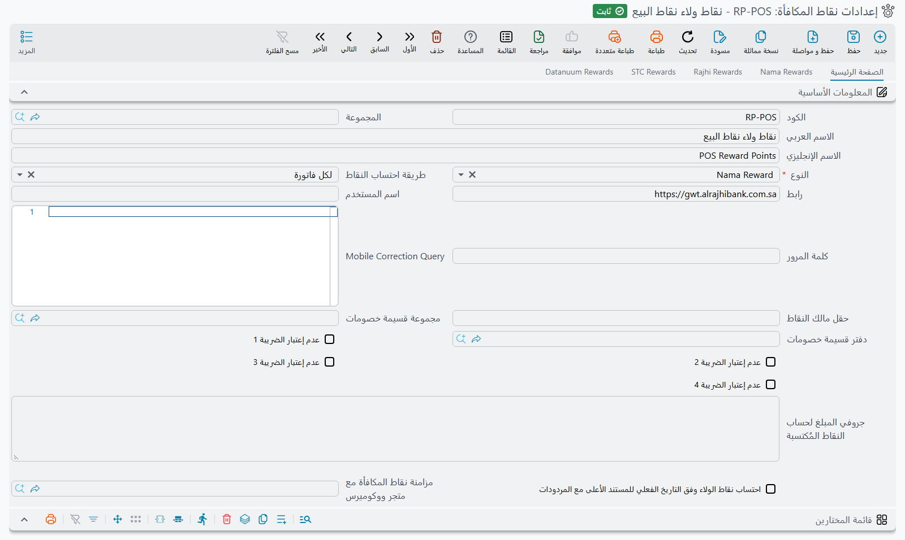
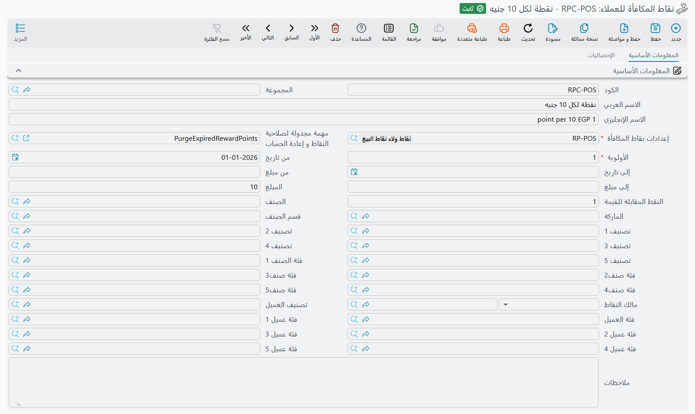

# إعداد نقاط المكافأة في نما (Nama Reward)

تشرح هذه الصفحة إعداد برنامج الولاء الخاص بنما: كيف يكسب العميل النقاط من فواتيره، ومتى تصبح قابلة للاستخدام ومتى تنتهي صلاحيتها، وكيف تُصرف، وكيف تُدخل الأرصدة الافتتاحية أو يُمنع عميل من البرنامج. قوالب الإشعارات والربط مع STC قطاف موجودة في صفحة [نقاط مكافآت العملاء](/ar/modules/invoicing/reward-points).

الشاشات الخمس كلها تحت **الأساسيات ← المستندات**.

## 1. البرنامج: إعدادات نقاط المكافأة

أنشئ سجل **إعدادات نقاط المكافأة** واجعل **النوع** = **Nama Reward**. الأنواع الأخرى تربط نما بمزوّد خارجي (الراجحي، العربي الوطني، STC، بونات، كانجارو، داتانيوم) يحتفظ بالرصيد عنده. كل ما يلي يخص Nama Reward، حيث يحتفظ نما بالرصيد بنفسه.

في الصفحة الأولى:

- **طريقة احتساب النقاط**: **لكل فاتورة** تمنح النقاط مع حفظ كل فاتورة. أما **فتري** فيسجّل فقط ما ينفقه كل عميل، وتُمنح النقاط لاحقًا بسند منح (الخطوة 5).
- **عدم إعتبار الضريبة 1** إلى **4**: تُكتسب النقاط على صافي قيمة السطر، وهو شامل الضريبة. علّم الضريبة هنا ليكون الاكتساب على القيمة من دونها.
- **قائمة المختارين**: تحدد المستندات التي تكسب نقاطًا. يمكن لكل سطر أن يحدد نوع مستند ودفترًا وتوجيهًا ومحددات و**تطبيق عند التوافق مع الاستعلام** أو **المعايير**، ثم **التطبيق** = **إدراج** أو **استبعاد**. أول سطر مطابق هو الذي يحسم. وبمجرد أن يكون في الجدول سطور، فالمستند الذي لا يطابق أيًّا منها لا يكسب شيئًا.
- **احتساب نقاط الولاء وفق التاريخ الفعلي للمستند الأعلى مع المردودات**: يُطابَق مردود المبيعات على قواعد الاكتساب بتاريخ الفاتورة الأصلية بدل تاريخه هو.
- **دفتر قسيمة خصومات** / **مجموعة قسيمة خصومات**: من أين تأخذ القسيمة التي ينشئها الصرف كودها (الخطوة 4).

في صفحة **Nama Rewards**:

- **استحقاق النقاط بعد (أيام)**: تصبح النقاط قابلة للاستخدام بعد هذا العدد من الأيام من تاريخ الفاتورة. اتركها 0 لتكون قابلة للاستخدام فورًا.
- **مدة صلاحية النقاط(تنتهي بعد عدد أيام)**: المدة التي تبقى فيها النقاط صالحة، محسوبة من يوم صيرورتها قابلة للاستخدام. املأ هذا الحقل: القيمة الفارغة تعني صفر أيام، فتنتهي النقاط في اليوم نفسه الذي تصبح فيه قابلة للاستخدام.
- **صلاحية النقاط تنتهي بنهاية السنة المنشأة فيها**: إضافة إلى ما سبق، تنتهي كل نقطة في 31 ديسمبر من سنة الفاتورة التي اكتسبتها. والأسبق من التاريخين هو الذي يُطبَّق. فمع 365 يومًا وهذا الخيار، تنتهي نقاط 1 مارس في 31 ديسمبر من السنة نفسها، وتنتهي نقاط 20 ديسمبر بعد أحد عشر يومًا.
- **المبلغ المقابل للنقاط في التعويض (مضروبأ في)** و**النقط المقابلة للمبلغ في التعويض (مقسوما علي)**: يحوّلان النقاط إلى مال عند صرفها، وكلاهما مطلوب. إذا كان كلاهما 1 فالنقطة الواحدة تساوي وحدة واحدة من عملة الشركة.
- **تنبية كود التحقق** و**عدد أحرف OTP** و**إنتهاء رمز التحقق اللحظي بعد (بالدقائق)** (3 دقائق إن تُرك فارغًا) و**استرداد النقاط بدون رمز OTP**: كيف يؤكد العميل عملية الصرف. والتنبيه مطلوب.

أخيرًا، اربط توجيهات مستندات المبيعات بالإعداد: حقل **إعدادات نقاط المكافأة** في [صفحة التسعير في التوجيه](/ar/modules/supplychain/document-terms/doc-term-pricing-taxes-discounts). ولنقاط البيع حدّده على الكاشير أو في إعدادات نقاط البيع. المستند الذي لا يحدد توجيهه أي إعداد لا يكسب شيئًا.

## 2. معدل الاكتساب: نقاط المكافأة للعملاء

يُحدَّد المعدل في شاشة مستقلة هي **نقاط المكافأة للعملاء**، ويمكن أن يكون للإعداد الواحد أكثر من سجل منها. كل سجل يحدد **إعدادات نقاط المكافأة** و**الأولوية** و**من تاريخ** / **إلى تاريخ** اختياريًا، ثم القاعدة نفسها:

- **المبلغ** و**النقط المقابلة للقيمة**: يكسب العميل *النقط المقابلة للقيمة* عن كل *مبلغ* من القيمة. مبلغ 10 ونقط 1 تعني نقطة لكل 10 من القيمة، فالسطر الذي قيمته 250 يكسب 25 نقطة.
- على من تُطبَّق: **مالك النقاط** واحد، أو فئات العملاء وتصنيفاتهم.
- على ماذا تُطبَّق: صنف أو قسم أو ماركة أو فئات الأصناف وتصنيفاتها، والمحددات في أسفل الشاشة.
- **من مبلغ** / **إلى مبلغ**: تستخدمها الطريقة الفترية؛ يجب أن يقع إجمالي إنفاق العميل في الفترة داخل هذا النطاق.

القيم المكتوبة في الرأس تُنسخ إلى كل سطر من سطور الجدول، فالرأس يحمل ما تشترك فيه السطور. تُجرَّب السجلات بترتيب **الأولوية** تصاعديًا، ولكل سطر في الفاتورة تعطي أول قاعدة تطابق الصنف والعميل والتاريخ المعدل. السطر الذي لا تطابقه أي قاعدة لا يكسب شيئًا. والجزء من الفاتورة المدفوع بقسائم خصومات، وهي الطريقة التي تُدفع بها النقاط المصروفة، لا يكسب نقاطًا.

**مهمة مجدولة لصلاحية النقاط و إعادة الحساب**: إن تُركت فارغة، فحفظ السجل يربطه بمهمة مجدولة يومية كودها `PurgeExpiredRewardPoints` (وينشئها إن لم تكن موجودة). هذه المهمة تُخرج النقاط المنتهية من رصيد كل عميل.

## 3. ما يحدث عند الحفظ والمردود والإلغاء

عند معالجة الفاتورة تُسجَّل نقاطها للعميل، وتعرضها شاشة العميل بتاريخ بدء استخدامها وتاريخ انتهائها. ومردود المبيعات يسترد النقاط التي اكتُسبت على القيمة المردودة. فإن لم يعد لدى العميل نقاط صالحة تكفي لردّها، رُفض المردود. ويُرفض إلغاء الفاتورة للسبب نفسه.

## 4. الصرف

في الفاتورة، يعرض زر **Request Redeem Customer Amount** (يظهر بالإنجليزية في الواجهة العربية أيضًا) النقاط المتبقية للعميل وقيمتها، ويسأل عن المبلغ المطلوب صرفه. فينشئ قسيمة خصومات بهذا المبلغ ويرسل إلى العميل رمز تحقق لمرة واحدة، إلا إذا كان **استرداد النقاط بدون رمز OTP** مفعّلًا. وبعد إدخال الرمز تُضاف القسيمة إلى سطور الدفع في الفاتورة وتُخصم النقاط، الأقدم أولًا. وفي نقاط البيع يتم الأمر نفسه من نافذة نقاط المكافأة (راجع [الدفع والسداد](/ar/modules/pos/pos-payment-and-tender)).

## 5. الأرصدة الافتتاحية والمنح الفتري والمنع

- **سند إفتتاحي نقاط ولاء** يُدخل الأرصدة من نظام سابق: سطر لكل عميل فيه **النقاط** و**تاريخ المكافأة** و**إلى تاريخ** اختياريًا. **قيمة النقاط** محسوبة، وتُسجَّل في القيود حسب طرفي القيد في توجيه السند.
- **سند منح نقاط ولاء فتري** هو النصف الثاني من الطريقة **فتري**. حدّد له **من تاريخ** و**إلى تاريخ**. عند الحفظ يجمع إنفاق كل عميل في هذه الفترة، ويختار سطر القاعدة الذي يقع الإجمالي داخل نطاق **من مبلغ** / **إلى مبلغ** فيه، ويمنح النقاط بتاريخ **تاريخ المكافأة** («إلى تاريخ» إن تُرك فارغًا). وتعرض قائمة السطور لكل عميل إجمالي المبلغ والنقاط وقيمتها.
- **منع احتساب أو صرف نقاط الولاء** يمنع عملاء لفترة محددة. كل سطر يحدد عميلًا مع **من تاريخ** و**إلى تاريخ**، ويعلّم **منع احتساب النقاط** أو **منع صرف النقاط** أو كليهما. اترك الإعداد في الرأس فارغًا ليشمل المنع كل البرامج.

## رسائل قد تظهر لك

| الرسالة | السبب | ماذا تفعل |
|---|---|---|
| «نقاط المكأفاة المتاحة {0} للعميل {1} أقل من النقاط المخصومة {2}» | مردود أو إلغاء سيسترد نقاطًا صرفها العميل بالفعل. | ألغِ عملية الصرف أولًا، أو قلّل المردود. |
| «لا يمكنك الإسترجاع, ليس هناك نقاط متاحه» | ليس لدى العميل نقاط صالحة في ذلك التاريخ؛ ربما لم تنقضِ بعدُ مدة **استحقاق النقاط بعد (أيام)**، أو انتهت صلاحيتها. | راجع قائمة نقاط العميل. |
| «النقاط المطلوب إسترجاعها {0} اكبر من المستحق {1} للعميل {2}» | المبلغ المطلوب يحتاج نقاطًا أكثر مما لدى العميل. | اصرف مبلغًا أقل. |
| «كود تحقق غير صالح» | الرمز خاطئ أو منتهي الصلاحية. | اطلب رمزًا جديدًا. |
| «العميل {0} ممنوع من صرف نقاط مكافأة» | سطر منع يمنع هذا العميل من الصرف في ذلك التاريخ. | راجع سطور منع احتساب أو صرف نقاط الولاء. |
| «ملف إعدادات نقاط المكافأة {0} يجب ان يكون من النوع {1}» | سجل نقاط المكافأة للعملاء يشير إلى إعداد ليس من نوع Nama Reward. | اختر إعدادًا من نوع Nama Reward. |
| *You can not cancel the document because there are {1} redeemed points for customer {0}* | لا يمكن إلغاء سند منح فتري صُرفت نقاطه. ليس لهذه الرسالة نص عربي، فتظهر بالإنجليزية في الواجهة العربية أيضًا. | ألغِ عمليات الصرف أولًا. |
| *You can not remove the customer {0} because there are {1} redeemed points* | لا يمكن حذف سطر افتتاحي صُرفت نقاطه. تظهر بالإنجليزية في الواجهة العربية أيضًا. | أبقِ السطر. |
