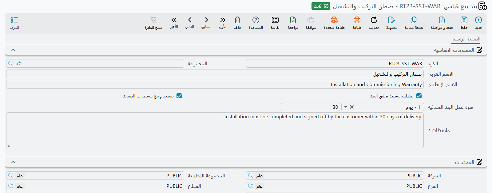

# توثيق خاصية الشروط والأحكام القياسية (Standard Terms and Conditions Feature Documentation)

## نظرة عامة (Overview)

تتيح خاصية الشروط القياسية في نما آلية شاملة لتتبع الشروط والأحكام في وثائق المبيعات (الفواتير والعروض وما إليها) ومراقبة مدى الوفاء بها. يمكّن هذا النظام الشركات من تحديد شروط موحدة وإرفاقها بالوثائق وتتبع حالة الوفاء بها وإدارة التمديدات عند الحاجة.

## المكونات الرئيسية (Key Components)

### 1. الشرط القياسي للمبيعات - ملف رئيسي (Sales Standard Term - Master File)
**الكيان**: `SalesStandardTerm`  
**النوع**: ملف رئيسي

هذا هو التعريف الرئيسي للشروط القياسية التي يمكن إرفاقها بوثائق المبيعات.

#### حقول الإعداد (Configuration Fields):
- **الكود** (`code`): معرّف فريد للشرط
- **الاسم 1** (`name1`): الاسم/الوصف الرئيسي للشرط
- **يتطلب مستند تحقق البند** (`requiresTermFulfillment`): علامة منطقية تشير إلى ما إذا كان هذا الشرط يحتاج إلى تتبع رسمي للوفاء به
- **يستخدم مع مستندات التمديد** (`useWithTermExtension`): علامة منطقية تشير إلى إمكانية تمديد هذا الشرط
- **فترة عمل البند المبدئية** (`initialTermWorkPeriod`): المدة الافتراضية للشرط (تشمل القيمة ووحدة القياس)
- **ملاحظات 2** (`remarks2`): ملاحظات إضافية أو وصف تفصيلي للشرط

### 2. وثيقة إتمام الشرط القياسي (Standard Term Fulfillment Document)
**الكيان**: `StandardTermFulfillment`  
**النوع**: ملف وثيقة

وثيقة تُستخدم لتسجيل الوفاء بشروط محددة رسميًا.

#### الحقول الرئيسية (Key Fields):
- **بناءً على** (`fromDoc`): مرجع عام للوثيقة المصدر (مثل فاتورة المبيعات)
- **التفاصيل** (`details`): مجموعة من سطور الوفاء

#### حقول سطر الوفاء (Fulfillment Line Fields):
- **البند القياسي** (`standardTerm`): حقل مرجع للشرط القياسي للمبيعات الذي تم الوفاء به
- **تاريخ التحقق** (`fulfillmentDate`): التاريخ الذي تم فيه الوفاء بالشرط

### 3. وثيقة تمديد الشرط القياسي (Standard Term Extension Document)
**الكيان**: `StandardTermExtension`  
**النوع**: ملف وثيقة

وثيقة تُستخدم لتمديد الموعد النهائي للشروط القياسية التي تسمح بالتمديد.

#### الحقول الرئيسية (Key Fields):
- **بناءً على** (`fromDoc`): مرجع عام للوثيقة المصدر
- **التفاصيل** (`details`): مجموعة من سطور التمديد

#### حقول سطر التمديد (Extension Line Fields):
- **البند القياسي** (`standardTerm`): حقل مرجع للشرط القياسي للمبيعات المراد تمديده
- **فترة التمديد** (`extensionPeriod`): مدة إضافية للتمديد
- **غرامة التمديد** (`extensionFine`): غرامة مالية مقابل التمديد

## التطبيق في وثائق المبيعات (Implementation in Sales Documents)

### سطر الشروط القياسية في فاتورة المبيعات (Sales Invoice Standard Terms Line)
في عروض أسعار المبيعات وأوامر البيع وفواتير المبيعات واستبدالات المبيعات وفواتير المشتريات جدولٌ للشروط القياسية، وكذلك في بعض مستندات الوحدات الأخرى (عقود البيع والإيجار في العقارات، وطلبات فواتير التأجير، وأمر البيع وموافقة البيع والفاتورة المبدئية في مراكز الخدمة).

#### حقول السطر (Line Fields):
- **البند القياسي** (`standardTerm`): حقل مرجع للشرط القياسي للمبيعات
- **ملاحظات** (`remarks`): ملاحظات إضافية خاصة بهذه الحالة
- **تاريخ نهاية عمل البند المخططة** (`termPlannedEndDate`): الموعد النهائي الأصلي للشرط
- **تاريخ نهاية عمل البند بعد التمديد** (`termExtendedEndDate`): الموعد النهائي المحدث بعد التمديدات (يحسبه النظام)
- **تاريخ التحقق** (`fulfillmentDate`): تاريخ الوفاء (يحدّثه النظام)
- **مجموع غرامات التمديد** (`extensionFines`): الغرامات المتراكمة من جميع التمديدات (يحسبها النظام)
- **وثيقة الوفاء** (`fulfillmentDoc`): حقل مرجع لوثيقة إتمام الشرط القياسي (يحدّثه النظام)

#### حقول مخصصة إضافية (Additional Custom Fields):
يوفر النظام حقولًا مرنة للبيانات المخصصة:
- **حقول مرجع** (`ref1` إلى `ref5`): مراجع عامة للربط بكيانات أخرى
- **حقول رقمية** (`n1` إلى `n5`): قيم عشرية للحسابات المخصصة
- **حقول نصية** (`text1` إلى `text5`): قيم نصية للمعلومات الإضافية
- **حقول التاريخ** (`date1` إلى `date5`): قيم تاريخ لتتبع المعالم
- **المرفقات** (`attachment1` إلى `attachment3`): بيانات ثنائية للوثائق الداعمة

## مسار العمل التجاري (Business Process Flow)

### 1. مرحلة الإعداد (Setup Phase)
1. أنشئ الشروط القياسية للمبيعات في الملف الرئيسي
2. قم بتهيئة كل شرط بما يلي:
   - هل يتطلب تتبع الوفاء
   - هل يمكن تمديده
   - مدة العمل الافتراضية

### 2. إنشاء الوثيقة (Document Creation)
1. أضف الشروط القياسية إلى وثائق المبيعات (الفواتير والعروض وما إليها)
2. إذا كان `termPlannedEndDate` فارغًا، يملؤه النظام عند الحفظ بناءً على:
   - تاريخ قيمة الوثيقة
   - الفترة الأولية للشرط (أو تاريخ القيمة نفسه إذا لم تكن للشرط فترة)

   وإذا كان في السطر تاريخ نهاية مخطط بالفعل فإنه يبقى كما هو.
3. بالنسبة للشروط المعلَّم فيها **يستخدم مع مستندات التمديد**، يحسب النظام `termExtendedEndDate` مع مراعاة أي تمديدات قائمة

### 3. عملية تمديد الشرط (Term Extension Process)
1. أنشئ وثيقة تمديد الشرط القياسي
2. أشر إلى الوثيقة المصدر
3. أضف سطور تمديد محددةً:
   - أي الشروط يُراد تمديدها
   - فترة التمديد
   - غرامات التمديد
4. يقوم النظام بتحديث:
   - `termExtendedEndDate` في الوثيقة الأصلية
   - تراكم `extensionFines`

### 4. عملية الوفاء بالشرط (Term Fulfillment Process)
1. أنشئ وثيقة إتمام الشرط القياسي
2. أشر إلى الوثيقة المصدر
3. أضف سطور وفاء محددةً:
   - أي الشروط تم الوفاء بها
   - تواريخ الوفاء
4. يتحقق النظام ويحدّث:
   - `fulfillmentDate` في الوثيقة الأصلية
   - حقل مرجع `fulfillmentDoc`

## قواعد التحقق (Validation Rules)

### تفرد الشروط (Term Uniqueness)
- الشرط القياسي الذي يتطلب تحققًا أو يُستخدم مع التمديد لا يظهر إلا مرة واحدة في الوثيقة، ويُرفض حفظ وثيقة تكرره بالرسالة «البند {0} مكرر في السطر {1}»

### العثور على الشرط (Finding the Term)
- تحتاج وثيقة التحقق أو التمديد إلى **بناءً على** (`fromDoc`)، ولا يظهر فيها كل شرط إلا مرة واحدة (بالرسالة نفسها «البند {0} مكرر في السطر {1}»)
- لا يوضع في وثيقة التحقق إلا شرط معلَّم فيه **يتطلب مستند تحقق البند**، ولا يوضع في وثيقة التمديد إلا شرط معلَّم فيه **يستخدم مع مستندات التمديد**. وأي شرط آخر يُرفض بالرسالة «البند {0} لا يمكن استخدامه مع {1}»
- يحتاج سطر التحقق إلى **تاريخ التحقق**، ويحتاج سطر التمديد إلى قيمة **فترة التمديد** ووحدتها معًا
- يجب أن يكون كل شرط في سطور وثيقة التحقق أو التمديد موجودًا في جدول الشروط القياسية بالوثيقة المصدر، وإلا رُفض بالرسالة «لا يمكن إيجاد البند {0} في المستند {1}»

### التحقق من التمديد (Extension Validation)
- كل تمديد للشرط يؤخر تاريخ نهايته بمقدار **فترة التمديد** في ذلك التمديد، وتُجمع غرامات التمديدات كلها في **مجموع غرامات التمديد**
- بعد تحقيق الشرط، تُفحص تمديداته بترتيب تاريخ القيمة ثم تاريخ الإنشاء، ويُرفض أي تمديد يبدأ في تاريخ التحقق أو بعده بالرسالة «البند {0} تم تحقيقه في التاريخ {1} بالمستند {2}, لا يمكن تمديد البند بالمستند {3} بعد هذا التاريخ»

### التحقق من الوفاء (Fulfillment Validation)
- لا يمكن الوفاء بالشرط إلا مرة واحدة. فإذا كانت وثيقة تحقق أخرى تحققه بالفعل، يُرفض الحفظ بالرسالة «لا يمكنك تحقق البند {0} بالمستند {1}, المستند {2} يحقق البند»
- يجري فحص التاريخ نفسه عند تحقيق الشرط: يجب أن يقع تاريخ التحقق بعد تاريخ النهاية الساري قبل كل تمديد من تمديداته
- حذف وثيقة التحقق أو إلغاؤها يمسح تاريخ التحقق ووثيقته من سطر الوثيقة المصدر، وإلغاء التمديد يطرح فترته وغرامته

## أمثلة الإعداد (Configuration Examples)

### مثال 1: شروط الدفع (Payment Terms)
**إعداد الشرط**:
- الكود: `PAY30`
- الاسم: "السداد خلال 30 يومًا"
- يتطلب وفاء: نعم
- يسمح بالتمديد: نعم
- الفترة الأولية: 30 يومًا

**الاستخدام**: يُرفق بفواتير المبيعات لتتبع مواعيد الدفع النهائية والتمديدات.

### مثال 2: شروط التسليم (Delivery Terms)
**إعداد الشرط**:
- الكود: `DEL7`
- الاسم: "التسليم خلال 7 أيام"
- يتطلب وفاء: نعم
- يسمح بالتمديد: لا
- الفترة الأولية: 7 أيام

**الاستخدام**: يُرفق بأوامر المبيعات لتتبع التزامات التسليم.

### مثال 3: شروط الضمان (Warranty Terms)
**إعداد الشرط**:
- الكود: `WAR365`
- الاسم: "ضمان لمدة سنة"
- يتطلب وفاء: لا
- يسمح بالتمديد: نعم
- الفترة الأولية: 365 يومًا

**الاستخدام**: يُرفق بفواتير المبيعات لتتبع الضمان.
