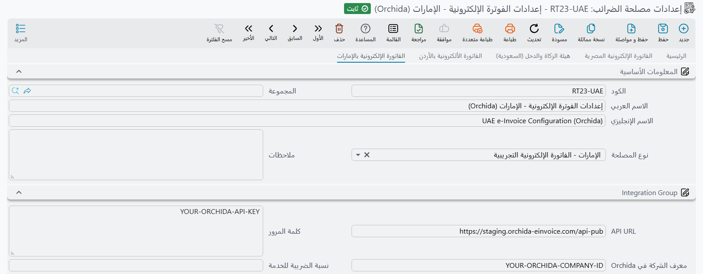
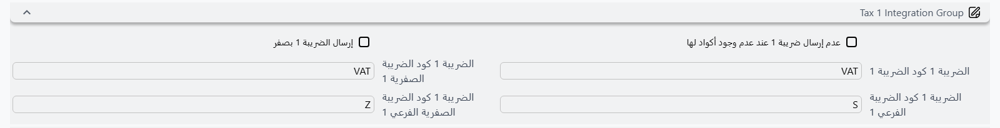

::: warning In Progress
هذا المستند لا يزال قيد الإعداد ولم يكتمل بعد
:::

# الربط مع الفاتورة الإلكترونية في الإمارات عبر Orchida osTax

## نظرة عامة (Overview)

يدعم NamaERP إرسال الفواتير الإلكترونية إلى الهيئة الاتحادية للضرائب في الإمارات (FTA) عبر مزوّد الخدمة Orchida osTax. تعمل Orchida بصفتها مزوّد خدمة معتمدًا (ASP) ضمن نموذج الفوترة الإلكترونية ذي الخمسة أطراف المبني على شبكة Peppol في الإمارات.

يُرسل النظام الفواتير بصيغة JSON إلى Orchida التي تتحقق منها وتُبلّغ بيانات الضريبة إلى الهيئة الاتحادية للضرائب وتوجّهها إلى المشتري عبر شبكة Peppol.

## المتطلبات الأساسية (Prerequisites)

قبل البدء في الإعداد، تحتاج إلى:

- حساب على منصة Orchida osTax (https://app.orchidatax.com)
- مفتاح API (Bearer Token) من لوحة تحكم Orchida
- معرّف الشركة (Company ID) من لوحة تحكم Orchida

### الحصول على بيانات الاعتماد من Orchida

1. سجّل الدخول إلى لوحة تحكم Orchida
2. أدخل رمز OTP المُرسَل إلى بريدك الإلكتروني
3. اختر المستأجر والشركة المناسبَين
4. اذهب إلى Security > Generate Key
5. أنشئ مفتاحًا جديدًا (حدد تاريخ انتهاء الصلاحية والاسم)
6. انسخ مفتاح API ومعرّف الشركة

## إعداد النظام (System Setup)

### الخطوة الأولى: إعدادات الفاتورة الإلكترونية العامة (Step 1: Global E-Invoice Settings)

من الإعدادات العامة > الصفحة الثانية:
- اضبط `عرض صفحة الفاتورة الإلكترونية الخاصة بـ` على `الفاتورة الإلكترونية بالإمارات`
- بعد تغيير القيمة قم بعمل Regen UI

### الخطوة الثانية: إعداد مصلحة الضرائب (Step 2: Tax Payer Configuration)

أنشئ إعداد مصلحة ضرائب جديدًا أو عدّل إعدادًا قائمًا.

#### المعلومات الأساسية (Basic Information)

| الحقل          | القيمة |
|----------------|-------|
| نوع المصلحة | `الإمارات - الفاتورة الإلكترونية التجريبية` (للاختبار) أو `الإمارات - الفاتورة الإلكترونية` (للإنتاج) |
| رقم التسجيل الضريبى | رقم التسجيل الضريبي للمنشأة |

#### إعدادات التكامل (Integration Settings)

| الحقل              | الوصف |
|--------------------|-------------|
| API URL            | يُملأ تلقائيًا عند اختيار **نوع المصلحة** |
| كلمة المرور        | مفتاح API من Orchida (Bearer Token) |
| معرف الشركة في Orchida | معرّف الشركة من لوحة تحكم Orchida |

#### إعداد أكواد الضريبة (Tax Code Configuration)

تتبع أكواد الضريبة في الإمارات معيار UN/EDIFACT 5305 (أكواد فئة الضريبة المنسَّقة).

**نوع الضريبة (Tax Type)**:

| الكود | الوصف |
|------|-------------|
| VAT | ضريبة القيمة المضافة |

**نوع الضريبة الفرعي (Tax SubType)**:

| الكود | الوصف |
|------|-------------|
| S | النسبة القياسية (5%) |
| Z | خاضع للضريبة بنسبة صفر |
| E | معفي من الضريبة |
| O | خارج النطاق |
| AE | الاحتساب العكسي |

::: warning
عند استخدام الكود `S` (النسبة القياسية)، يجب أن تكون نسبة ضريبة القيمة المضافة بالضبط `5.00`
:::

### الخطوة الثالثة: إعداد العميل (Step 3: Customer Setup)

لكل عميل سيستقبل فواتير إلكترونية، أكمل الحقول التالية:

#### البيانات الضريبية (Tax Information)

| الحقل        | الوصف |
|--------------|-------------|
| رقم التسجيل الضريبى | رقم التسجيل الضريبي (TRN) للعميل |
| الرقم المميز | معرّف نقطة نهاية Peppol للعميل |
| الوصف 4 (`description4`، غير ظاهر في شاشة العميل القياسية) | معرّف الجهة (مثلًا `TL`) |
| الوصف 5 (`description5`، غير ظاهر في شاشة العميل القياسية) | اسم الجهة (مثلًا اسم الشركة) |

#### العنوان (Address)

| الحقل       | الوصف |
|-------------|-------------|
| كود الدولة  | كود الدولة (مثلًا `AE`)؛ إن كان فارغًا تُرسَل **الدولة** بدلًا منه |
| المدينة     | اسم المدينة |
| شارع        | عنوان الشارع |
| المحافظة    | كود الإمارة |

::: tip أكواد الإمارات

| الكود | الإمارة |
|------|---------|
| AUH | أبوظبي |
| DXB | دبي |
| SHJ | الشارقة |
| AJM | عجمان |
| UAQ | أم القيوين |
| RAK | رأس الخيمة |
| FUJ | الفجيرة |
:::

### الخطوة الرابعة: إعداد وحدات القياس (Step 4: Unit of Measure Setup)

يجب أن تمتلك كل وحدة قياس مستخدمة في الفواتير كودًا صالحًا لدى مصلحة الضرائب وفق معيار UN/ECE Rec 20:

| الكود | الوصف |
|------|-------------|
| EA | وحدة |
| KGM | كيلوغرام |
| MTR | متر |
| LTR | لتر |
| XBX | صندوق |
| PCE | قطعة |

### الخطوة الخامسة: إعداد العملة (Step 5: Currency Setup)

تأكد من وجود عملة بكود مصلحة الضرائب `AED` وأنها مضبوطة كعملة افتراضية.

## إرسال الفواتير (Sending Invoices)

### إنشاء وثيقة إرسال لمصلحة الضرائب (Creating a Tax Authority Submission Document)

1. اذهب إلى **إرسال مستندات الي مصلحة الضرائب**
2. انقر على **تجميع مستندات الضرائب** لإضافة الفواتير المراد إرسالها
3. انقر على **إرسال المستندات المختارة فقط** أو **إرسال المستندات التي لم تُرسل** لتقديم الفواتير إلى Orchida

### حالات الإرسال (Submission Statuses)

بعد الإرسال تُضبط حالة الوثيقة إلى:
- **تم ارساله**: قبلت Orchida الفاتورة للمعالجة
- **لم يتم ارساله بشكل صحيح**: رُفضت الفاتورة — راجع حقل الأخطاء للاطلاع على التفاصيل

## أنواع الوثائق المدعومة (Supported Document Types)

| النوع | مدعوم |
|------|-----------|
| فاتورة | نعم |
| إشعار دائن | نعم |
| إشعار مدين | لا |

## الحد الأقصى لأيام الإرسال (Maximum Days to Send)

العدد الافتراضي للأيام المسموح بها لإرسال الفاتورة بعد تاريخ قيمتها هو **14 يومًا**. يمكن تغيير هذا الإعداد في إعداد مصلحة الضرائب ضمن حقل **أقصي عدد أيام لإرسال الفواتير**.
