# تثبيت ZATCA SDK ونشر zatca.war

قبل أن يرسل نما أي مستند إلى هيئة الزكاة والضريبة والجمارك، يحتاج الخادم الذي يعمل عليه نما إلى شيئين. الأول **أداة الهيئة (ZATCA SDK)**، وفيها المخططات وملفات القواعد التي تُفحص بها كل فاتورة قبل توقيعها. والثاني **`zatca.war`**، خدمة التوقيع في نما، وهي تعمل داخل Tomcat نفسه الذي يعمل عليه نما وتقرأ ملفات الأداة.

تتم هذه الخطوات مرة واحدة لكل خادم، قبل إنشاء الإعدادات المشروحة في [الربط مع هيئة الزكاة والضريبة والجمارك](./zatca-guide.md)، وتستغرق نحو ربع ساعة. وهي مرتبة كما ينفذها فريق ZATCA لدينا على خوادم العملاء، والصور مأخوذة من تثبيت فعلي على Windows Server.

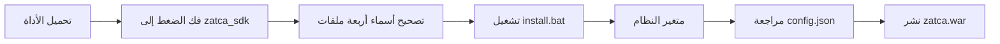

وبالكلام: حمّل الأداة، وفك ضغطها إلى `C:\zatca_sdk`، وأعد لأربعة ملفات امتداداتها الصحيحة، وشغّل `install.bat`، وانسخ `SDK_CONFIG` إلى متغيرات النظام، وراجع `config.json`، ثم انشر `zatca.war` على Tomcat.

## قبل أن تبدأ

تحتاج إلى حساب مسؤول (Administrator) على الخادم، وغالبًا تصل إليه عن بُعد بأداة مثل AnyDesk، وأن يكون نما مثبتًا ويعمل على Tomcat.

**تأكد أن الخادم يصل إلى نماسوفت.** من الخادم نفسه افتح <https://namasoft.com/bin/zatca/files/>، فتظهر الملفات `CountryCodes.json` و`TaxSubtypes.json` و`TaxTypes.json`. هذه قوائم أكواد الهيئة، ويقرؤها نما من هذا العنوان كلما فحص مستندًا أو إعدادات، فالخادم الذي لا يفتح هذه الصفحة لا يستطيع التحقق من شيء. أصلح اتصاله بالإنترنت أو الجدار الناري أولًا.

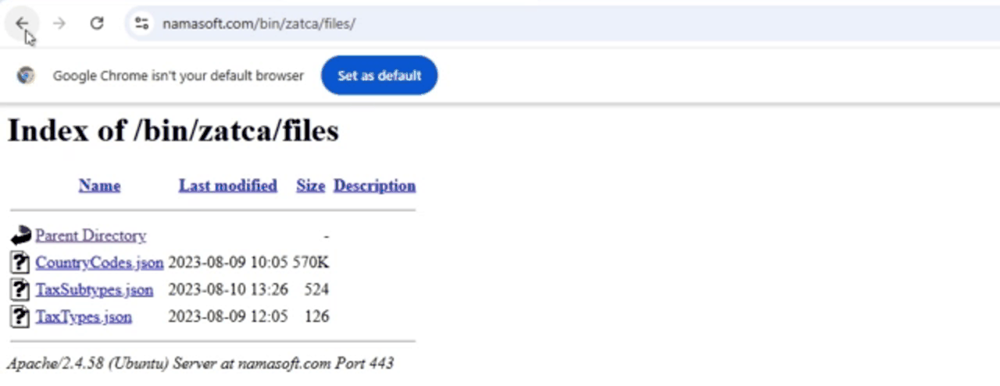

**أظهر امتدادات الملفات.** في مستكشف الملفات افتح **View** وعلّم على **File name extensions**. فالخطوة الثالثة كلها عن الامتدادات، وإذا كانت مخفية بدا `install.ba_` و`install.bat` متطابقين.

## 1. تحميل الأداة

افتح [صفحة تحميل الأداة على موقع الهيئة](https://zatca.gov.sa/en/E-Invoicing/SystemsDevelopers/ComplianceEnablementToolbox/Pages/DownloadSDK.aspx)، وانزل إلى الشروط، وعلّم على **I accept the above terms and conditions**، ثم اضغط **Download SDK**. يحمل اسم الملف رقم الإصدار، مثل `zatca-envoice-sdk-203.zip`.

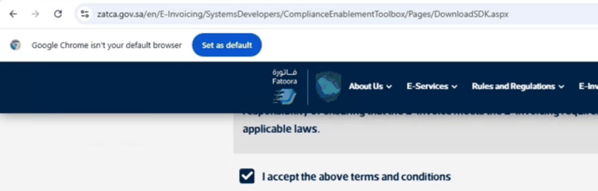

## 2. فك الضغط إلى C:\zatca_sdk

من مجلد **Downloads** اضغط بزر الفأرة الأيمن على الملف المضغوط وفك ضغطه.

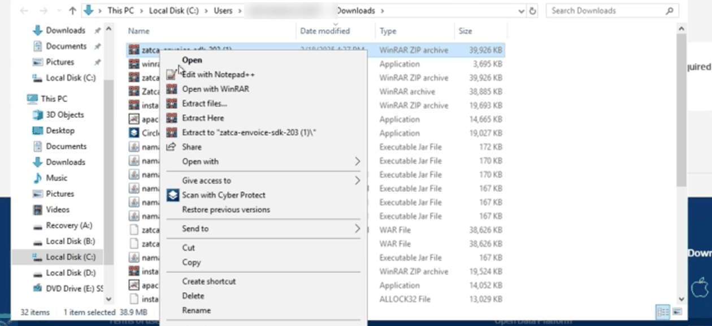

انقل المجلد الناتج إلى `C:\` وغيّر اسمه من `zatca-envoice-sdk-203` إلى `zatca_sdk`.

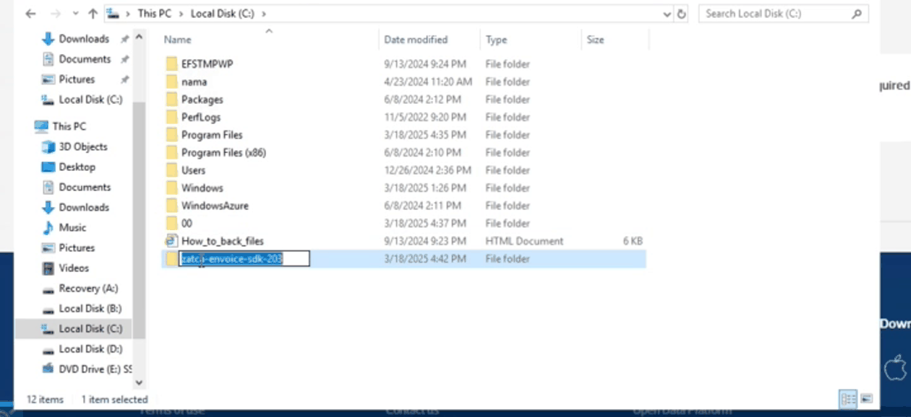

افتح `C:\zatca_sdk`. يجب أن تكون المجلدات `Apps` و`Configuration` و`Data` و`Lib` و`Readme` والملفات `install.ba_` و`install.sh` و`LICENSE` بداخله مباشرة. فإذا وجدت مستوى مجلد إضافيًا، مثل `C:\zatca_sdk\zatca-envoice-sdk-203\Apps`، فانقل محتويات المجلد الداخلي مستوى واحدًا إلى الأعلى.

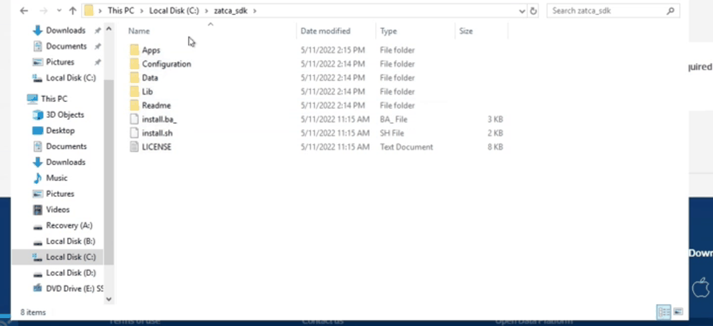

## 3. إعادة الامتدادات الصحيحة لأربعة ملفات

تأتي برامج الأداة من الهيئة وقد استُبدل آخر حرف في امتدادها بشرطة سفلية، ولا يشغّلها Windows حتى يُعاد تسميتها. حدد كل ملف واضغط **F2** وصحّح الامتداد، ثم أجب بـ **Yes** عندما ينبّهك Windows أن الملف قد يصبح غير صالح للاستخدام:

| المجلد | الاسم الحالي | الاسم الجديد |
|---|---|---|
| `C:\zatca_sdk\Apps` | `fatoora.ba_` | `fatoora.bat` |
| `C:\zatca_sdk\Apps` | `jq.ex_` | `jq.exe` |
| `C:\zatca_sdk\Configuration` | `jq.ex_` | `jq.exe` |
| `C:\zatca_sdk` | `install.ba_` | `install.bat` |

::: details الملفات الأربعة واحدًا واحدًا
`Apps` — من `fatoora.ba_` إلى `fatoora.bat`:

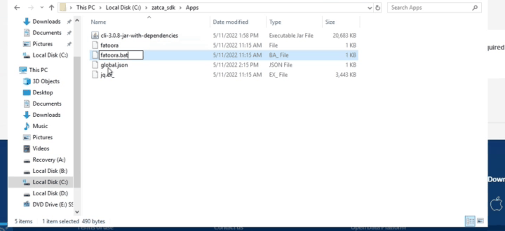

`Apps` — من `jq.ex_` إلى `jq.exe`:

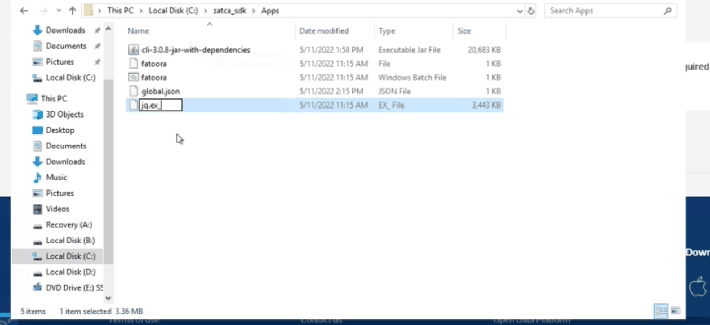

`Configuration` — من `jq.ex_` إلى `jq.exe`:


`C:\zatca_sdk` — من `install.ba_` إلى `install.bat`:

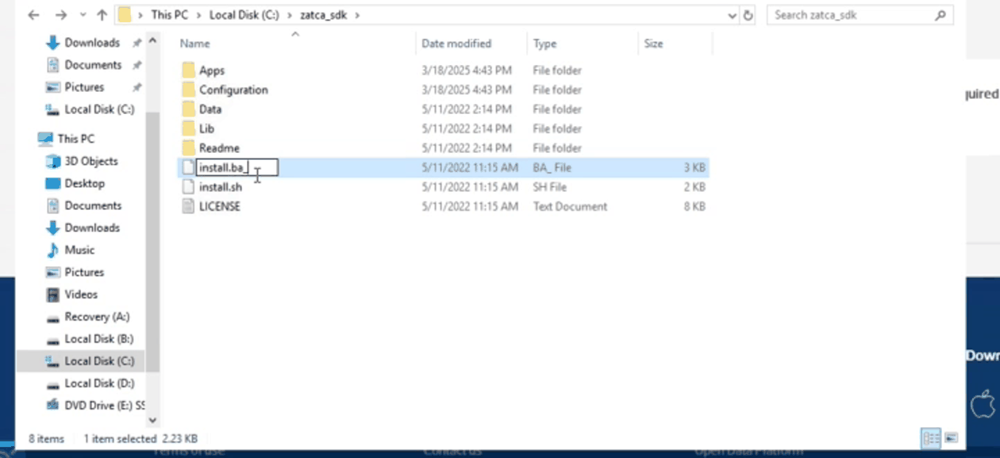
:::

## 4. تشغيل install.bat

انقر نقرًا مزدوجًا على `C:\zatca_sdk\install.bat`، فتفتح نافذة أوامر وتظهر فيها:

```text
WARNING: User credentials cannot be used for local connections.
```

هذا التنبيه طبيعي ولا يعني أن التثبيت فشل.

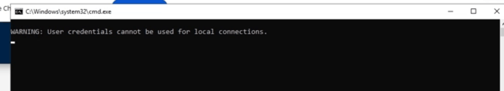

ينشئ السكربت ثلاثة متغيرات بيئة **للمستخدم** الذي سجلت الدخول به:

| المتغير | القيمة |
|---|---|
| `FATOORA_HOME` | `C:\zatca_sdk\Apps\` |
| `Path` | تُضاف إليه `C:\zatca_sdk\Apps\` |
| `SDK_CONFIG` | `C:\zatca_sdk\Configuration/config.json` |

## 5. نسخ SDK_CONFIG إلى متغيرات النظام

متغيرات الخطوة الرابعة خاصة بحساب المستخدم وحده، وTomcat يعمل كخدمة Windows بحساب آخر فلا يراها. وخدمة التوقيع لا تحتاج منها إلا `SDK_CONFIG`، الذي يدلها على مكان `config.json`. أما المتغيران الآخران فلأداة سطر الأوامر الخاصة بالهيئة، ونما لا يستخدمها، فلا بأس أن يبقيا متغيرين للمستخدم.

1. افتح محرر متغيرات البيئة: اضغط Win + R ثم شغّل:
   ```sh
   rundll32 sysdm.cpl,EditEnvironmentVariables
   ```
   أو ادخل من **System Properties ← Advanced ← Environment Variables**.
2. في متغيرات المستخدم انقر نقرًا مزدوجًا على `SDK_CONFIG` وانسخ قيمته.

   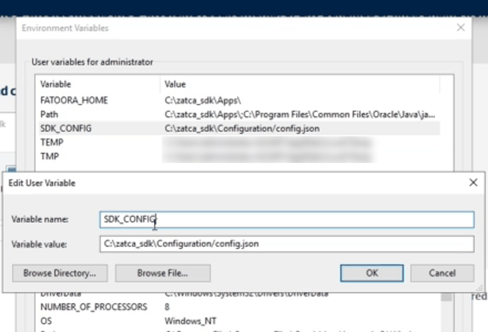

3. في **System variables** اضغط **New**، واكتب الاسم `SDK_CONFIG`، والصق القيمة، ثم اضغط **OK**.

   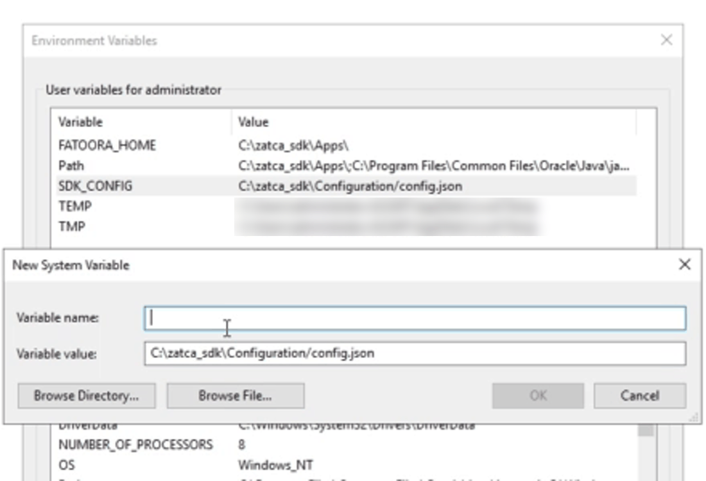

ويجب أن يظهر `SDK_CONFIG` الآن في متغيرات النظام:


::: tip انسخ المتغير عبر PowerShell
شغّل هذا في PowerShell **كمسؤول (Administrator)**، وأنت داخل بالمستخدم نفسه الذي شغّل `install.bat`:
```powershell
$varName = "SDK_CONFIG"
$userValue = [Environment]::GetEnvironmentVariable($varName, "User")
if ($userValue) {
    Write-Host "Copying $varName with value '$userValue' to system environment..."
    [Environment]::SetEnvironmentVariable($varName, $userValue, "Machine")
    Write-Host "Copied successfully."
} else {
    Write-Host "User environment variable '$varName' not found."
}
```
:::

## 6. مراجعة config.json

افتح `C:\zatca_sdk\Configuration\config.json` في Notepad++ أو Notepad. هو سطر واحد فيه مسارات مخططات الأداة وملفات قواعدها وشهاداتها، ويجب أن يبدأ كل مسار بـ `C:\\zatca_sdk\\` وأن يشير إلى ملف موجود:

```json
{ "xsdPath": "C:\\zatca_sdk\\Data\\Schemas\\xsds\\UBL2.1\\xsd\\maindoc\\UBL-Invoice-2.1.xsd", "enSchematron": "C:\\zatca_sdk\\Data\\Rules\\schematrons\\CEN-EN16931-UBL.xsl", "zatcaSchematron": "C:\\zatca_sdk\\Data\\...", ... }
```

إذا أشار مسار إلى مكان آخر، كمجلد باقٍ من تثبيت سابق، فصحّحه واحفظ الملف، ثم انظر إلى تاريخ تعديل الملف لتتأكد أن الحفظ تم.

## 7. نشر zatca.war على Tomcat

1. حمّل `zatca.war` من <https://namasoft.com/bin/zatca.war>. وإذا كانت في **Downloads** نسخة قديمة، يحفظ المتصفح الجديدة باسم `zatca (2).war`.
2. انسخه إلى مجلد `webapps` الخاص بـ **Tomcat الذي يعمل عليه نما**، أي الذي فيه `erp.war` و`basic-services.war`، مثل `C:\Program Files\Apache Software Foundation\Tomcat 10.1\webapps`.
3. غيّر اسمه إلى `zatca.war` بالضبط.

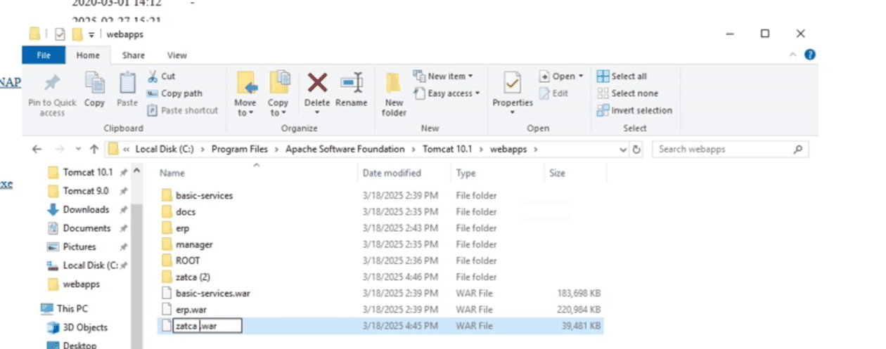

يسلّم نما كل مستند لخدمة التوقيع داخل الخادم لا عبر الشبكة، فإذا نُشر `zatca.war` على Tomcat آخر أو جهاز آخر فلن يجده نما أبدًا، وتظهر رسالة *Please update zatca JAR*.

::: warning اترك نسخة واحدة فقط في webapps
ينشر Tomcat ملف war بمجرد وصوله إلى `webapps`. فإذا وصل الملف باسم `zatca (2).war` فقد يكون Tomcat فكّه بالفعل في مجلد `zatca (2)` كما في الصورة أعلاه. احذف ذلك المجلد وأي نسخة قديمة أخرى من `zatca`. فكل نسخة تسجّل نفسها على أنها خدمة التوقيع، وعندما يوقف Tomcat إحداها يفقد نما خدمة التوقيع مع أن نسخة أخرى ما زالت تعمل، فتظهر رسالة *Please update zatca JAR*.
:::

4. أعد تشغيل خدمة Tomcat، فتُنشر `zatca` باسمها الصحيح ويقرأ Tomcat متغير النظام الجديد `SDK_CONFIG`. وإذا ظل التوقيع يفشل لأن الأداة غير موجودة، فأعد تشغيل الخادم نفسه، فبعض إصدارات Windows لا تُظهر متغير النظام الجديد للخدمات إلا بعد إعادة التشغيل.

## 8. التأكد من أنها تعمل

من الخادم افتح `http://localhost:<port>/zatca/api` في المتصفح، مستخدمًا المنفذ الذي يعمل عليه نما، فيجيب بـ:

```text
Zatca war is running
```

هذا يؤكد أن الخدمة منشورة. أما الأداة نفسها فأول ما تُستخدم عند تشغيل **إعتماد النظام**، فإذا كان في `config.json` مسار خاطئ ظهر الخطأ هناك. بعد ذلك أظهر صفحة الهيئة من الإعدادات العامة كما في قسم «إظهار صفحة الهيئة» في [دليل الربط مع الهيئة](./zatca-guide.md).
